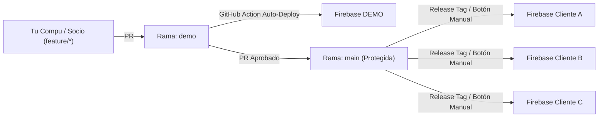

# Flujo GitHub de 2 Ramas (`demo` → `main`) y Despliegue Multi-Cliente con Reglas Recicladas

Esta referencia documenta la arquitectura exacta para mantener **1 solo código base**, probar novedades en un entorno **Demo**, y desplegar versiones estables a **todos los proyectos Firebase de clientes** reciclando exactamente las mismas `firestore.rules`, `storage.rules` y `firestore.indexes.json`.

---

## 1. Arquitectura de 2 Ramas (`demo` → `main`)



### Comandos para proteger la rama `main` con GitHub CLI (`gh`)
Ejecuta esto una sola vez para impedir que alguien suba código sin pasar por Pull Request desde `demo`:

```bash
gh api \
  --method PUT \
  -H "Accept: application/vnd.github+json" \
  repos/{OWNER}/{REPO}/branches/main/protection \
  -f required_pull_request_reviews='{"required_approving_review_count":1,"dismiss_stale_reviews":true}' \
  -F enforce_admins=true \
  -F required_linear_history=true \
  -f restrictions=null
```

---

## 2. Manifiesto Central de Clientes (`deploy/clients.manifest.json`)

Guarda este archivo en la raíz del repositorio. **NO contiene llaves secretas ni credenciales** (solo IDs públicos de proyectos Firebase y dominios), por lo que es seguro mantenerlo versionado en Git:

```json
{
  "schemaVersion": 1,
  "demoProject": {
    "projectId": "mi-producto-demo",
    "displayName": "Producto Demo",
    "domain": "demo.tudominio.com",
    "hostingType": "apphosting"
  },
  "clients": [
    {
      "clientId": "cliente-alpha",
      "displayName": "Cliente Alpha S.A.",
      "projectId": "crm-cliente-alpha",
      "domain": "crm.alpha.com",
      "hostingType": "apphosting",
      "rolloutRing": "canary",
      "active": true
    },
    {
      "clientId": "cliente-beta",
      "displayName": "Cliente Beta Corp",
      "projectId": "crm-cliente-beta",
      "domain": "app.betacorp.com",
      "hostingType": "hosting",
      "rolloutRing": "stable",
      "active": true
    }
  ]
}
```

---

## 3. GitHub Actions: Auto-Deploy a Demo + Rollout Controlado a Clientes

### A. `.github/workflows/deploy-demo.yml` (Se dispara al hacer merge a `demo`)

```yaml
name: Auto-Deploy Demo

on:
  push:
    branches: [demo]

jobs:
  build-and-deploy-demo:
    runs-on: ubuntu-latest
    steps:
      - uses: actions/checkout@v4
      - uses: actions/setup-node@v4
        with:
          node-version: '22'
          cache: 'npm'

      - run: npm ci
      - run: npm run typecheck
      - run: npm run build

      - name: Autenticar Google Cloud (Service Account)
        uses: google-github-actions/auth@v2
        with:
          credentials_json: ${{ secrets.FIREBASE_DEPLOY_SA_JSON }}

      - name: Desplegar Reglas, Índices y Hosting a DEMO
        run: |
          DEMO_ID=$(node -e "console.log(require('./deploy/clients.manifest.json').demoProject.projectId)")
          npx firebase-tools deploy \
            --only firestore:rules,firestore:indexes,storage,hosting \
            --project "$DEMO_ID" \
            --non-interactive
```

### B. `.github/workflows/deploy-clients.yml` (Rollout desde `main` con botón o Release Tag)

```yaml
name: Rollout Multi-Cliente desde Main

on:
  release:
    types: [published]
  workflow_dispatch:
    inputs:
      target_scope:
        description: 'Alcance: all-active | canary | <projectId específico>'
        required: true
        default: 'canary'

jobs:
  resolve-targets:
    runs-on: ubuntu-latest
    outputs:
      projects: ${{ steps.pick.outputs.projects }}
    steps:
      - uses: actions/checkout@v4
      - id: pick
        run: |
          SCOPE="${{ github.event.inputs.target_scope || 'all-active' }}"
          PROJECTS=$(node -e "
            const m = require('./deploy/clients.manifest.json');
            const scope = process.env.SCOPE;
            const list = m.clients.filter(c => {
              if (!c.active) return false;
              if (scope === 'all-active') return true;
              if (scope === 'canary') return c.rolloutRing === 'canary';
              return c.projectId === scope || c.clientId === scope;
            }).map(c => ({ projectId: c.projectId, hostingType: c.hostingType }));
            console.log(JSON.stringify(list));
          " SCOPE="$SCOPE")
          echo "projects=$PROJECTS" >> "$GITHUB_OUTPUT"

  deploy-each-client:
    needs: resolve-targets
    if: needs.resolve-targets.outputs.projects != '[]'
    runs-on: ubuntu-latest
    strategy:
      fail-fast: false
      max-parallel: 3
      matrix:
        target: ${{ fromJson(needs.resolve-targets.outputs.projects) }}
    steps:
      - uses: actions/checkout@v4
      - uses: actions/setup-node@v4
        with:
          node-version: '22'
          cache: 'npm'

      - run: npm ci
      - run: npm run typecheck

      - name: Autenticar Service Account Maestro
        uses: google-github-actions/auth@v2
        with:
          credentials_json: ${{ secrets.FIREBASE_DEPLOY_SA_JSON }}

      - name: Desplegar Reglas Recicladas + Build Cliente (${{ matrix.target.projectId }})
        run: |
          npx firebase-tools deploy \
            --only firestore:rules,firestore:indexes,storage \
            --project "${{ matrix.target.projectId }}" \
            --non-interactive
          if [ "${{ matrix.target.hostingType }}" = "hosting" ]; then
            npm run build
            npx firebase-tools deploy --only hosting --project "${{ matrix.target.projectId }}" --non-interactive
          fi
```

> **Nota sobre App Hosting (SSR Next.js):** Cuando un cliente usa `hostingType: "apphosting"`, puedes conectar el backend de Firebase App Hosting de ese proyecto a la rama `main` (o disparar un rollout CLI), mientras GitHub Actions sincroniza automáticamente las `firestore.rules`, `storage.rules` y `firestore.indexes.json` idénticas en todos los proyectos al mismo tiempo.

---

## 4. Script de Semilla Inicial Día 0 (`scripts/seed-tenant-day0.mjs`)

Al dar de alta un cliente nuevo, ejecuta un seed idempotente que cree su configuración inicial y asigne `platformDev: true` en Firebase Auth Custom Claims a ti y tu socio (sin quemar correos en `firestore.rules` ni en el frontend):

```javascript
#!/usr/bin/env node
import admin from 'firebase-admin';

// Uso: GOOGLE_APPLICATION_CREDENTIALS=./sa-key.json node scripts/seed-tenant-day0.mjs --project crm-cliente-alpha --devs "steven@agencia.com,socio@agencia.com" --business "Cliente Alpha"
const args = process.argv.slice(2);
const getArg = (flag) => {
  const idx = args.indexOf(flag);
  return idx >= 0 ? args[idx + 1] : '';
};

const projectId = getArg('--project');
const businessName = getArg('--business') || 'Mi Empresa';
const devEmails = (getArg('--devs') || '').split(',').map((e) => e.trim().toLowerCase()).filter(Boolean);

if (!projectId) {
  console.error('Falta --project <PROJECT_ID>');
  process.exit(1);
}

admin.initializeApp({ projectId });
const db = admin.firestore();
const auth = admin.auth();

async function run() {
  const batch = db.batch();

  batch.set(db.doc('config/branding'), {
    businessName,
    paletteId: 'sky-slate',
    logoUrl: '',
    updatedAt: admin.firestore.FieldValue.serverTimestamp(),
  }, { merge: true });

  batch.set(db.doc('config/tenant_license'), {
    planTier: 'pro',
    subscriptionStatus: 'active',
    enabledModules: {
      core: true,
      whatsapp: true,
      meta_social: false,
      ai_agent: true,
      pos: false,
      help_copilot: true,
    },
    maxSeats: 10,
    updatedAt: admin.firestore.FieldValue.serverTimestamp(),
  }, { merge: true });

  batch.set(db.doc('config/announcements'), {
    active: false,
    severity: 'release',
    title: '',
    message: '',
    dismissible: true,
    updatedAt: admin.firestore.FieldValue.serverTimestamp(),
  }, { merge: true });

  await batch.commit();

  for (const email of devEmails) {
    try {
      const user = await auth.getUserByEmail(email);
      await auth.setCustomUserClaims(user.uid, { ...(user.customClaims || {}), platformDev: true });
      console.log(`✅ Claim platformDev:true asignado a ${email} (${user.uid})`);
    } catch {
      console.log(`ℹ️ ${email} aún no ha iniciado sesión en ${projectId}; asignar Claim tras su primer login.`);
    }
  }

  console.log(`🎉 Seed Día 0 completado en ${projectId}`);
}

run().catch((err) => {
  console.error(err);
  process.exit(1);
});
```
