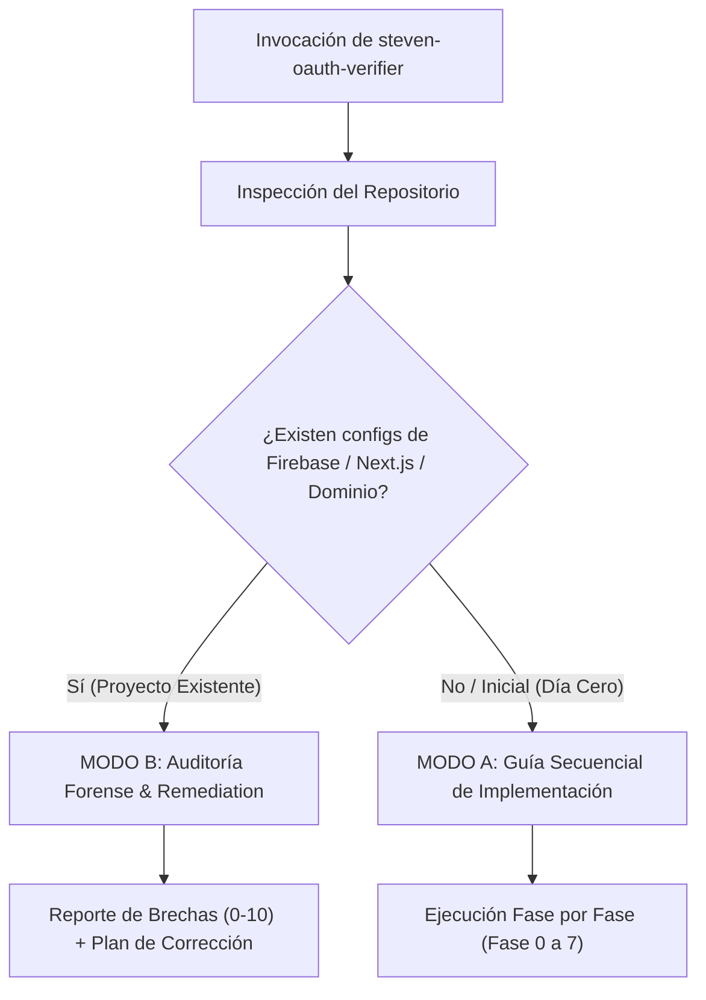

# Protocolo Maestro Universal de Google OAuth & Verificación de Dominio (`steven-oauth-verifier`)

Este skill gobierna de forma técnica, reproducible y rigurosa la integración de **Google OAuth 2.0**, la gobernanza de **Dominios Personalizados**, la eliminación de fugas de dominios genéricos (`*.firebaseapp.com`), el cumplimiento normativo legal (**Costa Rica: Ley 8968 y Ley 7472**) y la auditoría de seguridad de **Google Cloud Platform (GCP)** y **Firebase (Classic Hosting y App Hosting)**.

Sirve tanto para guiar un proyecto desde el **Día Cero** como para ejecutar una **Auditoría Técnica Forense** en proyectos existentes para detectar y corregir problemas de verificación y redirección.

---

## 1. Modo de Operación y Detección Automática

Cuando se invoca este skill, el agente debe determinar inmediatamente en cuál de los dos modos debe operar:



### Heurística de Inspección:
1. Revisa `firebase.json`, `apphosting.yaml`, `.firebaserc`, `package.json`, `next.config.ts` o `vite.config.ts`.
2. Busca cadenas de texto como `firebaseapp.com`, `authDomain`, `signInWithPopup`, `GoogleAuthProvider`, `google-site-verification` y variables de entorno OAuth (`GOOGLE_OAUTH_CLIENT_ID`).
3. Si el repositorio ya cuenta con código: ejecuta primero el **Checklist de Auditoría Forense** (Sección 3).
4. Si el usuario solicita iniciar un proyecto nuevo o conectar un dominio nuevo: despliega la **Guía Maestra Paso a Paso** (Sección 2).

---

## 2. Guía Maestra Paso a Paso (Desde el Paso Cero)

### FASE 0: Adquisición y Gobernanza de Dominio
1. **Compra del Dominio**:
   - Para dominios internacionales (`.com`, `.studio`, `.app`, `.io`): Cloudflare Registrar, Namecheap, Google Domains (migrado a Squarespace), GoDaddy.
   - Para dominios territoriales de Costa Rica (`.cr`, `.co.cr`): Gestionados a través de **NIC Costa Rica** (`nic.cr`).
2. **DNS Management**:
   - Se recomienda encarecidamente delegar los Name Servers a **Cloudflare** o administrarlos con TTLs bajos (300 segundos / 5 minutos) durante la fase de puesta en marcha para evitar retardos de propagación.
3. **Estructura Recomendada de Registros**:
   - Apex Domain: `@` (ej. `midominio.com`) apuntando a IPs A Records proporcionadas por el proveedor de hosting.
   - Subdominio Web: `www` apuntando vía CNAME a `midominio.com` o al CNAME asignado por Firebase.

---

### FASE 1: Vinculación a Firebase Hosting (Classic vs App Hosting)

La arquitectura de Firebase impone diferencias críticas entre ambos tipos de hosting:

#### Modelo A: Firebase App Hosting (Next.js SSR / Cloud Run / SSR Angular)
- **Naturaleza**: Despliegue contenerizado gestionado sobre Cloud Run.
- **Configuración de Dominio**:
  1. En Firebase Console > **App Hosting** > Seleccionar Backend > Pestaña **Settings** o **Domains**.
  2. Agregar el dominio personalizado (ej. `midominio.com` y `www.midominio.com`).
  3. Firebase asignará registros DNS tipo `A` y `AAAA` específicos para el tráfico entrante de Google Cloud Load Balancer.
  4. Certificado SSL: Google emite automáticamente un certificado TLS administrado (puede tomar de 20 minutos a 2 horas en estado `Provisioning`).

#### Modelo B: Firebase Classic Hosting (SPA / Vite / Static Next.js)
- **Naturaleza**: CDN global estático de Google.
- **Configuración de Dominio**:
  1. En Firebase Console > **Hosting** > **Agregar dominio personalizado**.
  2. Si ingresas `midominio.com`, Firebase sugerirá redirigir `www.midominio.com` al apex (o viceversa). Siempre configura una redirección canónica 301.
  3. Ingresar los registros DNS `A` en tu proveedor.

---

### FASE 2: Verificación de Propiedad con Google Search Console

> [!CRITICAL]
> **REGLA DE ORO DE OAUTH EN GOOGLE CLOUD:**
> Para poder autorizar un dominio en la Pantalla de Consentimiento de OAuth de Google Cloud, el dominio **DEBE estar verificado previamente en Google Search Console** bajo la misma cuenta de Google (o conceder permisos de propietario a la cuenta del desarrollador/organización).

1. Ingresar a [Google Search Console](https://search.google.com/search-console).
2. Seleccionar la opción **Dominio** (abarca todos los subdominios y protocolos `http`/`https`).
3. Google generará un registro TXT único:
   ```txt
   google-site-verification=XXXXXXXXXXXXXXXXXXXXXXXXXXXXXXXXXXXXXXXXXXX
   ```
4. Agregar el registro TXT en la zona DNS de tu dominio:
   - Tipo: `TXT`
   - Nombre / Host: `@` (o la raíz del dominio)
   - Contenido: El valor de verificación de Google.
   - TTL: 300 segundos.
5. Hacer clic en **Verificar**.

---

### FASE 3: Purga Inmediata de Caché DNS (Google Public DNS Flush Cache)

Normalmente los resolvers de Google (`8.8.8.8` y `8.8.4.4`) cachean los registros DNS antiguos según el TTL. Si acabas de actualizar tus registros `A`, `TXT` o `CNAME` y Search Console o Firebase marcan error:

1. Abrir la herramienta oficial: [Google Public DNS Flush Cache](https://dns.google/cache).
2. En el campo **Domain name**, ingresar tu dominio (ej. `midominio.com`).
3. En **RR type**, seleccionar:
   - `TXT` (para forzar la lectura del token de Search Console).
   - `A` (para forzar la IP de Firebase Hosting / App Hosting).
   - `CNAME` (para validar subdominios como `www`).
4. Presionar **Flush Cache**.
5. Repetir para el subdominio `www.midominio.com`. Esto actualiza la caché global de Google en segundos.

---

### FASE 4: Requisitos Legales y Páginas Públicas (Costa Rica & Compliance Digital)

Google exige de manera estricta que la aplicación cuente con páginas de **Política de Privacidad** y **Términos de Servicio** públicas, accesibles sin login y en el dominio propio verificado.

> [!WARNING]
> Un popover o modal dentro del formulario de login es una buena práctica de UX, pero **NO cumple con los requisitos de Google Cloud ni con la legislación de protección de datos**. Deben existir rutas directas públicas (ej. `/privacy` y `/terms`).

#### Marco Legal de Costa Rica para Aplicaciones y Negocios Digitales:

##### A. Política de Privacidad (Bajo Ley N° 8968 y Reglamento)
La **Ley de Protección de la Persona frente al Tratamiento de sus Datos Personales (Ley N° 8968)** exige:
1. **Consentimiento Expreso e Informado**: La recolección de datos (nombre, correo, fotos, accesos a calendario/drive) debe ser informada al usuario previo a su captura.
2. **Finalidad Estrictamente Determinada**: Debe explicitarse que los datos son de uso exclusivo para la operativa interna del servicio/estudio y **NO serán vendidos, comercializados, transferidos ni compartidos con terceros** sin autorización previa.
3. **Autodeterminación Informativa y Derechos ARCO**:
   - Todo titular tiene derecho de **Acceso, Rectificación, Cancelación y Oposición**.
   - Se debe colocar un correo de contacto visible (ej. `soporte@midominio.com` o `legal@midominio.com`) donde el usuario pueda solicitar la eliminación inmediata de su cuenta y borrado físico de sus datos de la base de datos (Firestore/Auth).
4. **Almacenamiento y Seguridad**: Mención de que la información se almacena en infraestructuras seguras con cifrado en tránsito y en reposo (Google Cloud Platform / Firebase).
5. **Referencia a Autoridad Nacional**: Indicar que la autoridad competente en la materia en Costa Rica es la **Agencia de Protección de Datos de los Habitantes (PRODHAB)**.

##### B. Términos y Condiciones de Servicio (Bajo Ley N° 7472 y Código de Comercio)
La **Ley de Promoción de la Competencia y Defensa Efectiva del Consumidor (Ley N° 7472)** exige transparencia en contrataciones electrónicas:
1. **Identificación del Responsable**: Razón social o nombre comercial, cédula física o jurídica costarricense, domicilio y correo oficial.
2. **Naturaleza del Servicio**: Descripción clara de qué hace la aplicación (SaaS, agenda, portal de clientes, gestión de entregables).
3. **Propiedad Intelectual**: Todos los textos, marcas, código fuente, logotipos y activos digitales son propiedad exclusiva de la empresa o licenciantes, protegidos por la Ley de Derechos de Autor y Conexos (Ley N° 6683).
4. **Exclusión de Garantías y Limitación de Responsabilidad**:
   - Cláusula *"Tal Cual"* (*As Is*): El servicio se brinda según disponibilidad tecnológica.
   - No responsabilidad por caídas de terceros (Google APIs, Meta APIs, fallas de conectividad de telecomunicaciones locales como ICE/Liberty).
5. **Jurisdicción y Ley Aplicable**:
   - Todo diferendo o conflicto se resolverá conforme a las leyes de la **República de Costa Rica**, sometiéndose a los tribunales de justicia de San José, Costa Rica.

---

### FASE 5: Google Cloud Console - Pantalla de Consentimiento OAuth

1. Ir a [Google Cloud Console > Pantalla de consentimiento de OAuth](https://console.cloud.google.com/apis/credentials/consent).
2. **Tipo de usuario**:
   - **Interno**: Solo disponible si cuentas con Google Workspace de empresa. Los usuarios fuera de la organización no pueden acceder, pero no requiere verificación pública de Google.
   - **Externo**: Obligatorio si clientes, colaboradores o usuarios con cuentas `@gmail.com` utilizarán la app.
3. **Información de la aplicación (Branding)**:
   - **Nombre de la aplicación**: El nombre comercial limpio (ej. `Sharon Studio`). NUNCA dejes nombres genéricos generados por CLI.
   - **Correo de asistencia técnica**: Correo del administrador/desarrollador.
   - **Logotipo de la aplicación**: Imagen PNG cuadrada (120x120 px, fondo transparente o sólido, máx 1MB) alojada preferiblemente en el mismo dominio o storage público.
4. **Dominio de la aplicación (URLs canónicas)**:
   - Página principal: `https://midominio.com`
   - Enlace a la política de privacidad: `https://midominio.com/privacy`
   - Enlace a los términos de servicio: `https://midominio.com/terms`
5. **Dominios autorizados**:
   - Agregar el dominio raíz verificado en Search Console: `midominio.com` (sin `https://` ni barras).
6. **Credenciales > ID de cliente OAuth 2.0 (Aplicación web)**:
   - **Orígenes autorizados de JavaScript**:
     - `https://midominio.com`
     - `https://www.midominio.com`
     - `http://localhost:3000` / `http://localhost:9002` (para desarrollo local)
   - **URIs de redireccionamiento autorizados**:
     - `https://midominio.com/__/auth/handler` (Handler de Firebase Auth en dominio propio)
     - `https://www.midominio.com/__/auth/handler`
     - `https://<PROJECT-ID>.firebaseapp.com/__/auth/handler` (Handler de reserva de Firebase)
     - `https://midominio.com/api/auth/[servicio]/callback` (Para callbacks directos de backend OAuth)

---

### FASE 6: Arquitectura de Código (Eliminación Definitiva de `firebaseapp.com`)

Existen 3 lugares donde el dominio genérico de Firebase se filtra si no se programa con defensa en profundidad:

#### 1. Configuración de Firebase Client (`src/firebase/config.ts`)
Debe calcular dinámicamente o forzar el `authDomain` en producción:

```typescript
// src/firebase/config.ts
const getAuthDomain = (): string => {
  if (typeof window !== 'undefined') {
    const host = window.location.hostname;
    // Si estamos en el dominio de producción
    if (host === 'midominio.com' || host === 'www.midominio.com') {
      return host;
    }
  }
  return process.env.NODE_ENV === 'production'
    ? 'midominio.com'
    : '<PROJECT-ID>.firebaseapp.com';
};

export const firebaseConfig = {
  projectId: "<PROJECT-ID>",
  appId: "<APP-ID>",
  apiKey: "<API-KEY>",
  authDomain: getAuthDomain(),
  storageBucket: "<STORAGE-BUCKET>",
  messagingSenderId: "<SENDER-ID>",
  projectNumber: "<PROJECT-NUMBER>"
};
```

#### 2. Inicialización en App Hosting (`src/firebase/init.ts`)
En Firebase App Hosting, llamar a `initializeApp()` sin argumentos inyecta por defecto variables de entorno donde `authDomain` vuelve a ser `<PROJECT-ID>.firebaseapp.com`.

**Solución obligatoria**: Forzar siempre `firebaseConfig`:
```typescript
// src/firebase/init.ts
import { firebaseConfig } from '@/firebase/config';
import { initializeApp, getApps, getApp } from 'firebase/app';

export function initializeFirebase() {
  if (!getApps().length) {
    let firebaseApp;
    try {
      // Priorizar explícitamente la configuración con authDomain propio
      firebaseApp = initializeApp(firebaseConfig);
    } catch (e) {
      if (getApps().length > 0) {
        firebaseApp = getApp();
      } else {
        firebaseApp = initializeApp();
      }
    }
    return getSdks(firebaseApp);
  }
  return getSdks(getApp());
}
```

#### 3. Proxy Rewrite para el Túnel de Firebase Auth en Next.js (`next.config.ts`)
Cuando Firebase Auth ejecuta `signInWithPopup`, intenta cargar `https://midominio.com/__/auth/handler`. Dado que Next.js no tiene esa ruta en su router de páginas, respondería 404 a menos que creemos el proxy rewrite hacia Firebase Auth:

```typescript
// next.config.ts
import type { NextConfig } from 'next';

const nextConfig: NextConfig = {
  async rewrites() {
    return [
      {
        source: '/__/auth/:path*',
        destination: 'https://<PROJECT-ID>.firebaseapp.com/__/auth/:path*',
      },
    ];
  },
};

export default nextConfig;
```

#### 4. Separación entre Firebase Auth y OAuth de Servicios de Google
- **Firebase Auth (`signInWithPopup`)**: Usarlo **únicamente** para autenticar identidad (`openid`, `profile`, `email`).
- **Google APIs con Scopes Sensibles (Calendar, Drive, etc.)**: NUNCA solicitar scopes sensibles a través de `signInWithPopup(auth, provider)` si quieres evitar la intermediación del túnel de Firebase.
- **Implementar el flujo OAuth directo**:
  1. Frontend solicita URL de autorización al backend: `GET /api/auth/[service]/connect`.
  2. Backend genera la URL usando `googleapis` (`OAuth2Client`) con `redirect_uri: https://midominio.com/api/auth/[service]/callback`.
  3. El usuario autoriza directamente a tu cliente OAuth verificado.
  4. Google redirige al endpoint callback en tu servidor; el backend intercambia el código por tokens y los guarda en Firestore con cifrado o en colección protegida `/config/...`.

#### 5. Resolución Canónica de Origen en Contenedores (Cloud Run / App Hosting)
> [!CRITICAL]
> **TRAMPA DE CONTENEDOR (0.0.0.0:8080):**
> En Firebase App Hosting y Cloud Run, la aplicación corre dentro de un contenedor Docker detrás del Google Cloud Load Balancer.
> Si en el backend usas `new URL(request.url).origin`, Next.js resolverá `https://0.0.0.0:8080`, provocando un error **`redirect_uri_mismatch (Error 400: invalid_request)`** fatal en Google OAuth.
> 
> **Patrón Obligatorio de Detección Canónica**:
> ```typescript
> const host =
>   request.headers.get('x-forwarded-host') ||
>   request.headers.get('host') ||
>   'midominio.com';
> const isLocal = host.includes('localhost') || host.includes('127.0.0.1');
> const proto = isLocal
>   ? (request.headers.get('x-forwarded-proto') || 'http')
>   : 'https';
> const origin = `${proto}://${host}`;
> const redirectUri = `${origin}/api/auth/[service]/callback`;
> ```

---

### FASE 7: Catálogo Completo de Scopes de Google y Niveles de Verificación

Google clasifica las APIs en 3 categorías de riesgo:

| Nivel de Riesgo | Servicios / APIs | Scopes de Ejemplo | Exigencia de Google |
| :--- | :--- | :--- | :--- |
| **No Sensibles (Basic)** | Firebase Auth, Google Sign-In | `openid`, `email`, `profile` | Aprobación automática. Solo requiere branding y URLs de privacidad. |
| **Sensibles (Sensitive)** | Google Calendar, Google Drive (archivos de la app), YouTube, People API, Sheets | `.../auth/calendar`, `.../auth/calendar.events`, `.../auth/drive.file`, `.../auth/youtube.upload`, `.../auth/spreadsheets` | Requiere justificación formal y video de demostración en YouTube. |
| **Restringidos (Restricted)** | Gmail, Google Drive Completo | `.../auth/gmail.send`, `.../auth/gmail.readonly`, `.../auth/drive` | Requiere auditoría externa anual de seguridad (**CASA - Cloud Application Security Assessment**, costo aproximado de $500 a $3,000 USD). |

#### Casos de Uso Detallados:
1. **Google Calendar API**:
   - Usado para agendamiento de reuniones, disponibilidad de citas y sincronización de entregables.
   - *Mejor Práctica*: Solicitar `https://www.googleapis.com/auth/calendar.events` en lugar de acceso total a toda la cuenta si solo vas a agendar reuniones.
2. **Google Drive & Picker API**:
   - Usado para subir entregables de diseño, videos pesados o carpetas de clientes.
   - *Mejor Práctica*: Usar `https://www.googleapis.com/auth/drive.file` (solo accede a los archivos creados por la aplicación), lo cual reduce drásticamente las trabas de auditoría frente a `drive` completo.
3. **Gmail API**:
   - Usado para enviar notificaciones transaccionales o correos a nombre del usuario.
   - *Mejor Práctica*: Si es para notificaciones del sistema, usar un servicio transaccional (Resend, SendGrid, Postmark) en lugar de la API de Gmail para evitar someter la app a la auditoría CASA.

---

## 3. Checklist de Auditoría Forense (Para Proyectos Existentes)

Cuando el agente ejecute este checklist, debe evaluar los siguientes 10 puntos de control:

- [ ] **1. Dominio en Search Console**: ¿El dominio apex está verificado mediante registro DNS TXT en Google Search Console?
- [ ] **2. Firebase Authorized Domains**: ¿Están incluidos `midominio.com` y `www.midominio.com` en Firebase Console > Authentication > Settings > Authorized Domains?
- [ ] **3. GCP OAuth Client URIs**: ¿Están agregados `https://midominio.com/__/auth/handler` y los callbacks `/api/auth/.../callback` en Credenciales de Google Cloud?
- [ ] **4. GCP JavaScript Origins**: ¿Están `https://midominio.com` y `https://www.midominio.com` en los Orígenes autorizados de JavaScript?
- [ ] **5. Next.js Auth Rewrite**: ¿Existe el rewrite `/__/auth/:path*` hacia `<PROJECT-ID>.firebaseapp.com` en `next.config.ts`?
- [ ] **6. Inyección de `authDomain` Limpio**: ¿El archivo `src/firebase/config.ts` o `init.ts` sobreescribe `authDomain` en producción para que nunca use `firebaseapp.com`?
- [ ] **7. Rutas Públicas Legales**: ¿Existen `/privacy` y `/terms` como rutas estáticas directas y públicas (no modales) con mención a la Ley 8968 y Ley 7472 de Costa Rica?
- [ ] **8. Branding de OAuth Consent Screen**: ¿Tiene nombre comercial formal (sin sufijos de dev/testing), logo 120x120 px y correos de soporte válidos?
- [ ] **9. Estado de Verificación de Scopes**: ¿Los scopes solicitados coinciden con los declarados en la pantalla de consentimiento de Google Cloud?
- [ ] **10. Manejo de Usuarios de Prueba**: Si la app está en modo "En pruebas" o en proceso de verificación, ¿los correos de prueba están dados de alta en Google Cloud Console?

---

## 4. Matriz de Errores Comunes y Troubleshooting (RCA)

### Error 1: "Google no ha verificado esta aplicación" (Pantalla Roja)
* **Causa Raíz**: La app solicita un scope sensible (`calendar`, `drive`, `youtube`) en modo "En producción" sin haber completado la auditoría manual de Google, o el usuario está accediendo desde un flujo que no coincide con el dominio verificado.
* **Solución Inmediata**: En la pantalla de advertencia, hacer clic en `Configuración avanzada` > `Ir a [Nombre de App] (no seguro)`.
* **Solución Definitiva**: Subir video a YouTube demostrando el uso de los scopes y enviar a verificación en Google Cloud Console.

### Error 2: `redirect_uri_mismatch` (Error 400 de Google: invalid_request)
* **Causa Raíz**: La URL exacta a la que Google intenta devolver el código no está registrada letra por letra en **URIs de redireccionamiento autorizados** en Google Cloud Console.
* **Puntos Críticos**:
  1. Falta de protocolo `https://`, presencia o ausencia de barra diagonal final (`/`), o diferencia entre `www.midominio.com` y `midominio.com`.
  2. **Trampa de Contenedores en Cloud Run / App Hosting**: Si el código usa `new URL(request.url).origin`, resolverá `https://0.0.0.0:8080`, el cual es rechazado de inmediato por Google al no coincidir con el dominio registrado. Debe leerse de las cabeceras `x-forwarded-host` o `host`.

### Error 3: Aparece `*.firebaseapp.com` en la barra del navegador
* **Causa Raíz**:
  1. `initializeApp()` inicializado sin parámetros en Firebase App Hosting.
  2. Falta de rewrite en `next.config.ts`.
  3. Se está usando `signInWithPopup` en lugar de una redirección OAuth directa del backend.

### Error 4: `invalid_client / The provided client secret is invalid (auth/invalid-credential)`
* **Causa Raíz**:
  **La Trampa del Secreto Regenerado o Desincronizado**:
  Al configurar Google Sign-In en Firebase Authentication, Firebase vincula automáticamente las credenciales OAuth en Google Cloud.
  Si un desarrollador entra a Google Cloud Console y **borra, regenera o crea un nuevo Client Secret** (por ejemplo, para usarlo en variables de entorno de backend o integraciones de Google Calendar) y **NO actualiza el proveedor Google en Firebase Authentication**, Firebase Auth seguirá intentando canjear los tokens de login con el secreto viejo que ya no existe en Google Cloud.
* **Manifestación en Consola**:
  ```text
  FirebaseError: Firebase: Error getting access token from google.com, OAuth2 redirect uri is: https://midominio.com/__/auth/handler, response: OAuth2TokenResponse{params: error=invalid_client&error_description=The provided client secret is invalid., httpMetadata: HttpMetadata{status=401...}} (auth/invalid-credential)
  ```
* **Solución Inmediata**:
  1. Ir a [Google Cloud Console > Credenciales](https://console.cloud.google.com/apis/credentials) y copiar el `Client Secret` activo del cliente Web.
  2. Ir a [Firebase Console > Authentication > Sign-in method > Google](https://console.firebase.google.com/).
  3. Desplegar **"Configuración del SDK web"** (Web SDK configuration).
  4. Pegar el **ID de cliente** y el **nuevo Secreto de cliente** idénticos a los de Google Cloud.
  5. Presionar **Guardar**. Ambos servicios volverán a estar sincronizados en tiempo real.

---

## 5. Instrucciones para el Agente que Ejecuta este Skill

1. **Nunca asumir configuración sin leer el código**: Lee `firebase.json`, `next.config.ts`, `src/firebase/config.ts` y las variables de entorno.
2. **Generar código exacto**: Cuando propongas cambios, entrega los diffs exactos para `next.config.ts` y los inicializadores de Firebase.
3. **Validación de Integridad**: Tras cualquier ajuste de código, ejecuta siempre `npx tsc --noEmit` y `npm run build` para garantizar cero regresiones.
