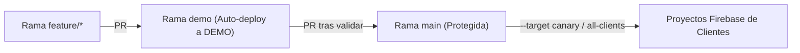

# Protocolo Universal de Despliegue a Producción (`steven-project-deploy`)

Este skill gobierna de forma estricta, reproducible y universal el ciclo de vida de despliegues, control de versiones SemVer, sincronización de reglas e infraestructura en aplicaciones web desplegadas en **Firebase (App Hosting o Classic Hosting)** y **GitHub**.

Es un estándar agnóstico diseñado para funcionar en cualquier repositorio sin hardcodear nombres de proyectos ni configuraciones fijas.

---

## 1. Manifiesto de Ingeniería: Por qué el Service Worker Pasivo Falla

En aplicaciones web modernas (PWAs, SPAs y SSR), confiar ciegamente en el ciclo de vida por defecto del Service Worker provoca tres fallas críticas de producción:
1. **Pestañas Bloqueadas (Waiting State):** El navegador descarga el nuevo worker en segundo plano pero lo mantiene en estado de espera hasta que el usuario cierre absolutamente todas las pestañas y ventanas de la app.
2. **Mismatch de Chunks JS (Pantallas Blancas):** Al navegar entre rutas, frameworks como Next.js intentan cargar hashes antiguos (`/_next/static/chunks/...`) que ya fueron eliminados del servidor en el nuevo build, provocando errores JavaScript fatales de pantalla blanca.
3. **Persistencia Ciega en CacheStorage:** Los assets estáticos permanecen almacenados localmente de forma indefinida bajo estrategias Cache-First.

### La Solución: Arquitectura Híbrida "Version Gate"
En vez de esperar a que el navegador resuelva pasivamente el Service Worker:
1. **Inyección en Build:** La versión (`package.json`) y el timestamp de compilación se inyectan en las variables cliente del bundle.
2. **Push Reactivo en Tiempo Real:** Firestore emite eventos vía WebSocket a través del documento `/config/app_version`.
3. **Telón de Bloqueo (Overlay) y Purga Atómica:** Si la versión local es inferior a la de la nube, se desmonta la UI para impedir mutaciones desactualizadas, se purga `window.caches`, se desregistran los Service Workers y se fuerza una recarga con parámetro único de cache-busting (`_v_catchup`).

---

## 2. Matriz de Compatibilidad de Hosting y Estrategia de Sincronización

Para erradicar el **bucle infinito de recarga** (cuando Firestore anuncia una nueva versión antes de que el servidor termine de compilar), el skill distingue automáticamente dos modelos de alojamiento:

### Modelo A: Firebase App Hosting (SSR / Next.js / Cloud Run)
* **Indicador:** Presencia de `apphosting.yaml` o arquitectura Next.js SSR conectada a Cloud Build.
* **Estrategia (Server Boot Sync):** 
  * **NUNCA** se publica la versión a Firestore desde la máquina local ni durante el `git push`.
  * La actualización de `/config/app_version` en Firestore la ejecuta exclusivamente el hook nativo `src/instrumentation.ts` en el servidor de producción **al momento en que el contenedor de Cloud Run arranca físicamente y está listo para recibir tráfico**.

### Modelo B: Firebase Classic Hosting (Static / Vite / SPA / SSG)
* **Indicador:** Presencia de bloque `"hosting"` en `firebase.json` sin `apphosting.yaml`.
* **Estrategia (Post-Deploy Sync):**
  * Al no existir un runtime de servidor Node.js permanente para ejecutar `instrumentation.ts`, la sincronización de `/config/app_version` se realiza mediante el hook nativo `"postdeploy"` en `firebase.json` o en el paso posterior de GitHub Actions:
    ```json
    "hosting": {
      "public": "dist",
      "postdeploy": "npx tsx scripts/publish-version.ts"
    }
    ```
  * Esto garantiza que los archivos ya estén replicados en los bordes del CDN de Google antes de alertar a los clientes.

### Defensa en Profundidad: Handshake Anti-Bucle en el Cliente
En ambos modelos, el modal cliente (`VersionGateOverlay`) incluye un **Handshake previo**:
Al presionar *"Actualizar Ahora"*, realiza un `fetch('/api/version')` (en SSR) o `fetch('/version.json')` (en estático) con cabeceras `no-store`. Si el servidor web aún entrega la versión anterior, el botón muestra *"El servidor está terminando el despliegue... verificando"* y reintenta cada 3 segundos, **impidiendo que el usuario recargue antes de tiempo y quede atrapado en un loop**.

---

## 3. Reglas Inquebrantables (Iron Laws)

1. **Cero Despliegues a Ciegas**: NUNCA ejecutes `git push`, ni alteres `package.json`, ni ejecutes comandos de despliegue sin presentar primero la auditoría y recibir la **aprobación explícita del usuario** en el chat.
2. **Prohibición de Escritura Prematura en Firestore**:
   * **NUNCA** actualices manualmente el documento de versión (`/config/app_version` o `/config/landing_version`) en Firestore desde la máquina local, vía MCP o antes del `git push`.
   * Hacerlo antes de tiempo activa el Version Gate en los clientes mientras el servidor en la nube todavía está compilando los nuevos chunks, atrapando a los usuarios en bucles de recarga o pantallas blancas.
   * La sincronización con Firestore **DEBE ocurrir única y exclusivamente cuando el servidor termine de compilar y arranque**:
     * En **SSR (App Hosting / Cloud Run)**: a través de `instrumentation.ts` en el `server startup`.
     * En **Static (Classic Hosting)**: a través del hook `postdeploy` en `firebase.json` o al final del pipeline de CI/CD.
3. **Blindaje Absoluto Anti-Cruce de Proyectos**:
   * Prohibición total de comandos `firebase deploy` desnudos (sin `--project`).
   * Es MANDATORIO validar que el proyecto en `.firebaserc` (`projects.default`) coincida exactamente con la salida de `npx firebase-tools use`.
   * Si hay discrepancia entre repositorios (ej. Kairos vs DecoToolkit), **la operación debe abortar de inmediato**.
4. **Auditoría de Working Tree (Cero Fugas de Código)**: Auditar activamente `git status`. Si existen scripts de pruebas, archivos temporales (`scripts/scratch-*.js`) o cambios no confirmados, advertirlos y excluirlos del staging.
5. **Despliegue Atómico de Reglas e Índices**: Si los cambios tocan `firestore.rules`, `storage.rules` o `firestore.indexes.json`, deben desplegarse a Firebase con el flag explícito `--project <DETECTED_PROJECT_ID>` antes o durante el release.
6. **Soberanía del Usuario**: Si el usuario propone una versión o mensaje distinto al sugerido por la IA, la decisión del usuario prevalece inmediatamente.

---

## 4. Flujo Operativo Paso a Paso

### Fase 1: Auditoría Técnica y Detección Dinámica de Entorno

1. **Detección Dinámica de Identidad:**
   * Leer `package.json` para obtener nombre de la app y versión actual.
   * Leer `.firebaserc` para extraer dinámicamente `<TARGET_PROJECT_ID>`.
   * Ejecutar `npx firebase-tools use` y comprobar que coincida con `<TARGET_PROJECT_ID>`.
   * Si no coincide, ejecutar `npx firebase-tools use <TARGET_PROJECT_ID>` o abortar si no está autorizado.
2. **Detección del Modelo de Hosting:**
   * Comprobar existencia de `apphosting.yaml` (App Hosting) o `firebase.json` (Classic Hosting).
3. **Detección de Etapa (Día 0 vs Día N):**
   * Si la versión es inicial (`0.1.0`, `0.0.0`) o el documento `/config/app_version` no existe en Firestore -> **Activar Protocolo Día 0**.
   * Si el proyecto ya está en producción -> **Activar Protocolo Día N (SemVer Incremental)**.
4. **Auditoría de Git:**
   * Ejecutar `git status` y `git diff --stat`.
   * Identificar archivos listos para release vs archivos en curso que deben excluirse.

---

### Fase 2: Motor de Inferencia SemVer y Clasificación de Alcance

#### Protocolo Día 0 (Primer Despliegue Inaugural)
* Se asigna la versión base fundacional: `v1.0.0`.
* Se prepara el seed inicial en Firestore para crear `/config/app_version`.
* Se valida que `firestore.rules` contemple `match /config/{configId} { allow read: if true; }`.

#### Protocolo Día N (Actualizaciones Subsecuentes)
Evaluar los cambios bajo la matriz SemVer universal:

| Tipo | Incremento | Criterio de Aplicación Universal | Ejemplos |
|---|---|---|---|
| **PATCH** | `X.Y.Z + 1` | Correcciones de bugs, hotfixes, ajustes de CSS/Tailwind, fixes en validaciones, optimizaciones menores, textos o componentes visuales existentes. | Corrección de cálculo, fix de layout en móvil, ajuste de badge, corrección de tipado. |
| **MINOR** | `X.Y + 1.0` | Nuevos módulos, nuevas rutas de navegación, nuevas Server Actions, endpoints de API o integraciones externas retrocompatibles. | Nuevo asistente de importación, integración de pasarela de pago, nuevo módulo administrativo. |
| **MAJOR** | `X + 1.0.0` | Reestructuraciones masivas de arquitectura, rediseño total de la app, migraciones breaking en esquemas de Firestore o cambios en autenticación. | Migración integral de base de datos, reescritura core del motor de la aplicación, v2.0.0. |

---

### Fase 3: Puerta de Confirmación Interactiva (Gatekeeper)

Presentar al usuario en el chat el reporte estructurado antes de realizar cualquier acción:

```markdown
### 🚀 Auditoría de Despliegue a Producción (`steven-project-deploy`)

- **Aplicación**: `<APP_NAME>` (`package.json`)
- **Proyecto Firebase Validado**: `<TARGET_PROJECT_ID>` 🔒 (Anti-Cross-Project Verified)
- **Tipo de Hosting Detectado**: `[Firebase App Hosting (SSR) | Firebase Classic Hosting]`
- **Etapa de Despliegue**: `[Día 0 (Inaugural v1.0.0) | Día N (Actualización)]`
- **Versión Actual**: `v<VERSION_ACTUAL>`
- **Archivos Modificados**: `<RESUMEN_ARCHIVOS>`
- **Reglas / Índices de Firestore**: `[Modificados (se desplegarán a <TARGET_PROJECT_ID>) | Sin cambios]`
- **Clasificación SemVer**: `[PATCH | MINOR | MAJOR]`
  - *Justificación*: <Explicación concisa del impacto técnico>
- **Versión Recomendada**: `v<VERSION_SUGERIDA>`
- **Mensaje de Commit Propuesto**: `chore(release): v<VERSION_SUGERIDA> - <RESUMEN_CAMBIOS>`

¿Confirmas el despliegue bajo la versión `v<VERSION_SUGERIDA>` hacia el proyecto `<TARGET_PROJECT_ID>`?
```

**DETENERSE AQUÍ**. Esperar la respuesta y confirmación explícita del usuario.

---

### Fase 4: Ejecución del Pipeline (Solo tras Aprobación)

1. **Reglas e Índices (si fueron modificados):**
   ```bash
   npx firebase-tools deploy --only firestore:rules,firestore:indexes,storage --project <TARGET_PROJECT_ID>
   ```
2. **Actualización de Versión en `package.json` y Constante Local:**
   * Establecer la versión confirmada (`v<VERSION_CONFIRMADA>`) en `package.json` y en la constante fallback de versión cliente (ej. `LOCAL_APP_VERSION`).
   * **ADVERTENCIA CRÍTICA**: NUNCA actualizar Firestore manualmente en este paso.
3. **Commit Semántico y Tag:**
   ```bash
   git add <ARCHIVOS_AUDITADOS>
   git commit -m "chore(release): v<VERSION_CONFIRMADA> - <MENSAJE_CONFIRMADO>"
   git tag -a v<VERSION_CONFIRMADA> -m "Release v<VERSION_CONFIRMADA>"
   ```
4. **Despliegue de Código (El servidor sincronizará Firestore):**
   * **En App Hosting (SSR):** `git push origin main --tags` (Cloud Build compilará y el runtime ejecutará `src/instrumentation.ts` en el arranque del servidor, actualizando Firestore en el segundo exacto en que la instancia nueva está viva y lista).
   * **En Classic Hosting (Static):** `npx firebase-tools deploy --only hosting --project <TARGET_PROJECT_ID>` (y el hook `postdeploy` actualizará Firestore cuando los archivos ya estén en el CDN).
5. **Confirmación Final:**
   * Notificar al usuario el hash del commit generado y que la versión en Firestore se actualizará automáticamente tan pronto el servidor termine de compilar y arranque en producción.

---

## 5. Guía de Replicación Rápida para Proyectos Nuevos (Día 0 Checklist)

Al implementar este protocolo en un **proyecto nuevo**, es mandatorio configurar la sincronización diferida para que Firestore se actualice **únicamente cuando el servidor ya compiló**:

1. **Inyección en Compilación (`next.config.ts` o Vite `define`):**
   * Inyectar `NEXT_PUBLIC_APP_VERSION: packageJson.version` y `NEXT_PUBLIC_BUILD_TIME: String(Date.now())`.
2. **Motor Lógico y Purga (`src/lib/version.ts`):**
   * Crear funciones `compareSemver`, `isVersionOutdated`, `purgeAllCachesAndServiceWorkers` y `forceHardRefresh`.
3. **Listener y Telón de Bloqueo (`src/components/version-gate/`):**
   * Envolver el layout raíz con `VersionGateProvider` (escuchando el doc de versión en `/config/...` con `onSnapshot`).
   * Renderizar `VersionGateOverlay` con handshake anti-bucle consultando `/api/version`.
4. **Hook de Sincronización Automático al Compilar/Arrancar (OBLIGATORIO):**
   * **Para SSR (Next.js / App Hosting):** Configurar `src/instrumentation.ts` con llamada a `syncAppVersionOnServerStartup()`. Esto asegura por diseño que la escritura en Firestore la haga el servidor recién compilado cuando inicia, nunca el desarrollador o agente localmente.
   * **Para Classic Hosting (Vite / React SPA):** Configurar script en `scripts/publish-version.ts` invocado obligatoriamente en el bloque `"postdeploy"` de `firebase.json`:
     ```json
     "hosting": {
       "public": "dist",
       "postdeploy": "npx tsx scripts/publish-version.ts"
     }
     ```
5. **Regla de Firestore:**
   * Agregar a `firestore.rules`:
     ```javascript
     match /config/{configId} {
       allow read: if true;
       allow write: if isAdmin() || isPlatformDeveloper();
     }
     ```

---

## 6. Arquitectura Multi-Cliente de 2 Ramas (`demo` → `main`) y Sincronización con Banner Global de Novedades

Cuando el repositorio opera bajo el modelo de **1 código base + múltiples proyectos Firebase por cliente**, el despliegue sigue estrictamente este flujo de dos ramas:

### 6.1 Flujo `demo` → PR → `main` (`deploy/clients.manifest.json`)



1. **Rama `demo`:** Conectada automáticamente al proyecto Demo definido en `deploy/clients.manifest.json` (`demoProject.projectId`). Toda fusión a `demo` valida `typecheck` + `build` y despliega a la Demo para pruebas y ventas.
2. **Rama `main`:** Protegida contra `push` directo; recibe cambios únicamente mediante Pull Request desde `demo`.
3. **Rollout Multi-Cliente (`--target demo | client:<id> | all-clients`):**
   * Prohibido desplegar usando un `.firebaserc` estático ambiguo cuando hay múltiples clientes. Cada iteración del pipeline pasa explícitamente `--project <CLIENT_PROJECT_ID>`.
   * Las reglas e índices (`firestore.rules`, `storage.rules`, `firestore.indexes.json`) son **100% idénticos y reciclables** en todos los proyectos cliente; al detectar cambios en reglas, el pipeline las despliega en cada proyecto activo del manifiesto antes del código.

### 6.2 Extensión de `/config/app_version` para el Banner Global y Changelog Drawer

Conservando la **Regla Inquebrantable #2** (nunca escribir Firestore antes de que compile/arranque el servidor), el payload que escriben `src/instrumentation.ts` (en App Hosting SSR) o `scripts/publish-version.ts` (en `postdeploy` Classic Hosting) puede incluir notas de lanzamiento estructuradas para alimentar automáticamente el **Banner Global estilo Jira** y el **Drawer de Novedades**:

```typescript
// Escrito ÚNICAMENTE por el servidor recién compilado o hook postdeploy
await firestore.doc('config/app_version').set({
  version: packageJson.version,
  buildTime: process.env.NEXT_PUBLIC_BUILD_TIME || String(Date.now()),
  releaseSummary: releaseMeta.summary || `Actualización v${packageJson.version} disponible`,
  changelogItems: releaseMeta.items || [], // Ej: [{ type: 'new' | 'improvement' | 'fix', text: '...' }]
  updatedAt: FieldValue.serverTimestamp(),
}, { merge: true });
```

De esta forma, cuando un despliegue termina con éxito en producción, **Version Gate** purga la caché obsoleta sin bucles y el panel de **Novedades** muestra al instante qué cambió en la nueva versión.

