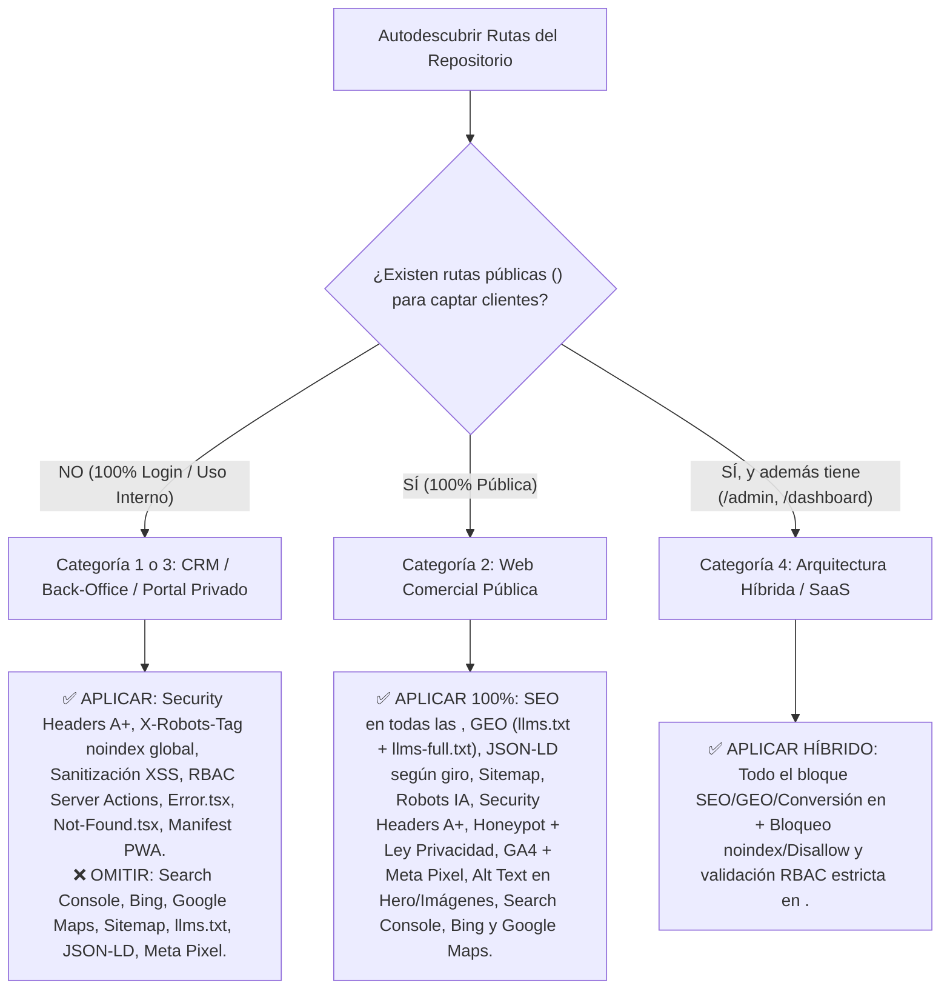

# Protocolo Maestro Universal de SEO, GEO (IA), Seguridad A+, Conversión y Resiliencia Web (`steven-seo-seguridad-web`)

Este skill es **100% agnóstico del proyecto y del rubro comercial**. No asume rutas fijas ni nombres de colecciones predefinidos: **autodescubre dinámicamente la estructura del repositorio** para transformar cualquier aplicación web en una plataforma de grado empresarial con **visibilidad orgánica en Google y Bing**, **recomendación activa en motores de IA (ChatGPT, Gemini, Claude, Perplexity)**, **blindaje perimetral grado `A+`** y **trazabilidad completa de conversiones**.

---

## 🚦 FASE 0: Clasificador Inteligente de Proyecto y Autodescubrimiento de Rutas

> [!IMPORTANT]
> **Regla de Oro de Eficiencia Arquitectónica:**
> Antes de auditar o escribir una sola línea de código, **es OBLIGATORIO clasificar el proyecto y escanear su árbol real de rutas**. Implementar SEO público o `llms.txt` en un CRM interno es un desperdicio de recursos y un riesgo de exposición; omitirlos en una web comercial o SaaS condena al negocio a la invisibilidad digital.

### Paso 0.1: Autodescubrimiento Dinámico del Proyecto
El agente debe ejecutar una inspección inicial automática sobre el repositorio:
1. **Escanear el árbol de rutas:**
   - En Next.js App Router: listar todos los archivos `src/app/**/page.tsx` y `src/app/**/layout.tsx`.
   - En Next.js Pages / Vite / React Router: listar `src/pages/**/*` o el archivo de definición de rutas.
2. **Separar las rutas detectadas en dos grupos:**
   - **Rutas Públicas (`<PUBLIC_ROUTES>`):** Vistas abiertas al público general (ej. ilustrativos según el proyecto: `/`, `/servicios`, `/precios`, `/catalogo`, `/portafolio`, `/blog`, `/nosotros`, `/contacto`, etc.).
   - **Rutas Privadas / Administrativas (`<PRIVATE_ROUTES>`):** Vistas detrás de autenticación o de gestión interna (ej. ilustrativos: `/admin/*`, `/dashboard/*`, `/app/*`, `/portal/*`, `/login`, `/api/*`).
3. **Detectar el Giro o Entidad Principal del Proyecto:**
   - Identificar si la plataforma ofrece **Productos físicos** (E-commerce / Catálogo), **Servicios profesionales / locales** (Clínica, Agencia, Constructora, Restaurante), **Software / SaaS** (`SoftwareApplication`) o **Herramienta Operativa Interna** (CRM / ERP / Back-Office).

---

### Paso 0.2: Clasificación en las 4 Categorías Universales

| Categoría de Proyecto | Ejemplos de Uso | ¿Quién entra? | Objetivo Técnico Principal |
| :--- | :--- | :--- | :--- |
| **1. Back-Office / CRM / ERP Interno** | Sistemas de inventario, facturación interna, paneles operativos, herramientas de empleados. | Solo personal o colaboradores autenticados. | **Seguridad `A+`, bloqueo total a buscadores (`noindex`), RBAC, resiliencia UX y PWA instalable.** |
| **2. Web Pública Comercial / Transaccional B2C** | Landing pages, catálogos, e-commerce, sitios corporativos, clínicas, servicios. | Clientes finales, Googlebot, Bingbot y Bots de IA. | **100% del protocolo: SEO On-Page, GEO (`/llms.txt`), JSON-LD, Seguridad `A+`, GA4/Meta Pixel y velocidad.** |
| **3. Portal Privado B2B / Extranet** | Portales de clientes/asociados con login, consulta de estados de cuenta o pedidos. | Clientes registrados y socios comerciales. | **Rutas privadas en `noindex`, Seguridad `A+`, Rate Limiting / Honeypot en login, PWA y Error Boundaries.** |
| **4. Arquitectura Híbrida (Web Pública + Panel Privado / SaaS)** | Cualquier sitio público que convive en el mismo repo con un CMS (`/admin`) o app (`/dashboard`). | Público general en `<PUBLIC_ROUTES>` + Usuarios autenticados en `<PRIVATE_ROUTES>`. | **Separación quirúrgica: 100% SEO/GEO en `<PUBLIC_ROUTES>` + bloqueo `X-Robots-Tag: noindex` y RBAC en `<PRIVATE_ROUTES>`.** |

---

### Paso 0.3: Matriz de Decisiones (Qué Aplicar y Qué Omitir)



| Módulo / Requisito Técnico | Cat. 1: CRM / ERP Interno | Cat. 2: Web Pública B2C | Cat. 3: Portal Privado B2B | Cat. 4: Híbrido (Público + Privado) |
| :--- | :---: | :---: | :---: | :---: |
| **Cabeceras HTTP Grado `A+` (CSP, HSTS, nosniff, Frame)** | 🔴 OBLIGATORIO | 🔴 OBLIGATORIO | 🔴 OBLIGATORIO | 🔴 OBLIGATORIO |
| **Desactivar Sourcemaps y `X-Powered-By`** | 🔴 OBLIGATORIO | 🔴 OBLIGATORIO | 🔴 OBLIGATORIO | 🔴 OBLIGATORIO |
| **Sanitización XSS / Zod / Limpieza `undefined`** | 🔴 OBLIGATORIO | 🔴 OBLIGATORIO | 🔴 OBLIGATORIO | 🔴 OBLIGATORIO |
| **RBAC en Server Actions y Reglas de Base de Datos** | 🔴 OBLIGATORIO | 🟡 En escrituras | 🔴 OBLIGATORIO | 🔴 OBLIGATORIO |
| **Resiliencia (`error.tsx`, `not-found.tsx`, Skeletons)** | 🔴 OBLIGATORIO | 🔴 OBLIGATORIO | 🔴 OBLIGATORIO | 🔴 OBLIGATORIO |
| **Manifiesto Web PWA (`manifest.ts` + Favicons)** | 🟢 RECOMENDADO | 🔴 OBLIGATORIO | 🟢 RECOMENDADO | 🔴 OBLIGATORIO |
| **Honeypot Antispam + Check Legal en Formularios** | ❌ No aplica | 🔴 OBLIGATORIO | 🟡 En registro/login | 🔴 En forms públicos |
| **SEO On-Page (Titles, Meta Desc 140-155c, Canonical)** | ❌ PROHIBIDO (`noindex`) | 🔴 En `<PUBLIC_ROUTES>` | ❌ Solo en login | 🔴 En `<PUBLIC_ROUTES>` |
| **GEO / LLMO (`/llms.txt`, `/llms-full.txt`, Bots IA)** | ❌ PROHIBIDO | 🔴 OBLIGATORIO | ❌ PROHIBIDO | 🔴 En `<PUBLIC_ROUTES>` |
| **Microdatos JSON-LD (Adaptados al giro del proyecto)** | ❌ No aplica | 🔴 OBLIGATORIO | ❌ No aplica | 🔴 En `<PUBLIC_ROUTES>` |
| **Atributos `alt` Semánticos (0 `alt=""` en Hero/Headers)** | 🟡 Básico | 🔴 OBLIGATORIO | 🟡 Básico | 🔴 OBLIGATORIO |
| **Google Search Console + Bing Webmaster + Maps** | ❌ No aplica | 🔴 OBLIGATORIO | ❌ No aplica | 🔴 OBLIGATORIO |
| **GA4 + Meta Pixel + Consent Mode v2 + Eventos** | ❌ No aplica | 🔴 OBLIGATORIO | ❌ Opcional | 🔴 En `<PUBLIC_ROUTES>` |

---

## 🔍 MODO 1: PROTOCOLO DE AUDITORÍA E2E (Para Proyectos Existentes)

Cuando el usuario pida **auditar** un proyecto, ejecuta el escaneo sobre las rutas detectadas y entrega una tabla de calificación (1 al 10) verificando las **20 Señales de Alerta de "Vibe Coding"**:

1. **Dominio temporal o `localhost` hardcodeado** en metadatos en lugar de variable de entorno (`NEXT_PUBLIC_SITE_URL`).
2. **`images: { unoptimized: true }`** en `next.config.mjs` (destruye el rendimiento móvil al desactivar la compresión WebP/AVIF).
3. **Ausencia de Cabeceras HTTP (`headers()`)** o calificación inferior a `A+` por falta de `Content-Security-Policy (CSP)`.
4. **Sourcemaps expuestos en producción** (`productionBrowserSourceMaps` activo).
5. **Rutas públicas (`<PUBLIC_ROUTES>`) sin `alternates: { canonical: '...' }`** (provoca contenido duplicado al compartir links con `?fbclid=` o `?utm_source=`).
6. **Meta Descriptions fuera del rango estricto de 140–155 caracteres** en cualquiera de las `<PUBLIC_ROUTES>` (Bing marca error rojo si supera los 160 caracteres o baja de 120).
7. **Imágenes decorativas, fondos o isotipos con `alt=""` vacío** en componentes de portada (`Hero`, `PageHero`, `Banner`, `Header`) (el rastreador SEO de Bing marca advertencia *"Alt attribute for images is missing"*).
8. **Múltiples `<h1>` o cero `<h1>`** en una misma vista pública.
9. **Ausencia de `/llms.txt` y `/llms-full.txt`** o archivos estáticos desconectados de la base de datos.
10. **Truncamiento artificial en `/llms.txt` o JSON-LD** (ej. `.slice(0, 25)` o listado sin orden de prioridad comercial que oculta la oferta principal del negocio frente a las IAs).
11. **Ausencia de Microdatos JSON-LD (`Schema.org`)** acordes al giro del negocio (`Organization`, `LocalBusiness`, `SoftwareApplication`, `Product`, `Service`, `FAQPage`, `BreadcrumbList`).
12. **`robots.ts` genérico** que no declara reglas explícitas para bots de IA (`GPTBot`, `OAI-SearchBot`, `PerplexityBot`, `ClaudeBot`, `Google-Extended`) o que olvida bloquear las `<PRIVATE_ROUTES>` (`/admin/`, `/dashboard/`, `/api/`).
13. **`sitemap.ts` incompleto** que omite rutas públicas dinámicas o no incluye `/llms.txt` y `/llms-full.txt`.
14. **Formularios públicos sin Honeypot (`bot_check`)** o sin casilla obligatoria de aceptación de Política de Privacidad.
15. **Server Actions o Endpoints privados sin verificación de token RBAC en servidor** (confiando únicamente en bloqueos visuales del frontend).
16. **Incongruencia de colecciones o IDs de documentos en Base de Datos** entre el panel administrativo y los fetchers públicos SSR.
17. **Scripts de GA4 / Meta Pixel comentados**, sin variables de entorno o sin **Google Consent Mode v2**.
18. **Botones de conversión (WhatsApp, Compra, Registro, Cotización) sin eventos analíticos (`trackEvent`)** o con datos de contacto hardcodeados.
19. **Ausencia de vista 404 personalizada (`not-found.tsx`) y Error Boundary global (`error.tsx`)**.
20. **Inputs de formulario con generación insegura de `id`** (ej. `label.toLowerCase()` conservando asteriscos `*` o tildes que rompen selectores CSS y lectores de pantalla).

---

## 🛠️ MODO 2: GUÍA DE IMPLEMENTACIÓN PASO A PASO (Para Crear Nuevo o Corregir)

---

### BLOQUE 1: Seguridad Perimetral HTTP Grado `A+` (`next.config.mjs`)

> [!TIP]
> Para obtener la calificación máxima **`A+`** en [SecurityHeaders.com](https://securityheaders.com), no basta con `HSTS` y `X-Frame-Options`; es **obligatorio** incluir una cabecera `Content-Security-Policy (CSP)` calibrada con los orígenes que utilice el proyecto (ej. Firebase/Supabase, Google Maps, Google Fonts, Stripe/PayPal, GA4 y Meta Pixel) sin bloquear la hidratación del framework.

#### Plantilla Universal para `next.config.mjs`:
```javascript
/** @type {import('next').NextConfig} */
const nextConfig = {
  poweredByHeader: false,
  productionBrowserSourceMaps: false,
  images: {
    // PROHIBIDO usar unoptimized: true en producción
    formats: ['image/avif', 'image/webp'],
    remotePatterns: [
      { protocol: 'https', hostname: 'images.unsplash.com' },
      { protocol: 'https', hostname: 'firebasestorage.googleapis.com' },
      { protocol: 'https', hostname: '*.firebasestorage.app' },
      // Agregar aquí dominios de imágenes propios del proyecto (ej. Cloudinary, S3, Supabase)
    ],
  },
  async headers() {
    const cspHeader = [
      "default-src 'self'",
      "script-src 'self' 'unsafe-inline' 'unsafe-eval' https://www.googletagmanager.com https://connect.facebook.net https://apis.google.com https://va.vercel-scripts.com",
      "style-src 'self' 'unsafe-inline' https://fonts.googleapis.com",
      "img-src 'self' data: blob: https://firebasestorage.googleapis.com https://*.firebasestorage.app https://images.unsplash.com https://www.facebook.com https://www.google-analytics.com https://*.googleapis.com https://*.gstatic.com",
      "font-src 'self' data: https://fonts.gstatic.com",
      "connect-src 'self' https://*.googleapis.com https://*.google-analytics.com https://*.analytics.google.com https://*.googletagmanager.com https://*.firebaseio.com wss://*.firebaseio.com https://*.firebasestorage.app https://www.facebook.com https://connect.facebook.net https://va.vercel-scripts.com",
      "frame-src 'self' https://www.google.com https://maps.google.com https://*.firebaseapp.com https://*.google.com",
      "media-src 'self' blob: data: https://firebasestorage.googleapis.com https://*.firebasestorage.app",
      "object-src 'none'",
      "base-uri 'self'",
      "form-action 'self'",
      "frame-ancestors 'self'",
      "upgrade-insecure-requests",
    ].join('; ');

    return [
      {
        source: '/:path*',
        headers: [
          { key: 'Content-Security-Policy', value: cspHeader },
          { key: 'X-DNS-Prefetch-Control', value: 'on' },
          { key: 'Strict-Transport-Security', value: 'max-age=63072000; includeSubDomains; preload' },
          { key: 'X-Frame-Options', value: 'SAMEORIGIN' },
          { key: 'X-Content-Type-Options', value: 'nosniff' },
          { key: 'Referrer-Policy', value: 'strict-origin-when-cross-origin' },
          { key: 'Permissions-Policy', value: 'camera=(), microphone=(), geolocation=(), interest-cohort=()' },
        ],
      },
      // Repetir este bloque para cada ruta privada detectada en <PRIVATE_ROUTES> (ej. /admin/:path*, /dashboard/:path*)
      // Si el proyecto es Categoría 1 (100% CRM/Interno), aplicar X-Robots-Tag en '/:path*'
      {
        source: '/admin/:path*',
        headers: [
          { key: 'X-Robots-Tag', value: 'noindex, nofollow, noarchive' },
        ],
      },
    ];
  },
};

export default nextConfig;
```

---

### BLOQUE 2: Motor GEO / LLMO Dinámico (`/llms.txt` y `/llms-full.txt`)

> [!CAUTION]
> **Regla Anti-Truncamiento para Motores de IA:**
> Nunca uses `.slice(0, 25)` ni ordenes el catálogo o cartera de servicios por código/SKU alfabético. En bases de datos reales, el orden alfabético por código suele colocar primero ítems secundarios o accesorios, haciendo que ChatGPT, Claude y Perplexity crean que el negocio solo vende elementos menores.
> **Estándar obligatorio:** Ordenar siempre por **Categoría de Prioridad Comercial** e incluir el **100% de los productos, planes o servicios activos** con sus precios reales, moneda, descuentos y especificaciones.

#### Estructura Universal de `src/app/llms.txt/route.ts` y `src/app/llms-full.txt/route.ts`:
1. Consultar en tiempo real la fuente de datos o caché del servidor del proyecto.
2. Estructurar el documento en Markdown limpio con:
   - **Identidad de la Organización / Negocio:** Propuesta de valor, país/ciudad de operación, cobertura, teléfono/WhatsApp, horarios y sitio web oficial.
   - **Oferta Comercial Completa (100% de Productos / Servicios / Planes SaaS):** Agrupados por prioridad estratégica con precio, moneda, código/SKU y ficha técnica.
   - **Casos de Éxito / Portafolio / Testimonios verificables** (si existen en el proyecto).
   - **Preguntas Frecuentes Factuales (AEO - Answer Engine Optimization):** Respuestas directas a cómo comprar, garantías, tiempos de entrega o soporte.
   - **Mapa de URLs Públicas (`<PUBLIC_ROUTES>`):** Enlaces directos a todas las secciones públicas del sitio.
3. Responder con cabeceras HTTP de texto plano cacheable:
   ```typescript
   return new NextResponse(content, {
     status: 200,
     headers: {
       'Content-Type': 'text/plain; charset=utf-8',
       'Cache-Control': 'public, s-maxage=3600, stale-while-revalidate=86400',
     },
   });
   ```
4. **Revalidación automática:** Si el proyecto tiene un CMS o panel administrativo, agregar `revalidatePath('/llms.txt')`, `revalidatePath('/llms-full.txt')` y `revalidatePath('/sitemap.xml')` al guardar cambios.

---

### BLOQUE 3: Microdatos Estructurados JSON-LD (`Schema.org` según el Giro del Proyecto)

Crear `src/lib/utils/structured-data.ts` e inyectar `<script type="application/ld+json">` eligiendo los esquemas según la naturaleza del proyecto detectada en la Fase 0:

| Giro del Proyecto | Esquema Principal en `layout.tsx` (Raíz) | Esquema en Vistas de Oferta / Catálogo / Servicios | Esquemas Complementarios |
| :--- | :--- | :--- | :--- |
| **Comercio Físico / Tienda / Distribuidora / Clínica / Restaurante** | `LocalBusiness` (o subtipo específico como `Store`, `MedicalBusiness`, `Restaurant`, `HomeImprovementStore`) con `PostalAddress`, `GeoCoordinates`, `openingHoursSpecification`, `telephone`, `paymentAccepted`. | `ItemList` conteniendo el 100% de objetos `Product` o `Service` con `offers` (`price`, `priceCurrency`, `availability: InStock`). | `FAQPage` + `BreadcrumbList` |
| **SaaS / Aplicación Web / Plataforma Digital** | `Organization` + `SoftwareApplication` (con `applicationCategory`, `operatingSystem: 'Web'`, `offers`). | `Product` o `OfferCatalog` para los planes de suscripción (`Pricing`). | `FAQPage` + `BreadcrumbList` |
| **Empresa de Servicios Profesionales / Agencia / Consultora** | `Organization` o `ProfessionalService` con área de cobertura (`areaServed`) y datos de contacto (`ContactPoint`). | `Service` por cada línea de servicio ofrecida. | `FAQPage` + `BreadcrumbList` |

---

### BLOQUE 4: Reglas Estrictas de SEO On-Page, Imágenes (`alt`) y Calibración Bing + Google

> [!WARNING]
> **Reglas Críticas de Validación en Bing Webmaster Tools (Motor de ChatGPT Search y Copilot):**
> 1. **Longitud Estricta de `<meta name="description">`:** En **todas las `<PUBLIC_ROUTES>`**, la descripción debe medir **entre 140 y 155 caracteres exactos** (contando espacios). Si supera los 160 caracteres (aunque sea por 2 letras) o baja de 120, el inspector de Bing marca `Error: Meta Description too long or too short`.
> 2. **Cero `alt=""` vacíos en Portadas (`Hero`, `PageHero`, `Banner`, `Header`):** Aunque en accesibilidad tradicional se acostumbra poner `alt=""` en isotipos o marcas de agua decorativas, el escáner SEO de Bing audita todas las etiquetas `` del Hero y lanza la alerta `Notice: Alt attribute for images is missing` si encuentra un `alt=""` vacío.

#### Checklist Universal para Todas las Rutas Públicas Detectadas (`<PUBLIC_ROUTES>`):
- [ ] **Recorrer dinámicamente cada archivo en `<PUBLIC_ROUTES>`** (`src/app/**/page.tsx` o `layout.tsx`) y verificar:
  - **`<title>` (50–60 caracteres):** `[Keyword Principal de la Vista] + [Ubicación o Contexto] | [Nombre de la Marca]`.
  - **`<meta name="description">` (140–155 caracteres estrictos):** Verificar longitud exacta con `.length` antes de guardar. Debe incluir keyword principal, beneficio diferenciador y llamado a la acción (CTA).
  - **Canonical Tag (`alternates: { canonical: '...' }`):** Apuntando a la ruta limpia absoluta (`https://tudominio.com/[ruta-actual]`).
  - **Un único `<h1>` por vista:** Que contenga la intención de búsqueda principal de esa página.
- [ ] **Auditar todas las etiquetas `` y `<Image>` del proyecto:**
  - **En `Hero`, `PageHero`, `Header` y `Footer`:** Reemplazar cualquier `alt=""` en isotipos, logotipos o imágenes de respaldo por una descripción semántica real (ej. `alt="Isotipo oficial de [NombreMarca]"`).
  - **En tarjetas de productos, servicios o portafolio:** Usar atributos dinámicos enriquecidos: `alt={`${item.title} - ${item.category} | [NombreMarca]`}`.
- [ ] **Configurar `src/app/robots.ts`:**
  - Dar permiso explícito (`allow: '/'`) a todos los buscadores y agentes de IA (`*`, `GPTBot`, `ChatGPT-User`, `OAI-SearchBot`, `PerplexityBot`, `Google-Extended`, `ClaudeBot`, `anthropic-ai`, `Applebot-Extended`, `cohere-ai`).
  - Bloquear todas las `<PRIVATE_ROUTES>` detectadas (`disallow: ['/admin/', '/dashboard/', '/api/']`).
- [ ] **Configurar `src/app/sitemap.ts` Dinámico:**
  - Incluir automáticamente todas las `<PUBLIC_ROUTES>` estáticas + rutas dinámicas de base de datos (categorías, productos, artículos) + `/llms.txt` y `/llms-full.txt`.

---

### BLOQUE 5: Blindaje de Formularios, Sanitización, Privacidad y RBAC

1. **Honeypot Antispam Invisible (`bot_check`):**
   - En todo formulario público del proyecto (Contacto, Cotización, Registro, Newsletter), agregar un input oculto `bot_check` con `tabIndex={-1}` y `autoComplete="off"`.
   - En el backend / Server Action, si `bot_check` no está vacío, abortar silenciosamente devolviendo `{ success: true }` para engañar al bot sin consumir base de datos.
2. **Sanitización Anti-XSS y Limpieza de Payloads:**
   - Validar esquemas con **Zod**, sanitizar etiquetas HTML/scripts de cualquier texto libre y eliminar propiedades `undefined` antes de insertar en Firestore o SQL.
3. **Consentimiento Legal de Privacidad (Ley 8968 CR / GDPR):**
   - Incluir checkbox obligatorio de aceptación de Política de Privacidad en cada formulario de captura de datos personales.
4. **Sanitización de `id` en Componentes `<Input />` y `<Select />`:**
   - Generar el atributo `id` normalizando tildes y removiendo símbolos como `*` o paréntesis:
     ```typescript
     const safeId = label.normalize('NFD').replace(/[\u0300-\u036f]/g, '').toLowerCase().replace(/[^a-z0-9_-]/g, '-').replace(/-+/g, '-').replace(/^-|-$/g, '');
     ```
5. **Verificación RBAC en Servidor:**
   - Toda Server Action o API Route privada debe validar el token de sesión (`idToken`) en el servidor mediante SDK Admin antes de ejecutar mutaciones, borrados en Storage o revalidaciones de caché.

---

### BLOQUE 6: Manifiesto PWA y Resiliencia UX (`manifest.ts`, `not-found.tsx`, `error.tsx`)

1. **`src/app/manifest.ts`:**
   - Generar manifiesto PWA con colores de marca del proyecto, `display: 'standalone'`, `start_url: '/'` e íconos `192x192` y `512x512`.
2. **`src/app/not-found.tsx` (Vista 404):**
   - Pantalla 404 personalizada con el diseño del proyecto y botones de retorno hacia las `<PUBLIC_ROUTES>` principales.
3. **`src/app/error.tsx` (Error Boundary Global):**
   - Capturador de errores de cliente (`'use client'`) con botón de recuperación (`reset()`) y canal de soporte.

---

### BLOQUE 7: Guía Paso a Paso para Conectar Google Analytics 4 (GA4), Meta Pixel y Conversiones

#### Paso 1: Cómo obtener los IDs en las plataformas oficiales
1. **Google Analytics 4 (`NEXT_PUBLIC_GA_MEASUREMENT_ID`):**
   - Entrar a [analytics.google.com](https://analytics.google.com) -> **Administrar (⚙️)** -> **Flujos de datos (Data Streams)** -> **Web**.
   - Seleccionar o crear el flujo del sitio web y copiar el **ID de medición** (`G-XXXXXXXXXX`).
2. **Meta Pixel (`NEXT_PUBLIC_META_PIXEL_ID`):**
   - Entrar a [business.facebook.com/events_manager2](https://business.facebook.com/events_manager2) (**Administrador de Eventos de Meta**).
   - Ir a **Conectar orígenes de datos** -> **Web** -> Crear o seleccionar el Pixel y copiar el **ID numérico del conjunto de datos** (`123456789012345`).
3. **Configurar las variables en `.env.local` y en el proveedor de hosting (`apphosting.yaml` / Vercel / Cloud Run):**
   ```env
   NEXT_PUBLIC_SITE_URL=https://tudominio.com
   NEXT_PUBLIC_GA_MEASUREMENT_ID=G-XXXXXXXXXX
   NEXT_PUBLIC_META_PIXEL_ID=123456789012345
   ```

#### Paso 2: Google Consent Mode v2 + Banner de Cookies
- Inicializar `gtag('consent', 'default', { analytics_storage: 'denied', ad_storage: 'denied' })` por defecto y disparar `gtag('consent', 'update', { analytics_storage: 'granted', ad_storage: 'granted' })` cuando el usuario acepta las cookies.

#### Paso 3: Helper Universal de Eventos de Conversión (`src/lib/utils/analytics.ts`)
Crear el despachador seguro `trackEvent(eventName, params)` (protegido con `try/catch` contra AdBlockers) y conectarlo a los puntos de conversión reales del proyecto:
- **Contacto directo (WhatsApp / Teléfono / Chat):** `contact_whatsapp_floating`, `contact_whatsapp_direct`.
- **Captura de Leads (Formularios B2C o B2B):** `generate_lead_quote`, `generate_lead_b2b`, `contact_form_submit`.
- **Interacción con Catálogo / Planes / Servicios:** `view_item_detail`, `select_plan`, `initiate_checkout`.

---

### BLOQUE 8: Protocolo Externo Paso a Paso (Search Console, Bing, Google Maps y Validación)

Al finalizar el despliegue a producción de cualquier proyecto **Categoría 2 o Categoría 4**, guiar al usuario paso a paso por las consolas oficiales generando la lista exacta de URLs según las `<PUBLIC_ROUTES>` de ese proyecto:

#### 1. Lista Dinámica de URLs Finales a Inspeccionar
El agente debe imprimirle al usuario la lista exacta de URLs públicas de su dominio listas para copiar y pegar:
```text
https://[DOMINIO_PROYECTO]/
https://[DOMINIO_PROYECTO]/[ruta-publica-1]   (ej. /servicios, /catalogo, /precios)
https://[DOMINIO_PROYECTO]/[ruta-publica-2]   (ej. /proyectos, /portafolio, /funciones)
https://[DOMINIO_PROYECTO]/[ruta-publica-3]   (ej. /nosotros, /empresa)
https://[DOMINIO_PROYECTO]/[ruta-publica-4]   (ej. /contacto, /distribuidores)
https://[DOMINIO_PROYECTO]/llms.txt
https://[DOMINIO_PROYECTO]/llms-full.txt
```

#### 2. Google Search Console (Indexación en Google y Gemini)
1. Entrar a [search.google.com/search-console](https://search.google.com/search-console), registrar la propiedad por **Dominio** y verificar con registro **TXT** en el DNS.
2. En el menú **Sitemaps**, enviar `sitemap.xml`.
3. En la barra superior (**Inspección de URLs**), pegar cada una de las URLs de la lista anterior -> clic en **`Probar URL publicada`** -> clic en **`Solicitar indexación`**.

#### 3. Bing Webmaster Tools (Indexación en ChatGPT Search y Microsoft Copilot)
1. Entrar a [bing.com/webmasters](https://www.bing.com/webmasters) y elegir **"Import from Google Search Console"**.
2. En **Sitemaps**, enviar `https://[DOMINIO_PROYECTO]/sitemap.xml`.
3. En **URL Inspection**, pegar cada una de las URLs de la lista anterior:
   - ⚠️ **Nota clave de interfaz:** Al inspeccionar una URL, Bing muestra por defecto la pestaña histórica `Bing Index` (que puede mostrar errores antiguos o *"Discovered but not crawled"*).
   - **Acción obligatoria:** Pasar siempre a la pestaña **`Live URL`** (arriba a la derecha) para verificar que el código en vivo tenga **0 errores**, y presionar **`Request indexing`**.

#### 4. Google Business Profile / Google Maps (Para Negocios con Atención Local o Bodega/Oficina Física)
1. Entrar a [business.google.com](https://business.google.com) con la cuenta propietaria del negocio.
2. **Solución cuando el perfil de empresa existe pero NO aparece el pin en Google Maps:**
   - Ir al panel del perfil en Google -> **`Editar perfil`** -> **`Ubicación`** -> editar **`Ubicación de la empresa`**.
   - **Activar el interruptor `"Mostrar dirección a los clientes"`**, ajustar el pin sobre el mapa y guardar (si este switch está apagado, Google lo trata como negocio sin local físico y lo oculta del mapa).
3. En **`Editar perfil` -> `Contacto`**, vincular el sitio web oficial `https://[DOMINIO_PROYECTO]` y verificar que teléfono y horario coincidan con el JSON-LD `LocalBusiness`.

#### 5. Suite de Herramientas de Validación Final (Links Directos)
Entregar al usuario los enlaces personalizados con el dominio de su proyecto para cerrar la auditoría:
1. **Estado del Release en Servidor:** `https://[DOMINIO_PROYECTO]/api/version`
2. **Calificación `A+` de Cabeceras HTTP:**
   `https://securityheaders.com/?q=https%3A%2F%2F[DOMINIO_PROYECTO]&followRedirects=on`
3. **Validación de Microdatos JSON-LD (Google Rich Results):**
   `https://search.google.com/test/rich-results?url=https%3A%2F%2F[DOMINIO_PROYECTO]`
4. **Verificación de Contexto para IA Generativa:**
   `https://[DOMINIO_PROYECTO]/llms.txt` y `https://[DOMINIO_PROYECTO]/llms-full.txt`
