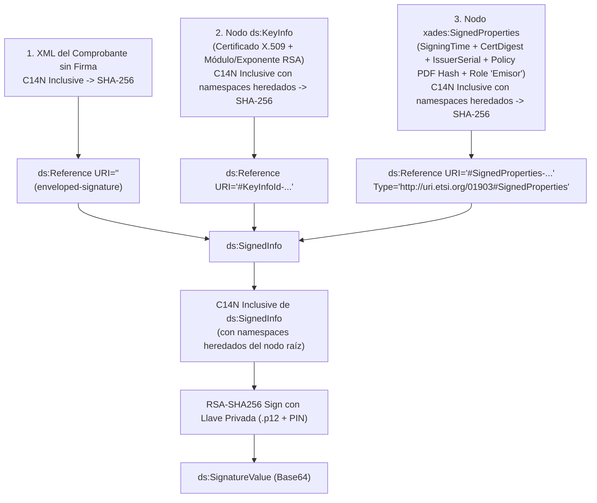

# 03 — Firma Criptográfica XAdES-EPES (`.p12`) paso a paso en Node.js / Serverless

Guía criptográfica completa de cómo funciona la firma exigida por el Ministerio de Hacienda de Costa Rica y cómo operarla sin errores en macOS, Linux (Cloud Run / Docker) y entornos Serverless.

---

## 1. ¿Qué es exactamente `XAdES-EPES` y por qué falla cuando se intenta improvisar?

Hacienda no usa un simple HMAC ni una firma XML-DSig básica; exige el estándar europeo **ETSI TS 101 903 v1.3.2 (`XAdES-EPES` — Electronic Signature with Explicit Policy)** incrustada (`enveloped`) como último hijo antes de cerrar el nodo raíz (`</FacturaElectronica>`).

Una firma `XAdES-EPES` válida para Hacienda v4.4 contiene **3 referencias criptográficas (`<ds:Reference>`)** dentro de `<ds:SignedInfo>`, todas con `SHA-256`, y luego firma la canonización **W3C Inclusive C14N 1.0 (`http://www.w3.org/TR/2001/REC-xml-c14n-20010315`)** de `<ds:SignedInfo>` con la llave privada `RSA-2048` del contribuyente (`rsa-sha256`):



---

## 2. Los 5 Detalles Criptográficos Donde Fallan el 95% de las Implementaciones

Nuestro motor [`sign-and-validate-v44.mjs`](../scripts/sign-and-validate-v44.mjs) resuelve de raíz estas 5 trampas reales de Hacienda:

### Trampa 1: Herencia de Namespaces en W3C Inclusive C14N (`REC-xml-c14n-20010315`)
Cuando Hacienda verifica el `DigestValue` de `#KeyInfoId-...` o `#SignedProperties-...`, y cuando verifica la firma sobre `<ds:SignedInfo>`, esos nodos viven **dentro** de `<FacturaElectronica xmlns="https://.../v4.4/facturaElectronica" xmlns:xsd="..." xmlns:xsi="...">` y `<ds:Signature xmlns:ds="http://www.w3.org/2000/09/xmldsig#">`.
En **Inclusive C14N**, un sub-árbol extraído de un documento XML **hereda todos los atributos `xmlns` y `xmlns:*` en alcance de sus ancestros** ordenados lexicográficamente.
- Si calculas el hash de `<ds:KeyInfo Id="...">` aislado sin inyectarle `xmlns`, `xmlns:ds`, `xmlns:xsd` y `xmlns:xsi` antes de canonizar, **el hash SHA-256 cambiará** en cuanto insertes `<ds:Signature>` dentro de `<FacturaElectronica>` y Hacienda rechazará el comprobante con *"Firma inválida: Digest mismatch en KeyInfo o SignedProperties"*.
- En [`sign-and-validate-v44.mjs`](../scripts/sign-and-validate-v44.mjs) (líneas 731–770), cada sub-árbol se canoniza con exactamente los namespaces ancestrales que tendrá en el documento final ensamblado.

### Trampa 2: Política de Firma Explícita v4.4 (`<xades:SignaturePolicyIdentifier>`)
En v4.2/v4.3 se usaba un URL bajo `tribunet.hacienda.go.cr` o `hacienda.go.cr/ATV/...` (hoy caídos o `404`). En **v4.4**, la política oficial verificada en vivo (`163,479 bytes`, `HTTP 200`) es:

- **`<xades:Identifier>`**:
  `https://cdn.comprobanteselectronicos.go.cr/xml-schemas/Resoluci%C3%B3n_General_sobre_disposiciones_t%C3%A9cnicas_comprobantes_electr%C3%B3nicos_para_efectos_tributarios.pdf`
- **`<ds:DigestMethod>`**:
  `http://www.w3.org/2001/04/xmlenc#sha256`
- **`<ds:DigestValue>` (SHA-256 en Base64 del PDF exacto)**:
  `DWxin1xWOeI8OuWQXazh4VjLWAaCLAA954em7DMh0h8=`

> **Protección futura:** El script [`preflight-and-drift-sentinel.mjs`](../scripts/preflight-and-drift-sentinel.mjs) descarga ese PDF directamente del CDN de Hacienda, recalcula su `SHA-256` en vivo y dispara una **Alerta Roja de Deriva Normativa** si el Ministerio llega a sustituir el archivo PDF por una nueva resolución.

### Trampa 3: `X509SerialNumber` en Decimal Entero Gigante (`BigInt`), NO en Hexadecimal
OpenSSL y `crypto.X509Certificate.serialNumber` devuelven el número de serie del certificado en **hexadecimal** (ej. `"71:A4:9F:00:B2:..."` de 16–20 bytes = 128–160 bits).
El esquema `xmldsig-core-schema.xsd` define `<ds:X509SerialNumber>` como `xs:integer` (base 10).
- Si usas `parseInt(hex, 16)` o `Number('0x' + hex)` (como hacía un viejo parche en PHP), pierdes precisión a partir de 53 bits (`Number.MAX_SAFE_INTEGER`) y corrompes los últimos dígitos del serial -> **Rechazo criptográfico en Hacienda**.
- **Solución exacta:** `BigInt('0x' + cleanHex).toString(10)` — precisión arbitraria exacta de 160+ bits sin pérdida.

### Trampa 4: Orden RFC 2253 en `<ds:X509IssuerName>`
`node:crypto` devuelve `x509.issuer` separado por saltos de línea desde la raíz hacia la hoja (`C=CR\nO=...\nOU=...\nCN=CA POLITICA PERSONA JURIDICA - COSTA RICA`). Hacienda y Java/XMLSec esperan formato **RFC 2253 inverso** (`CN=..., OU=..., O=..., C=CR`). Por eso invertimos el arreglo (`x509.issuer.split('\n').filter(Boolean).reverse().join(', ')`).

### Trampa 5: Certificados `.p12` de Hacienda / BCCR en OpenSSL 3.x (`PBE-SHA1-RC2-40`)
Los contenedores `.p12` generados por la infraestructura PKI gubernamental de Costa Rica suelen cifrar la bolsa de certificados con algoritmos PKCS#12 clásicos (`RC2-40-CBC` o `3DES` + `SHA1`).
- En **macOS** (`LibreSSL 3.3.6`), `openssl pkcs12` los abre directamente.
- En **Ubuntu 22.04/24.04, Debian 12, Alpine y Node 20–24 sobre Linux** (Cloud Run, Railway, Fly.io, AWS), OpenSSL 3 deshabilitó `RC2-40` en el provider por defecto y lanza `error:0308010C:digital envelope routines::unsupported`.
- **Solución doble implementada en `sign-and-validate-v44.mjs`:**
  1. Primero intenta `openssl pkcs12 -in ...` estándar.
  2. Si falla, reintenta automáticamente con `openssl pkcs12 -legacy -in ...`.

---

## 3. Alternativa 100% Pure-JS (Cero Binarios Nativos) para Vercel / Cloudflare / Serverless Puro

En un contenedor Docker / Cloud Run / VPS / Mac tienes `openssl` y `xmllint` instalados y puedes invocar `sign-and-validate-v44.mjs` directamente (tarda ~18ms por factura).
Si algún día despliegas en un runtime **Serverless restringido sin binarios del sistema** (ej. Vercel Functions ligeras), reemplaza únicamente las 2 llamadas CLI (`openssl pkcs12` y `xmllint --c14n`) con estos paquetes NPM auditados:

1. **Extracción de `.p12` legacy en memoria pura JS**: `node-forge` (`npm i node-forge`) soporta nativamente `PBE-SHA1-RC2-40` y `3DES` sin depender de OpenSSL 3 `-legacy`:
   ```ts
   import forge from 'node-forge';
   import crypto from 'node:crypto';

   export function parseP12PureJs(p12Buffer: Buffer, pin: string) {
     const asn1 = forge.asn1.fromDer(p12Buffer.toString('binary'));
     const p12 = forge.pkcs12.pkcs12FromAsn1(asn1, false, pin);
     const keyBags = p12.getBags({ bagType: forge.pki.oids.pkcs8ShroudedKeyBag })[forge.pki.oids.pkcs8ShroudedKeyBag] || [];
     const certBags = p12.getBags({ bagType: forge.pki.oids.certBag })[forge.pki.oids.certBag] || [];
     if (!keyBags[0]?.key || !certBags[0]?.cert) throw new Error('PIN incorrecto o .p12 inválido');
     const privateKeyPem = forge.pki.privateKeyToPem(keyBags[0].key);
     const certPem = forge.pki.certificateToPem(certBags[0].cert);
     return {
       privateKey: crypto.createPrivateKey(privateKeyPem),
       x509: new crypto.X509Certificate(certPem),
       certPem,
     };
   }
   ```
2. **Canonización W3C Inclusive C14N pura JS**: `@xmldom/xmldom` + `xml-crypto` (`C14nCanonicalization`). Mantén exactamente la misma estructura de `<ds:SignedInfo>`, `<ds:KeyInfo>` y `<xades:SignedProperties>` de `sign-and-validate-v44.mjs`.

---

## 4. Salud y Monitoreo Preventivo del Certificado `.p12`

Tu backend debe inspeccionar `x509.validTo` cada vez que se guarda un `.p12` y en un cron diario (ver `preflight-and-drift-sentinel.mjs`):

| Días Restantes (`daysRemaining`) | Nivel de Alerta Visual en UI | Comportamiento del Sistema |
|---|---|---|
| `> 30 días` | **Verde (`OK`)** | Operación normal. Muestra fecha exacta de vencimiento en Configuración Fiscal. |
| `15 a 30 días` | **Amarillo (`WARNING`)** | Banner preventivo en Dashboard/POS: *"Tu Llave Criptográfica de Hacienda vence en X días. Renuévala en TRIBU-CR sin urgencia."* |
| `1 a 14 días` | **Naranja (`URGENT`)** | Modal diario al abrir caja + notificación por correo/WhatsApp al administrador. |
| `<= 0 días` (Vencido) | **Rojo (`CRITICAL_EXPIRED`)** | **NO borra ni bloquea ventas**: guarda la venta en estado `QUEUED_CONTINGENCY` (pre-guardada en CRM/POS) y muestra alerta clara: *"Llave Criptográfica vencida. Tus ventas están seguras y pre-guardadas; sube tu nuevo .p12 de TRIBU-CR para transmitirlas automáticamente."* |
