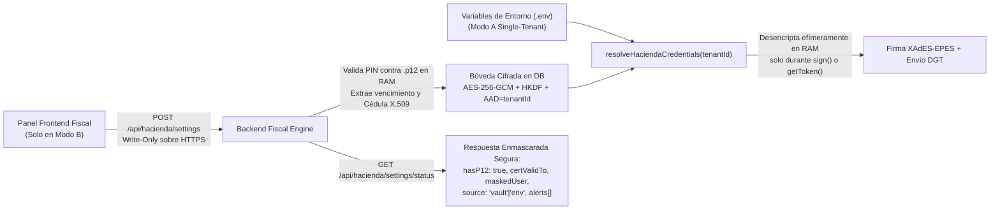

# 04 — Arquitecturas de Credenciales: Modo A (`.env` Backend) vs. Modo B (Bóveda Replicable Frontend `AES-256-GCM`)

Steven necesita soportar **dos modelos de despliegue** con el mismo motor fiscal sin reescribir la lógica de facturación:

1. **Modo A — Single-Tenant Backend-Only (`.env` / Secret Manager)**: Para un negocio único donde nadie cambia llaves desde la web; todo vive blindado del lado del servidor en variables de entorno.
2. **Modo B — Plantilla Replicable / SaaS Multi-Tenant (Configuración desde Frontend con Bóveda `AES-256-GCM`)**: Donde clonas el proyecto para un cliente nuevo (o das de alta organizaciones en un SaaS) y el dueño sube su `.p12`, su PIN, su usuario/contraseña de TRIBU-CR, sucursal y actividades económicas desde un panel de Configuración seguro **sin exponer jamás un solo byte sensible en `GET`, Redux, `localStorage` ni DevTools**.

La solución arquitectónica limpia es un **Resolvedor Unificado (`resolveHaciendaCredentials(tenantId)`)** con prioridad `vault -> env`.

---

## 1. Diagrama de Resolución Dual (`source: 'vault' | 'env'`)



---

## 2. Modo A: Single-Tenant Backend-Only (`.env` Puro)

Ideal para sistemas internos de una sola empresa donde quieres cero superficie de configuración en UI.

### Plantilla `.env.example` Completa (Modo A)

```dotenv
# ============================================================================
# MODO A: HACIENDA COSTA RICA v4.4 (SINGLE-TENANT BACKEND-ONLY)
# ============================================================================
HACIENDA_ENV=stag                                  # 'stag' (Pruebas TRIBU-CR) o 'prod' (Producción)
HACIENDA_PROVEEDOR_SISTEMAS=3101888777             # Cédula del emisor o de tu casa de software

# Identidad Fiscal del Emisor
HACIENDA_EMISOR_NOMBRE="NOVA SISTEMAS COSTA RICA SOCIEDAD ANONIMA"
HACIENDA_EMISOR_NOMBRE_COMERCIAL="Nova Sistemas CR"
HACIENDA_EMISOR_TIPO_ID=02                         # 01=Física, 02=Jurídica, 03=DIMEX, 04=NITE
HACIENDA_EMISOR_CEDULA=3101888777
HACIENDA_EMISOR_ACTIVIDAD=620101                   # 6 dígitos CIIU4 inscrito en TRIBU-CR
HACIENDA_EMISOR_CORREO=facturacion@novasistemas.cr
HACIENDA_EMISOR_TEL_PAIS=506
HACIENDA_EMISOR_TEL_NUMERO=22223333
HACIENDA_EMISOR_PROVINCIA=1
HACIENDA_EMISOR_CANTON=01
HACIENDA_EMISOR_DISTRITO=01
HACIENDA_EMISOR_BARRIO="Barrio Carmen"
HACIENDA_EMISOR_OTRAS_SENAS="Avenida Central, 200m Este del Parque"

# Numeración por Defecto
HACIENDA_SUCURSAL=001
HACIENDA_TERMINAL=00001

# Credenciales OAuth2 IdP (TRIBU-CR Comprobantes Electrónicos)
HACIENDA_IDP_USERNAME="cpj-3-101-888777@stag.comprobanteselectronicos.go.cr"
HACIENDA_IDP_PASSWORD="TU_PASSWORD_API_GENERADO_EN_TRIBU_CR"

# Llave Criptográfica (.p12): usa RUTA en servidor local o BASE64 en Cloud Run / Vercel / Railway
HACIENDA_P12_BASE64="MIIKpQIBAzCCCl8GCSqGSIb3DQEHAaCCC..."
# HACIENDA_P12_PATH="/etc/secrets/llave-tributaria.p12"
HACIENDA_P12_PIN="1234"

# Webhook Asíncrono (Opcional pero recomendado en Producción)
HACIENDA_CALLBACK_URL="https://api.tudominio.com/api/webhooks/hacienda"
```

> **Regla de Oro Modo A:** Ninguna variable empieza con `NEXT_PUBLIC_` ni `VITE_`. El archivo `.p12` nunca se commitea a Git (`.gitignore` debe bloquear `*.p12`, `*.pfx`, `*.pem`, `.env*`). En Cloud Run / Vercel / Railway pega el `.p12` convertido con `base64 -i llave.p12 | tr -d '\n'` dentro de `HACIENDA_P12_BASE64`.

---

## 3. Modo B: Sistema Replicable / Multi-Tenant con Bóveda Cifrada (`AES-256-GCM`)

Cuando duplicas el proyecto para un nuevo cliente y quieres configurar todo desde el Frontend sin tocar código ni re-desplegar variables de entorno:

### 3.1 Criptografía de Grado Bancario (`HKDF-SHA256` + `AES-256-GCM` + `AAD`)

Un solo secreto maestro de infraestructura vive en el servidor:
```dotenv
VAULT_MASTER_KEY="64_HEX_CHARS_O_32_BYTES_BASE64_GENERADO_CON_OPENSSL_RAND"
# Generar con: openssl rand -hex 32
```

¿Por qué `AES-256-GCM` con `HKDF` y `AAD` (Additional Authenticated Data) y **nunca** el `aes-256-cbc` de `CRLibre`?
1. **Derivación por Tenant (`HKDF-SHA256`)**: Cada organización (`tenantId`) deriva una sub-llave criptográfica única.
2. **IV aleatorio de 96 bits (`12 bytes`) por cada escritura**: Aunque dos clientes tengan el mismo PIN `"1234"`, el texto cifrado es radicalmente distinto.
3. **Autenticación Anti-Tampering (`GCM AuthTag 16 bytes` + `AAD = tenantId:fieldName`)**: Si alguien con acceso directo a la base de datos intenta copiar el blob cifrado del `.p12` del Cliente A y pegarlo en la fila del Cliente B, la desencriptación **falla matemáticamente** porque `AAD` vincula el cifrado a `tenantId` y al nombre del campo.

### 3.2 Implementación Lista para Producción (`vault-crypto.ts`)

```ts
import crypto from 'node:crypto';

export interface EncryptedEnvelope {
  v: 1;
  alg: 'AES-256-GCM';
  iv: string;   // Base64 (12 bytes)
  tag: string;  // Base64 (16 bytes)
  ct: string;   // Base64 ciphertext
}

function getMasterKey(): Buffer {
  const raw = process.env.VAULT_MASTER_KEY || '';
  if (!raw) throw new Error('Falta VAULT_MASTER_KEY en el entorno del servidor');
  const buf = /^[0-9a-fA-F]{64}$/.test(raw) ? Buffer.from(raw, 'hex') : Buffer.from(raw, 'base64');
  if (buf.length < 32) throw new Error('VAULT_MASTER_KEY debe tener al menos 32 bytes (256 bits)');
  return buf.subarray(0, 32);
}

function deriveTenantFieldKey(tenantId: string, fieldName: string): Buffer {
  return Buffer.from(
    crypto.hkdfSync(
      'sha256',
      getMasterKey(),
      Buffer.from(`hacienda-cr-v44:${tenantId}`, 'utf8'),
      Buffer.from(`field:${fieldName}`, 'utf8'),
      32
    )
  );
}

export function encryptSecret(plaintext: string | Buffer, tenantId: string, fieldName: string): EncryptedEnvelope {
  const key = deriveTenantFieldKey(tenantId, fieldName);
  const iv = crypto.randomBytes(12);
  const cipher = crypto.createCipheriv('aes-256-gcm', key, iv, { authTagLength: 16 });
  cipher.setAAD(Buffer.from(`${tenantId}:${fieldName}:v1`, 'utf8'));

  const input = Buffer.isBuffer(plaintext) ? plaintext : Buffer.from(plaintext, 'utf8');
  const ct = Buffer.concat([cipher.update(input), cipher.final()]);
  const tag = cipher.getAuthTag();
  key.fill(0); // Limpia sub-llave de RAM

  return {
    v: 1,
    alg: 'AES-256-GCM',
    iv: iv.toString('base64'),
    tag: tag.toString('base64'),
    ct: ct.toString('base64'),
  };
}

export function decryptSecretToBuffer(env: EncryptedEnvelope, tenantId: string, fieldName: string): Buffer {
  if (!env || env.v !== 1 || env.alg !== 'AES-256-GCM') {
    throw new Error(`Sobre criptográfico inválido en campo ${fieldName}`);
  }
  const key = deriveTenantFieldKey(tenantId, fieldName);
  try {
    const decipher = crypto.createDecipheriv('aes-256-gcm', key, Buffer.from(env.iv, 'base64'), { authTagLength: 16 });
    decipher.setAAD(Buffer.from(`${tenantId}:${fieldName}:v1`, 'utf8'));
    decipher.setAuthTag(Buffer.from(env.tag, 'base64'));
    return Buffer.concat([decipher.update(Buffer.from(env.ct, 'base64')), decipher.final()]);
  } finally {
    key.fill(0);
  }
}
```

---

## 4. Contrato API Write-Only para el Frontend (Seguridad Cero Fugas)

### Reglas Inquebrantables del Panel de Configuración Fiscal:

1. **Validación atómica al guardar (`POST /api/hacienda/settings`)**:
   - Cuando el usuario sube el archivo `.p12` y escribe el `PIN` de 4 dígitos, el backend **abre el `.p12` en RAM en ese mismo milisegundo** usando `extractKeyPairFromP12(p12Buffer, pin)`.
   - Si el PIN es incorrecto -> responde `HTTP 422` inmediato (`"El PIN ingresado no corresponde a esta Llave Criptográfica .p12"`). Nunca se guarda basura en la bóveda.
   - Extrae del certificado X.509: `subject`, `serialNumber`, `validFrom`, `validTo` y comprueba que la cédula del certificado coincida con la cédula del Emisor configurada. Si no coinciden -> bloquea el guardado con mensaje claro.
   - Opcionalmente (`verifyIdpNow: true`), prueba un `grant_type=password` contra el IdP (`rut-stag` o `rut`) para confirmar que el usuario y contraseña de TRIBU-CR también son válidos antes de guardar.
2. **Actualizaciones parciales sin borrar secretos**:
   - Si el administrador entra mañana a cambiar solo el teléfono comercial o agregar una sucursal `002`, deja en blanco los inputs de `.p12`, `PIN` e `IdP Password`; el backend conserva los sobres `EncryptedEnvelope` existentes en la bóveda.
3. **Lectura 100% Enmascarada (`GET /api/hacienda/settings/status`)**:
   - El endpoint `GET` **JAMÁS desencripta ni devuelve** `p12Base64`, `pin` ni `idpPassword`.
   - Devuelve únicamente metadatos públicos y de salud para poblar la interfaz:

```json
{
  "configured": true,
  "source": "vault",
  "environment": "stag",
  "emisor": {
    "nombre": "NOVA SISTEMAS COSTA RICA S.A.",
    "nombreComercial": "Nova Sistemas CR",
    "tipoIdentificacion": "02",
    "numeroIdentificacion": "3101888777",
    "codigoActividadPrincipal": "620101",
    "actividadesSecundarias": ["620200"],
    "sucursalDefault": "001",
    "terminalDefault": "00001",
    "correo": "facturacion@novasistemas.cr"
  },
  "credentialsHealth": {
    "hasP12": true,
    "hasPin": true,
    "hasIdpPassword": true,
    "idpUsernameMasked": "cpj-3-101-***777@stag.comprobanteselectronicos.go.cr",
    "certSubject": "CN=NOVA SISTEMAS COSTA RICA S.A., SERIALNUMBER=CPJ-3-101-888777",
    "certValidFrom": "2026-11-13T00:00:00.000Z",
    "certValidTo": "2028-11-13T00:00:00.000Z",
    "certDaysRemaining": 730,
    "certAlertLevel": "OK",
    "lastVerifiedAt": "2026-11-13T22:45:00.000Z"
  }
}
```

### Controles Adicionales de Seguridad en Modo B
- **RBAC Estricto**: Solo roles `OWNER` o `FISCAL_ADMIN` autenticados pueden hacer `POST /api/hacienda/settings`. Un rol `CASHIER` o `SALES_AGENT` puede emitir facturas (el servidor lee la bóveda internamente), pero no puede modificar ni exportar credenciales.
- **Bitácora de Auditoría Inmutable (`fiscal_vault_audit_log`)**: Registra `actorUserId`, `ip`, `userAgent`, `timestamp`, `action` (`ROTATE_P12`, `SWITCH_ENV_TO_PROD`, `UPDATE_IDP_CREDENTIALS`) y huella `sha256` pública del certificado cargado, sin guardar jamás el PIN ni la llave privada en logs.
- **Cambio de `stag` a `prod` separado**: En la bóveda conviene guardar dos ranuras independientes (`credentials.stag` y `credentials.prod`) y un selector `activeEnvironment: 'stag' | 'prod'`, para que puedas hacer pruebas en Sandbox en cualquier momento sin sobrescribir tus credenciales de Producción.
