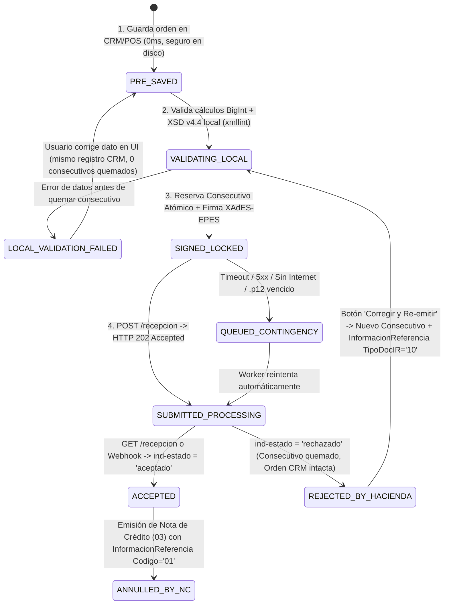

# 05 — Lógica Bancaria, Pre-Guardado Anti-Pérdida, Manejo de Rechazos, Alertas de Obsolescencia y Diccionario UX

Este documento implementa exactamente la arquitectura de resiliencia financiera solicitada por Steven: **ninguna venta o registro del CRM se pierde ni se borra jamás**, los rechazos de Hacienda quedan auditados con historial de intentos, el sistema avisa visualmente cuando algo está vencido o desactualizado en Hacienda, y los errores crudos en XML se traducen a instrucciones claras para humanos.

---

## 1. Ley de Hierro #1: Patrón Pre-Guardado + Transactional Outbox (Cero Pérdida de Datos)

**El pecado mortal de los sistemas contables amateurs:** Hacer `POST /recepcion` a Hacienda **antes** de guardar la venta/orden en la base de datos del CRM/POS, o hacer `ROLLBACK` / borrar la factura local cuando Hacienda responde `rechazado` o da timeout.

### Separación de Dos Entidades en tu Base de Datos

Siempre separa la **Orden Comercial (CRM/POS)** del **Intento de Comprobante Fiscal (Hacienda)**:

1. **`crm_orders` / `sales_invoices` (Registro Comercial Permanente — NUNCA SE BORRA)**:
   - Se guarda en milisegundo 1 con estado comercial `CONFIRMED` y estado fiscal `PRE_SAVED`.
   - Tiene un `idempotency_key` único generado desde el botón de cobro del Frontend (para que doble clic del cajero jamás duplique la venta ni queme dos consecutivos).
2. **`fiscal_documents` + `fiscal_attempts` (Historial Fiscal Inmutable)**:
   - Cada vez que se emite un comprobante para esa orden, se crea un registro en `fiscal_documents` con su `clave` (50 dígitos), `consecutivo` (20 dígitos), `unsigned_xml`, `signed_xml`, `hacienda_status` y su arreglo/tabla `fiscal_attempts[]`.

---

## 2. Máquina de Estados Bancaria del Comprobante



### Reglas Fiscales Críticas sobre Consecutivos y Rechazos

1. **Si falla en `VALIDATING_LOCAL` (antes de enviar a Hacienda)**:
   - Como validamos contra los 10 XSD oficiales localmente **antes** de asignar el consecutivo definitivo (o antes de transmitir), si falta un CABYS o un correo está mal escrito, **no quemas ningún consecutivo** y el usuario corrige al instante.
2. **Si Hacienda devuelve `REJECTED_BY_HACIENDA` (`ind-estado: "rechazado"`)**:
   - **PROHIBIDO reutilizar ese `NumeroConsecutivo` o esa `Clave`**: Hacienda ya registró esa clave como rechazada; si la vuelves a enviar corregida con el mismo consecutivo, Hacienda te responderá `HTTP 400: El comprobante ya fue recibido anteriormente`.
   - **PROHIBIDO borrar la fila rechazada**: Debe quedar guardada en `attemptHistory[]` con su XML enviado y el `MensajeHacienda` del rechazo para auditoría contable.
   - **Cómo se re-emite legalmente (1 clic en tu UI)**:
     - El usuario edita el campo erróneo en la Orden Pre-Guardada del CRM (ej. corrige la Actividad Económica del Receptor o el CABYS) y pulsa **"Corregir y Re-emitir a Hacienda"**.
     - El motor toma el **siguiente consecutivo disponible** (ej. pasa del `42` rechazado al `43`) y agrega automáticamente en el nuevo XML un nodo `<InformacionReferencia>`:
       ```xml
       <InformacionReferencia>
         <TipoDocIR>10</TipoDocIR>
         <Numero>50613112600310188877700100001010000000042168916456</Numero>
         <FechaEmisionIR>2026-11-13T16:45:12-06:00</FechaEmisionIR>
         <Codigo>04</Codigo>
         <Razon>Sustituye comprobante rechazado por el Ministerio de Hacienda</Razon>
       </InformacionReferencia>
       ```
     - De esta forma, la contabilidad tiene trazabilidad perfecta: Orden `#1005` -> Intento #1 (`Consecutivo 42`, Rechazado + motivo) -> Intento #2 (`Consecutivo 43`, Aceptado, referenciando al `42`).
3. **Si una factura ya fue `ACCEPTED` y hay que anularla**:
   - **PROHIBIDO borrar o editar una factura aceptada**. La única forma legal en Costa Rica de anular total o parcialmente una factura aceptada es emitir una **Nota de Crédito Electrónica (`NC`, tipo `03`)** con `<InformacionReferencia>` apuntando a la `Clave` de 50 dígitos de la factura original (`TipoDocIR="01"`, `Codigo="01"` *"Anula documento de referencia"*).

---

## 3. Bloqueo Atómico de Consecutivos (Cero Colisiones en Alta Concurrencia)

Si dos vendedores cobran al mismo milisegundo en la misma sucursal y terminal, sin bloqueo transaccional ambos leerían `secuencia = 41` y generarían dos facturas distintas con `secuencia = 42` (la segunda será rechazada por clave duplicada).

### Opción PostgreSQL / Supabase (`SELECT ... FOR UPDATE`)

```sql
CREATE TABLE fiscal_sequences (
  tenant_id TEXT NOT NULL,
  environment TEXT NOT NULL CHECK (environment IN ('stag', 'prod')),
  cedula_emisor TEXT NOT NULL,
  sucursal CHAR(3) NOT NULL,
  terminal CHAR(5) NOT NULL,
  tipo_doc CHAR(2) NOT NULL,
  last_val BIGINT NOT NULL DEFAULT 0,
  updated_at TIMESTAMPTZ NOT NULL DEFAULT NOW(),
  PRIMARY KEY (tenant_id, environment, cedula_emisor, sucursal, terminal, tipo_doc)
);

-- Reserva atómica en 1 sola sentencia serializada por fila:
INSERT INTO fiscal_sequences (tenant_id, environment, cedula_emisor, sucursal, terminal, tipo_doc, last_val)
VALUES ($1, $2, $3, $4, $5, $6, 1)
ON CONFLICT (tenant_id, environment, cedula_emisor, sucursal, terminal, tipo_doc)
DO UPDATE SET last_val = fiscal_sequences.last_val + 1, updated_at = NOW()
RETURNING last_val;
```

### Opción Cloud Firestore (`db.runTransaction`)

```ts
export async function nextConsecutivoFirestore(db: FirebaseFirestore.Firestore, params: {
  tenantId: string; env: 'stag' | 'prod'; cedula: string; sucursal: string; terminal: string; tipoCodigo: string;
}): Promise<number> {
  const docId = `${params.env}_${params.cedula}_${params.sucursal}_${params.terminal}_${params.tipoCodigo}`;
  const ref = db.collection('tenants').doc(params.tenantId).collection('fiscal_sequences').doc(docId);

  return db.runTransaction(async (tx) => {
    const snap = await tx.get(ref);
    const nextVal = (snap.exists ? Number(snap.data()?.lastVal || 0) : 0) + 1;
    tx.set(ref, { lastVal: nextVal, updatedAt: new Date().toISOString() }, { merge: true });
    return nextVal;
  });
}
```

---

## 4. Archivo Legal por 5 Años (Código de Normas y Procedimientos Tributarios, Art. 109)

La ley costarricense exige conservar durante **mínimo 5 años** (en almacenamiento inmutable como S3 / GCS / R2 + referencia en DB) los **3 artefactos originales** de cada comprobante emitido y recibido:
1. **XML del Comprobante Firmado (`XAdES-EPES`)** enviado a Hacienda.
2. **XML de `MensajeHacienda`** (`respuesta-xml` decodificado de Base64, firmado digitalmente por el Ministerio de Hacienda — ¡ese XML es la prueba legal de aceptación, no el PDF!).
3. **Representación Gráfica (PDF)** con código QR que apunte al validador/clave y la leyenda obligatoria: *"Autorizado mediante la resolución general N° MH-DGT-RES-0027-2024 del 13 de noviembre del 2024 de la Dirección General de Tributación"*.

---

## 5. Centinela Visual de Obsolescencia Normativa y Alertas Preventivas

Steven pidió explícitamente: *"incluso si hay algo desactualizado y se está rechazando porque está desactualizado algo, que tire alertas visuales"*.

Implementa un componente superior **`<FiscalHealthBanner />`** en tu CRM/ERP alimentado por dos fuentes:

### Fuente A: Chequeo Proactivo (`preflight-and-drift-sentinel.mjs` / Cron Diario)
1. **Deriva de Política Criptográfica DGT (`POLICY_HASH_DRIFT`)**: Si el PDF de política en el CDN de Hacienda cambia su hash `SHA-256` respecto a `DWxin1xWOeI8OuWQXazh4VjLWAaCLAA954em7DMh0h8=`, muestra alerta **Roja de Actualización Normativa**: *"El Ministerio de Hacienda publicó una nueva versión del documento de Política de Firma Digital. Actualiza la constante `POLICY_V44` antes de emitir."*
2. **Vencimiento de Llave Criptográfica `.p12` (`CERT_EXPIRING` / `CERT_EXPIRED`)**: Alerta amarilla a 30 días, naranja a 14 días, roja a 0 días.
3. **Salud de Servidores TRIBU-CR (`HACIENDA_OUTAGE`)**: Si `idp` o `api` dan timeout o `503`, activa automáticamente banner **Modo Contingencia Activo**: *"Servidores del Ministerio de Hacienda presentan intermitencia. Tus ventas se están pre-guardando de forma segura y se transmitirán en segundo plano apenas Hacienda restablezca el servicio."*

### Fuente B: Detector Reactivo de Obsolescencia por Patrón de Rechazo
Si `MensajeHacienda` o `X-Error-Cause` contiene cualquiera de estos patrones, el sistema dispara un **Banner Visual de Catálogo / Esquema Desactualizado** en lugar de un error genérico:

| Patrón Detectado en Respuesta de Hacienda | Alerta Visual User-Friendly + Botón de Acción |
|---|---|
| `namespace` / `version` / `esquema` / `schema` / `4.4` | **Alerta Roja — Esquema XML Desactualizado:** *"Hacienda rechazó la estructura del XML por cambio de versión normativa. Tu venta sigue guardada; revisa actualización de esquemas XSD."* |
| `CABYS` / `cabys` / `tarifa` no corresponde al código | **Alerta Ámbar — Catálogo CABYS Actualizado por Hacienda:** *"El código CABYS de uno de los productos cambió de tarifa o fue reclasificado por Hacienda/BCCR. Pulsa 'Sincronizar CABYS en Vivo' para actualizar el producto y re-emitir."* |
| `actividad` / `CIIU` / `no inscrita` / `CodigoActividad` | **Alerta Ámbar — Actividad Económica Desactualizada en TRIBU-CR:** *"La actividad económica enviada ya no coincide con el padrón actual en TRIBU-CR (pudo migrar a CIIU4). Pulsa 'Consultar Padrón Hacienda' para refrescar actividades automáticamente."* |
| `certificado` / `revocado` / `vencido` / `firma` / `politica` | **Alerta Roja — Llave Criptográfica `.p12` Vencida o Revocada:** *"Hacienda rechazó la firma digital porque el certificado `.p12` venció o fue revocado en TRIBU-CR. Tu registro comercial está intacto; sube tu nueva llave `.p12` en Configuración Fiscal y pulsa Re-emitir."* |
| `Exoneracion` / `EXONET` / `vencida` | **Alerta Ámbar — Carta de Exoneración Vencida:** *"El documento de exoneración del cliente ya venció en EXONET o no cubre este código CABYS."* |
| `moroso` / `omiso` / `desinscrito` (Receptor) | **Alerta Informativa — Estado Tributario del Receptor:** *"El cliente receptor figura como desinscrito o sin actividad válida para crédito fiscal. Puedes cambiar el comprobante a Tiquete Electrónico (TE) o actualizar su cédula."* |

---

## 6. Diccionario Traductor de Errores Crudos DGT -> Español Amigable (`dgt-error-humanizer`)

Nunca muestres al cajero o contador un bloque XML crudo ni un código `cvc-complex-type.2.4.a`. Usa una función traductora determinista que devuelva:
- `severity`: `'warning' | 'error' | 'obsolescence'`
- `title`: Título claro en español (máx. 70 chars)
- `friendlyMessage`: Explicación sencilla de qué pasó y tranquilidad explícita (*"Tu venta está pre-guardada y no se perdió"*)
- `suggestedAction`: Paso concreto que resuelve el problema
- `canRetrySameClave`: `boolean` (`true` si fue falla de red/token y se reintenta la misma clave; `false` si Hacienda rechazó el contenido y hay que usar el botón *"Corregir y Re-emitir con nuevo consecutivo"*).

> La implementación completa y probada de este traductor + centinela se incluye lista para copiar en `sandbox-v44/dgt-error-humanizer.mjs`.
