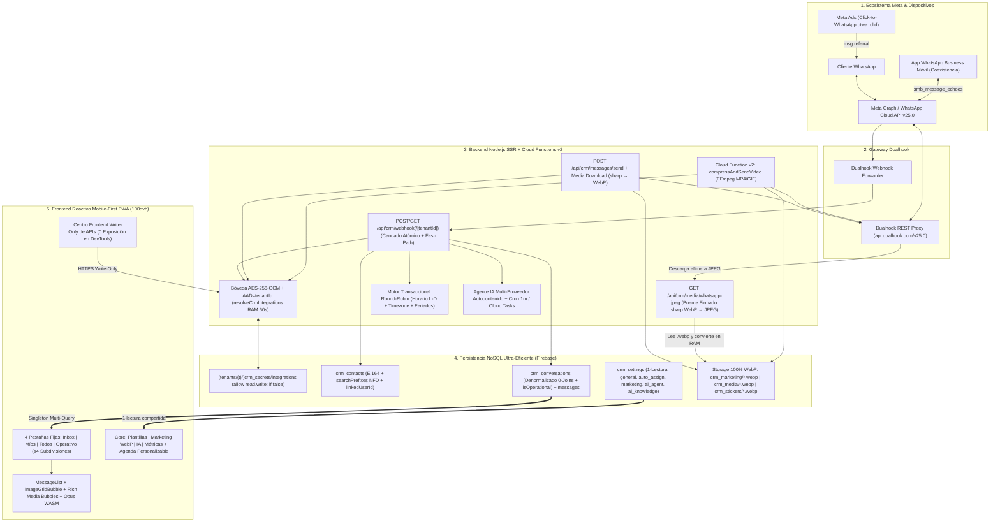

# Protocolo Maestro Universal v5.2: CRM Omnicanal Modular Sellable + Suite Comercial Activable + Facturación Hacienda CR v4.4 (`steven-waba-dualhook-connection`)

Este skill define el estándar completo e **100% autocontenido** de ingeniería de producción para diseñar, aprovisionar desde terminal, construir desde **carpeta vacía (`crm-from-scratch`)**, expandir mediante **2 ramas GitHub (`demo` → `main` Multi-Cliente)** reutilizando al 100% las mismas `firestore.rules`, `storage.rules` e `firestore.indexes.json`, operar como **App Autónoma por Cliente, Módulo Integrado o SaaS Multi-Tenant**, y auditar un **CRM Omnicanal** sobre **WhatsApp Dualhook (`https://api.dualhook.com/v25.0`, Coexistencia `smb_message_echoes`)** + **Instagram Direct & Facebook Messenger nativos (`https://graph.facebook.com/v25.0`)**.

> [!TIP]
> **Ecosistema Opcional de Aceleradores (`steven-*`)**: Esta skill funciona de manera completamente autónoma por sí sola (ideal incluso si se entrega o vende aislada en `.zip`). Si en el entorno también existen `steven-firebase-client-bootstrap`, `steven-module-architect`, `steven-rbac-invitations-licensing`, `steven-whitelabel-theming-banners`, `steven-meta-omnichannel-identity`, `steven-project-deploy` o `steven-brd-docs-bootstrap`, úsalos como aceleradores complementarios sin romper nunca la autonomía aquí documentada.

---

## 0. FASE 0 AUTOMATIZADA (`CLI + REST PROVISIONING`): Bootstrap de Proyecto Firebase, APIs, App Check & Claims Día 0

> [!CAUTION]
> **REGLA DE HIERRO — PROHIBIDO ESCRIBIR CÓDIGO SIN INFRAESTRUCTURA LISTA (`Blaze + Native + Auth + Storage + App Check`)**:
> Este CRM **NO** funciona sobre bases de datos SQL (PostgreSQL, MySQL, Supabase), ni sobre *Firestore in Datastore Mode*, ni con exportación estática (`output: 'export'`), ni en Cloudflare Edge Runtime puro, ni en el plan gratuito **Spark** de Firebase (bloquea egress hacia Dualhook/Meta/IA y Cloud Functions v2).
> **En lugar de obligar al usuario a configurar pantalla por pantalla en la consola Firebase, el agente EJECUTA primero el aprovisionador automatizado incluido en esta skill:**
> ```bash
> node scripts/provision-firebase-crm.mjs --project <PROJECT_ID> --region nam5 --owner-email <TU_CORREO_DEV> [--dry-run]
> ```

### 0.1 Qué Automatiza `scripts/provision-firebase-crm.mjs` vs Qué Requiere 1 Clic Humano Irreducible
1. **Automatizado al 100% por CLI/REST (`gcloud` + `firebase-tools` + REST APIs oficiales):**
   - Crea o vincula el `<PROJECT_ID>` y habilita todas las APIs requeridas: `firestore.googleapis.com`, `identitytoolkit.googleapis.com`, `firebasestorage.googleapis.com`, `cloudfunctions.googleapis.com`, `cloudbuild.googleapis.com`, `artifactregistry.googleapis.com`, `run.googleapis.com`, `firebaseappcheck.googleapis.com`, `secretmanager.googleapis.com`.
   - Crea la base Cloud Firestore `(default)` en modo **`FIRESTORE_NATIVE`** en la región elegida (`nam5`, `us-central1`, `southamerica-east1`, etc.).
   - Registra la **Web App SDK** en Firebase y exporta las claves públicas `NEXT_PUBLIC_FIREBASE_*` hacia `.env.local.generated` (más plantilla `.env.example` limpia).
   - Configura **Firebase App Check** (reCAPTCHA v3 / Enterprise si se pasa `--recaptcha-site-key` o deja el bloque listo con TTL 1h).
   - Realiza el seed atómico Día 0 en Firestore Admin SDK: documento inicial **`crm_system/tenant_license`**, documento **`crm_settings/branding`**, documento **`crm_settings/announcements`** y asignación del Custom Claim **`{ platformDev: true }`** al correo del desarrollador (`--owner-email`) + registro en `deploy/clients.manifest.json`.
2. **Únicos pasos donde Google exige acción humana en UI (con link directo si falla o falta):**
   - **Cuenta de Facturación (`Blaze`)**: Si el proyecto nuevo no tiene Billing Account asociada (`--billing-account`), Google requiere vincular tarjeta en `https://console.firebase.google.com/project/{PROJECT_ID}/usage/details` (se recomienda presupuesto de alerta de `$5–$10 USD`).
   - **Activar Bucket Default de Storage + OAuth Consent Screen (Google Sign-In)**: Si la API responde que Storage aún no fue inicializado en consola o el cliente OAuth Google pide consentimiento, se entrega el link directo exacto de `{PROJECT_ID}` y luego se re-verifica.

### 0.2 Matriz Obligatoria de Pre-Flight Verificado (`7/7 ✅`)
Antes de escribir la Fase 1 de aplicación, imprime el tablero tras correr `scripts/provision-firebase-crm.mjs`:

```markdown
### 🛡️ Pre-Flight Automatizado de Infraestructura Firebase (`{PROJECT_ID}`)
1. [✅/❌] Proyecto Firebase creado/vinculado + APIs Cloud habilitadas (`scripts/provision-firebase-crm.mjs`)
2. [✅/❌] Plan de facturación **Blaze** activo → https://console.firebase.google.com/project/{PROJECT_ID}/usage/details
3. [✅/❌] Cloud Firestore `(default)` en modo **`FIRESTORE_NATIVE`**
4. [✅/❌] Authentication con **Email/Password** y **Google Sign-In** habilitados → https://console.firebase.google.com/project/{PROJECT_ID}/authentication/providers
5. [✅/❌] Cloud Storage bucket default inicializado (`gs://{BUCKET}`)
6. [✅/❌] App Web SDK (`NEXT_PUBLIC_FIREBASE_*`) + **Firebase App Check** registrados
7. [✅/❌] Custom Claim **`platformDev: true`** asignado + **`crm_system/tenant_license`** sembrado
```

> **Compuerta de Desbloqueo**: Solo cuando las 7 filas marquen **`✅`** avanza a **Fase 0.5** o **Fase 1**.

---

## 0.5 FASE 0.5 OBLIGATORIA: Wizard Interactivo Paso a Paso de 4 Rondas (`ask_question`) Antes de Codificar

> [!IMPORTANT]
> **PROTOCOLO INTERACTIVO OBLIGATORIO ANTES DE ESCRIBIR O MODIFICAR CÓDIGO**:
> Al completar Pre-Flight (o al iniciar una expansión/nuevo cliente), el agente **DEBE** invocar `ask_question` paso a paso en **4 Rondas claras y ordenadas** (esperando respuesta del usuario entre rondas) para fijar infraestructura Git, canales Meta, modo de POS, diseño White-Label, dominio de correos, licenciamiento `/developer`, **módulos comerciales activables según el plan del cliente** y **frontera estricta del Agente IA** antes de generar código:

#### Ronda 1 — Proyecto, Topología GitHub (`demo` → `main`) & Base Multicliente
```json
{
  "questions": [
    {
      "question": "1/3 · ¿Cómo se desplegará y clonará este proyecto en GitHub + Firebase?",
      "is_multi_select": false,
      "options": [
        "(Recommended) Flujo 2-Ramas Sellable: rama 'demo' (auto-deploy a Firebase Demo/Pruebas) -> PR a 'main' (deploy masivo a cada cliente en deploy/clients.manifest.json reciclando las mismas Rules e Índices)",
        "Rama única dedicada a 1 solo cliente en App Hosting / Cloud Run",
        "Plataforma SaaS Multi-Tenant (1 proyecto Firebase compartido bajo tenants/{tenantId}/...)"
      ]
    },
    {
      "question": "2/3 · ¿Qué región de Firestore & Cloud Functions deseas usar para el proyecto?",
      "is_multi_select": false,
      "options": [
        "(Recommended) nam5 / us-central1 (EE. UU. multi-región — menor latencia hacia Meta Graph, Dualhook y Gemini)",
        "southamerica-east1 (São Paulo)",
        "europe-west1 (Bélgica)"
      ]
    },
    {
      "question": "3/3 · ¿Cuál modo operativo aplica en esta sesión?",
      "is_multi_select": false,
      "options": [
        "(Recommended) Construir / Actualizar CRM Completo desde Cero o Base Maestra",
        "Solo provisionar un nuevo cliente (nuevo Firebase Project + Seed + Manifest)",
        "Auditoría Forense + Mejora sobre un repositorio CRM existente"
      ]
    }
  ]
}
```

#### Ronda 2 — Canales Meta Omnicanal, Punto de Venta (POS) & Estudio Visual White-Label
```json
{
  "questions": [
    {
      "question": "1/3 · ¿Qué canales de mensajería y fuentes omnicanal tendrá activos el CRM?",
      "is_multi_select": true,
      "options": [
        "(Recommended) WhatsApp Business vía Dualhook v25.0 (Modo Coexistencia App Móvil + Cloud API)",
        "(Recommended) Instagram Direct + Comentarios DM vía Meta Graph v25.0 (Auto-Discovery 1-Token)",
        "(Recommended) Facebook Messenger (Meta Graph v25.0) con Unificación de Identidad 360° (WA + IG + FB)",
        "Solo WhatsApp Business sin redes sociales Meta"
      ]
    },
    {
      "question": "2/3 · ¿Qué modalidad de Punto de Venta (POS) y herramientas operativas se incluirán?",
      "is_multi_select": false,
      "options": [
        "(Recommended) Modo A: POS Nativo Standalone en Firestore (Catálogo, carrito, cotizaciones, facturas, abonos y PDF) + Agenda/Notas",
        "Modo B1 (Costa Rica Nativo v4.4): Emisión directa TRIBU-CR / DGT v4.4 en Node.js puro con firma XAdES-EPES (.p12), XSD offline, Outbox PRE_SAVED y conversión TE -> NC + FE",
        "Modo B2: POS Integrado con ERP Fiscal externo (Alegra / DIAN / SAT) + mapeo 1-a-1 de vendedores",
        "Modo C: POS Híbrido conectado a Webhook / API REST propio",
        "Sin POS (solo mensajería omnicanal, etiquetas, directorio y agenda opcional)"
      ]
    },
    {
      "question": "3/3 · ¿Qué paleta inicial del Estudio White-Label (--primary/--secondary/--tertiary) e iconografía deseas activar?",
      "is_multi_select": false,
      "options": [
        "(Recommended) Sky Slate (#38BDF8 + Esmeralda) con Studio en vivo de 8 paletas e íconos @phosphor-icons/react Duotone",
        "Emerald Executive (#10B981 + Slate) con Studio en vivo de 8 paletas e íconos @phosphor-icons/react",
        "Obsidian Luxe / Custom (el admin del cliente subirá su logo WebP y elegirá primario/secundario/terciario desde Frontend)"
      ]
    }
  ]
}
```

#### Ronda 3 — Dominio de Correos, Licenciamiento `/developer` & Copiloto IA Gratuito
```json
{
  "questions": [
    {
      "question": "1/3 · ¿Cómo se enviarán los correos de invitación profesional a usuarios de cada cliente?",
      "is_multi_select": false,
      "options": [
        "(Recommended) Subdominio de Agencia listo en 0 min (ej. notificaciones@mail.<tu-agencia>.com + Reply-To al admin del cliente) con opción por cliente a subdominio propio",
        "Subdominio propio dedicado del cliente (ej. notificaciones@notify.<dominio-cliente>.com vía Resend Domains API + SPF/DKIM/DMARC)",
        "Solo links manuales de invitación sin envío SMTP/Resend automático"
      ]
    },
    {
      "question": "2/3 · ¿Cómo gestionarás las suscripciones y encendido/apagado de módulos por cliente?",
      "is_multi_select": false,
      "options": [
        "(Recommended) Híbrido: Panel /developer protegido por platformDev Claim (interruptores en vivo) + endpoint HMAC /api/crm/system/license-webhook listo para Stripe/Tilopay/Paddle",
        "Control manual exclusivo desde Panel /developer + botón externo de cobro/portal",
        "Todos los módulos activos sin restricción por suscripción (Single-Client perpetuo)"
      ]
    },
    {
      "question": "3/3 · ¿Qué opciones de IA Comercial y Asistencia Interna deseas activar?",
      "is_multi_select": true,
      "options": [
        "(Recommended) Guardrails en Bot Clientes: Lectura OGG, Pin GPS 1.ª persona y bloqueo de cotización de instalación/mano de obra",
        "(Recommended) Copiloto IA de Ayuda Interna en Capa Gratuita (gemini-2.5-flash-lite leyendo *_ai_agent_docs filtrados por rol, 30 consultas/día)",
        "(Recommended) Banner Global estilo Jira + Drawer Whats New conectado a /config/app_version"
      ]
    }
  ]
}
```

#### Ronda 4 — Módulos Comerciales Activables por Plan (Entregas Locales, Catálogo/Excel/Web, B2B/Precios/Caja) & Frontera del Agente IA
```json
{
  "questions": [
    {
      "question": "1/3 · ¿Cómo operará el módulo de Entregas, Visitas Técnicas, Proyectos Multi-Día y Garantías?",
      "is_multi_select": false,
      "options": [
        "(Recommended) Modo 100% Local en el CRM (Firestore SSOT autónomo con folios ETG/VIS/PROY/GAR, calendario/tabla y ruteo GPS sin sistemas externos)",
        "Modo Híbrido: Operación Local en el CRM + Conector API/Webhook hacia plataforma logística externa (ExternalLogisticsAdapter)",
        "Desactivado en el plan inicial del cliente (enabledModules.scheduling = false)"
      ]
    },
    {
      "question": "2/3 · ¿Qué módulos extra de Catálogo, Web, Precios, Mayoristas y Caja deseas activar según el plan del cliente?",
      "is_multi_select": true,
      "options": [
        "(Recommended) Catálogo Maestro (catalog_master): SKUs, márgenes, Plantillas Excel (.xlsx), Actualización en 3 Pasos y Hoja Masiva 100% ERP-agnóstica",
        "(Recommended) Exposición en Catálogo Web (web_catalog) + Bandeja Dual de Prospectos Web B2B/B2C (web_leads)",
        "Escalas de Descuento B2C + Aprobación Gerencial Inline en Campana + Web Push FCM (pricing_approvals)",
        "Portal Mayorista B2B Autoservicio (/portal-distribuidores sin Auth externo, 6 bandas y borradores POS B2B-XXXX)",
        "Links de Pago en el Chat + Control de Caja Física Bimoneda + Conciliación de Transferencias/SINPE (cash_reconciliation)"
      ]
    },
    {
      "question": "3/3 · ¿Cómo se configurará el Prompt y las Reglas de Dominio del Agente IA Comercial?",
      "is_multi_select": false,
      "options": [
        "(Recommended) Prompt White-Label limpio para este negocio + Veto Estricto de Mundo Cerrado (PROHIBIDO responder temas ajenos al negocio o fuera de la documentación oficial; Notas Inteligentes consolidadas 2h + Prefix Caching -90% + Ventana Consciente de Madrugada)",
        "Solo Asistente Interno de Ayuda (Bot de WhatsApp para clientes apagado inicialmente: deploymentMode = 'off')"
      ]
    }
  ]
}
```

### Matriz de Reacción Automática tras Completar las 4 Rondas:
1. **Ronda 1 (`demo` → `main`)**: Crea `deploy/clients.manifest.json`, `.github/workflows/deploy-demo.yml` y `.github/workflows/deploy-clients.yml` reusando idénticamente `firestore.rules`, `storage.rules` y `firestore.indexes.json` ([Blueprint 10](./references/10-new-module-extension-and-multiclient-ops.md)).
2. **Ronda 2 (`IG + FB + Identity Merge` + `Theme Studio`)**: Implementa adaptadores nativos `meta-social-client.ts`, auto-discovery de 1 token (`/api/crm/admin/meta-social/discover`), `resolveOmnichannelContact(channelKeys)` y fusión 360° ([Blueprint 07](./references/07-meta-omnichannel-ig-messenger-identity.md)), más `ThemeInjectorProvider` + `SettingsBranding` + `<AppIcon />` con `@phosphor-icons/react` ([Blueprint 09](./references/09-global-banners-theming-and-help-copilot.md)).
3. **Ronda 2 (`POS Modo A/B1/B2/C`)**: Construye la UI universal del POS (multiplicador `+1/+5/+10`, borradores Cloud `crm_pos_drafts`, match `100% E.164`, despacho PDF `<24h` y `>24h`) conectada al adaptador elegido: `FirestoreNativePosAdapter` (`Modo A`), `HaciendaCrNativePosAdapter` (`Modo B1`, ejecutando [Blueprint 11](./references/11-hacienda-cr-v44-pos-fiscal-engine.md) + `./scripts/sign-and-validate-v44.mjs` + `./resources/xsd/v4.4/`), `ErpFiscalPosAdapter` (`Modo B2`, activando la cápsula de Ledger de Stock e idempotencia de [Blueprint 06 Sección 10](./references/06-pos-point-of-sale-global-spec.md)) o `CustomWebhookPosAdapter` (`Modo C`).
4. **Ronda 3 (`Subdomain Invites` + `/developer` + `Help Copilot`)**: Genera `SettingsRolesBuilder`, `crm_invitations` SHA-256 72h, `/accept-invite`, `/developer` + `crm_system/tenant_license` + webhook HMAC ([Blueprint 08](./references/08-rbac-roles-branded-invites-and-licensing.md)), `GlobalAnnouncementBanner` + `/config/app_version` + `POST /api/crm/help-copilot/ask` sobre `*_ai_agent_docs` ([Blueprint 09](./references/09-global-banners-theming-and-help-copilot.md)).
5. **Ronda 4 (`Entregas Locales`, `Catálogo/Excel/Web`, `Add-Ons B2B/Precios/Caja` & `IA Mundo Cerrado`)**:
   - Si activa Entregas/Proyectos: despliega la suite `100%` local con folios `ETG/VIS/PROY/GAR` y ruteo GPS/OSRM ([Blueprint 12](./references/12-local-deliveries-agenda-projects-spec.md)), agregando `ExternalLogisticsAdapter` solo si eligió modo híbrido.
   - Si activa Catálogo Maestro / Web: despliega `catalogProducts` + `web_catalog` (`writeBatch` dual), plantillas `.xlsx`, asistente de 3 pasos y hoja masiva ([Blueprint 13](./references/13-master-catalog-web-exposure-excel-engine.md)).
   - Enciende en `crm_system/tenant_license.enabledModules` únicamente los add-ons seleccionados (`pricing_approvals`, `b2b_wholesale_portal`, `web_leads`, `cash_reconciliation` — [Blueprint 14](./references/14-modular-addons-pricing-b2b-webleads-pwa.md)) e inyecta la Constitución White-Label de Mundo Cerrado (`Closed-World SSOT Veto`) en el Agente IA ([Blueprint 04 Secciones 12–13](./references/04-ai-automations-5-subtabs-spec.md)).

---

## 1. Modos de Operación, Topologías de Montaje y Orquestador Desde Cero (`crm-from-scratch`)

### 1.1 Los 3 Modos de Ejecución del Skill
1. **MODO A — Construcción Determinística Desde Cero (`Greenfield / crm-from-scratch`)**: Ejecuta primero la **Fase 0 Bloqueante (`6/6 ✅` en Sección 0)** y luego construye secuencialmente en **8 Fases Verificables** todo el CRM listo para clonar, conectar a Firebase y configurar llaves desde el Frontend sin tocar código.
2. **MODO B — Extensión de Nuevos Sub-Módulos en el Chat (`Feature Expansion`)**: Aplica la receta estándar de la **Sección 10** para conectar herramientas específicas de un negocio en `ChatContextualToolbar` y `CrmRightPanel`.
3. **MODO C — Auditoría Forense, Optimización de Costos y Blindaje (`Brownfield`)**: Audita rutas `/api/crm/*`, Server Actions, bóveda de secretos, hooks de lectura/paginación, pipeline WebP↔JPEG, `src/app/globals.css` (cero hardcoding visual), dropdowns/capas Z, los 8 submódulos de Configuración, `functions/index.js`, `firestore.rules`, `storage.rules` y `firestore.indexes.json` contra el **Checklist Forense de 24 Puntos (Sección 11.4)** y los **5 Blueprints de `./references/`**.

### 1.2 Las 3 Topologías de Montaje Soportadas con el Mismo Núcleo (`<CrmAppShell />`)
Diseña siempre el CRM encapsulado bajo un adaptador de sesión (`CrmHostAuthAdapter`) y un resolvedor de rutas (`crmPaths(tenantId?)`) para operar en cualquiera de estas 3 modalidades:
- **Topología 1 — App CRM Autónoma (`Standalone` montada en `/`)**: Ideal para repositorio público de GitHub, compartir con amigos o entregar un CRM dedicado a una empresa. Incluye `/login`, Wizard de Día 0 (`/setup` para reclamar `Owner` sin correos quemados en código), vista principal del CRM y pestaña interna de *Equipo, Roles y Permisos RBAC*.
- **Topología 2 — Módulo Integrado (`Embedded` montado en `/crm`)**: Se enchufa al `<AuthGuard>`, colección `users/{uid}` y catálogo de módulos (`allowedModules: ['crm']`, `adminModules: ['crm']`) de un ERP o aplicación mayor existente.
- **Topología 3 — Plataforma SaaS Multi-Tenant (montada en `/t/[tenantSlug]/crm`)**: Particiona todas las colecciones y carpetas de Storage bajo `tenants/{tenantId}/...`, asignando a cada empresa su propia Bóveda Cifrada de APIs y su propio endpoint `/api/crm/webhook/[tenantId]`.



### 1.3 Manifiesto Obligatorio de Paquetes y Binarios para Crear Desde Cero (`MODO A`)
Para que un proyecto limpio (`crm-from-scratch`) compile y funcione sin fallos ocultos en audio, imágenes o video:
1. **Dependencias Next.js (`package.json`)**:
   - Base & Firebase: `next` (App Router), `react`, `typescript`, `tailwindcss`, `firebase`, `firebase-admin`.
   - Multimedia Servidor & Cliente: **`sharp`** (obligatorio en servidor para comprimir entrantes a `.webp` y servir el puente WebP → JPEG a WhatsApp) y **`opus-media-recorder`** (grabación de notas de voz `audio/ogg; codecs=opus`).
   - **Activos Estáticos WASM Obligatorios en `/public/opus/`**: Copiar desde `node_modules/opus-media-recorder/` los archivos **`OggOpusEncoder.wasm`** y **`encoderWorker.umd.js`** hacia `public/opus/` (mediante script `postinstall` en `package.json`). Sin estos 2 archivos en `public/opus/`, el grabador de voz falla en Chrome/Android/Desktop.
   - IA, Iconografía & Utilidades: `@google/genai` (y fetch estándar compatible con OpenAI/Anthropic), **`@phosphor-icons/react`** (librería primaria anti-IA para `<AppIcon />` Duotone/Regular; mantener `lucide-react` opcional solo vía alias `LEGACY_LUCIDE_ALIASES`), `date-fns`, primitivas `@radix-ui/*` (`dialog`, `popover`, `tooltip`, `tabs`, `switch`, `select`, `dropdown-menu`).
2. **Dependencias Cloud Functions (`/functions/package.json`)**:
   - `"engines": { "node": "22" }`, `firebase-admin`, `firebase-functions` (`^6.x` Gen 2), `fluent-ffmpeg` y `@ffmpeg-installer/ffmpeg` (o `ffmpeg-static`).
3. **Scripts CLI y Activos Autocontenidos (`./scripts/` y `./resources/`)**:
   - [`scripts/provision-firebase-crm.mjs`](./scripts/provision-firebase-crm.mjs): Aprovisionador Cero-Fricción (`--project`, `--region`, `--owner-email`, `--dry-run`) para APIs, Firestore Native, Storage/Auth check, Web SDK, App Check, `crm_system/tenant_license` (incluyendo `hacienda_cr`), claim `platformDev: true` y `deploy/clients.manifest.json`.
   - [`scripts/audit-crm-forensic.mjs`](./scripts/audit-crm-forensic.mjs): Auditor Forense estático local (7 checks incluyendo Higiene PKI `.p12`/`.pfx`, excepciones `/api/crm/webhooks/hacienda`, sin fuga en `/crm_media` ni hardcodes HEX/correos).
   - **Suite Fiscal Nativa Costa Rica DGT v4.4 (Ruta CLI Cloud Run `openssl` `-legacy` + `libxml2-utils` `xmllint`, o fallback Pure-JS `node-forge` + `@xmldom/xmldom` + `xml-crypto`)**:
     - [`scripts/hacienda-math-and-clave-v44.mjs`](./scripts/hacienda-math-and-clave-v44.mjs) + [`scripts/hacienda-xml-builder-v44.mjs`](./scripts/hacienda-xml-builder-v44.mjs) + [`scripts/sign-and-validate-v44.mjs`](./scripts/sign-and-validate-v44.mjs) (Clave 50 dígitos UTC-6, aritmética `BigInt` 5 decimales, firma XAdES-EPES v4.4, validación offline XSD y suite 10/10 auto-verificable).
     - [`scripts/generate-lab-p12.mjs`](./scripts/generate-lab-p12.mjs), [`scripts/preflight-and-drift-sentinel.mjs`](./scripts/preflight-and-drift-sentinel.mjs) y [`scripts/dgt-error-humanizer.mjs`](./scripts/dgt-error-humanizer.mjs).
     - [`resources/xmldsig-core-schema.xsd`](./resources/xmldsig-core-schema.xsd) y `./resources/xsd/v4.4/*.xsd`: Esquemas oficiales XSD v4.4 completos empaquetados para validación offline sin acceso externo.

### 1.4 Orquestador de Construcción en Fase 0 + 8 Fases (`MODO A — Greenfield`)
Cuando construyas el CRM desde una carpeta vacía, **prohibido generar archivos al azar en un solo bloque monolítico o saltar la validación de backend**. Ejecuta estrictamente la **Fase 0 Automatizada (`scripts/provision-firebase-crm.mjs`)**, las **3 Rondas Interactivas de Fase 0.5** y las **8 fases** (delegando dominios independientes a subagentes en paralelo tras bloquear los tipos en Fase 2 y manteniendo cada archivo `< 500 líneas`):
- **Fase 0 (CLI + REST — Pre-Flight Backend Firebase `7/7 ✅`)**: Ejecutar `node scripts/provision-firebase-crm.mjs --project <ID> --owner-email <DEV_EMAIL>` verificando APIs, Plan `Blaze`, Firestore `FIRESTORE_NATIVE`, Auth `Email/Password` + `Google`, Storage, Web App SDK + App Check, Claim `platformDev: true` y `crm_system/tenant_license`.
- **Fase 1 (Infraestructura, Auth Email+Google, Bóveda 8-Tarjetas & Theme Injector)**: Scaffold Next.js + `firebase.json` + `src/firebase/{client,server}.ts` + `crmPaths(tenantId?)` + Bóveda `AES-256-GCM` (`crm-credentials-vault.ts`, incluyendo `haciendaCr`) + Bootstrap Día 0 (`/api/crm/setup/bootstrap`) + `ThemeInjectorProvider` Zero-FOUC.
- **Fase 2 (Tipos Canónicos, RBAC 3 Planos & Seguridad)**: `src/lib/types/crm.ts`, `crm-permissions.ts` (`CRM_PERMISSIONS` **20** claves incluyendo `SETTINGS_FISCAL` + `normalizeCrmPermissionKey`), `crm-auth-guard.ts`, `firestore.rules`, `storage.rules` y `firestore.indexes.json` (100% reciclables por cliente).
- **Fase 3 (Gateway Dualhook + Meta IG/Messenger nativos, Puente Sharp & Webhook)**: `dualhook-client.ts`, `meta-social-client.ts`, `/api/crm/admin/meta-social/discover`, `resolveOmnichannelContact` (`channelKeys`), `/api/crm/media/whatsapp-jpeg`, `/api/crm/webhook` (+ `[tenantId]`), `/api/crm/messages/{send,search}` y Server Actions chunked (`≤ 450` ops).
- **Fase 4 (Datos Eficientes, N-Gram, 4 Pestañas & Round-Robin)**: `search-helpers.ts` (`'a'`, `'an'`, `'ana'` NFD), hooks Singleton (`use-crm-conversations`, `use-crm-messages` Target Mode, `use-crm-contacts`) y motor `auto-assign-service.ts`.
- **Fase 5 (Shell UI `100dvh`, `<AppIcon />` Phosphor, Banner Jira & Cloud Function FFmpeg)**: `/login`, `/setup`, `/accept-invite`, `/developer`, `GlobalAnnouncementBanner` + `WhatsNewChangelogDrawer` (`/config/app_version`), `ChatSidebar`, `ChatArea`, burbujas enriquecidas, `useAudioRecorder` WASM y `functions/index.js`.
- **Fase 6 (Módulos Core, POS 4 Modos / Hacienda CR v4.4 & Copiloto IA Gratis)**: Plantillas WABA, Marketing `.webp`, Agente IA Clientes (`ai_knowledge`), Copiloto IA de Ayuda Interna (`gemini-2.5-flash-lite` sobre `*_ai_agent_docs`), POS `PosProviderAdapter` (incluyendo `HaciendaCrNativePosAdapter`, Outbox `PRE_SAVED`, `/api/crm/webhooks/hacienda/[tenantId]/[env]/[mac]` y `/api/crm/pos/convert-te-to-fe` si aplica CR), Métricas y Agenda opcional.
- **Fase 7 (Centro de Configuración, Marca en Vivo, Hacienda CR & Roles/Invitaciones Branded)**: `SettingsView` con las 8 tarjetas Write-Only (y pestaña `SettingsFiscalHacienda` con `verify-and-activate`), **Marca y Apariencia** (Logo WebP, 8 paletas + pickers `--primary`/`--secondary`/`--tertiary`), **Usuarios, Constructor de Roles Dinámicos e Invitaciones Subdominio** y **Mapeo 1-a-1 POS**.
- **Fase 8 (Compuerta Empírica Obligatoria)**: Ejecutar `node scripts/audit-crm-forensic.mjs .`, `node scripts/sign-and-validate-v44.mjs` + `node scripts/preflight-and-drift-sentinel.mjs` (si Facturación Hacienda CR está activa), `npm run typecheck` (`tsc --noEmit`), `node --check functions/index.js` y `npm run build` con **0 errores** antes de entregar.

### 1.5 Regla Maestra White-Label (`src/app/globals.css` + Estudio Vivo) y Compuertas Obligatorias de Lectura (`./references/01..14`)

> [!IMPORTANT]
> **1. `src/app/globals.css` + `ThemeInjectorProvider` como Única Fuente de Verdad Visual y Tipográfica (Zero Hardcoding)**:
> - **Toda** la paleta de colores (`:root` y `.dark`), superficies (`--background`, `--card`, `--popover`, `--muted`, `--accent`), marca (`--primary`, `--secondary`, `--tertiary`, `--ring`), estados semánticos (`--destructive`, `--success`, `--warning`, `--info`), burbujas WhatsApp (`--chat-outbound`, `--chat-inbound`, `--chat-internal-note`), series de gráficas (`--chart-1..5`), radios (`--radius`) y variables tipográficas (`--font-sans`, `--font-headline`, `--font-mono`) **se definen única y exclusivamente en `src/app/globals.css`**, con sobreescritura en vivo desde *Configuración → Marca y Apariencia* (`crm_settings/branding` + caché `localStorage` Zero-FOUC).
> - **PROHIBIDO** quemar colores HEX/RGB/HSL (`bg-[#...]`), escalas fijas de Tailwind (`bg-slate-900`, `text-gray-800`, `bg-blue-600`) o íconos genéricos `lucide-react` donde corresponda `<AppIcon />` (`@phosphor-icons/react`).
>
> **2. Lectura Obligatoria Progresiva de los 14 Blueprints (`./references/01..14`)**:
> Antes de escribir o auditar cualquier pantalla, dropdown, submódulo de `Configuración CRM`, canal IG/Messenger, flujo de etiquetas, automatización IA, Punto de Venta (`POS`), Facturación Hacienda CR v4.4, Entregas/Proyectos locales, Catálogo/Excel/Web, Add-Ons B2B/Precios/Caja, directorio, roles/licencias o tema visual, **DEBES leer con `read_file` el manual correspondiente** en la carpeta `references/` de esta skill:

| Blueprint Modular en `./references/` | Cuándo es OBLIGATORIO Leerlo | Qué Especifica al 100% |
| :--- | :--- | :--- |
| [`01-design-system-dropdowns-zlayers.md`](./references/01-design-system-dropdowns-zlayers.md) | Fase 1, Fase 5–7 y toda tarea o auditoría de UI / CSS / Modales / Íconos | Plantilla maestra `src/app/globals.css` White-Label (`--primary`/`--secondary`/`--tertiary`), Sección 9 `<AppIcon />` (`@phosphor-icons/react` Duotone + `LEGACY_LUCIDE_ALIASES` incluyendo `'fiscal'`), Dropdowns en portales anti-recorte (`z-[150]`), escalera `z-10` → `z-[9999]`, 18 clases `.crm-tag-{hue}` WCAG AAA, `isPlainPojo()` SWC-safe y bypass Workbox PWA. |
| [`02-chat-workspace-tags-quickreplies.md`](./references/02-chat-workspace-tags-quickreplies.md) | Fase 5 y tareas sobre Chat, Header, PDF Multilínea, Burbujas Visuales, Audio OGG, Ubicación GPS, Navegación Móvil, Etiquetas o Atajos `/` | Ciclo de Etiquetas en 5 puntos, Respuestas Rápidas `/atajo`, cola FIFO `use-crm-send-queue.ts`, `useCrmMessages` dual + anclaje `useLayoutEffect`, grabación WASM OGG, `VoiceNotePlayer`, suite completa de burbujas (PDF `line-clamp-2`, GPS, AdReferral, Albums), `ChatHeader` 5 categorías y `useCrmMobileBackLayer`. |
| [`03-settings-hub-and-8-submodules.md`](./references/03-settings-hub-and-8-submodules.md) | Fase 6, Fase 7 y tareas en `Configuración CRM` y Permisos RBAC | `SettingsLayout` (`<AppIcon />` + pestañas `branding` y `fiscal_hacienda` + `isModuleLicensed`), `SettingsConnections` (Bóveda 8-tarjetas `/api/crm/admin/credentials*`), `CRM_PERMISSIONS` + `normalizeCrmPermissionKey`, Submódulo Mapeo 1-a-1 POS, keyring `crm-crypto.ts` y puente Anti-SSRF. |
| [`04-ai-automations-5-subtabs-spec.md`](./references/04-ai-automations-5-subtabs-spec.md) | Fase 6 y toda tarea del Bot IA de Clientes / Prompt White-Label / Eficiencia / Guardrails | `SettingsBot` 5 Subtabs, telemetría, audios OGG, Pin GPS `[location]`, guardrail instalación, **Sección 12 Prompt White-Label + Veto Mundo Cerrado (`Closed-World SSOT`)** y **Sección 13 Prefix Caching (`-90%`), Circuit Breaker por scope, Notas Inteligentes Consolidadas `2h` y Ventana Consciente de Madrugada**. |
| [`05-directory-and-analytics-spec.md`](./references/05-directory-and-analytics-spec.md) | Fase 6 y tareas de Directorio, Agenda o Analíticas | `DirectoryLayout` N-Gram, paginación `collectionGroup`, Suite Ejecutiva Dual-Tab de Métricas y Telemetría IA (`v4.10.2`), SLA `calculateBusinessMinutes`, `.select(...CONV_SELECT_FIELDS)`, Horas Pico Dual-Line y `AnalyticsDrilldownModal`. |
| [`06-pos-point-of-sale-global-spec.md`](./references/06-pos-point-of-sale-global-spec.md) | Fase 6 y toda tarea sobre Punto de Venta (POS), Cotizaciones, Borradores, Facturación o Stock | `PosProviderAdapter` 4 Modos, **Sección 7 UI Universal botón por botón (`+1/+5/+10`, `DOC_MODE_CARDS`, `PosHistoryView` 3 niveles)**, **Sección 8 Borradores Cloud `crm_pos_drafts` + Match `100% E.164`**, **Sección 9 PDF `<24h` vs `>24h` (`headerDocument`)** y **Sección 10 Cápsula ERP/Alegra (`Modo B2`: Ledger de Stock + Cron `15m`)**. |
| [`07-meta-omnichannel-ig-messenger-identity.md`](./references/07-meta-omnichannel-ig-messenger-identity.md) | Fase 3 y toda integración de **Instagram Direct**, **Facebook Messenger** o **Unificación 360°** | Guía Meta Business + interruptor IG móvil, auto-discovery 1-Token (`/api/crm/admin/meta-social/discover`), `meta-social-client.ts` (`24h` vs `7d HUMAN_AGENT`), `channelKeys` (`wa:`/`ig:`/`fb:`), sugerencia de fusión por teléfono y `mergeOmnichannelContacts`. |
| [`08-rbac-roles-branded-invites-and-licensing.md`](./references/08-rbac-roles-branded-invites-and-licensing.md) | Fase 2, 5, 7 y todo cambio en Roles, Invitaciones o Panel `/developer` | **RBAC en 3 Planos** (`platformDev` Custom Claim vs Owner/Admin vs `roles/{roleId}`), `CRM_PERMISSIONS` expandido + aliases, `SettingsRolesBuilder`, invitaciones `crm_invitations` SHA-256 72h por subdominio, `/accept-invite`, `/developer` + `crm_system/tenant_license` (15 flags modulares) + webhook HMAC. |
| [`09-global-banners-theming-and-help-copilot.md`](./references/09-global-banners-theming-and-help-copilot.md) | Fase 1, 5–7 y tareas de Tema en Vivo, Banners o Copiloto IA Gratis | Estudio de Marca y **8 Paletas WCAG AA/AAA** (`ThemeInjectorProvider` Zero-FOUC), **`GlobalAnnouncementBanner`** estilo Jira + **`WhatsNewChangelogDrawer`** (`/config/app_version`) y **Copiloto IA de Ayuda Gratis** (`gemini-2.5-flash-lite` + `*_ai_agent_docs` filtrados por rol). |
| [`10-new-module-extension-and-multiclient-ops.md`](./references/10-new-module-extension-and-multiclient-ops.md) | Fase 0, 8 y al conectar un Nuevo Módulo de Negocio o clonar a Clientes | Receta de 6 pasos para enchufar un módulo nuevo en `ChatContextualToolbar`/`CrmRightPanel`, catálogo de módulos pre-integrados y Workflow **GitHub 2-Ramas (`demo` → `main`)** con `deploy/clients.manifest.json`. |
| [`11-hacienda-cr-v44-pos-fiscal-engine.md`](./references/11-hacienda-cr-v44-pos-fiscal-engine.md) | Fase 2, 6, 7 y toda integración de Facturación Electrónica Costa Rica (TRIBU-CR / DGT v4.4) | 7 Leyes de Hierro + Outbox `PRE_SAVED`, `HaciendaCrNativePosAdapter`, conversión `TE -> NC + FE`, matriz `<Receptor>` v4.4 + APIs públicas (`/fe/ae`, `/fe/cabys`, `/fe/ex`, `/indicadores/tc/dolar`), `REP 10` Art. 27 LIVA, firma XAdES-EPES (`-legacy` + Cloud Run Dockerfile / Pure-JS), webhook 4 anillos + polling 60s, UI 3 tarjetas `verify-and-activate`, Sandbox Dual y `<FiscalHealthBanner />`. |
| [`12-local-deliveries-agenda-projects-spec.md`](./references/12-local-deliveries-agenda-projects-spec.md) | Fase 6 y toda tarea de Entregas, Visitas Técnicas, Proyectos Multi-Día o Garantías (`scheduling`) | Suite `100%` Local en Firestore (cero sistemas propietarios acoplados): folios atómicos `ETG/VIS/PROY/GAR`, máquinas de estado terminales completas, conversión `Visita → Proyecto`, vigencia de garantía, calendario multi-día, desenrollador GPS/OSRM Anti-SSRF y `ExternalLogisticsAdapter` opcional. |
| [`13-master-catalog-web-exposure-excel-engine.md`](./references/13-master-catalog-web-exposure-excel-engine.md) | Fase 6 y toda tarea de Catálogo Maestro, Exposición en Página Web o Plantillas Excel / Edición Masiva | Doble colección `catalogProducts` (SSOT con costos) + `web_catalog` (`writeBatch` seguro sin costos + `/api/revalidate`), generador SKU con detección de huecos, plantillas `.xlsx` universales (+ perfil ERP opcional), actualización Excel en 3 pasos y hoja interactiva `/products/mass-update` con 5 operadores por lote. |
| [`14-modular-addons-pricing-b2b-webleads-pwa.md`](./references/14-modular-addons-pricing-b2b-webleads-pwa.md) | Fase 5–8 y al activar Precios B2C, Portal Mayorista B2B, Prospectos Web, Caja/Pagos o blindar PWA | Escalas B2C + aprobaciones inline en Campana `<Popover>` + Web Push (`pricing_approvals`), Portal Mayorista `/portal-distribuidores` sin Auth externo (`b2b_wholesale_portal`), `WebLeadsModal` B2B/B2C (`web_leads`), Links de Pago + Caja bimoneda + SINPE (`cash_reconciliation`) y **5 Defensas Críticas PWA/Radix/Workbox**. |

---

## 2. PASO CERO: Meta Business Portfolio, Coexistencia, Bootstrap Día 0 y Bóveda Cifrada Frontend

> [!IMPORTANT]
> **Requisito Comercial en Meta**: Antes de conectar credenciales en la interfaz del CRM, el número telefónico debe pertenecer a un **Portafolio Comercial de Meta (Meta Business Portfolio)** activo y sin restricciones en `https://business.facebook.com/settings`.

### 2.1 Preparación del Número y Modalidad en Meta Business Suite
1. **Modalidad A — Coexistencia (`WhatsApp Business App` + `Cloud API` simultáneos) [ESTÁNDAR RECOMENDADO]**:
   - El número **sigue operando en el celular físico** con la app oficial **WhatsApp Business** (jamás WhatsApp Messenger personal).
   - Requisitos de Meta: app WhatsApp Business actualizada, antigüedad mínima recomendada de **7 días de uso activo** y país habilitado para *WhatsApp Business App Onboarding*.
   - Todo mensaje enviado desde el celular se sincroniza al CRM vía `smb_message_echoes` y pausa automáticamente al Bot IA (*Human Takeover*).
2. **Modalidad B — Cloud API Puro (Exclusivo en servidor)**:
   - El número no debe tener sesión activa en ninguna app móvil de WhatsApp al momento de verificarlo por SMS/llamada en el Embedded Signup.

### 2.2 Obtención de Parámetros en Dualhook (Embedded Signup v25.0)
1. En el panel de **Dualhook**, abrir **"Conectar WhatsApp Business" (Embedded Signup v25.0)**, elegir el Portafolio Comercial propietario de la marca/anuncios y vincular el número (por QR de Coexistencia o SMS).
2. Copiar únicamente los **3 datos de negocio** que el usuario pegará en el Frontend del CRM:
   - **`Dualhook API Key`**: Token Bearer para `https://api.dualhook.com/v25.0/...`.
   - **`Phone Number ID`**: ID Graph numérico del teléfono (ej. `105928374650192`, distinto al número telefónico).
   - **`WABA ID`**: Identificador de la cuenta WhatsApp Business (`/{wabaId}/message_templates`).
3. En **Dualhook → Webhook Settings**, pegar la **Callback URL** y el **Verify Token** autogenerados por el panel Frontend del CRM (Sección 2.6) y activar los campos (`fields`):
   - `messages` (mensajes, `statuses`, `reaction`, `revoke`, `referral` de anuncios Meta),
   - `smb_message_echoes` (ecos desde el celular en Coexistencia),
   - `message_template_status_update` (cambios `APPROVED` / `REJECTED` / `PAUSED`).

### 2.3 Bootstrap Atómico de Día 0 (Cero Correos Quemados para Repositorios Públicos)
Jamás quemes correos personales en `firestore.rules`, `storage.rules` ni en el backend. Cuando alguien clona el repositorio y conecta un proyecto Firebase limpio:
1. El frontend consulta `GET /api/crm/setup/status` → verifica si existe `crm_system/bootstrap`.
2. Si **no existe**, redirige a `/setup` (*Asistente Inicial Día 0*), donde el primer usuario autenticado define los parámetros base del negocio (`businessName`, `defaultCountryCode` ej. `'506'`/`'52'`/`'1'`, `localPhoneLength` ej. `8`/`10`, `timezone` ej. `'America/Costa_Rica'`/`'America/Mexico_City'`, `currencySymbol`) y reclama la propiedad del sistema:

```typescript
// POST /api/crm/setup/bootstrap — Reclamo único e irrepetible de Super-Admin (Owner)
export async function claimInitialSystemOwnership(
  uid: string,
  email: string,
  generalInput: {
    businessName: string;
    defaultCountryCode: string;
    localPhoneLength: number;
    timezone: string;
    currencySymbol: string;
  }
) {
  const { auth, firestore } = initializeFirebaseAdmin();
  const bootstrapRef = firestore.doc('crm_system/bootstrap');

  try {
    // Candado atómico: falla con código 6 (ALREADY_EXISTS) si ya fue reclamado
    await bootstrapRef.create({
      initialized: true,
      ownerUid: uid,
      ownerEmail: email.toLowerCase(),
      claimedAt: FieldValue.serverTimestamp(),
    });
  } catch (err: any) {
    if (err?.code === 6 || err?.message?.includes('ALREADY_EXISTS')) {
      throw Object.assign(new Error('El sistema ya fue inicializado previamente.'), { statusCode: 403 });
    }
    throw err;
  }

  const batch = firestore.batch();
  batch.set(
    firestore.collection('users').doc(uid),
    {
      email: email.toLowerCase(),
      isOwner: true,
      isAdmin: true,
      role: 'owner',
      crmAvailability: { isAvailable: true, updatedAt: FieldValue.serverTimestamp() },
      updatedAt: FieldValue.serverTimestamp(),
    },
    { merge: true }
  );

  batch.set(
    firestore.doc('crm_settings/general'),
    {
      businessName: generalInput.businessName.trim() || 'Mi Empresa',
      defaultCountryCode: generalInput.defaultCountryCode.replace(/\D/g, '') || '506',
      localPhoneLength: Number(generalInput.localPhoneLength) || 8,
      timezone: generalInput.timezone || 'UTC',
      currencySymbol: generalInput.currencySymbol || '$',
      operationalDivisions: [
        { id: 'team', label: 'Equipo Interno', iconName: 'Users', enabled: true, isSystemTeam: true },
        { id: 'suppliers', label: 'Proveedores', iconName: 'Building2', enabled: true },
        { id: 'logistics', label: 'Mensajería / Rutas', iconName: 'Truck', enabled: true },
      ],
      schedulingModule: {
        enabled: true,
        label: 'Entregas',
        singularLabel: 'Entrega',
        iconName: 'Truck',
        mode: 'native',
      },
      updatedAt: FieldValue.serverTimestamp(),
    },
    { merge: true }
  );

  await batch.commit();
  await auth.setCustomUserClaims(uid, { owner: true, admin: true });
}
```

### 2.4 Bóveda Criptográfica Anti-Hackers (`AES-256-GCM` + `AAD = tenantId` + Derivación `HKDF`)
Todas las credenciales de APIs externas del CRM se ingresan desde el Frontend y se almacenan **cifradas en Firestore** en un documento bloqueado al cliente (`crm_secrets/integrations` en Single-Tenant o `tenants/{tenantId}/crm_secrets/integrations` en Multi-Tenant, con `allow read, write: if false;` en `firestore.rules`):

```typescript
// src/lib/services/crm-credentials-vault.ts (EXCLUSIVO SERVIDOR — 'server-only')
import crypto from 'node:crypto';
import { initializeFirebaseAdmin } from '@/firebase/server';

export interface EncryptedFieldPayload {
  ciphertext: string; // Base64
  iv: string;         // Base64 (12 bytes únicos por escritura)
  authTag: string;    // Base64 (16 bytes GCM tag)
  keyVersion: number;
  last4: string;      // Único metadato visible en UI: ej. "••••9f2a"
}

/**
 * Derivación de llave maestra en 2 niveles (Zero-Friction al clonar + Grado Enterprise en SaaS):
 * Nivel 1: Usa process.env.CRM_VAULT_MASTER_KEY (32 bytes / 64 hex chars en Secret Manager) si existe.
 * Nivel 2 (Clone-and-Run): Deriva en RAM una llave de 256 bits vía HKDF-SHA256 desde el material privado
 * del Service Account de firebase-admin (jamás incluido en NEXT_PUBLIC_* ni accesible en navegador).
 */
function getVaultMasterKeyBuffer(): { key: Buffer; keyVersion: number } {
  const explicitSecret = process.env.CRM_VAULT_MASTER_KEY?.trim();
  if (explicitSecret) {
    const key =
      explicitSecret.length === 64 && /^[0-9a-fA-F]+$/.test(explicitSecret)
        ? Buffer.from(explicitSecret, 'hex')
        : crypto.createHash('sha256').update(explicitSecret, 'utf8').digest();
    return { key, keyVersion: 2 };
  }

  const serverSeed =
    process.env.FIREBASE_SERVICE_ACCOUNT_KEY ||
    process.env.GOOGLE_CLOUD_PROJECT ||
    initializeFirebaseAdmin().app.options.projectId ||
    'fallback-local-dev-only';

  const derived = crypto.hkdfSync(
    'sha256',
    Buffer.from(serverSeed, 'utf8'),
    Buffer.from('steven-waba-crm-vault-v1-salt', 'utf8'),
    Buffer.from('crm-integrations-aes-256-gcm-kek', 'utf8'),
    32
  );
  return { key: Buffer.from(derived), keyVersion: 1 };
}

export function encryptTenantSecret(plainText: string, tenantId = 'default'): EncryptedFieldPayload {
  const clean = plainText.trim();
  const { key, keyVersion } = getVaultMasterKeyBuffer();
  const iv = crypto.randomBytes(12);
  const cipher = crypto.createCipheriv('aes-256-gcm', key, iv);
  // AAD liga criptográficamente el texto cifrado al tenantId (impide trasplante entre clientes en SaaS)
  cipher.setAAD(Buffer.from(`tenant:${tenantId}:v:${keyVersion}`, 'utf8'));

  const encrypted = Buffer.concat([cipher.update(clean, 'utf8'), cipher.final()]);
  const authTag = cipher.getAuthTag();

  return {
    ciphertext: encrypted.toString('base64'),
    iv: iv.toString('base64'),
    authTag: authTag.toString('base64'),
    keyVersion,
    last4: clean.length > 4 ? clean.slice(-4) : '••••',
  };
}

export function decryptTenantSecret(payload: EncryptedFieldPayload | undefined, tenantId = 'default'): string | null {
  if (!payload?.ciphertext || !payload?.iv || !payload?.authTag) return null;
  const { key } = getVaultMasterKeyBuffer();
  const decipher = crypto.createDecipheriv('aes-256-gcm', key, Buffer.from(payload.iv, 'base64'));
  decipher.setAAD(Buffer.from(`tenant:${tenantId}:v:${payload.keyVersion}`, 'utf8'));
  decipher.setAuthTag(Buffer.from(payload.authTag, 'base64'));

  const decrypted = Buffer.concat([
    decipher.update(Buffer.from(payload.ciphertext, 'base64')),
    decipher.final(),
  ]);
  return decrypted.toString('utf8');
}
```

### 2.5 Resolvedor Centralizado en RAM (`resolveCrmIntegrations(tenantId)`) con Invalidación Instantánea
Prohibido leer `process.env.DUALHOOK_*` o `CRM_CHAT_AGENT_API_KEY` dispersos por el código. **Todos** los servicios backend (Webhook, `dualhook-client`, Plantillas, `media/download`, Puente JPEG, Cloud Function `compressAndSendVideo`, Bot IA y Analítica Meta) invocan `resolveCrmIntegrations(tenantId = 'default')` bajo este contrato tipado único:

```typescript
export interface ResolvedCrmIntegrations {
  dualhook: {
    apiKey: string;
    phoneNumberId: string;
    wabaId: string;
    webhookVerifyToken: string;
    webhookSecret: string;
  };
  metaSocial?: {
    appSecret?: string;
    systemUserToken?: string;
    pageId?: string;
    pageName?: string;
    igBusinessAccountId?: string;
    igUsername?: string;
  };
  ai: {
    provider: 'gemini' | 'openai' | 'anthropic_compatible';
    apiKey: string;
    modelName: string;
  };
  helpCopilotAi?: {
    provider: 'gemini';
    apiKey: string;
    modelName: 'gemini-2.5-flash-lite' | string;
  };
  metaAds?: {
    accessToken?: string;
    adAccountId?: string;
  };
  transactionalEmail?: {
    provider: 'resend' | 'postmark' | 'smtp';
    apiKey: string;
    fromAddress: string;
    customDomain?: string;
  };
  externalOpsOrPos?: {
    baseUrl?: string;
    apiKey?: string;
    incomingWebhookSecret?: string;
  };
  haciendaCr?: {
    activeEnv: 'stag' | 'prod';
    stag?: {
      enabled: boolean;
      sandboxLevel: 'SIMULATED_DGT' | 'LIVE_DGT';
      clientId: 'api-stag';
      username: string;
      password: string;
      p12Base64: string;
      p12Pin: string;
      sucursal: string;
      terminal: string;
      proveedorSistemas: string;
      codigoActividadEmisor: string;
    };
    prod?: {
      enabled: boolean;
      clientId: 'api-prod';
      username: string;
      password: string;
      p12Base64: string;
      p12Pin: string;
      sucursal: string;
      terminal: string;
      proveedorSistemas: string;
      codigoActividadEmisor: string;
    };
  };
}
```
- Mantiene una caché privada en memoria del proceso Node.js `Map<string, { expiresAt: number; data: ResolvedCrmIntegrations }>` con **`TTL = 60_000 ms`** (`0` lecturas repetidas a Firestore durante ráfagas de webhooks).
- Prioridad de resolución: **1.º Bóveda Cifrada Firestore** → **2.º Variables `process.env` como fallback retrocompatible** (`HACIENDA_STAG_*` / `HACIENDA_PROD_*`).
- Cuando el administrador guarda o rota cualquier credencial en el Frontend, el endpoint llama a `invalidateCrmIntegrationsCache(tenantId)` para efecto en `0 ms`.

### 2.6 Centro Frontend Unificado *Write-Only* de APIs del CRM (Exposición Cero en DevTools — 8 Tarjetas Aisladas)
En *Configuración → Conexiones y APIs*, el endpoint único canónico es **`/api/crm/admin/credentials`** (junto con `/status`, `/test`, `/api/crm/admin/meta-social/discover` y `/api/crm/admin/hacienda/verify-and-activate`), unificando las **8 tarjetas independientes**:
1. **Tarjeta 1 (`dualhook`) — Gateway WhatsApp Business (Dualhook / Meta v25.0)**:
   - Campos: `Dualhook API Key` (*Write-Only password*), `Phone Number ID`, `WABA ID`, más webhook verify/HMAC autogenerados (`crypto.randomBytes(32)`) y validados en vivo (`Test-Before-Commit` vía `GET https://api.dualhook.com/v25.0/${phoneNumberId}`).
2. **Tarjeta 2 (`metaSocial`) — Instagram Direct & Facebook Messenger Nativos (Auto-Discovery 1-Token)**:
   - El admin del cliente solo pega `App Secret` + `System User Token` (`Nunca` expira). `POST /api/crm/admin/meta-social/discover` descubre Páginas/Cuentas IG vinculadas, suscribe los webhooks automáticamente y habilita coexistencia directa en `https://graph.facebook.com/v25.0` ([Blueprint 07](./references/07-meta-omnichannel-ig-messenger-identity.md)).
3. **Tarjeta 3 (`ai`) — Motor GenAI Comercial (Bot Atención Clientes)**:
   - Selector `Google Gemini` (`gemini-2.5-flash`), `OpenAI` (`gpt-4.1-mini`) o `Anthropic / OpenAI-Compatible` con prueba en vivo.
4. **Tarjeta 4 (`helpCopilotAi`) — Copiloto IA de Ayuda Interna (Capa Gratuita)**:
   - API Key gratuita de Google AI Studio (`gemini-2.5-flash-lite`) dedicada exclusivamente a responder dudas de uso del equipo leyendo `/<proyecto>_ai_agent_docs` filtrados por rol ([Blueprint 09](./references/09-global-banners-theming-and-help-copilot.md)).
5. **Tarjeta 5 (`metaAds`) — Atribución Meta Ads (Opcional)**: `Meta Ads Access Token` + `Ad Account ID` para *Click-to-WhatsApp*.
6. **Tarjeta 6 (`transactionalEmail`) — Correos Branded por Subdominio (Resend / Postmark)**: API Key, `fromAddress` (agencia o subdominio cliente) e ID de verificación DNS SPF/DKIM/DMARC ([Blueprint 08](./references/08-rbac-roles-branded-invites-and-licensing.md)).
7. **Tarjeta 7 (`externalOpsOrPos`) — Conector Externo ERP / POS / Agenda (Opcional)**: Credenciales para Alegra/DIAN/SAT o webhook operativo externo.
8. **Tarjeta 8 (`haciendaCr`) — Facturación Electrónica Nativa Costa Rica (TRIBU-CR / DGT v4.4)**: Sub-slots aislados `stag` y `prod`, subida *Write-Only* del certificado `.p12` + PIN (con extractor automático `p12ExpiresAt`), usuario/contraseña ATV/TRIBU-CR, sucursal/terminal, consecutivos iniciales de migración, selector **Sandbox Dual (`SIMULATED_DGT` vs `LIVE_DGT`)** y botón **`POST /api/crm/admin/hacienda/verify-and-activate`** (**5 checks sin quemar secuencias** — [Blueprint 11](./references/11-hacienda-cr-v44-pos-fiscal-engine.md)).

**Reglas de Seguridad Inquebrantables del Contrato `/api/crm/admin/credentials*`**:
- **Contrato *Write-Only***: `GET /api/crm/admin/credentials/status` **jamás** desencripta secretos; retorna `{ configured, source: 'vault' | 'env' | 'none', maskedHint, lastTestedAt, testStatus, publicMeta }`.
- **Sesión Fresca (`< 900 s`) + Auditoría**: `POST` exige `isOwner || isClientAdmin || crm.settings.credentials`, verifica sesión reciente **`Date.now()/1000 - caller.authTimeSeconds < 900`** (15 minutos unificados en todo el CRM), limpia los inputs en React tras `200 OK` y escribe en `crm_audit_logs`.

### 2.7 Higiene para Repositorio Multi-Cliente GitHub (`demo` → `main`)
Para mantener una sola base maestra expandible sin filtrar secretos:
- **Archivos seguros en Git**: `src/`, `functions/`, `firestore.rules` (100% reciclables sin correos/roles quemados), `storage.rules`, `firestore.indexes.json`, `firebase.json`, `apphosting.yaml`, `.env.example`, `deploy/clients.manifest.json` y `.github/workflows/deploy-{demo,clients}.yml`.
- **`.gitignore` obligatorio**: `.env*.local`, `.env.local.generated`, `.firebaserc`, `*service-account*.json`, `*.pem`, `*.p12`, `*.pfx`, `*.tsbuildinfo`, `public/sw.js`.
- **Flujo de Alta de Nuevo Cliente en 3 Minutos**: (1) Correr `node scripts/provision-firebase-crm.mjs --project crm-<cliente> --owner-email <tu-correo>`; (2) configurar credenciales Meta/Dualhook en *Conexiones y APIs*; (3) push a `demo` → validar → Pull Request a `main` para desplegar automáticamente al parque completo de clientes.

---

## 3. Modelo de Datos Canónico, Localización Dinámica y Abstracción Multi-Tenant

### 3.1 Normalización Telefónica Multi-País E.164 vs Dígitos Meta (Anti-Duplicados)
- **Meta / Dualhook opera siempre sin `+`**: `"50688887777"`, `"525512345678"`, `"13055551234"`.
- **Firestore almacena siempre en formato E.164 con `+`**: `"+50688887777"`.
- **Localización Dinámica**: `defaultCountryCode` y `localPhoneLength` se leen desde `crm_settings/general` (configurados en el Wizard Día 0), jamás quemados para un solo país:

```typescript
// src/lib/utils/phone-normalizer.ts
export interface PhoneLocaleConfig {
  defaultCountryCode: string; // Ej: '506', '52', '1', '57', '34'
  localPhoneLength: number;   // Ej: 8 (CR), 10 (MX/US/CO), 9 (ES)
}

export function normalizeToE164(rawPhone: string, locale: PhoneLocaleConfig): string {
  const digits = (rawPhone || '').replace(/[^\d]/g, '');
  if (!digits) return '';
  const cc = locale.defaultCountryCode.replace(/\D/g, '') || '506';
  if (rawPhone.trim().startsWith('+')) return `+${digits}`;
  if (digits.length === locale.localPhoneLength) return `+${cc}${digits}`;
  return `+${digits}`;
}

export function toMetaDigits(phone: string): string {
  return (phone || '').replace(/[^\d]/g, '');
}

export function getPhoneLookupVariants(rawPhone: string, locale: PhoneLocaleConfig): string[] {
  const digits = toMetaDigits(rawPhone);
  if (!digits) return [];
  const cc = locale.defaultCountryCode.replace(/\D/g, '') || '506';
  const len = locale.localPhoneLength || 8;
  const variants = new Set<string>();

  if (digits.startsWith(cc) && digits.length === cc.length + len) {
    const local = digits.slice(cc.length);
    variants.add(`+${cc}${local}`);
    variants.add(`${cc}${local}`);
    variants.add(local);
  } else if (digits.length === len) {
    variants.add(`+${cc}${digits}`);
    variants.add(`${cc}${digits}`);
    variants.add(digits);
  } else {
    variants.add(`+${digits}`);
    variants.add(digits);
  }
  return Array.from(variants);
}
```

### 3.2 Sanitizador Universal Anti-`undefined`
```typescript
export function removeUndefined<T extends Record<string, any>>(obj: T): T {
  if (obj === null || typeof obj !== 'object') return obj;
  if (Array.isArray(obj)) {
    return obj.filter((v) => v !== undefined).map((v) => removeUndefined(v)) as unknown as T;
  }
  if (obj instanceof Date || typeof obj.toMillis === 'function' || obj.constructor?.name !== 'Object') {
    return obj;
  }
  const clean: Record<string, any> = {};
  for (const [k, v] of Object.entries(obj)) {
    if (v !== undefined) {
      clean[k] = typeof v === 'object' && v !== null ? removeUndefined(v) : v;
    }
  }
  return clean as T;
}
```

### 3.3 Abstracción `crmPaths(tenantId?)` y Regla Anti-Colisión en `collectionGroup`
Un único helper centraliza todas las rutas Firestore y Storage para soportar indistintamente **Single-Tenant** (`tenantId = 'default'` → colecciones en raíz) y **Multi-Tenant SaaS** (`tenantId = 'empresa_x'` → subcolecciones aisladas):

```typescript
// src/lib/utils/crm-paths.ts
export function crmPaths(tenantId = 'default') {
  const prefix = tenantId === 'default' ? '' : `tenants/${tenantId}/`;
  const settingsCol = `${prefix}crm_settings`;
  const contactsCol = `${prefix}crm_contacts`;
  const conversationsCol = `${prefix}crm_conversations`;
  const tagsCol = `${prefix}crm_tags`;
  const templatesCol = `${prefix}crm_whatsapp_templates`;
  const stickersCol = `${prefix}crm_stickers`;

  return {
    tenantId,
    secretsDoc: `${prefix}crm_secrets/integrations`,
    settingsCol,
    settingsDoc: (docId: string) => `${settingsCol}/${docId}`,
    contactsCol,
    contacts: contactsCol,
    conversationsCol,
    conversations: conversationsCol,
    tagsCol,
    tags: tagsCol,
    templatesCol,
    templates: templatesCol,
    stickersCol,
    stickers: stickersCol,
    webhookLogCol: `${prefix}crm_webhook_log`,
    auditLogsCol: `${prefix}crm_audit_logs`,
    usersDoc: (uid: string) => (tenantId === 'default' ? `users/${uid}` : `tenants/${tenantId}/members/${uid}`),
    storageMediaDir: (convId: string) => `${prefix}crm_media/${convId}`,
    storageRawVideoDir: (msgId: string) => `${prefix}crm_media/raw/${msgId}`,
    storageMarketingDir: `${prefix}crm_marketing`,
    storageStickersDir: `${prefix}crm_stickers`,
  };
}
```
> [!WARNING]
> **Regla Obligatoria para `collectionGroup` en Multi-Tenant SaaS**: En Firestore, `collectionGroup('messages')` o `collectionGroup('schedules')` atraviesa toda la base de datos. Todo documento en subcolecciones **DEBE** persistir el campo `tenantId`, y toda consulta `collectionGroup` debe filtrar `.where('tenantId', '==', currentTenantId)` respaldada por su índice compuesto y `firestore.rules`.

### 3.4 Mapa Completo de Colecciones Firestore y Rutas Storage (`100% WebP` en Imágenes + Omnicanal + Licencias)

| Colección / Ruta *(prefijada con `tenants/{t}/` en SaaS)* | Propósito, Denormalización y Clave Primaria |
| :--- | :--- |
| `crm_system/bootstrap` | Candado atómico Día 0 (`doc.create`) que registra la inicialización del sistema y `ownerUid`. Bloqueado en cliente (`allow read, write: if false`). |
| `crm_system/tenant_license` | **Contrato Único de Licencia y Suscripción (`/developer`)**: `planTier`, `subscriptionStatus`, `maxSeats`, `enabledModules` (`core`, `whatsapp`, `meta_social`, `ai_agent`, `pos`, `hacienda_cr`, `scheduling`, `analytics_pro`, `help_copilot`), editable por `platformDev === true` o `/api/crm/system/license-webhook`. |
| `crm_secrets/integrations` | **Bóveda Cifrada `AES-256-GCM` (8 Tarjetas)**: `dualhook`, `metaSocial`, `ai`, `helpCopilotAi`, `metaAds`, `transactionalEmail`, `externalOpsOrPos`, `haciendaCr` (slots `stag`/`prod` + `.p12` write-only). `allow read, write: if false`. |
| `crm_audit_logs/{logId}` | Bitácora inmutable de rotación/prueba de credenciales y cambios críticos (`actorUid`, `ip`, `action`, `newLast4`). |
| `roles/{roleId}` | **Constructor Dinámico de Roles (`CRM_PERMISSIONS`)**: `name`, `isAdminRole`, `isSystemDefault`, `allowedModules`, `adminModules`, `crmPermissions`. |
| `crm_invitations/{inviteId}` | Invitaciones branded con `tokenHash` (`SHA-256`), expiración `72h`, `roleId` e `inviterUid`. Solo accesible vía Admin SDK (`allow read, write: if false`). |
| `crm_contacts/{contactId}` | Maestro unificado 360°: `phone` (E.164), `name`, `company`, `email`, **`channelKeys` (`['wa:+506...', 'ig:...', 'fb:...']`)**, `searchPrefixes`, `tagIds`, `ownerId`, `isOperational`, `operationalDivisionId`, **`linkedUserId`**, `firstAdSourceId`, `interactedAdIds`, `lastContactAt`. |
| `crm_contacts/{contactId}/notes/{id}` | Notas internas de asesores y resúmenes automáticos de escalación IA (`tenantId`). |
| `crm_contacts/{contactId}/schedules/{id}` | Eventos del Módulo Personalizable de Agenda / Entregas / Citas (`scheduleDate`, `status`, `mapUrl`, `tenantId`, consultables vía `collectionGroup('schedules')`). |
| `crm_conversations/{conversationId}` | Hilo activo omnicanal denormalizado: `contactId`, **`source` (`whatsapp` \| `instagram` \| `facebook`)**, `externalAccountId`, `contactName`, `contactPhone`, `tagIds`, `isOperational`, `operationalDivisionId`, `linkedUserId`, `status`, `assignedTo`, `unreadCount`, `lastMessageText`, `lastMessageAt`, `isServiceWindowOpen`, `serviceWindowExpiresAt`, `humanAgentTagExpiresAt`, estado IA. |
| `crm_conversations/{id}/messages/{msgId}` | Subcolección cronológica (`createdAt`, `tenantId`): `waMessageId`, `source`, `type`, `direction`, `senderType`, `status`, `media`, `location`, `sharedContacts`, `referral`, `reactions`, `isRevoked`, `templateName`, `context`. |
| `catalogProducts`, `crm_pos_{estimates,invoices,payments}`, `pos_idempotency` | Colecciones POS Modo A/B1/B2/C y candado anti-duplicado de `120s` por hash `SHA-256` ([Blueprint 06](./references/06-pos-point-of-sale-global-spec.md)). |
| `crm_fiscal_documents/{clave}` | **Outbox Fiscal DGT v4.4 (`PRE_SAVED` → `ACCEPTED` / `REJECTED_BY_DGT` / `CONVERTED_TO_FE`)**: Enlazado 1-a-1 con `crm_pos_invoices`, `attempts[]` humanizados y rutas Storage en `/crm_fiscal_archive/` ([Blueprint 11](./references/11-hacienda-cr-v44-pos-fiscal-engine.md)). |
| `crm_fiscal_sequences/{tipo_suc_term}` | Contadores atómicos transaccionales (`lastValue`) con tolerancia a migración (`Math.max(lastVal, initialSeq) + 1`). Escritura exclusiva Admin SDK. |
| `crm_tags/{tagId}`, `crm_whatsapp_templates/{id}`, `crm_stickers/{id}` | Etiquetas coloreadas WCAG AAA, caché de plantillas WABA y stickers `image/webp`. |
| `crm_settings/{docId}` | **Diccionarios Singleton de 1 Lectura**: `general`, **`branding` (logo/favicon `.webp`, paleta 8 presets + `--primary`/`--secondary`/`--tertiary`)**, **`announcements` (Banner Global estilo Jira)**, **`fiscal_emisor` (datos públicos tributarios CR)**, `global` (`/atajo`), `auto_assign`, `meta_campaigns`, `marketing_images`, `ai_agent`, `ai_knowledge`, `pos_inventory_pulse`. |
| `config/app_version` | Registro sincronizado en cada release (`version`, `releaseSummary`, `changelogItems[]`) consumido por `WhatsNewChangelogDrawer`. |
| `Storage: crm_media/{convId}/{file}.webp` | Multimedia privada (`.webp`, `.ogg`, `.mp4`, `.pdf`). **`allow read: if hasCrmChatPermission();` (NUNCA público)**. |
| `Storage: crm_fiscal_archive/{clave}/{asset}` | Archivo legal de **5 años** (`signed.xml`, `mh-response.xml`, `invoice.pdf`) según Art. 109 CNPT (`allow delete: if false;`). |
| `Storage: public_branding/{fileName}` | Logotipos/favicons corporativos del tema en vivo (`allow read: if true;` para `/login` e emails). |
| `Storage: crm_marketing/{ts}_{slug}.webp` | Activos de Marketing `.webp` / `.pdf` con lectura pública para entrega directa WhatsApp/Meta. |

---

## 4. Motor de Webhooks Entrantes, Idempotencia Atómica y Coexistencia (`/api/crm/webhook` y `/api/crm/webhook/[tenantId]`)

### 4.1 Reglas Críticas del Endpoint Webhook
1. **Resolución Dinámica por Tenant**: `/api/crm/webhook` opera con `tenantId = 'default'`; `/api/crm/webhook/[tenantId]` extrae `tenantId` de la ruta y llama a `const creds = await resolveCrmIntegrations(tenantId)`.
2. **Verificación `GET`**: Validar `hub.mode === 'subscribe'` y `hub.verify_token === creds.dualhook.webhookVerifyToken`; responder `new NextResponse(challenge, { status: 200 })` en texto plano.
3. **Autenticación Criptográfica en `POST`**:
   - Validar `X-Hub-Signature-256` con `crypto.timingSafeEqual` (HMAC-SHA256 del raw body usando `creds.dualhook.webhookSecret`) o query `?token=<webhookSecret>`, **y verificar obligatoriamente** `value.metadata.phone_number_id === creds.dualhook.phoneNumberId` (impide spoofing cruzado entre tenants).
4. **Ejecución Completa Antes de Retornar HTTP `200`**: Ejecutar todas las escrituras y auto-descarga de notas de voz con `await` en `< 4s` antes de responder `200`.

### 4.2 Candado Idempotente Atómico con `doc.create()`
```typescript
import { FieldValue } from 'firebase-admin/firestore';
import { crmPaths } from '@/lib/utils/crm-paths';

export async function acquireWebhookIdempotencyLock(
  firestore: FirebaseFirestore.Firestore,
  wamid: string,
  eventType: string,
  tenantId = 'default'
): Promise<boolean> {
  if (!wamid) return true;
  const safeDocId = wamid.replace(/\//g, '_');
  try {
    await firestore.collection(crmPaths(tenantId).webhookLogCol).doc(safeDocId).create({
      waMessageId: wamid,
      eventType,
      status: 'processing',
      receivedAt: FieldValue.serverTimestamp(),
    });
    return true;
  } catch (err: any) {
    if (err?.code === 6 || err?.message?.includes('ALREADY_EXISTS')) {
      return false;
    }
    throw err;
  }
}
```

### 4.3 Los 4 Flujos del Webhook (`POST`)
1. **`message_template_status_update`**: Actualiza estado (`APPROVED`, `REJECTED`, `PAUSED`) en `crm_whatsapp_templates`.
2. **`smb_message_echoes` (Coexistencia Móvil)**:
   - `echo.to` es el teléfono del cliente (`normalizeToE164(echo.to, generalLocale)`).
   - Guarda con `direction: 'outbound'`, `senderType: 'mobile'`, `senderName: 'WhatsApp Móvil'`, `status: 'sent'`.
   - **No abre ventana de 24h** ni altera `unreadCount`, y activa **Human Takeover Instantáneo** (`{ aiHandling: false, aiPendingEvaluation: false, humanTookOver: true }`).
3. **`value.messages[]` (Cliente → Empresa)**:
   - **`reaction`** y **`revoke`**: `reaction` muta el mapa `reactions`; `revoke` **jamás borra evidencia**, marca `{ isRevoked: true, revokedAt: FieldValue.serverTimestamp(), originalBody }`.
   - **Mensaje Estándar / Multimedia / Anuncio**: Adquiere candado `acquireWebhookIdempotencyLock`, resuelve contacto/conversación por `getPhoneLookupVariants`, extiende `serviceWindowExpiresAt = Date.now() + 86_400_000`, incrementa `unreadCount`, hidrata cita `msg.context?.id` y `msg.referral`, auto-descarga `audio` y `sticker`.
   - **Disparo Automático de Round-Robin + SLA IA**: Si `!conv.isOperational`: (a) si `conv.status === 'unassigned'` y `isWithinBusinessHours(autoAssignConfig, generalConfig.timezone, aiConfig.closedDates)`, ejecuta `runAutoAssignTransaction(conv.id, tenantId)`; (b) programa la evaluación SLA del Agente IA (salvo chats operativos no vinculados a `liveWhatsappTest`).
4. **`value.statuses[]` (`sent` → `delivered` → `read` / `failed` — Fast-Path de Solo Lectura)**:
   - **PROHIBIDO** invocar `getOrCreateContact` o `getOrCreateConversation` en ticks de estado.
   - Consulta `conversationsCol.where('contactPhone', 'in', variants).limit(1)`, localiza `messages.where('waMessageId', '==', status.id).limit(1)` y aplica orden monotónico (`sending: 0 < sent: 1 < delivered: 2 < read: 3`; `failed` graba `errorCode` y `errorMessage`).

---

## 5. Guardián RBAC Universal (Sin Hardcodes) y Cliente Outbound Dualhook

### 5.1 Guardián Centralizado en 3 Planos (`verifyCrmRequestAuth`) con Licencia Activa y Frontera Multi-Tenant
Todo Route Handler `/api/crm/*` y Server Action `'use server'` **DEBE** invocar `verifyCrmRequestAuth`. Opera bajo los **3 Planos de Autoridad** (cero correos ni roles `'developer'`/`'vendedor'` quemados), normaliza claves heredadas vía `normalizeCrmPermissionKey()` y valida `crm_system/tenant_license`:

```typescript
// src/lib/services/crm-auth-guard.ts
import { NextRequest } from 'next/server';
import { initializeFirebaseAdmin } from '@/firebase/server';
import { CrmPermission, normalizeCrmPermissionKey } from '@/lib/constants/crm-permissions';

export interface VerifiedCrmCaller {
  uid: string;
  email: string;
  displayName: string;
  tenantId: string;
  authTimeSeconds: number;
  isPlatformDev: boolean;
  isOwner: boolean;
  isGlobalAdmin: boolean;
  isCrmAdmin: boolean;
  crmPermissions: string[];
}

export async function verifyCrmRequestAuth(
  reqOrToken: NextRequest | string,
  requiredSubPermission?: CrmPermission,
  tenantId = 'default'
): Promise<VerifiedCrmCaller> {
  const { auth, firestore } = initializeFirebaseAdmin();
  const rawToken =
    typeof reqOrToken === 'string'
      ? reqOrToken
      : reqOrToken.headers.get('authorization')?.replace(/^Bearer\s+/i, '') || '';

  if (!rawToken) {
    throw Object.assign(new Error('No autorizado: Token Bearer requerido'), { statusCode: 401 });
  }

  let decoded;
  try {
    decoded = await auth.verifyIdToken(rawToken);
  } catch {
    throw Object.assign(new Error('Sesión inválida o expirada'), { statusCode: 401 });
  }

  const isPlatformDev = decoded.platformDev === true;

  // En modo Multi-Tenant SaaS, validar membresía estricta en tenants/{tenantId}/members/{uid}
  const userDocRef =
    tenantId === 'default'
      ? firestore.collection('users').doc(decoded.uid)
      : firestore.doc(`tenants/${tenantId}/members/${decoded.uid}`);

  const licenseRef =
    tenantId === 'default'
      ? firestore.doc('crm_system/tenant_license')
      : firestore.doc(`tenants/${tenantId}/crm_system/tenant_license`);

  const [userSnap, licenseSnap] = await Promise.all([userDocRef.get(), licenseRef.get()]);
  if (!userSnap.exists && !isPlatformDev) {
    throw Object.assign(new Error('Usuario sin membresía activa en este espacio CRM'), { statusCode: 403 });
  }

  const licenseData = licenseSnap.exists ? licenseSnap.data() || {} : {};
  if (!isPlatformDev && licenseData.subscriptionStatus === 'suspended') {
    throw Object.assign(new Error('Suscripción suspendida: contacta a soporte o actualiza tu plan'), { statusCode: 402 });
  }

  const user = userSnap.data() || {};
  const roleId = String(user.role || '').trim();
  const isOwner = user.isOwner === true || (tenantId === 'default' && decoded.owner === true);

  let roleDocData: Record<string, any> = {};
  if (roleId) {
    const rolePath = tenantId === 'default' ? `roles/${roleId}` : `tenants/${tenantId}/roles/${roleId}`;
    const roleSnap = await firestore.doc(rolePath).get();
    if (roleSnap.exists) roleDocData = roleSnap.data() || {};
  }

  const isGlobalAdmin =
    isPlatformDev ||
    isOwner ||
    user.isAdmin === true ||
    decoded.admin === true ||
    roleDocData.isAdminRole === true;

  const allowedModules = new Set<string>([
    ...(roleDocData.allowedModules || []),
    ...(user.permissions?.allowedModules || []),
  ]);
  const adminModules = new Set<string>([
    ...(roleDocData.adminModules || []),
    ...(user.permissions?.adminModules || []),
  ]);

  // En modo Standalone, todo miembro activo tiene acceso base al módulo 'crm'
  const isStandalone = process.env.NEXT_PUBLIC_CRM_MOUNT_MODE === 'standalone';
  const isCrmAdmin = isGlobalAdmin || adminModules.has('crm');
  const hasCrmAccess = isCrmAdmin || isStandalone || allowedModules.has('crm');

  if (!hasCrmAccess) {
    throw Object.assign(new Error('Sin acceso autorizado al CRM'), { statusCode: 403 });
  }

  const rawPerms: string[] =
    user.permissions?.crmPermissions ?? roleDocData.crmPermissions ?? [];
  const resolvedSubPerms = Array.from(
    new Set(rawPerms.map((perm) => normalizeCrmPermissionKey(perm)))
  );

  if (
    requiredSubPermission &&
    !isCrmAdmin &&
    !resolvedSubPerms.includes(normalizeCrmPermissionKey(requiredSubPermission))
  ) {
    throw Object.assign(
      new Error(`Permiso insuficiente: ${requiredSubPermission}`),
      { statusCode: 403 }
    );
  }

  return {
    uid: decoded.uid,
    email: (user.email || decoded.email || '').toLowerCase(),
    displayName: user.displayName || decoded.name || 'Asesor',
    tenantId,
    authTimeSeconds: Number(decoded.auth_time) || 0,
    isPlatformDev,
    isOwner,
    isGlobalAdmin,
    isCrmAdmin,
    crmPermissions: resolvedSubPerms,
  };
}
```

### 5.2 Cliente HTTP Dualhook (`dualhook-client.ts`) Conectado a Bóveda y Puente JPEG
- Obtiene `const { dualhook } = await resolveCrmIntegrations(tenantId)` y despacha hacia `POST https://api.dualhook.com/v25.0/${dualhook.phoneNumberId}/messages` con `Authorization: Bearer ${dualhook.apiKey}`.
- **Conversión Automática en Imágenes Salientes**: Si `type === 'image'` y `mediaUrl` apunta a un archivo `.webp` de nuestro Firebase Storage (`storagePath` o URL `.webp`), `sendMediaMessage` la transforma automáticamente en una URL firmada `buildSignedWhatsappJpegUrl(storagePath, tenantId)` (Sección 6.2) para que Meta reciba `image/jpeg` puro mientras el CRM conserva únicamente el `.webp` ligero.
- En el `writeBatch` tras envío exitoso: limpia `'media.isUploading': false` y `'media.isProcessing': false`, resetea `unreadCount: 0`, calcula `firstResponseAt` (solo si `!conv.isOperational`) y activa `humanTookOver: true`.

---

## 6. Ingeniería Multimedia Avanzada: Almacenamiento 100% WebP + Puente JPEG a WhatsApp, FFmpeg y Opus

### 6.1 Matriz de Almacenamiento Interno vs. Despacho a Meta Cloud API

| Tipo WhatsApp | Formato Guardado en Nuestro Storage | Formato Exigido por Meta Cloud API | Límite Meta | Pipeline Exacto en el CRM |
| :--- | :--- | :--- | :---: | :--- |
| **`image`** *(Chat, Marketing y Entrantes)* | **`image/webp`** (`máx 1600px`, `q=0.82`, **-60% peso**) | `image/jpeg`, `image/png` *(rechaza `.webp` con `131053`)* | 5 MB | Guardar siempre `.webp` en Storage (en cliente vía `<canvas>` al subir; en servidor vía `sharp` al recibir de clientes). Al enviar a WhatsApp, despachar por el **Puente Firmado `sharp` WebP → JPEG** (`0` archivos duplicados). |
| **`video` & GIF** | `video/mp4` (`H.264` + `AAC`) | `video/mp4`, `video/3gpp` *(rechaza `image/gif`, HEVC, WebM)* | 16 MB | Subir original/GIF a `crm_media/raw/{msgId}/` y transcodificar en Cloud Function v2 con **FFmpeg (`libx264` + `yuv420p`, 720p, `crf 28`, `+faststart`)**. |
| **`sticker`** | `image/webp` (`512×512`) | `image/webp` estático o animado | 100 KB / 500 KB | Stickers entrantes: copiar binario crudo sin pasar por `sharp`/`<canvas>` para preservar animación. Stickers creados desde foto: `512×512` WebP `< 90 KB`. |
| **`audio`** | `audio/ogg` (Opus) o `audio/mp4` | `audio/ogg` (**solo Opus**), `audio/mp4`, `audio/mpeg` | 16 MB | Grabar con **`opus-media-recorder` (WASM en `/public/opus/`)** o fallback `audio/mp4` en Safari iOS. Prohibido enviar `audio/webm`. |
| **`document`** | Binario original (`.pdf`, Office, `.csv`, `.txt`, `.zip`) | PDF, Word, Excel, PowerPoint, CSV, TXT, ZIP | 100 MB | Validar MIME en `storage.rules` y enviar `filename` explícito en Dualhook. |

### 6.2 Motor Dual de Imágenes: 100% WebP en Storage + Puente Firmado `sharp` WebP → JPEG hacia WhatsApp
Este pipeline garantiza el menor costo posible de almacenamiento y carga instantánea en UI sin sufrir jamás rechazos de Meta:

1. **Compresión Cliente → `.webp` al Subir en Marketing o en el Chat (`compressImageToWebp`)**:
   - Convierte cualquier `JPG`, `PNG`, `HEIC` o imagen editada en `ImageEditorModal` a un `File` `image/webp` (`maxDim = 1600`, `quality = 0.82`) antes de subirlo a `crm_marketing/` o `crm_media/`.
2. **Compresión Servidor → `.webp` al Recibir Fotos de Clientes (`/api/crm/media/download`)**:
   - Cuando el servidor descarga un `mediaId` desde Meta CDN y `mimeType` es `image/jpeg` o `image/png` (excluyendo `sticker`), lo convierte en RAM antes de guardar en el bucket:
     ```typescript
     import sharp from 'sharp';

     const isConvertiblePhoto =
       (mimeType.includes('jpeg') || mimeType.includes('png')) && msgData.type === 'image';

     const finalBuffer = isConvertiblePhoto
       ? await sharp(Buffer.from(rawArrayBuffer))
           .rotate() // Respeta orientación EXIF de cámaras móviles
           .resize({ width: 1600, height: 1600, fit: 'inside', withoutEnlargement: true })
           .webp({ quality: 82 })
           .toBuffer()
       : Buffer.from(rawArrayBuffer);

     const finalMime = isConvertiblePhoto ? 'image/webp' : mimeType;
     const finalExt = isConvertiblePhoto ? '.webp' : resolvedExt;
     ```
3. **Puente Efímero Firmado WebP → JPEG para Envíos a WhatsApp (`GET /api/crm/media/whatsapp-jpeg`)**:
   - Funciona idéntico para **envíos manuales de asesores, envíos del catálogo de Marketing y envíos automáticos del Agente IA**:
     ```typescript
     // 1. Generador de URL firmada (usado automáticamente en dualhook-client.ts)
     export function buildSignedWhatsappJpegUrl(storagePath: string, tenantId = 'default'): string {
       const exp = Date.now() + 10 * 60 * 1000; // Válida por 10 minutos para descarga de Meta
       const encodedPath = Buffer.from(storagePath, 'utf8').toString('base64url');
       const payload = `${tenantId}:${encodedPath}:${exp}`;
       const sig = crypto
         .createHmac('sha256', getInternalBridgeHmacSecret())
         .update(payload)
         .digest('base64url');
       const baseUrl = process.env.NEXT_PUBLIC_APP_URL;
       return `${baseUrl}/api/crm/media/whatsapp-jpeg?t=${tenantId}&p=${encodedPath}&exp=${exp}&sig=${sig}&f=image.jpg`;
     }

     // 2. Route Handler GET /api/crm/media/whatsapp-jpeg/route.ts
     // Verifica firma HMAC con timingSafeEqual, valida exp > Date.now() y que storagePath
     // pertenezca a crmPaths(tenantId) sin '..', descarga el .webp interno con Admin Storage y responde:
     const jpegBuffer = await sharp(webpBuffer)
       .flatten({ background: '#ffffff' }) // Transparencias PNG/WebP limpias sobre blanco
       .jpeg({ quality: 86, mozjpeg: true })
       .toBuffer();

     return new NextResponse(jpegBuffer, {
       status: 200,
       headers: {
         'Content-Type': 'image/jpeg',
         'Cache-Control': 'public, max-age=600, immutable',
       },
     });
     ```

### 6.3 Grillas Visuales (`ImageGridBubble`) y Editor en Memoria (`ImageEditorModal`)
- **Agrupación Visual Estilo WhatsApp (`groupMessages`)**: Agrupa secuencias de `≥ 2` imágenes consecutivas del mismo emisor (`isUs`), separadas por `≤ 5 min`, ya descargadas y sin captions intermedios en mosaicos `2`, `3`, `4` o `5+` (con overlay `+{N-3}` que abre carrusel en `MediaLightboxModal` vía `createPortal` con `z-[100]`).
- **Edición No Destructiva (`ImageEditorModal`)**: Recorta o dibuja sobre adjuntos o activos `.webp` de Marketing generando un `editedFile` `.webp` nuevo en memoria (liberando `URL.revokeObjectURL` en `useEffect`) sin alterar el activo maestro de `crm_marketing/`.

### 6.4 GIFs, Videos y Cloud Function `compressAndSendVideo` Blindada (Anti-SSRF + Multi-Tenant)
- **GIFs Inbound y Outbound**: WhatsApp entrega GIFs entrantes como `video/mp4` cortos silenciosos (renderizar con `autoPlay loop muted playsInline` + badge `"GIF"`). En salida, todo `.gif` adjunto o pegado (`Ctrl+V`) se enruta como `type: 'video'` hacia `compressAndSendVideo` (`noAudio()`, dimensiones pares `pad=ceil(iw/2)*2:ceil(ih/2)*2`, H.264 `yuv420p`).
- **Seguridad en `compressAndSendVideo`**: El cliente **solo** envía `{ tenantId, conversationId, messageId, rawStoragePath, caption, replyToWaMessageId }` (prohibido aceptar `appBaseUrl` o `userToken`). La función valida membresía de `request.auth.uid` en `tenantId`, exige `rawStoragePath.startsWith(crmPaths(tenantId).storageRawVideoDir(messageId))`, transcodifica con FFmpeg, sube el `.mp4`, obtiene credenciales con `resolveCrmIntegrations(tenantId)`, envía a Dualhook, actualiza `status: 'sent'` (o `'failed'` en `catch`) y borra el temporal raw.

### 6.5 Borrado Multimedia Anti-IDOR (`/api/crm/media/delete`)
- Lee `realPath = msgSnap.data()?.media?.storagePath` desde Firestore (ignorando cualquier ruta enviada por el navegador), verifica que `realPath.startsWith(crmPaths(tenantId).storageMediaDir(conversationId))` (nunca borrando activos compartidos de `crm_marketing/`) y elimina del bucket.

---

## 7. Payloads Enriquecidos, Metadatos de Webhook y Capa de Display UI

1. **Tarjetas de Contacto (`msg.type === 'contacts'` / vCard)**:
   - Parsea `msg.contacts[]` extrayendo `name.formatted_name`, `org.company`, `phones[].wa_id || phones[].phone` (normalizado a E.164 según `crm_settings/general`) y `emails[]`.
   - En UI (`SharedContactCard` + `SaveSharedContactModal`), verifica duplicados contra las variantes telefónicas (`/api/crm/conversations/check`); si no existe, permite guardarlo como **`Cliente`** o dentro de cualquiera de las **subdivisiones activas de `Operativo`** con `isServiceWindowOpen: false` y abrir el hilo vía `CustomEvent('crm:select-chat')`.
2. **Ubicaciones GPS (`msg.type === 'location'`) y Enlaces de Mapas**:
   - Extrae `{ latitude, longitude, name, address, url }` tanto en mensajes de clientes como en `smb_message_echoes` y detecta enlaces `maps.app.goo.gl`, `google.com/maps` y `waze.com/ul` en texto. Si `schedulingModule.enabled === true`, muestra el botón dinámico con el ícono y nombre configurados (*"Agregar a {singularLabel}"*) precargando `mapUrl`.
3. **Anuncios de Meta Click-to-WhatsApp (`msg.referral`)**:
   - Cuando el cliente entra desde un anuncio de Facebook/Instagram, `msg.referral` entrega `{ source_id, source_type: 'ad', source_url, headline, body, media_type, image_url, thumbnail_url, ctwa_clid }`.
   - **Triple Persistencia**: (a) En `messages/{msgId}.referral` para precargar la tarjeta visual `AdReferralPreview` encima del texto del cliente; (b) en `crm_conversations/{convId}.lastReferral` para que el asesor y el **Agente IA** conozcan el anuncio exacto; (c) en `crm_contacts/{contactId}` (`firstAdSourceId` first-touch + `interactedAdIds` multi-touch) y en el diccionario único `crm_settings/meta_campaigns` para analítica de campañas en 1 lectura.
4. **Citas (`QuotedMessagePreview`), Formato `WhatsAppText` y Búsqueda Anti-XSS**:
   - Citas bidireccionales con `scrollIntoView` + resaltado ámbar de `2.2s` (incluyendo miniaturas dentro de `ImageGridBubble`).
   - Renderizado de formato WhatsApp (`*negrita*`, `_cursiva_`, `~tachado~`, `` `código` ``) y resaltado de búsqueda en **JSX puro** (prohibido `dangerouslySetInnerHTML` sobre texto crudo de WhatsApp).
5. **Procesamiento Integral de Audios OGG (Grabación WASM Saliente, Auto-Descarga a Storage, `VoiceNotePlayer` Enviado/Recibido y Lectura Multimodal IA)**:
   - **Grabación Saliente y Reproducción en Chat**: Grabación en navegador con `useAudioRecorder` (`OpusMediaRecorder` WASM `OggOpusEncoder.wasm` → `audio/ogg; codecs=opus`, con pre-escucha en `AudioRecordBar` y bloqueo de `audio/webm`) y reproducción unificada en `VoiceNotePlayer` (`1x / 1.5x / 2x`, scrubber y descarga bajo demanda tanto para burbujas enviadas `isUs === true` como recibidas `isUs === false`). Ver código ejecutable completo en [`references/02-chat-workspace-tags-quickreplies.md`](./references/02-chat-workspace-tags-quickreplies.md) (Secciones 8 y 9).
   - **Auto-Descarga Pre-SLA y Procesamiento Multimodal por la IA**: En `POST /api/crm/webhook`, todo `type === 'audio'` entrante ejecuta `await autoDownloadMediaInBackground(conv.id, savedMsgId, mediaObj.mediaId, 'audio')` **antes** de programar el SLA del Agente IA. Al despertar el runner (`evaluateAndRespondConversation`), descarga hasta `4` audios `.ogg` desde Firebase Storage en memoria (`fetchAudioAsBase64`, `<= 12 MB`), los inyecta en `userParts.push({ inlineData: { mimeType: 'audio/ogg', data: base64Data } })` hacia `@google/genai`, responde directamente a lo que el cliente pidió en el audio y guarda `🎤 Resumen de audio: ${decision.audioTranscriptSummary}` en la Nota Inteligente IA. Ver código ejecutable completo en [`references/04-ai-automations-5-subtabs-spec.md`](./references/04-ai-automations-5-subtabs-spec.md) (Sección 10).

---

## 8. Ingeniería de Eficiencia Extrema en Firestore, Búsqueda N-Gram (`'a'`, `'an'`, `'ana'`), 4 Pestañas Fijas + Subdivisiones Operativas Dinámicas y Paginación Multicapa

> [!IMPORTANT]
> Esta sección contiene el núcleo de eficiencia de datos y organización operativa del CRM. Permite operar miles de conversaciones y contactos en tiempo real sobre Cloud Firestore **sin pagar motores externos (Algolia/Typesense)**, reduciendo listeners redundantes y manteniendo el consumo diario de lecturas y escrituras al mínimo absoluto.

### 8.1 Motor de Búsqueda Instantánea por Prefijos N-Gram (`'a'`, `'an'`, `'ana'`) en Firestore
Firestore no posee `ILIKE '%texto%'` nativo. Para lograr búsqueda instantánea mientras el usuario escribe letra por letra (`"a"` → `"an"` → `"ana"` → `"ana maria"` o `"88"` → `"8888"`), cada documento en `crm_contacts` almacena en tiempo de creación/edición el arreglo `searchPrefixes: string[]`.

**Reglas de Ingeniería del Generador `generateSearchPrefixes`**:
1. **Normalización Dual (Con y Sin Tildes `NFD`)**: Genera prefijos tanto en minúscula original como sin diacríticos (`normalize('NFD').replace(/[\u0300-\u036f]/g, '')`), de modo que buscar `"maria"` o `"maría"` encuentre a `"María José"` en `O(1)`.
2. **Descomposición por Palabra + Frase Completa**: Si el contacto se llama `"Ana Sofía Rojas"`, indexa `'a'`, `'an'`, `'ana'`, `'ana s'`, ..., más cada palabra individual (`'s'`, `'so'`, `'sof'`, ..., `'r'`, `'ro'`, `'roj'`, ...). Así el asesor puede buscar por primer nombre, segundo nombre o apellido indistintamente.
3. **Indexación Telefónica Internacional + Nacional Dinámica**: Indexa prefijos de los dígitos completos (`"50688887777"` → `'5'`, `'50'`, `'506'`, `'5068'`, ...) **y también sin el `defaultCountryCode` configurado en `crm_settings/general`** (además de prefijos internacionales frecuentes), permitiendo encontrar al cliente escribiendo el número con código de país o directo el número local.
4. **Cota Dura de 500 Elementos**: Limita cada palabra a `30` caracteres y el arreglo total a `500` entradas únicas para jamás acercarse al límite de entradas de índice por documento en Firestore.

```typescript
// src/lib/utils/search-helpers.ts
export function normalizeSearchQuery(raw: string): string {
  return (raw || '')
    .trim()
    .toLowerCase()
    .normalize('NFD')
    .replace(/[\u0300-\u036f]/g, '');
}

function addWordAndPhrasePrefixes(rawText: string, prefixes: Set<string>) {
  const cleanVariants = new Set<string>([
    rawText.trim().toLowerCase(),
    normalizeSearchQuery(rawText),
  ]);

  for (const variant of cleanVariants) {
    if (!variant) continue;
    const maxPhrase = Math.min(variant.length, 30);
    for (let i = 1; i <= maxPhrase; i++) {
      prefixes.add(variant.slice(0, i));
    }
    const words = variant.split(/\s+/).filter(Boolean);
    for (const word of words) {
      const maxWord = Math.min(word.length, 30);
      for (let i = 1; i <= maxWord; i++) {
        prefixes.add(word.slice(0, i));
      }
    }
  }
}

export function generateSearchPrefixes(
  name?: string,
  phone?: string,
  email?: string,
  company?: string,
  defaultCountryCode?: string
): string[] {
  const prefixes = new Set<string>();

  if (name) addWordAndPhrasePrefixes(name, prefixes);
  if (company) addWordAndPhrasePrefixes(company, prefixes);

  if (phone) {
    const cleanPhone = phone.replace(/\D/g, '');
    for (let i = 1; i <= cleanPhone.length; i++) {
      prefixes.add(cleanPhone.slice(0, i));
    }
    const cleanCc = (defaultCountryCode || '').replace(/\D/g, '');
    const stripped =
      cleanCc && cleanPhone.startsWith(cleanCc)
        ? cleanPhone.slice(cleanCc.length)
        : cleanPhone.replace(/^(506|52|57|34|54|56|51|507|502|503|504|505|593|598|58|55|1)/, '');

    if (stripped && stripped !== cleanPhone) {
      for (let i = 1; i <= stripped.length; i++) {
        prefixes.add(stripped.slice(0, i));
      }
    }
  }

  if (email) {
    const cleanEmail = normalizeSearchQuery(email);
    const localPart = cleanEmail.split('@')[0] || '';
    const maxEmail = Math.min(localPart.length, 25);
    for (let i = 1; i <= maxEmail; i++) {
      prefixes.add(localPart.slice(0, i));
    }
  }

  prefixes.delete('');
  return Array.from(prefixes).slice(0, 500);
}
```

### 8.2 Las 4 Pestañas Fijas del Chat (`Inbox`, `Míos`, `Todos`, `Operativo`), Hasta 4 Subdivisiones Dinámicas, Vinculación de Empleados y Pipeline Híbrido

#### A. Contrato Fijo de Navegación en `ChatSidebar` (Las 4 Pestañas Core)
Toda instalación del CRM mantiene **4 pestañas principales fijas** en la cabecera de `ChatSidebar` para separar con precisión quirúrgica el embudo de ventas de la operación interna:
1. **`Inbox` (`Entrada`)**: `chat.status === 'unassigned' && !chat.isOperational` — Leads y clientes esperando ser tomados o asignados.
2. **`Míos` (`Mine`)**: `chat.status === 'assigned' && chat.assignedTo === currentUser.uid && !chat.isOperational` — Cartera activa del asesor autenticado ordenada por `lastMessageAt DESC`.
3. **`Todos` (`All`)**: `!chat.isOperational` — Supervisión comercial global con filtro multi-asesor (completa para `isModuleAdmin('crm')`; acotada a propios + `unassigned` para colaboradores regulares según `firestore.rules`).
4. **`Operativo` (`Operations`)**: `chat.isOperational === true` — Canal dedicado a comunicación interna, empleados, proveedores, logística o aliados, **100% aislado del embudo comercial**.

#### B. Subdivisiones Operativas Dinámicas (Máximo Estricto de 4 Divisiones) y Vinculación Empleado ↔ Contacto (`linkedUserId`)
Dentro de la pestaña **`Operativo`**, en lugar de quemar booleanos rígidos por industria, el administrador configura en `crm_settings/general.operationalDivisions` **hasta un máximo estricto de 4 subdivisiones** (para preservar ergonomía táctil limpia en móvil `< 768px` y desktop):

```typescript
export interface OperationalDivisionConfig {
  id: string;              // Ej: 'team' | 'suppliers' | 'logistics' | 'technicians'
  label: string;           // Nombre editable en UI (ej. 'Equipo', 'Proveedores', 'Mensajeros', 'Taller')
  iconName: string;        // Ícono Lucide seleccionable ('Users' | 'Building2' | 'Truck' | 'Wrench' | 'ShieldCheck')
  enabled: boolean;        // Activar o desactivar la subdivisión en 1 clic
  isSystemTeam?: boolean;  // true en la división base 'team' (habilita vinculación directa con users/{uid})
}
```

- **Regla de Oro de Conversaciones Operativas (`syncOperationalConversations`)**:
  Todo contacto o conversación marcado con `isOperational: true` ejecuta `syncOperationalConversations` (`writeBatch` en bloques `≤ 450`) forzando `assignedTo: null`, `assignedToName: null`, `ownerId: null`, `ownerName: null`. Esto garantiza **triple aislamiento**:
  1. **Excluido de Round-Robin**: Jamás consume turnos de la ruleta de vendedores.
  2. **Excluido de Métricas Comerciales**: No distorsiona los tiempos de primera respuesta ni tasas de cierre de los asesores.
  3. **Excluido del Agente IA de Ventas**: El bot ignora automáticamente todo chat con `isOperational === true` *(única excepción controlada: si ese hilo fue elegido explícitamente como chat de prueba en `liveWhatsappTest.conversationId`)*.
- **Vinculación Directa Empleado ↔ Contacto (`linkedUserId` y `linkedUserEmail`)**:
  - En *Configuración → Equipo* (al crear/editar un miembro con su número WhatsApp) o desde *Ficha del Contacto / Nuevo Chat*, el administrador puede vincular un contacto con cualquier empleado registrado en `users/{uid}` en 1 clic.
  - Al vincularse, el sistema asigna automáticamente `isOperational: true`, `operationalDivisionId: 'team'`, `linkedUserId: uid`, `linkedUserEmail: email`; si aún no existía conversación abierta, `createNewOutboundChat` la deja creada en `Operativo → Equipo`, y además alimenta automáticamente el selector seguro de teléfonos internos para **`liveWhatsappTest`** en la configuración del Agente IA.

#### C. Pipeline Híbrido de Filtrado y Búsqueda en 3 Niveles (`0 Lecturas Redundantes`)
1. **Debounce Inteligente (`400 ms`)**: Mientras el usuario teclea en la barra de búsqueda, un `useEffect` espera `400 ms` antes de consultar Firestore, mientras el filtro en memoria responde en `0 ms`.
2. **Nivel 1 — Filtrado Instantáneo en Memoria (`0 Lecturas Firestore`)**:
   - Filtra los chats ya presentes en el Singleton (`chats`) comparando `normalizeSearchQuery(chat.contactName)`, `chat.contactPhone` y `normalizeSearchQuery(chat.lastMessage)`.
   - Aplica en memoria la pestaña activa (`Inbox` / `Míos` / `Todos` / `Operativo` + `chat.operationalDivisionId === activeDivisionId`), chips rápidos (`unread`, `new`, `ai_handling`, `ai_escalated`, `vip_wholesale`), etiquetas (`selectedTags`) y asesores (`selectedAdvisors`).
3. **Nivel 2 — Búsqueda Histórica N-Gram + Hidratación Bajo Demanda (`≤ 10 Lecturas`)**:
   - Tras el debounce de `400 ms`, ejecuta sobre `crmPaths(tenantId).contacts`:
     ```typescript
     const term = normalizeSearchQuery(debouncedQuery);
     const contactsSnap = await getDocs(
       query(
         collection(firestore, crmPaths(tenantId).contacts),
         where('searchPrefixes', 'array-contains', term),
         limit(10)
       )
     );
     ```
   - Para cada contacto encontrado cuyo hilo **no esté ya en memoria** (`loadedChatsMap`), invoca `fetchConversation({ contactId, phone })` e inyecta el hilo histórico en `onDemandMap` sin abrir listeners globales adicionales.
4. **Nivel 3 — Hidratación Dinámica al Filtrar por Etiquetas (`loadTagConversations` → `taggedMap`)**:
   - Ejecuta `where('tagIds', 'array-contains', tagId), orderBy('updatedAt', 'desc'), limit(200)` una sola vez por etiqueta (`loadedTagIds.has(tagId)`), con fallback sin `orderBy` si el índice compuesto sigue construyéndose.

### 8.3 Arquitectura de Paginación en 4 Niveles (Chats, Mensajes, Salto Histórico y Directorio)

#### Nivel 1: Singleton Multi-Query Listeners (1 Solo Listener Operativo) + Paginación Progresiva de DOM
`useCrmConversations` mantiene un **Singleton a nivel de módulo** con conteo de referencias (`subscribers.size`) sobre `crmPaths(tenantId).conversations` que fusiona 5 tajadas acotadas:
- `recentMap`: `orderBy('lastMessageAt', 'desc'), limit(300)` — tráfico activo reciente.
- `inboxMap`: `where('status', '==', 'unassigned'), orderBy('lastMessageAt', 'desc'), limit(150)` — ningún lead nuevo sin atender queda oculto.
- `assignedMap`: `where('assignedTo', '==', currentUser.uid), orderBy('lastMessageAt', 'desc'), limit(300)` — cartera activa del asesor.
- `unreadMap`: `where('unreadCount', '>', 0), limit(300)` — **garantía cero pérdida**: ningún chat con mensajes sin leer desaparece aunque sea antiguo.
- `operationalMap` (**Optimización `3 listeners → 1 solo listener`**): `where('isOperational', '==', true), orderBy('lastMessageAt', 'desc'), limit(300)` — trae todas las conversaciones operativas en una única suscripción y subdivide en memoria por `operationalDivisionId` (`0 lecturas extra` al alternar entre las hasta 4 subdivisiones).
- **Paginación Progresiva en el DOM (`ChatList`)**: Mantiene `visibleCount = 40` (reiniciado al cambiar pestaña/filtro) e incrementa `+40` cuando `scrollTop + clientHeight >= scrollHeight - 240`, envolviendo cada fila en `React.memo(ChatItem)` para scroll a `60 FPS` en móviles con `0 lecturas extra`.

#### Nivel 2: Ventana Incremental de Mensajes en el Chat Activo (`useCrmMessages` Modo Normal)
- Al abrir un chat, solo se suscribe a los **últimos 50 mensajes**: `query(messagesRef, orderBy('createdAt', 'desc'), limit(limitCount))` (`limitCount = 50`).
- Al subir al tope del historial, `loadMore()` incrementa `limitCount += 50` (solo si `snapshot.docs.length === limitCount`), preservando `scrollHeight` previo para evitar saltos visuales.
- **Hidratación `O(N)` de Citas en Memoria (`0 Lecturas Extra`)**: Construye dos `Map` efímeros (`mediaById` y `mediaByWaId`) sobre los mensajes cargados para hidratar miniaturas `replyTo.mediaUrl` sin hacer `getDoc` individuales.

#### Nivel 3: Salto Histórico Quirúrgico desde el Buscador (`useCrmMessages` Target Window Mode)
Cuando el asesor busca una palabra clave en un mensaje antiguo y hace clic en el resultado (`targetMessageId`):
- **Antipatrón prohibido**: Cargar miles de mensajes intermedios desde hoy hasta esa fecha.
- **Patrón Quirúrgico Target Mode (`~51 lecturas totales`)**:
  1. Lee únicamente el documento objetivo `getDoc(doc(messagesRef, targetMessageId))` (`1 lectura`).
  2. Carga `25` mensajes anteriores (`orderBy('createdAt', 'desc'), startAt(targetDoc), limit(25)`).
  3. Carga `25` mensajes posteriores (`orderBy('createdAt', 'asc'), startAt(targetDoc), limit(25)`).
  4. Abre un listener ligero de cola viva (`where('createdAt', '>', newestTime)`) para recibir mensajes entrantes mientras inspecciona el contexto histórico.

#### Nivel 4: Paginación Bidireccional por Cursores en Directorio (`useCrmContacts`)
Para tablas administrativas de miles de contactos (`PAGE_SIZE = 25`), nunca uses `offset`:
- **Conteo Exacto Económico**: `getCountFromServer(baseQuery)` (`1 lectura de agregación por cada 1,000 entradas de índice`).
- **Página Siguiente (`nextPage`)**: `query(baseQuery, startAfter(lastVisibleDoc), limit(25))`.
- **Página Anterior (`prevPage`)**: `query(baseQuery, endBefore(firstVisibleDoc), limitToLast(25))`.
- **Salto a Última Página (`goToLastPage`)**: Invierte el orden (`orderBy('lastContactAt', 'asc')`), pide `remainder = totalCount % 25 || 25` con `limit(remainder)` y aplica `.reverse()` en memoria (**máximo 25 lecturas** incluso con 100,000 contactos).

### 8.4 Decálogo de Optimización de Costos de Lectura y Escritura en Firestore

| Práctica de Eficiencia | Impacto Medible en Firestore | Regla de Implementación |
| :--- | :--- | :--- |
| **1. Diccionarios Singleton de 1 Documento** | **1 lectura** en vez de `100–800` lecturas por sesión | Guardar catálogos compactos en un solo doc: `marketing_images`, `meta_campaigns`, `global` (quick replies), `ai_agent`, `ai_knowledge`, `general`. *(Umbral: `1 MiB` por doc ≈ `1,500` ítems; si supera `1,200`, particionar en `_shard_{n}`).* |
| **2. Denormalización Controlada en `crm_conversations`** | **0 joins (`getDoc`)** al renderizar la barra lateral | Copiar `contactName`, `contactPhone`, `tagIds`, `isVipOrWholesale`, `isOperational`, `operationalDivisionId`, `linkedUserId` y `lastReferral` en el documento de conversación y sincronizarlos vía `writeBatch` cuando cambian en `crm_contacts`. |
| **3. Listeners Singleton Ref-Counted** | Evita multiplicar lecturas `× N` componentes | Mantener `onSnapshot` a nivel de módulo con `Set<Subscriber>` (clave por `tenantId`) en `useCrmConversations`, `useMarketingItems` y `useCrmStickers`; ejecutar `unsubscribe()` cuando `subscribers.size === 0`. |
| **4. `{ serverTimestamps: 'estimate' }`** | Elimina doble disparo de UI al enviar mensajes | Leer `doc.data({ serverTimestamps: 'estimate' })` para obtener timestamp inmediato durante escrituras optimistas. |
| **5. Caché Server-Side con TTL + Invalidación Push** | **-95% lecturas** en turnos del Agente IA y Webhook | Cachear en RAM del servidor (`60s` para `resolveCrmIntegrations(tenantId)` y `5 min` para `getCrmAiKnowledgeContext(tenantId)`), invalidando al instante cuando un admin actualiza llaves, base de conocimiento o marketing. |
| **6. Fast-Path en `statuses` del Webhook** | **-85% operaciones** por cada mensaje saliente | Consultar conversación existente con `where('contactPhone', 'in', variants).limit(1)` sin abrir transacciones `getOrCreateContact`. |
| **7. Guardián Monotónico de Estados** | Ahorra escrituras inútiles por webhooks desordenados | Si el mensaje ya está en `read (3)` y llega un webhook tardío `delivered (2)` o `sent (1)`, abortar el `update()` inmediatamente. |
| **8. Chunking de `writeBatch` (`≤ 450` ops)** | Cero fallos `INVALID_ARGUMENT` en sincronizaciones | Dividir escrituras masivas (`syncDualhookTemplates`, `syncOperationalConversations`) en bloques de `450` operaciones por `batch.commit()`. |
| **9. Captura Obligatoria de `failed-precondition`** | Resiliencia total durante despliegue de índices | Todo `onSnapshot` / `getDocs` compuesto captura `err.code === 'failed-precondition'`, imprime la URL autogenerada de Firebase Console y activa un query de respaldo en memoria. |
| **10. Filtro de Cortesía Pre-LLM** | Ahorra tokens GenAI + escrituras de mensajes bot | Si el bot ya respondió y el cliente envía solo *"Gracias 👍"* o *"Perfecto, muy amable"*, cerrar turno sin invocar al LLM ni enviar otro WhatsApp redundante. |

---

## 8.5 Motor Completo de Auto-Asignación Round-Robin, Horario Comercial Semanal (`Lunes a Domingo`) y Disponibilidad en Vivo

El CRM incluye de fábrica un motor transaccional de distribución equitativa de leads comerciales (**Round-Robin**) gobernado por horario laboral diario, feriados y estado de disponibilidad en tiempo real de cada vendedor.

### A. Esquema de Configuración (`crm_settings/auto_assign`)
```typescript
// src/lib/types/crm-auto-assign.ts
export type DayOfWeek =
  | 'monday'
  | 'tuesday'
  | 'wednesday'
  | 'thursday'
  | 'friday'
  | 'saturday'
  | 'sunday';

export interface DaySchedule {
  enabled: boolean;   // Ej: Lunes a Viernes true, Sábado true (medio día), Domingo false
  startTime: string;  // Formato 24h "HH:mm" (ej. "08:00")
  endTime: string;    // Formato 24h "HH:mm" (ej. "17:00" entre semana, "12:00" sábado)
}

export interface AutoAssignConfig {
  enabled: boolean;                          // Switch maestro del motor Round-Robin
  timezone: string;                          // Sincronizado con crm_settings/general.timezone (jamás hardcodear un país fijo)
  schedule: Record<DayOfWeek, DaySchedule>;  // Horario independiente para cada uno de los 7 días
  closedDates?: string[];                    // 'MM-DD' anuales (ej. '12-25') o 'YYYY-MM-DD' puntuales
  assignableUserIds: string[];               // Orden exacto de rotación en la ruleta de asesores
  roundRobinIndex: number;                   // Puntero circular persistente del próximo turno
  autoReassignOnOpen: boolean;               // Repartir pendientes de Inbox al abrir horario laboral
  preferExistingContactOwner?: boolean;      // Si true y el contacto ya tenía ownerId disponible, reasignarlo a su asesor
}
```

### B. Interfaz de Configuración en 2 Columnas (`SettingsAutoAssign`) + Switch Personal en Vivo
1. **Cabecera de Control (`SettingsAutoAssign`)**:
   - Switch maestro **"Activar Sistema Round-Robin"**, indicador de zona horaria activa (`timezone`) y botón de acción manual **"Auto-asignar ahora"** con badge en vivo del conteo de chats comerciales sin asignar en `Inbox`.
2. **Columna Izquierda — Horario Comercial Semanal (`Lunes a Domingo`)**:
   - Renderiza las **7 filas de la semana** (`Lunes` a `Domingo`). Cada día incluye un Switch individual (`enabled`) y dos selectores `<input type="time" className="text-[16px] sm:text-sm ..." />` (`startTime` a `endTime`), permitiendo horarios diferenciados por día (ej. Lunes a Viernes `08:00 – 17:00`, Sábado `08:00 – 12:00`, Domingo cerrado).
   - Incluye el botón rápido **"Igualar Activos"**, que copia en 1 clic el `startTime` y `endTime` del primer día habilitado hacia todos los demás días encendidos.
3. **Columna Derecha — Cola Ordenada de Asesores en la Ruleta (`assignableUserIds`)**:
   - Lista todos los miembros del equipo que posean `crm.chats` + `crm.agent`, mostrando su badge en tiempo real (**Disponible** en verde / **Pausado** en gris desde `users/{uid}.crmAvailability.isAvailable`), el puntero del siguiente turno (`roundRobinIndex`) y controles para activar/desactivar o reordenar su posición en la ruleta.
4. **Control Personal en Vivo en `ChatSidebar` (`users/{uid}.crmAvailability`)**:
   - En la cabecera de `ChatSidebar`, cada asesor con permiso `crm.agent` dispone de un switch rápido (*"Recepción de chats: Disponible / Pausado"*) que actualiza `users/{uid}.crmAvailability = { isAvailable: boolean, updatedAt: serverTimestamp() }`. Un vendedor solo recibe turnos si está en `assignableUserIds`, tiene `crm.agent` y su estado es `Disponible`.

### C. Evaluador Exacto de Horario Comercial + Feriados + Sinergia con el Agente IA
```typescript
// src/lib/services/auto-assign-service.ts
const WEEKDAY_MAP: Record<string, DayOfWeek> = {
  monday: 'monday',
  tuesday: 'tuesday',
  wednesday: 'wednesday',
  thursday: 'thursday',
  friday: 'friday',
  saturday: 'saturday',
  sunday: 'sunday',
};

function parseHmToMinutes(hm: string): number {
  const [h, m] = (hm || '00:00').split(':').map((n) => parseInt(n, 10) || 0);
  return h * 60 + m;
}

export function isWithinBusinessHours(
  config: AutoAssignConfig,
  fallbackTimezone = 'UTC',
  extraClosedDates: string[] = [],
  now = new Date()
): boolean {
  const tz = config.timezone || fallbackTimezone || 'UTC';
  const parts = new Intl.DateTimeFormat('en-US', {
    timeZone: tz,
    hourCycle: 'h23',
    weekday: 'long',
    year: 'numeric',
    month: '2-digit',
    day: '2-digit',
    hour: '2-digit',
    minute: '2-digit',
  }).formatToParts(now);

  const get = (type: string) => parts.find((p) => p.type === type)?.value || '';
  const yyyyMmDd = `${get('year')}-${get('month')}-${get('day')}`;
  const mmDd = `${get('month')}-${get('day')}`;

  const allHolidays = new Set([...(config.closedDates || []), ...extraClosedDates]);
  if (allHolidays.has(yyyyMmDd) || allHolidays.has(mmDd)) {
    return false;
  }

  const dayKey = WEEKDAY_MAP[get('weekday').toLowerCase()];
  const daySchedule = dayKey ? config.schedule?.[dayKey] : undefined;
  if (!daySchedule?.enabled) return false;

  const currentMinutes = (parseInt(get('hour'), 10) || 0) * 60 + (parseInt(get('minute'), 10) || 0);
  const startMinutes = parseHmToMinutes(daySchedule.startTime);
  const endMinutes = parseHmToMinutes(daySchedule.endTime);

  return currentMinutes >= startMinutes && currentMinutes < endMinutes;
}
```
- **Sinergia Fuera de Horario con el Agente IA**: Si un cliente escribe de noche, domingo o feriado (`isWithinBusinessHours === false`), Round-Robin **no asigna el chat a ningún vendedor dormido** (permanece en `Inbox` para no castigar métricas nocturnas), el **Agente IA** utiliza exactamente esta misma función `isWithinBusinessHours` para activar su *Modo Fuera de Horario* tras `debounceSeconds`, y a la mañana siguiente (`autoReassignOnOpen: true`) los hilos que requieran atención humana se reparten equitativamente entre los asesores activos.

### D. Transacción Atómica `runAutoAssignTransaction` y los 3 Disparadores Sincronizados
```typescript
export async function runAutoAssignTransaction(
  firestore: FirebaseFirestore.Firestore,
  conversationId: string,
  tenantId?: string
): Promise<{ assigned: boolean; assignedTo?: string; reason?: string }> {
  const paths = crmPaths(tenantId);
  const convRef = firestore.doc(`${paths.conversations}/${conversationId}`);
  const autoAssignRef = firestore.doc(paths.settingsDoc('auto_assign'));
  const generalRef = firestore.doc(paths.settingsDoc('general'));
  const aiRef = firestore.doc(paths.settingsDoc('ai_agent'));

  return firestore.runTransaction(async (tx) => {
    const [convSnap, configSnap, generalSnap, aiSnap] = await Promise.all([
      tx.get(convRef),
      tx.get(autoAssignRef),
      tx.get(generalRef),
      tx.get(aiRef),
    ]);

    if (!convSnap.exists || !configSnap.exists) {
      return { assigned: false, reason: 'missing_docs' };
    }

    const conv = convSnap.data()!;
    const config = configSnap.data() as AutoAssignConfig;
    const generalTz = generalSnap.data()?.timezone || 'UTC';
    const aiHolidays: string[] = aiSnap.data()?.closedDates || [];

    // Reglas estrictas de exclusión
    if (!config.enabled) return { assigned: false, reason: 'disabled' };
    if (conv.isOperational === true) return { assigned: false, reason: 'operational_chat' };
    if (conv.status !== 'unassigned' || conv.assignedTo) {
      return { assigned: false, reason: 'already_assigned' };
    }
    if (!isWithinBusinessHours(config, generalTz, aiHolidays)) {
      return { assigned: false, reason: 'outside_business_hours' };
    }

    const pool = (config.assignableUserIds || []).filter(Boolean);
    if (pool.length === 0) return { assigned: false, reason: 'empty_pool' };

    const userRefs = pool.map((uid) => firestore.doc(paths.usersDoc(uid)));
    const userSnaps = await Promise.all(userRefs.map((ref) => tx.get(ref)));
    const availableAdvisors = userSnaps
      .filter((s) => s.exists && s.data()?.isActive !== false && s.data()?.crmAvailability?.isAvailable !== false)
      .map((s) => ({
        uid: s.id,
        name: s.data()?.displayName || s.data()?.name || s.data()?.email || 'Asesor',
      }));

    if (availableAdvisors.length === 0) {
      return { assigned: false, reason: 'no_available_advisors' };
    }

    const contactRef = conv.contactId ? firestore.doc(`${paths.contacts}/${conv.contactId}`) : null;
    const contactSnap = contactRef ? await tx.get(contactRef) : null;
    const existingOwnerId = contactSnap?.data()?.ownerId;

    let winner =
      config.preferExistingContactOwner && existingOwnerId
        ? availableAdvisors.find((a) => a.uid === existingOwnerId) || null
        : null;
    let nextPointer = config.roundRobinIndex || 0;

    if (!winner) {
      const availableMap = new Map(availableAdvisors.map((a) => [a.uid, a]));
      const startIdx = ((config.roundRobinIndex || 0) % pool.length + pool.length) % pool.length;

      for (let offset = 0; offset < pool.length; offset++) {
        const candidateIdx = (startIdx + offset) % pool.length;
        const candidate = availableMap.get(pool[candidateIdx]);
        if (candidate) {
          winner = candidate;
          nextPointer = (candidateIdx + 1) % pool.length;
          break;
        }
      }
    }

    if (!winner) return { assigned: false, reason: 'no_match_in_rotation' };

    const nowTs = FieldValue.serverTimestamp();
    tx.update(convRef, {
      status: 'assigned',
      assignedTo: winner.uid,
      assignedToName: winner.name,
      assignedAt: nowTs,
      updatedAt: nowTs,
    });

    if (contactRef && contactSnap?.exists) {
      tx.update(contactRef, {
        ownerId: winner.uid,
        ownerName: winner.name,
        updatedAt: nowTs,
      });
    }

    if (nextPointer !== config.roundRobinIndex) {
      tx.update(autoAssignRef, { roundRobinIndex: nextPointer, updatedAt: nowTs });
    }

    return { assigned: true, assignedTo: winner.uid };
  });
}
```

**Los 3 Disparadores Sincronizados**:
1. **Inbound en Vivo (`POST /api/crm/webhook`)**: Inmediatamente después de persistir un mensaje entrante de cliente en una conversación comercial con `status === 'unassigned'`, ejecuta `runAutoAssignTransaction(firestore, conversationId, tenantId)`.
2. **Barrido Reactivo al Abrir Jornada (`autoReassignOnOpen` — Lotes de 25)**: El hook `useAutoAssign` detecta la transición a horario hábil (o cuando un asesor cambia su switch a `Disponible` habiendo pendientes en `Inbox`) e invoca `POST /api/crm/auto-assign/reassign`, que consulta hasta `25` conversaciones `status == 'unassigned'` (`!isOperational`) ordenadas por `lastMessageAt ASC` (FIFO justo) y ejecuta `runAutoAssignTransaction` sobre cada una.
3. **Disparo Manual en Configuración**: Botón *"Auto-asignar ahora"* protegido por `verifyCrmRequestAuth(req, 'crm.settings.autoAssign')`.

---

## 9. Módulos Core Fijos vs. Módulos Personalizables de Negocio (Arquitectura Plug-in Universal)

### 9.0 Matriz Oficial de Módulos Fijos (`CORE MUST`) vs. Módulos Comerciales Activables por Plan (`tenant_license`)
Toda instancia clonada o creada con esta skill incluye de serie **6 Módulos Core Fijos** (libres de nombres o reglas atadas a una empresa específica) más una **Suite de Módulos Activables en Caliente** desde `/developer` (`crm_system/tenant_license.enabledModules`):

| Categoría | Módulo / Componente | Estado en la Arquitectura |
| :--- | :--- | :--- |
| **CORE FIJO 1** | **Bandeja Omnicanal (`Chats` WA + IG + FB)** | Siempre activo: 4 pestañas fijas (`Inbox`, `Míos`, `Todos`, `Operativo`), hasta 4 subdivisiones operativas configurables y `ChatSidebarTopBar` compacta (`360px` safe). |
| **CORE FIJO 2** | **Directorio 360° + `CrmRightPanel`** | Siempre activo: tabla paginada por cursores N-Gram, etiquetas, atribución Meta Ads y notas internas privadas. |
| **CORE FIJO 3** | **Plantillas Oficiales WABA (`24h Window`)** | Siempre activo: bloqueo automático al vencer ventana de 24h, plantillas con `HEADER DOCUMENT` y sincronización directa con Dualhook/Meta. |
| **CORE FIJO 4** | **Biblioteca de Marketing (`.webp` + `.pdf`)** | Siempre activo: activos visuales `.webp` en Storage + puente `sharp` JPEG hacia WhatsApp + catálogos/fichas PDF. |
| **CORE FIJO 5** | **Analítica Comercial y ROI Meta Ads** | Siempre activo: métricas por asesor, tiempos de primera respuesta (excluyendo `isOperational`), Horas Pico Dual-Curve y conversiones por anuncio. |
| **CORE FIJO 6** | **Centro de Configuración Integral + Marca** | Siempre activo: Bóveda Write-Only 8 tarjetas, Tema White-Label en vivo, Agente IA Autocontenido, Etiquetas, `/atajos`, Round-Robin Semanal y Roles/Invitaciones. |
| **ACTIVABLE 1 (`pos` / `hacienda_cr`)** | **Punto de Venta Universal (4 Modos)** | UI universal + borradores `crm_pos_drafts` + match `100% E.164` conectado a Firestore Nativo (`Modo A`), Hacienda CR v4.4 (`Modo B1`), ERP/Alegra (`Modo B2`) o Webhook (`Modo C`). |
| **ACTIVABLE 2 (`scheduling`)** | **Entregas Locales, Visitas, Proyectos y Garantías** | **100% Local en Firestore** con folios `ETG/VIS/PROY/GAR`, calendario multi-día y ruteo GPS/OSRM + `ExternalLogisticsAdapter` opcional ([Blueprint 12](./references/12-local-deliveries-agenda-projects-spec.md)). |
| **ACTIVABLE 3 (`catalog_master` / `web_catalog`)** | **Catálogo Maestro + Exposición Web + Motor Excel** | Doble colección `catalogProducts` + `web_catalog` (`writeBatch` seguro), plantillas `.xlsx`, actualización en 3 pasos y hoja masiva 100% ERP-agnóstica ([Blueprint 13](./references/13-master-catalog-web-exposure-excel-engine.md)). |
| **ACTIVABLE 4 (`pricing_approvals`)** | **Escalas B2C + Aprobación Gerencial + Push** | Reglas por volumen/combo/piso de margen, solicitudes a gerencia, aprobación inline en Campana `<Popover>` y Web Push FCM ([Blueprint 14](./references/14-modular-addons-pricing-b2b-webleads-pwa.md)). |
| **ACTIVABLE 5 (`b2b_wholesale_portal`)** | **Distribuidores y Portal Mayorista Autoservicio** | Acceso Crockford Base32 + 4 dígitos WhatsApp sin Firebase Auth, 6 bandas de margen y creación atómica de borradores POS `B2B-XXXX` ([Blueprint 14](./references/14-modular-addons-pricing-b2b-webleads-pwa.md)). |
| **ACTIVABLE 6 (`web_leads` / `cash_reconciliation`)** | **Prospectos Web B2B/B2C + Caja Bimoneda / Pagos** | `WebLeadsModal` con apertura 1-clic en WhatsApp, pestaña `Cobro` (links de pago), Caja física bimoneda y conciliación de transferencias/SINPE ([Blueprint 14](./references/14-modular-addons-pricing-b2b-webleads-pwa.md)). |

---

### 9.1 Módulo Core: Plantillas Oficiales WABA y Gobernanza de Ventana de 24 Horas
Meta bloquea mensajes libres (`text`, `image`, `audio`, `document`) cuando transcurren más de **24 horas** desde el último mensaje entrante del cliente (`Date.now() > conv.serviceWindowExpiresAt`).
1. **Bloqueo Reactivo en `ChatInput`**: Cuando `isWindowExpired === true`, deshabilita la escritura libre y despliega el banner ámbar con acción **"Enviar Plantilla Oficial WABA"** (`SendTemplateModal`).
2. **Sincronización Dinámica desde la Bóveda y Aplanado de Arrays Anidados**:
   - Resuelve credenciales con `const { dualhook } = await resolveCrmIntegrations(tenantId)` y consulta `GET https://api.dualhook.com/v25.0/${dualhook.wabaId}/message_templates?fields=id,name,language,status,category,components&limit=100`.
   - **Regla Crítica de Firestore**: Meta entrega `component.example.body_text` como matriz anidada `[["Juan", "Orden #45"]]`, lo cual **rompe Firestore** (`Nested arrays are not supported`). Aplánalo siempre antes de persistir en `crmPaths(tenantId).templates`:
     ```typescript
     export function sanitizeTemplateComponentsForFirestore(components: any[]): any[] {
       return (components || []).map((comp) => {
         if (!comp?.example?.body_text) return comp;
         const flatExamples = Array.isArray(comp.example.body_text[0])
           ? comp.example.body_text[0]
           : comp.example.body_text;
         return {
           ...comp,
           example: { ...comp.example, body_text: flatExamples },
         };
       });
     }
     ```
   - Al enviar una plantilla, interpola `{{1}}`, `{{2}}` (con atajos inteligentes `{{nombre_cliente}}`, `{{agente}}`, `{{empresa}}`) y persiste `templateName`, `templateComponents` y el `body` renderizado para mostrar la tarjeta fiel (`TemplatePreview`) en el historial.

---

### 9.2 Módulo Core: Marketing y Activos Comerciales (`.webp` Universal en Storage + Puente JPEG a WhatsApp)
Todo negocio que vende por WhatsApp necesita despachar activos visuales y documentos comerciales recurrentes en segundos (tanto manualmente por asesores como automáticamente por el Agente IA).

#### A. Adaptabilidad Semántica por Giro de Negocio
Usa un único documento diccionario `crmPaths(tenantId).settingsDoc('marketing_images')` (`1 lectura Firestore` vía Singleton `useMarketingItems`) y binarios en Storage `crm_marketing/{ts}_{filename}.webp` (o `.pdf`):

| Giro de Negocio | Pestaña 1 (`image` — **WebP `≤1600px` en Storage → JPEG al vuelo a WhatsApp**) | Pestaña 2 (`catalog` — PDF) | Pestaña 3 (`spec_sheet` — PDF / Opcional) | Etiquetas Personalizadas Sugeridas (`customCategories`) |
| :--- | :--- | :--- | :--- | :--- |
| **Ferretería / Construcción / Industrial** | Imágenes Marketing / Flyers | Catálogos Generales | Fichas Técnicas / Manuales | `Promociones`, `Liquidaciones`, `Instalación` |
| **Restaurante / Cafetería / Gastronomía** | Platos, Combos y Promos del Día | Menú Principal PDF | Menú Eventos / Catering | `Almuerzos`, `Postres`, `2x1`, `Sin Gluten` |
| **Clínica / Odontología / Estética** | Tratamientos y Antes/Después | Tarifario y Paquetes | Preparación / Cuidados Post | `Valoración`, `Promoción Mes`, `Requisitos` |
| **Inmobiliaria / Automotriz** | Galería y Flyers de Unidades | Brochures Comerciales | Planos / Ficha Mecánica | `Entrega Inmediata`, `Financiamiento`, `Liquidación` |
| **Retail / Moda / E-Commerce** | Fotos de Temporada y Ofertas | Lookbook / Catálogo | Guía de Tallas y Garantías | `Nueva Colección`, `Outlet`, `Envío Gratis` |

#### B. Esquema de Datos (`crm_settings/marketing_images`)
```typescript
export type MarketingCategory = 'image' | 'catalog' | 'spec_sheet';

export interface MarketingItem {
  id: string;
  name: string;
  type: MarketingCategory;
  imageUrl: string;      // URL permanente de Firebase Storage (.webp para imágenes o .pdf para documentos)
  storagePath: string;   // crm_marketing/{timestamp}_{cleanFileName}.webp | .pdf
  mimeType: 'image/webp' | 'application/pdf';
  categories: string[];  // Categorías y etiquetas comerciales para búsqueda rápida y contexto del Agente IA
  uploadedByUid: string;
  uploadedByName: string;
  createdAt: { seconds: number; nanoseconds: number };
}

export interface MarketingSettingsDocument {
  images: MarketingItem[];
  customCategories: string[];
}
```

#### C. Reglas de Compresión `.webp`, UX Compacta y Sincronización con IA
1. **Subida en Lote con Conversión Automática a `.webp`**: Al seleccionar imágenes `JPG`, `PNG` o `HEIC` en *Configuración → Marketing*, el navegador las comprime con `compressImageToWebp` (`image/webp`, `maxDim = 1600px`, `quality = 0.82`), ahorrando hasta `65%` de almacenamiento y ancho de banda dentro del CRM. Cuando un asesor o el Agente IA envía esa imagen a WhatsApp, `dualhook-client.ts` la envuelve automáticamente en el puente firmado `/api/crm/media/whatsapp-jpeg` para entregarla a Meta como `image/jpeg` compatible sin duplicar archivos en Storage.
2. **Acomodo Compacto de Etiquetas y Jerarquía `Z-Index` en Preview**:
   - En las tarjetas de `SettingsMarketingImages`, muestra únicamente la **1.ª etiqueta principal** + badge **`+{restantes}`** (con tooltip `hover` en desktop).
   - Al abrir el Lightbox de vista previa, renderízalo con `createPortal(..., document.body)` en **`z-[100]`** mostrando debajo todas las etiquetas completas (`flex-wrap`), autor y fecha.
3. **Ordenamiento Persistente por Usuario**: `useMarketingSortPreference(user.uid)` persiste en `localStorage` (`Más recientes`, `A–Z`, `Z–A`, `Por categoría`).
4. **Selector Rápido en el Chat (`MarketingImagesPicker` + Staging + Edición)**:
   - Permite seleccionar hasta **10 activos mixtos** (imágenes `.webp` + PDFs), colocarlos en staging sobre `ChatInput`, **rayar o anotar cualquiera en memoria con `ImageEditorModal`** (generando un nuevo `.webp` en `crm_media/` sin tocar el original de `crm_marketing/`) y despacharlos en ráfaga ordenada.
5. **Invalidación Instantánea del Agente IA**: Toda alta, edición o baja invoca `POST /api/crm/ai/config { action: 'refresh_cache' }` para actualizar la memoria del bot en `0 segundos`.

---

### 9.3 Módulo Core: Agente IA Multimodal Multi-Proveedor, Prompt White-Label y Veto Estricto de Mundo Cerrado (`CrmAiAgentConfig` + `crm_settings/ai_knowledge`)

> [!CAUTION]
> **MANDATO CRÍTICO DE COMPORTAMIENTO IA POR CLIENTE (`CLOSED-WORLD SSOT VETO`)**:
> 1. **Cero Prompt Específico Quemado**: **JAMÁS** copies ni quemes en el código fuente el prompt comercial ni las reglas de producto de otra empresa. El comportamiento, tono y políticas pertenecen a cada cliente en `crm_settings/ai_agent` (`promptSchemaVersion: number`).
> 2. **Veto Absoluto Fuera del Negocio y Documentación Oficial**: El Agente IA **PROHÍBE ESTRICTAMENTE** responder preguntas ajenas al giro comercial del negocio o inventar datos no respaldados explícitamente en el catálogo/documentación oficial del CRM:
>    - **Capa 0 Pre-LLM (`0 tokens`)**: Intercepta consultas fuera de dominio (cultura general, recetas, clima, código, tareas, chistes) devolviendo redirección cortés de 1 línea con `escalateToHuman: false`.
>    - **Capa 1 Constitución de Mundo Cerrado**: Si una consulta legítima pide un dato que no consta en la documentación oficial, **jamás adivina ni estima**; confirma el requerimiento, escala a humano (`escalateToHuman: true`) y consolida `smartNoteText` (ver detalle completo en [Blueprint 04 Secciones 12–13](./references/04-ai-automations-5-subtabs-spec.md)).

El Agente IA del CRM es **100% autónomo** (cero dependencia de colecciones externas de inventario de otra app) y consume exclusivamente la API Key cifrada del CRM desde `resolveCrmIntegrations(tenantId).ai`.

#### A. Base de Conocimiento Interna Autocontenida (`crm_settings/ai_knowledge`) + Adaptador Externo Opcional
Para que cualquier negocio recién clonado tenga un vendedor IA experto en minutos, el panel *Configuración → Agente IA* incluye la pestaña **"Base de Conocimiento (Catálogo Rápido & FAQs)"** almacenada en un diccionario de 1 lectura `crmPaths(tenantId).settingsDoc('ai_knowledge')`:

```typescript
// src/lib/types/crm-ai-knowledge.ts
export interface AiQuickCatalogItem {
  id: string;
  sku?: string;
  name: string;                        // Ej: 'Limpieza Dental Ultrasónica' | 'Silla Ergonómica Ejecutiva' | 'Plan SaaS Pro'
  category: string;
  price: number;
  currency: string;                    // Sincronizado con crm_settings/general.currencySymbol / currencyCode
  unit?: string;                       // Ej: 'sesión' | 'unidad' | 'm²' | 'mes'
  inStock: boolean;
  description: string;                 // Beneficios, medidas, condiciones o ingredientes
  linkedMarketingItemIds?: string[];   // Vínculo directo a fotos .webp o PDFs de crm_settings/marketing_images
}

export interface AiFaqItem {
  id: string;
  question: string;                    // Ej: '¿Cuáles son los métodos de pago y costos de envío?'
  answer: string;
  active: boolean;
}

export interface CrmAiKnowledgeDocument {
  catalogItems: AiQuickCatalogItem[];  // Editable en tabla UI o importable/exportable vía CSV
  faqs: AiFaqItem[];
  updatedAt?: any;
}

// Conector opcional (null por defecto) si el proyecto host ya posee un catálogo e-commerce/ERP propio
export type AiExternalCatalogAdapter = ((tenantId?: string) => Promise<AiQuickCatalogItem[]>) | null;
```

#### B. Esquema Completo del Agente IA (`crm_settings/ai_agent`) y Salida Estructurada (`CrmAiAgentDecision`)
```typescript
export type AiDeploymentMode = 'off' | 'sandbox_only' | 'whitelist_phones' | 'production';
export type CrmGenAiProvider = 'gemini' | 'openai' | 'anthropic_compatible';

export interface AiMediaSourcesConfig {
  crmMarketingImages: boolean;        // Flyers/fotos .webp de crm_settings/marketing_images (enviados como JPEG vía puente sharp)
  crmCatalogsPdf: boolean;            // PDFs tipo 'catalog'
  crmSpecSheetsPdf: boolean;          // PDFs tipo 'spec_sheet'
  externalCatalogImages: boolean;     // Solo visible si se registró un AiExternalCatalogAdapter externo
  disabledMarketingItemIds: string[]; // Lista negra granular de activos que el bot NO debe enviar
}

export interface AiCampaignRule {
  id: string;
  name: string;
  matchPattern: string;               // Regex o subcadena contra referral.headline de Meta Ads
  instructions: string;               // Guion comercial prioritario para ese anuncio
  active: boolean;
}

export interface CrmAiAgentConfig {
  deploymentMode: AiDeploymentMode;
  whitelistPhones: string[];
  provider: CrmGenAiProvider;         // Sincronizado con la tarjeta GenAI de la Bóveda Cifrada
  modelName: string;                  // Ej: 'gemini-2.5-flash' | 'gpt-4o-mini' | 'claude-3-7-sonnet-latest'
  botName: string;
  temperature: number;
  // SLAs y control de ráfagas
  newClientSlaMinutes: number;        // Espera en horario laboral para que el asesor humano responda primero
  followUpSlaMinutes: number;
  debounceSeconds: number;            // Agrupación de mensajes seguidos del cliente (ej. 25s)
  maxAiTurnsPerSession: number;       // Tope anti-bucle (ej. 8 turnos -> escala a humano)
  // Calendario y personalidad dual
  impersonateAssignedAdvisorInBusinessHours: boolean;
  closedDates: string[];              // 'MM-DD' anuales o 'YYYY-MM-DD' puntuales
  // Prompts comerciales
  businessContextPrompt: string;
  salesPlaybookPrompt: string;
  escalationRulesPrompt: string;
  mediaSourcesConfig: AiMediaSourcesConfig;
  campaignRules: AiCampaignRule[];
  // Prueba viva en WhatsApp real (alimentado por contactos con operationalDivisionId === 'team' / linkedUserId)
  liveWhatsappTest?: {
    enabled: boolean;
    phone: string;
    conversationId?: string;
  };
}

export interface CrmAiAgentDecision {
  action: 'reply' | 'escalate_only' | 'ignore';
  customerMessages: string[];         // 1 a 3 burbujas cortas naturales estilo WhatsApp
  mediaItemsToSend: Array<{
    source: 'knowledge_catalog' | 'marketing' | 'external_catalog';
    itemId: string;
    mediaType: 'image' | 'document';
    caption?: string;
  }>;                                 // Máximo 4 adjuntos verificados contra IDs reales del contexto
  assignTagIds: string[];
  shouldEscalateToHuman: boolean;
  escalationReason?: string;
  internalNote?: string;              // Nota privada automática en crm_contacts/{id}/notes
  confidence: number;
}
```

#### C. Las 7 Capacidades Clave del Motor del Bot IA
1. **Multi-Proveedor con Salida JSON Estructurada + Bóveda Cifrada**:
   - Usa un adaptador limpio `generateStructuredCrmDecision(provider, apiKey, modelName, prompt, audioPayloads)` que soporta nativamente `@google/genai` (`responseMimeType: 'application/json'`, `responseSchema`), OpenAI Structured Outputs (`json_schema`) o endpoints compatibles, leyendo la llave en memoria desde `resolveCrmIntegrations(tenantId).ai` (jamás expuesta al frontend).
2. **Motor Dual de Disparo SLA (`Zero-Config Cloud Function Cron` + `Cloud Tasks Opcional`)**:
   - Funciona *out-of-the-box* al desplegar Firebase gracias a `processCrmAiSlaQueue` (`onSchedule('every 1 minutes')` en `functions/index.js`) que barre `aiPendingEvaluation == true && aiNextCheckAt <= now`, con aceleración opcional al segundo exacto si `CLOUD_TASKS_QUEUE_PATH` está configurado.
3. **4 Modos de Despliegue + Prueba Viva Segura (`liveWhatsappTest`)**:
   - `sandbox_only` (simulador integrado), `whitelist_phones`, `liveWhatsappTest` (selector alimentado por los empleados vinculados en `Operativo → Equipo` con botón **"Reiniciar Sesión/Memoria en 1 Clic"**) y `production`.
4. **Identidad Dual (Horario Laboral vs. Fuera de Horario / Feriados)**:
   - Comparte `isWithinBusinessHours` con Round-Robin (`Sección 8.5`). En horario hábil con asesor asignado, si vence `newClientSlaMinutes`, responde en **Modo Suplantación Asistida** con el nombre del asesor; fuera de horario o en `closedDates`, responde en `~25s` presentándose con `botName`.
5. **Escucha Multimodal de Notas de Voz (`audioPayloads`)**:
   - Descarga hasta 4 notas de voz recientes (`< 12 MB`) desde Storage en memoria y las pasa al modelo multimodal para contestar exactamente a lo hablado por el cliente.
6. **Despacho Transparente de Imágenes `.webp` de Marketing a WhatsApp + Anti-Repetición**:
   - Filtra `disabledMarketingItemIds` y activos ya enviados previamente en el hilo para no repetir flyers, y despacha cada `.webp` a través de `dualhook-client.ts` (que firma el puente `/api/crm/media/whatsapp-jpeg` automáticamente).
7. **Candado Transaccional + `AiTakeoverBanner`**:
   - Reclama `aiPendingEvaluation: true → false` dentro de `runTransaction` (cero respuestas dobles) y muestra `AiTakeoverBanner` en el chat con botón **"Tomar Control"** en 1 clic.

---

### 9.4 Módulo Configurable: Agenda, Entregas, Citas u Operaciones (`SchedulingModuleConfig` + `SchedulingOperationsAdapter`)

No todos los negocios llaman igual a su operación de campo o agenda (una tienda programa *Entregas*, una clínica agenda *Citas*, un restaurante toma *Reservas*, una empresa SaaS agenda *Demos*, y otros prefieren apagarlo por completo). Por ello, este módulo se gobierna dinámicamente desde `crm_settings/general.schedulingModule`:

```typescript
// Configuración en crm_settings/general.schedulingModule
export interface SchedulingModuleConfig {
  enabled: boolean;                // Switch maestro On/Off: si es false, oculta el módulo en toda la interfaz
  label: string;                   // Plural editable en UI: 'Entregas' | 'Citas' | 'Reservas' | 'Visitas'
  singularLabel: string;           // Singular editable en UI: 'Entrega' | 'Cita' | 'Reserva' | 'Visita'
  iconName: string;                // Ícono Lucide editable: 'Truck' | 'CalendarCheck' | 'Clock' | 'Stethoscope' | 'Utensils' | 'Wrench'
  mode: 'native' | 'external_api'; // 'native' (Firestore autocontenido) o 'external_api' (credenciales en Bóveda)
}
```

#### Cómo Reacciona la Interfaz Automáticamente a `schedulingModule`
- Si `schedulingModule.enabled === true`:
  1. Renderiza en el TopBar de `ChatSidebar` el acceso al Calendario Global con el ícono `schedulingModule.iconName` y tooltip `schedulingModule.label`.
  2. Agrega en `ChatContextualToolbar` (pie del chat) y en `CrmRightPanel` la acción `{schedulingModule.singularLabel}`.
  3. Muestra en todas las burbujas GPS y enlaces de Google Maps / Waze el botón rápido **"Agregar a {schedulingModule.singularLabel}"** que abre el panel derecho precargando `mapUrl`.
- Si `schedulingModule.enabled === false`: oculta limpiamente todos esos puntos sin dejar código muerto ni errores.

#### Contrato Unificado del Adaptador (`src/lib/services/scheduling-adapter.ts`)
```typescript
export type ScheduleTicketStatus = 'pending' | 'scheduled' | 'in_progress' | 'completed' | 'cancelled';

export interface CrmScheduleTicketInput {
  tenantId: string;                // 'default' en Single-Tenant o ID del tenant en Multi-Tenant SaaS (vital para collectionGroup)
  contactId: string;
  conversationId?: string;
  customerName: string;
  customerPhone: string;
  scheduleDate: string;            // Formato canónico 'YYYY-MM-DD' para indexar el calendario mensual/semanal
  timeSlot?: string;               // Ej: 'AM' | 'PM' | '09:00 - 10:00'
  addressOrLocationText?: string;
  mapUrl?: string;                 // Pin GPS inyectado desde burbuja location o enlace Maps/Waze
  referenceNumber?: string;        // N.º de factura, orden, expediente o mesa
  notes?: string;
  assignedAdvisorUid: string;
  assignedAdvisorName: string;
}

export interface CrmScheduleTicket extends CrmScheduleTicketInput {
  id: string;
  externalTicketId?: string;       // Poblado cuando mode === 'external_api'
  status: ScheduleTicketStatus;
  createdAt: any;
  updatedAt: any;
}
```

1. **Modo `native` (100% Autocontenido en Firestore — Por Defecto)**:
   - Persiste mediante `writeBatch` en `${crmPaths(tenantId).contacts}/${contactId}/schedules/${ticketId}` (incluyendo siempre `tenantId` en el documento) y actualiza `metadata.lastMapUrl` en el contacto.
   - El calendario global consulta `collectionGroup(firestore, 'schedules')` filtrando `where('tenantId', '==', effectiveTenantId)` y `orderBy('scheduleDate', 'asc')`, pintando indicadores diarios y botón **"Ir al Chat"**.
2. **Modo `external_api` (Conector REST B2B desde la Bóveda Cifrada)**:
   - Las rutas proxy `/api/crm/operations/tickets` validan `verifyCrmRequestAuth(req, 'crm.scheduling', tenantId)`, leen `const { externalOps } = await resolveCrmIntegrations(tenantId)`, sincronizan la orden con el ERP/sistema logístico externo y guardan un espejo ligero local en `schedules/{id}` para carga en `< 30 ms` y recepción de estados vía `/api/webhooks/operations/status`.

---

## 10. Guía Maestra de Extensibilidad UI, Mobile Web / PWA (`100dvh`) y RBAC Adaptable (Standalone, Embedded & Multi-Tenant)

### 10.1 Conexión Dinámica de `schedulingModule` y Receta en 5 Pasos para Crear Sub-Módulos Nuevos en el Chat (`ChatContextualToolbar` + `CrmRightPanel`)
El pie del área de conversación (`ChatContextualToolbar`) renderiza dinámicamente el módulo configurable `schedulingModule` (si `enabled === true`, con su `singularLabel` e `iconName` elegidos por el cliente) y permite acoplar cualquier herramienta adicional de un negocio específico (ej. *Cotizador Rápido*, *Orden de Taller*, *Expediente Clínico* o *Solicitud de Crédito*) en **5 pasos modulares** respetando el límite estricto `< 500 líneas` por archivo:

#### Paso 1: Registrar el Sub-Permiso en `src/lib/constants/crm-permissions.ts`
Usa `'crm.scheduling'` para el módulo integrado configurable o agrega una clave tipada nueva (ej. `'crm.quotes'`) en `CRM_PERMISSIONS`, `CRM_PERMISSION_DEFINITIONS` y `CRM_ROLE_DEFAULTS`.

#### Paso 2: Renderizar Acciones Dinámicas Debajo del Input del Chat (`ChatContextualToolbar`)
```tsx
// src/components/crm/chat-contextual-toolbar.tsx
'use client';

import {
  Truck,
  CalendarCheck,
  Clock,
  Stethoscope,
  Utensils,
  Wrench,
  MapPin,
  FileSpreadsheet,
  type LucideIcon,
} from 'lucide-react';
import { useCrmPermissions } from '@/hooks/crm/use-crm-permissions';
import { SchedulingModuleConfig } from '@/lib/types/crm-settings';

export const SCHEDULING_ICON_MAP: Record<string, LucideIcon> = {
  Truck,
  CalendarCheck,
  Clock,
  Stethoscope,
  Utensils,
  Wrench,
  MapPin,
};

export type RightPanelTab = 'info' | 'schedule' | 'quote' | null;

interface ChatContextualToolbarProps {
  activePanel: RightPanelTab;
  schedulingModule?: SchedulingModuleConfig;
  onOpenPanel: (tab: Exclude<RightPanelTab, null>) => void;
}

export function ChatContextualToolbar({
  activePanel,
  schedulingModule,
  onOpenPanel,
}: ChatContextualToolbarProps) {
  const { can } = useCrmPermissions();

  const ScheduleIcon =
    SCHEDULING_ICON_MAP[schedulingModule?.iconName || 'CalendarCheck'] || CalendarCheck;

  const actions = [
    {
      id: 'schedule' as const,
      label: schedulingModule?.singularLabel || 'Agenda',
      icon: ScheduleIcon,
      visible: Boolean(schedulingModule?.enabled) && can('crm.scheduling'),
    },
    // Ejemplo de sub-módulo adicional a medida para un proyecto específico:
    // { id: 'quote' as const, label: 'Cotizar', icon: FileSpreadsheet, visible: can('crm.chats') },
  ].filter((a) => a.visible);

  if (actions.length === 0) return null;

  return (
    <div className="flex items-center gap-1.5 overflow-x-auto no-scrollbar px-3 py-1.5 border-t border-border/60 bg-muted/30">
      {actions.map(({ id, label, icon: Icon }) => {
        const isActive = activePanel === id;
        return (
          <button
            key={id}
            type="button"
            onClick={() => onOpenPanel(id)}
            className={`inline-flex items-center gap-1.5 px-2.5 py-1 rounded-lg text-xs font-medium whitespace-nowrap transition-colors ${
              isActive
                ? 'bg-primary text-primary-foreground shadow-sm'
                : 'bg-background hover:bg-accent text-muted-foreground hover:text-foreground border border-border/70'
            }`}
          >
            <Icon className="w-3.5 h-3.5 shrink-0" />
            <span>{label}</span>
          </button>
        );
      })}
    </div>
  );
}
```

#### Paso 3: Montar la Vista en `CrmRightPanel` (Drawer `400px` en Desktop / Pantalla Completa en Móvil)
`CrmRightPanel` actúa como contenedor responsivo único: en escritorio (`≥ 768px`) abre una tercera columna de `400px`; en móvil (`< 768px`) monta en `fixed inset-0 z-40` con cabecera de retorno `←`:

```tsx
// src/components/crm/right-panel/crm-right-panel.tsx
'use client';

import { ArrowLeft, X } from 'lucide-react';
import { RightPanelTab } from '../chat-contextual-toolbar';
import { Contact } from '@/lib/types/crm';

interface CrmRightPanelProps {
  activeTab: RightPanelTab;
  contact: Contact | null;
  scheduleSingularLabel?: string;
  onClose: () => void;
  children: React.ReactNode;
}

export function CrmRightPanel({
  activeTab,
  contact,
  scheduleSingularLabel = 'Agenda',
  onClose,
  children,
}: CrmRightPanelProps) {
  if (!activeTab || !contact) return null;

  const title =
    activeTab === 'info'
      ? 'Ficha del Contacto'
      : activeTab === 'schedule'
        ? `Programar ${scheduleSingularLabel}`
        : 'Cotizador Rápido';

  return (
    <aside
      className="fixed inset-0 z-40 flex flex-col bg-background md:static md:z-auto md:w-[400px] md:shrink-0 md:border-l md:border-border h-full overflow-hidden"
      aria-label={title}
    >
      <header className="flex items-center justify-between px-4 h-14 border-b border-border shrink-0 bg-card">
        <div className="flex items-center gap-2 min-w-0">
          <button
            type="button"
            onClick={onClose}
            className="md:hidden p-1.5 -ml-1.5 rounded-lg hover:bg-accent text-foreground"
            aria-label="Volver al chat"
          >
            <ArrowLeft className="w-5 h-5" />
          </button>
          <h3 className="font-semibold text-sm truncate">{title}</h3>
        </div>
        <button
          type="button"
          onClick={onClose}
          className="hidden md:inline-flex p-1.5 rounded-lg hover:bg-accent text-muted-foreground"
          aria-label="Cerrar panel"
        >
          <X className="w-4 h-4" />
        </button>
      </header>
      <div className="flex-1 overflow-y-auto p-4">{children}</div>
    </aside>
  );
}
```

#### Paso 4: Bus de Navegación Instantánea al Chat desde Cualquier Modal Global (`crm:select-chat`)
Para saltar desde el calendario global o una orden directamente al hilo de WhatsApp del cliente, despacha el evento estándar:
```typescript
window.dispatchEvent(
  new CustomEvent('crm:select-chat', {
    detail: { conversationId: item.conversationId, phone: item.customerPhone },
  })
);
```
El contenedor raíz del CRM escucha `crm:select-chat`, cierra modales secundarios, hidrata la conversación vía `fetchConversation` si era antigua y enfoca el chat inmediatamente.

#### Paso 5: Persistencia Atómica con `tenantId` e Índices `COLLECTION_GROUP`
Guarda los documentos en `${crmPaths(tenantId).contacts}/${contactId}/{submodulo}/${docId}` inyectando siempre `tenantId: tenantId || 'default'`, sanitizando con `removeUndefined()`, usando `writeBatch` cuando actualices metadatos del contacto y registrando el índice `COLLECTION_GROUP` en `firestore.indexes.json`.

---

### 10.2 Arquitectura Estricta Mobile Web & PWA (`100dvh` y Navegación Stack)

El CRM debe sentirse idéntico a una aplicación nativa iOS/Android cuando se instala como PWA o se abre en Safari/Chrome móvil:

1. **Bloqueo de Viewport Dinámico (`100dvh`)**:
   - El contenedor raíz usa `h-[100dvh] max-h-[100dvh] w-full overflow-hidden flex flex-col`. Jamás uses `100vh` (en iOS Safari la barra de direcciones recorta el `ChatInput` inferior).
2. **Navegación por Pila de Pantallas Completas en Móvil (`< 768px`) — Prohibido Comprimir Columnas**:
   - **Estado 1 (Sin chat seleccionado)**: Muestra `ChatSidebar` al `100%` (`w-full md:w-[360px]`); `ChatArea` permanece oculto (`hidden md:flex`).
   - **Estado 2 (Chat activo `selectedChatId !== null`)**: En móvil, `ChatSidebar` se oculta (`hidden md:flex`) y `ChatArea` ocupa el `100%` con botón `←` en `ChatHeader` que limpia `selectedChatId = null`.
   - **Estado 3 (Panel Derecho o Vista Secundaria — Configuración / Directorio / Métricas)**: Monta en pantalla completa (`fixed inset-0 z-40` o vista activa) con retorno `←`.
3. **Prevención de Auto-Zoom en iOS Safari**:
   - **TODOS** los `<input>`, `<textarea>` y `<select>` del CRM llevan `text-[16px] sm:text-sm`.
4. **Jerarquía Oficial de Capas `Z-Index`, Dropdowns Anti-Recorte y `createPortal`** *(ver detalle íntegro en [`references/01-design-system-dropdowns-zlayers.md`](./references/01-design-system-dropdowns-zlayers.md))*:
   - Cabeceras sticky (`ChatHeader`, `DirectoryLayout`, barras de subtabs): `z-10` – `z-20`.
   - FAB *"Nuevo Chat"* en `ChatSidebar` y menú contextual `⋮` en `ChatHeader`: `z-30`.
   - Popover inline **`+ Etiqueta`** en `ChatHeader` y `CrmRightPanel` pantalla completa móvil: `z-40`.
   - Menús flotantes desktop (`SelectContent`, `DropdownMenuContent`, `PopoverContent`), `ChatFilterPanel` (desktop), `QuickRepliesPopup` (`/`) y menú `@variable`: `z-50`.
   - Bottom Sheets móviles (`ChatFilterPanel` móvil, `PermissionsSheet`), `MarketingImageLightbox`, `MediaLightboxModal` e `ImageEditorModal` vía `createPortal(..., document.body)`: backdrop `z-[99]` + contenedor **`z-[100]`**.
   - **Dropdown Multi-Select Anidado (`ChatFilterMultiSelect` en `PopoverPortal`)**: **`z-[150]`** con `data-crm-filter-popover="true"` y `onEscapeKeyDown={(e) => e.stopPropagation()}` para desplegarse *encima* de cualquier Bottom Sheet `z-[100]` sin cerrar el panel padre.
   - **Constructores Fullscreen en `createPortal` (`TemplateBuilderModal` con `WhatsAppPhoneMockup`)**: **`z-[9999]`**.
5. **Tokens Semánticos Puros desde `src/app/globals.css`**:
   - Todo componente consume clases de token (`bg-background`, `bg-card`, `bg-popover`, `bg-primary text-primary-foreground`, `border-border`, `bg-chat-outbound`, `font-body`, `font-code`). Prohibido quemar colores HEX/Tailwind o fuentes fuera de `src/app/globals.css`.

---

### 10.3 Arquitectura Completa de Roles, `<CrmAppShell />` vs. `CrmHostAuthAdapter` y los 15 Sub-Permisos Granulares

#### A. Adaptabilidad Limpia según la Topología de Montaje
1. **Topología 1 — Standalone App (`/`)**: `<CrmAppShell />` provee `/login` (Firebase Auth), `/setup` (Bootstrap Día 0 para el primer `isOwner: true`) y el administrador integrado *Configuración → Equipo y Roles* (`users/{uid}` + `roles/{roleId}`), incluyendo el campo de teléfono WhatsApp para vincular al empleado en `Operativo → Equipo` (`linkedUserId`).
2. **Topología 2 — Módulo Integrado en Suite Existente (`/crm`)**: Registra `'crm'` en `src/lib/constants/modules.ts` (`SystemModule`, `SYSTEM_MODULE_DEFINITIONS`) + `MODULE_ICONS` (`header.tsx`, `role-modules-view.tsx`) y conecta el `usePermissions()` de la app anfitriona mediante `CrmHostAuthAdapter`.
3. **Topología 3 — Multi-Tenant SaaS (`/t/[tenantSlug]/crm`)**: Evalúa membresía y permisos por inquilino en `tenants/{tenantId}/members/{uid}`.

#### B. Arquitectura de 3 Planos (`platformDev` vs `Owner/Admin` vs `roles/{roleId}`)
- **Plano 1 — Platform Developer (`decoded.platformDev === true`)**: Control exclusivo de la agencia sobre `/developer`, encendido/apagado de módulos en `crm_system/tenant_license`, `subscriptionStatus` y `crm_settings/announcements`.
- **Plano 2 — Client Owner / Admin (`isOwner === true || isAdmin === true || roleDoc.isAdminRole === true`)**: Control administrativo total sobre marca, roles, invitaciones y bóveda dentro de los módulos licenciados (jamás habilita módulos apagados en `tenant_license`).
- **Plano 3 — Roles Dinámicos (`roles/{roleId}` + `allowedModules`/`adminModules`/`crmPermissions`)**: Cero nombres de roles ni correos quemados; los asesores operan sus asignados + `Inbox` + `Operativo`.

#### C. Los 20 Sub-Permisos Granulares Canónicos del CRM (`src/lib/constants/crm-permissions.ts`)

| Sub-Permiso (`CrmPermission`) | Alcance Exacto en UI y Backend *(aliases heredados vía `normalizeCrmPermissionKey`)* |
| :--- | :--- |
| `crm.chats` | Bandeja omnicanal (WhatsApp Dualhook + IG Direct + Facebook Messenger). |
| `crm.agent` | Elegible en ruleta Round-Robin de auto-asignación de nuevos leads. |
| `crm.directory` | Directorio paginado de clientes unificados 360° y exportación. |
| `crm.scheduling` | Módulo configurable `schedulingModule` (aliases: `crm.deliveries`, `crm.projects`). |
| `crm.pos` | Apertura y operación del Punto de Venta (POS) Modo A/B1/B2/C y caja. |
| `crm.metrics` | Panel de métricas personales de atención y tiempos de respuesta. |
| `crm.metrics.admin` | Analítica global comparativa entre asesores y atribución Meta Ads. |
| `crm.webLeads` | Bandeja de formularios/leads web o landing pages. |
| `crm.helpCopilot` | Acceso al **Copiloto IA de Ayuda Interna** en capa gratuita (`*_ai_agent_docs`). |
| `crm.settings.credentials` | **Admin/Owner**: Bóveda Write-Only 8 tarjetas (alias: `crm.settings.connections`). |
| `crm.settings.fiscal` | **Admin/Owner**: Configuración de Facturación Electrónica Hacienda CR v4.4, `.p12` y Sandbox. |
| `crm.settings.general` | País, moneda, timezone, `operationalDivisions` (`≤4`) y `schedulingModule`. |
| `crm.settings.branding` | **Estudio White-Label en Vivo**: logo/favicon WebP, 8 paletas WCAG y `--tertiary`. |
| `crm.settings.bot` | Bot IA clientes, `ai_knowledge`, guardrails y Sandbox (alias: `crm.settings.automations`). |
| `crm.settings.roles` | **Constructor de Roles Dinámicos** e **Invitaciones por Subdominio** (alias: `crm.settings.team`). |
| `crm.settings.templates` | Creación, sincronización y borrado de Plantillas WABA Dualhook/Meta. |
| `crm.settings.autoAssign` | Horario semanal Lunes–Domingo y ruleta Round-Robin. |
| `crm.settings.marketing` | Galería WebP, PDFs y caché IA de Marketing. |
| `crm.settings.quickReplies` | Gestión de respuestas rápidas `/atajo`. |
| `crm.settings.tags` | Creación, paleta semántica y borrado atómico de etiquetas (`crm_tags`). |

### 10.4 Submódulos Oficiales de `Configuración CRM` (`SettingsLayout`), Banner Global y Copiloto Gratis
El menú `Configuración CRM` despliega los submódulos Core + Studio filtrados por RBAC y licencia activa (`isModuleLicensed()`), sin acoples logísticos propietarios ni textos quemados:
1. **`Conexiones y APIs`** (Bóveda Write-Only 8 tarjetas: `dualhook`, `metaSocial` autodescubre IG+FB, `ai`, `helpCopilotAi`, `metaAds`, `transactionalEmail`, `externalOpsOrPos`, `haciendaCr` + Localización + `≤4` Subdivisiones + `schedulingModule`).
2. **`Facturación Hacienda CR`** (`SettingsFiscalHacienda`: tarjeta PKI `.p12`, credenciales TRIBU-CR stag/prod, secuencias iniciales, Sandbox Dual y botón `verify-and-activate` — visible solo si `isModuleLicensed('hacienda_cr')` — [Blueprint 11](./references/11-hacienda-cr-v44-pos-fiscal-engine.md)).
3. **`Marca y Apariencia`** (`SettingsBranding`: logo/favicon WebP en `/public_branding/`, selector de **8 paletas WCAG AA/AAA** Light/Dark + color pickers `--primary`, `--secondary`, `--tertiary` y radio, con `ThemeInjectorProvider` Zero-FOUC — [Blueprint 09](./references/09-global-banners-theming-and-help-copilot.md)).
4. **`Automatizaciones`** (`SettingsBot` con los 5 Subtabs completos y guardrails — [Blueprint 04](./references/04-ai-automations-5-subtabs-spec.md)).
5. **`Usuarios, Roles e Invitaciones`** (`SettingsUsers` + `SettingsRolesBuilder` + envío de invitaciones HTML branded por subdominio con SHA-256 72h hacia `/accept-invite` — [Blueprint 08](./references/08-rbac-roles-branded-invites-and-licensing.md)).
6. **`Plantillas WABA`**, **7. `Auto-Asignación`**, **8. `Marketing`**, **9. `Respuestas Rápidas`**, **10. `Etiquetas`**, y opcional **`Mapeo Vendedores POS`** (`usePosSellerMapping`) / **`Agenda Dinámica`**.
- **Superficies Globales Adicionales**: `/developer` (licencias por módulo + `subscriptionStatus`), `GlobalAnnouncementBanner` estilo Jira + `WhatsNewChangelogDrawer` (`/config/app_version`), y widget flotante `PlatformHelpCopilot` (`gemini-2.5-flash-lite`).

---

## 11. Reglas de Seguridad Reciclables (`firestore.rules` & `storage.rules` Cero Hardcodes), Índices Omnicanal y Checklist Forense de 45 Puntos

### 11.1 Reglas Firestore para el CRM (`firestore.rules` — 100% Reciclables entre Demo y Todos los Clientes)
> [!NOTE]
> Cero correos personales y cero strings de rol quemados (`'developer'`, `'vendedor'`, `'agent'`). Estas mismas reglas se despliegan sin modificar entre la rama `demo` y cada proyecto Firebase de cliente en `main`. En entornos con el subagente `firestore-rules-author`, delega la escritura real usando este contrato.

```javascript
// Helpers CRM en 3 Planos dentro de match /databases/{database}/documents
function userDocData() {
  return request.auth != null &&
    exists(/databases/$(database)/documents/users/$(request.auth.uid))
    ? get(/databases/$(database)/documents/users/$(request.auth.uid)).data
    : {};
}

function roleDocData(u) {
  let rid = u.get('role', '');
  return request.auth != null && rid != '' &&
    exists(/databases/$(database)/documents/roles/$(rid))
    ? get(/databases/$(database)/documents/roles/$(rid)).data
    : {};
}

function isPlatformDeveloper() {
  return request.auth != null && request.auth.token.get('platformDev', false) == true;
}

function isOwnerOrClientAdmin() {
  let u = userDocData();
  let r = roleDocData(u);
  return request.auth != null && (
    isPlatformDeveloper() ||
    u.get('isOwner', false) == true ||
    request.auth.token.get('owner', false) == true ||
    u.get('isAdmin', false) == true ||
    r.get('isAdminRole', false) == true
  );
}

function isCrmAdmin() {
  let u = userDocData();
  let r = roleDocData(u);
  return isOwnerOrClientAdmin() ||
    u.get('permissions', {}).get('adminModules', []).hasAny(['crm']) ||
    r.get('adminModules', []).hasAny(['crm']);
}

function hasCrmAccess() {
  let u = userDocData();
  let r = roleDocData(u);
  return request.auth != null && (
    isCrmAdmin() ||
    u.get('permissions', {}).get('allowedModules', []).hasAny(['crm']) ||
    r.get('allowedModules', []).hasAny(['crm'])
  );
}

function isModuleLicensed(modKey) {
  let licPath = /databases/$(database)/documents/crm_system/tenant_license;
  return isPlatformDeveloper() ||
    !exists(licPath) ||
    (
      get(licPath).data.get('subscriptionStatus', 'active') != 'suspended' &&
      get(licPath).data.get('enabledModules', {}).get(modKey, true) == true
    );
}

function isTenantMember(tenantId) {
  return request.auth != null && (
    isOwnerOrClientAdmin() ||
    exists(/databases/$(database)/documents/tenants/$(tenantId)/members/$(request.auth.uid))
  );
}

// 1. Colecciones de Licencias, Bóveda, Invitaciones y Servidor
match /crm_system/tenant_license {
  allow read: if request.auth != null;
  allow write: if false; // Solo Admin SDK via /api/crm/developer/license o /api/crm/system/license-webhook
}

match /crm_system/{docId} {
  allow read, write: if false; // bootstrap y candados internos
}

match /crm_secrets/{docId} {
  allow read, write: if false; // Bóveda AES-256-GCM 7-tarjetas
}

match /crm_webhook_log/{logId} {
  allow read, write: if false;
}

match /crm_invitations/{inviteId} {
  allow read, write: if false; // Token SHA-256 evaluado estrictamente en backend
}

match /pos_idempotency/{hashId} {
  allow read, write: if false;
}

match /crm_audit_logs/{logId} {
  allow read: if isCrmAdmin();
  allow write: if false;
}

match /roles/{roleId} {
  allow read: if request.auth != null;
  allow write: if isOwnerOrClientAdmin() ||
    (hasCrmAccess() && 'crm.settings.roles' in userDocData().get('permissions', {}).get('crmPermissions', []));
}

match /config/app_version {
  allow read: if request.auth != null;
  allow write: if false;
}

// 2. Configuración Operativa, Branding Público y Avisos Globales
match /crm_settings/{docId} {
  allow read: if docId == 'branding' || hasCrmAccess();
  allow write: if docId == 'announcements'
    ? isPlatformDeveloper()
    : isCrmAdmin();
}

// 3. Contactos Unificados 360° y Subcolecciones (notes, schedules)
match /crm_contacts/{contactId} {
  allow read, create, update: if hasCrmAccess();
  allow delete: if isCrmAdmin();

  match /{subcollection}/{itemId} {
    allow read, create, update: if hasCrmAccess();
    allow delete: if isCrmAdmin();
  }
}

match /{path=**}/schedules/{id} {
  allow read: if isModuleLicensed('scheduling') && (
    (resource.data.get('tenantId', 'default') == 'default' && hasCrmAccess()) ||
    (resource.data.get('tenantId', 'default') != 'default' && isTenantMember(resource.data.tenantId))
  );
}

// 4. Conversaciones Omnicanal y Mensajes
match /crm_conversations/{conversationId} {
  allow read: if hasCrmAccess() && (
    isCrmAdmin() ||
    resource.data.get('status', 'unassigned') == 'unassigned' ||
    resource.data.get('assignedTo', '') == request.auth.uid ||
    resource.data.get('isOperational', false) == true
  );
  allow create, update: if hasCrmAccess();
  allow delete: if isCrmAdmin();

  match /messages/{messageId} {
    allow read, create, update: if hasCrmAccess();
    allow delete: if isCrmAdmin();
  }
}

match /crm_tags/{tagId} {
  allow read: if hasCrmAccess();
  allow write: if isCrmAdmin();
}

match /crm_stickers/{stickerId} {
  allow read, create: if hasCrmAccess();
  allow delete: if isCrmAdmin() || (hasCrmAccess() && resource.data.uploadedBy == request.auth.uid);
}

match /crm_whatsapp_templates/{templateId} {
  allow read: if hasCrmAccess() && isModuleLicensed('whatsapp');
  allow write: if isCrmAdmin() && isModuleLicensed('whatsapp');
}

// 5. Punto de Venta (POS Modo A Nativo) y Catálogo protegidos por licencia
match /catalogProducts/{productId} {
  allow read: if hasCrmAccess();
  allow write: if isCrmAdmin() && isModuleLicensed('pos');
}

match /crm_pos_estimates/{docId} {
  allow read, create, update: if hasCrmAccess() && isModuleLicensed('pos');
  allow delete: if isCrmAdmin();
}

match /crm_pos_invoices/{docId} {
  allow read, create, update: if hasCrmAccess() && isModuleLicensed('pos');
  allow delete: if isCrmAdmin();
}

match /crm_pos_payments/{docId} {
  allow read, create: if hasCrmAccess() && isModuleLicensed('pos');
  allow update, delete: if isCrmAdmin();
}

match /crm_fiscal_sequences/{seqId} {
  allow read: if isCrmAdmin() && isModuleLicensed('hacienda_cr');
  allow write: if false; // Mutación exclusiva atómica vía Admin SDK runTransaction()
}

match /crm_fiscal_documents/{docId} {
  allow read: if hasCrmAccess() && isModuleLicensed('hacienda_cr');
  allow write: if false; // Outbox PRE_SAVED, webhook y polling exclusivos Admin SDK
}

match /crm_pos_drafts/{draftId} {
  allow read: if hasCrmAccess() && (isModuleLicensed('pos') || isModuleLicensed('b2b_wholesale_portal'));
  allow write: if false; // Borradores BOR-XXXX y B2B-XXXX mutados estrictamente vía Admin SDK
}

// 5.1 Suite Operativa Local (deliveries, visits, projects, warranties) y Add-Ons Comerciales
match /{path=**}/deliveries/{id} {
  allow read: if isModuleLicensed('scheduling') && (
    (resource.data.get('tenantId', 'default') == 'default' && hasCrmAccess()) ||
    (resource.data.get('tenantId', 'default') != 'default' && isTenantMember(resource.data.tenantId))
  );
}
match /{path=**}/visits/{id} {
  allow read: if isModuleLicensed('scheduling') && (
    (resource.data.get('tenantId', 'default') == 'default' && hasCrmAccess()) ||
    (resource.data.get('tenantId', 'default') != 'default' && isTenantMember(resource.data.tenantId))
  );
}
match /{path=**}/projects/{id} {
  allow read: if isModuleLicensed('scheduling') && resource.data.get('source', '') == 'CRM' && (
    (resource.data.get('tenantId', 'default') == 'default' && hasCrmAccess()) ||
    (resource.data.get('tenantId', 'default') != 'default' && isTenantMember(resource.data.tenantId))
  );
}
match /{path=**}/warranties/{id} {
  allow read: if isModuleLicensed('scheduling') && (
    (resource.data.get('tenantId', 'default') == 'default' && hasCrmAccess()) ||
    (resource.data.get('tenantId', 'default') != 'default' && isTenantMember(resource.data.tenantId))
  );
}

match /web_catalog/{sku} {
  allow read: if (
    isModuleLicensed('web_catalog') &&
    resource.data.get('active', false) == true &&
    resource.data.get('activeWeb', false) == true
  ) || hasCrmAccess();
  allow write: if isCrmAdmin() && (isModuleLicensed('catalog_master') || isModuleLicensed('web_catalog'));
}

match /pricing_approvals/{reqId} {
  allow read, create, update: if hasCrmAccess() && isModuleLicensed('pricing_approvals');
  allow delete: if isCrmAdmin();
}
match /pricing_approval_metrics/{reqId} {
  allow read: if isCrmAdmin() && isModuleLicensed('pricing_approvals'); // Costos y márgenes aislados del vendedor
  allow write: if false;
}

match /b2b_config/{docId} {
  allow read: if hasCrmAccess() && isModuleLicensed('b2b_wholesale_portal');
  allow write: if false;
}
match /b2b_orders/{orderId} {
  allow read: if hasCrmAccess() && isModuleLicensed('b2b_wholesale_portal');
  allow write: if false;
}
match /b2b_order_metrics/{orderId} {
  allow read: if isCrmAdmin() && isModuleLicensed('b2b_wholesale_portal');
  allow write: if false;
}
match /b2b_access_codes/{codeId} {
  allow read: if isCrmAdmin() && isModuleLicensed('b2b_wholesale_portal');
  allow write: if false;
}
match /b2b_rate_limits/{ipHash} {
  allow read, write: if false;
}

match /web_leads/{leadId} {
  allow create: if false; // Solo Admin SDK desde formularios web
  allow read, update: if hasCrmAccess() && isModuleLicensed('web_leads');
  allow delete: if isCrmAdmin() && isModuleLicensed('web_leads');
}

// 6. Variante Multi-Tenant SaaS (/tenants/{tenantId}/...)
function isTenantAdmin(tenantId) {
  return request.auth != null && (
    isOwnerOrClientAdmin() ||
    get(/databases/$(database)/documents/tenants/$(tenantId)/members/$(request.auth.uid))
      .data.get('isAdminRole', false) == true
  );
}

match /tenants/{tenantId}/crm_system/tenant_license {
  allow read: if isTenantMember(tenantId);
  allow write: if false;
}
match /tenants/{tenantId}/crm_secrets/{docId} {
  allow read, write: if false;
}
match /tenants/{tenantId}/crm_webhook_log/{logId} {
  allow read, write: if false;
}
match /tenants/{tenantId}/crm_invitations/{inviteId} {
  allow read, write: if false;
}
match /tenants/{tenantId}/crm_audit_logs/{logId} {
  allow read: if isTenantAdmin(tenantId);
  allow write: if false;
}
match /tenants/{tenantId}/crm_settings/{docId} {
  allow read: if isTenantMember(tenantId);
  allow write: if isTenantAdmin(tenantId);
}
match /tenants/{tenantId}/crm_contacts/{contactId} {
  allow read, create, update: if isTenantMember(tenantId);
  allow delete: if isTenantAdmin(tenantId);

  match /{subcollection}/{itemId} {
    allow read, create, update: if isTenantMember(tenantId);
    allow delete: if isTenantAdmin(tenantId);
  }
}
match /tenants/{tenantId}/crm_conversations/{conversationId} {
  allow read: if isTenantMember(tenantId) && (
    isTenantAdmin(tenantId) ||
    resource.data.get('status', 'unassigned') == 'unassigned' ||
    resource.data.get('assignedTo', '') == request.auth.uid ||
    resource.data.get('isOperational', false) == true
  );
  allow create, update: if isTenantMember(tenantId);
  allow delete: if isTenantAdmin(tenantId);

  match /messages/{messageId} {
    allow read, create, update: if isTenantMember(tenantId);
    allow delete: if isTenantAdmin(tenantId);
  }
}
match /tenants/{tenantId}/crm_tags/{tagId} {
  allow read: if isTenantMember(tenantId);
  allow write: if isTenantAdmin(tenantId);
}
match /tenants/{tenantId}/crm_stickers/{stickerId} {
  allow read, create: if isTenantMember(tenantId);
  allow delete: if isTenantAdmin(tenantId) || (isTenantMember(tenantId) && resource.data.uploadedBy == request.auth.uid);
}
match /tenants/{tenantId}/crm_whatsapp_templates/{templateId} {
  allow read: if isTenantMember(tenantId);
  allow write: if isTenantAdmin(tenantId);
}
match /tenants/{tenantId}/crm_fiscal_sequences/{seqId} {
  allow read: if isTenantAdmin(tenantId);
  allow write: if false;
}
match /tenants/{tenantId}/crm_fiscal_documents/{docId} {
  allow read: if isTenantMember(tenantId);
  allow write: if false;
}
```

### 11.2 `storage.rules` Endurecidas para CRM (`.webp` Universal, Cero Fugas en `/crm_media/`, Cero Hardcodes y Multi-Tenant Ready)
> [!CAUTION]
> **Blindaje de Privacidad**: La ruta `/crm_media/` y `/tenants/{tenantId}/crm_media/` contiene notas de voz, facturas PDF, comprobantes y fotos privadas de clientes. **PROHIBIDO `allow read: if true;`** en `crm_media`; exigir siempre `hasCrmChatPermission()` / `isTenantMemberStorage(tenantId)` (los tokens firmados `/api/crm/media/whatsapp-jpeg` y Admin SDK siguen accediendo sin fricción). Para logotipos/favicons White-Label públicos usar `/public_branding/{fileName}`.

```javascript
rules_version = '2';
service firebase.storage {
  match /b/{bucket}/o {
    function userDoc() {
      return firestore.get(/databases/(default)/documents/users/$(request.auth.uid)).data;
    }

    function roleDoc(u) {
      let rid = u.get('role', '');
      return rid != '' && firestore.exists(/databases/(default)/documents/roles/$(rid))
        ? firestore.get(/databases/(default)/documents/roles/$(rid)).data
        : {};
    }

    function isPlatformDev() {
      return request.auth != null && request.auth.token.get('platformDev', false) == true;
    }

    function isOwnerOrGlobalAdmin() {
      let u = userDoc();
      let r = roleDoc(u);
      return request.auth != null && (
        isPlatformDev() ||
        u.get('isOwner', false) == true ||
        request.auth.token.get('owner', false) == true ||
        u.get('isAdmin', false) == true ||
        r.get('isAdminRole', false) == true
      );
    }

    function isCrmAdmin() {
      let u = userDoc();
      let r = roleDoc(u);
      return isOwnerOrGlobalAdmin() ||
        u.get('permissions', {}).get('adminModules', []).hasAny(['crm']) ||
        r.get('adminModules', []).hasAny(['crm']);
    }

    function hasCrmChatPermission() {
      let u = userDoc();
      let r = roleDoc(u);
      let userPerms = u.get('permissions', {}).get('crmPermissions', []);
      let rolePerms = r.get('crmPermissions', []);
      let hasAllowedModule =
        u.get('permissions', {}).get('allowedModules', []).hasAny(['crm']) ||
        r.get('allowedModules', []).hasAny(['crm']);
      return request.auth != null && (
        isCrmAdmin() ||
        'crm.chats' in userPerms ||
        'crm.chats' in rolePerms ||
        hasAllowedModule
      );
    }

    function hasMarketingSettingsPermission() {
      let u = userDoc();
      let r = roleDoc(u);
      return request.auth != null && (
        isCrmAdmin() ||
        'crm.settings.marketing' in u.get('permissions', {}).get('crmPermissions', []) ||
        'crm.settings.marketing' in r.get('crmPermissions', [])
      );
    }

    function isValidCrmAttachment() {
      return (
        request.resource.contentType == 'image/webp' ||
        request.resource.contentType.matches('image/.*') ||
        request.resource.contentType.matches('video/.*') ||
        request.resource.contentType.matches('audio/.*') ||
        request.resource.contentType == 'application/pdf' ||
        request.resource.contentType == 'text/plain' ||
        request.resource.contentType == 'text/csv' ||
        request.resource.contentType == 'application/zip' ||
        request.resource.contentType == 'application/x-zip-compressed' ||
        request.resource.contentType.matches('application/msword') ||
        request.resource.contentType.matches('application/vnd\\.ms-.*') ||
        request.resource.contentType.matches('application/vnd\\.openxmlformats-officedocument\\..*')
      ) && request.resource.size <= 25 * 1024 * 1024;
    }

    function isValidRawVideo() {
      return (request.resource.contentType.matches('video/.*') || request.resource.contentType == 'image/gif')
        && request.resource.size <= 250 * 1024 * 1024;
    }

    match /public_branding/{fileName} {
      allow read: if true;
      allow write: if isCrmAdmin()
        && request.resource.contentType == 'image/webp'
        && request.resource.size <= 2 * 1024 * 1024;
      allow delete: if isCrmAdmin();
    }

    match /crm_media/{allPaths=**} {
      allow read: if hasCrmChatPermission();
      allow write: if hasCrmChatPermission() && (isValidCrmAttachment() || isValidRawVideo());
      allow delete: if isCrmAdmin();
    }

    match /crm_stickers/{fileName} {
      allow read: if request.auth != null;
      allow write: if hasCrmChatPermission()
        && request.resource.contentType == 'image/webp'
        && request.resource.size <= 1 * 1024 * 1024;
      allow delete: if isCrmAdmin();
    }

    match /crm_marketing/{fileName} {
      allow read: if true;
      allow write: if hasMarketingSettingsPermission()
        && (request.resource.contentType == 'image/webp'
            || request.resource.contentType.matches('image/.*')
            || request.resource.contentType == 'application/pdf')
        && request.resource.size <= 35 * 1024 * 1024;
      allow delete: if hasMarketingSettingsPermission();
    }

    match /crm_fiscal_archive/{clave}/{fileName} {
      allow read: if hasCrmChatPermission();
      allow write, delete: if false; // Retención legal 5 años (Art. 109 CNPT) vía Admin SDK únicamente
    }

    // Variante Multi-Tenant SaaS (/tenants/{tenantId}/...)
    function isTenantMemberStorage(tenantId) {
      return request.auth != null && (
        isOwnerOrGlobalAdmin() ||
        firestore.exists(/databases/(default)/documents/tenants/$(tenantId)/members/$(request.auth.uid))
      );
    }

    function isTenantAdminStorage(tenantId) {
      return request.auth != null && (
        isOwnerOrGlobalAdmin() ||
        firestore.get(/databases/(default)/documents/tenants/$(tenantId)/members/$(request.auth.uid))
          .data.get('isAdminRole', false) == true
      );
    }

    match /tenants/{tenantId}/crm_media/{allPaths=**} {
      allow read: if isTenantMemberStorage(tenantId);
      allow write: if isTenantMemberStorage(tenantId) && (isValidCrmAttachment() || isValidRawVideo());
      allow delete: if isTenantAdminStorage(tenantId);
    }

    match /tenants/{tenantId}/crm_stickers/{fileName} {
      allow read: if isTenantMemberStorage(tenantId);
      allow write: if isTenantMemberStorage(tenantId)
        && request.resource.contentType == 'image/webp'
        && request.resource.size <= 1 * 1024 * 1024;
      allow delete: if isTenantAdminStorage(tenantId);
    }

    match /tenants/{tenantId}/crm_marketing/{fileName} {
      allow read: if true;
      allow write: if isTenantAdminStorage(tenantId)
        && (request.resource.contentType == 'image/webp'
            || request.resource.contentType.matches('image/.*')
            || request.resource.contentType == 'application/pdf')
        && request.resource.size <= 35 * 1024 * 1024;
      allow delete: if isTenantAdminStorage(tenantId);
    }

    match /tenants/{tenantId}/crm_fiscal_archive/{clave}/{fileName} {
      allow read: if isTenantMemberStorage(tenantId);
      allow write, delete: if false; // Inmutable Art. 109 CNPT (5 años) vía Admin SDK
    }
  }
}
```

### 11.3 Índices Compuestos Obligatorios (`firestore.indexes.json` — Omnicanal + Invitaciones)
```json
{
  "indexes": [
    {
      "collectionGroup": "crm_conversations",
      "queryScope": "COLLECTION",
      "fields": [
        { "fieldPath": "status", "order": "ASCENDING" },
        { "fieldPath": "lastMessageAt", "order": "DESCENDING" }
      ]
    },
    {
      "collectionGroup": "crm_conversations",
      "queryScope": "COLLECTION",
      "fields": [
        { "fieldPath": "source", "order": "ASCENDING" },
        { "fieldPath": "lastMessageAt", "order": "DESCENDING" }
      ]
    },
    {
      "collectionGroup": "crm_conversations",
      "queryScope": "COLLECTION",
      "fields": [
        { "fieldPath": "assignedTo", "order": "ASCENDING" },
        { "fieldPath": "lastMessageAt", "order": "DESCENDING" }
      ]
    },
    {
      "collectionGroup": "crm_conversations",
      "queryScope": "COLLECTION",
      "fields": [
        { "fieldPath": "isOperational", "order": "ASCENDING" },
        { "fieldPath": "lastMessageAt", "order": "DESCENDING" }
      ]
    },
    {
      "collectionGroup": "crm_conversations",
      "queryScope": "COLLECTION",
      "fields": [
        { "fieldPath": "tagIds", "arrayConfig": "CONTAINS" },
        { "fieldPath": "updatedAt", "order": "DESCENDING" }
      ]
    },
    {
      "collectionGroup": "crm_conversations",
      "queryScope": "COLLECTION",
      "fields": [
        { "fieldPath": "aiPendingEvaluation", "order": "ASCENDING" },
        { "fieldPath": "aiNextCheckAt", "order": "ASCENDING" }
      ]
    },
    {
      "collectionGroup": "crm_conversations",
      "queryScope": "COLLECTION",
      "fields": [
        { "fieldPath": "assignedTo", "order": "ASCENDING" },
        { "fieldPath": "createdAt", "order": "DESCENDING" }
      ]
    },
    {
      "collectionGroup": "crm_conversations",
      "queryScope": "COLLECTION",
      "fields": [
        { "fieldPath": "createdAt", "order": "DESCENDING" },
        { "fieldPath": "status", "order": "ASCENDING" }
      ]
    },
    {
      "collectionGroup": "crm_ai_telemetry",
      "queryScope": "COLLECTION",
      "fields": [
        { "fieldPath": "assignedTo", "order": "ASCENDING" },
        { "fieldPath": "createdAt", "order": "DESCENDING" }
      ]
    },
    {
      "collectionGroup": "crm_contacts",
      "queryScope": "COLLECTION",
      "fields": [
        { "fieldPath": "searchPrefixes", "arrayConfig": "CONTAINS" },
        { "fieldPath": "lastContactAt", "order": "DESCENDING" }
      ]
    },
    {
      "collectionGroup": "crm_contacts",
      "queryScope": "COLLECTION",
      "fields": [
        { "fieldPath": "channelKeys", "arrayConfig": "CONTAINS" },
        { "fieldPath": "lastContactAt", "order": "DESCENDING" }
      ]
    },
    {
      "collectionGroup": "crm_invitations",
      "queryScope": "COLLECTION",
      "fields": [
        { "fieldPath": "email", "order": "ASCENDING" },
        { "fieldPath": "status", "order": "ASCENDING" }
      ]
    },
    {
      "collectionGroup": "schedules",
      "queryScope": "COLLECTION_GROUP",
      "fields": [
        { "fieldPath": "tenantId", "order": "ASCENDING" },
        { "fieldPath": "scheduleDate", "order": "ASCENDING" },
        { "fieldPath": "createdAt", "order": "DESCENDING" }
      ]
    },
    {
      "collectionGroup": "crm_fiscal_documents",
      "queryScope": "COLLECTION",
      "fields": [
        { "fieldPath": "status", "order": "ASCENDING" },
        { "fieldPath": "fechaEmision", "order": "DESCENDING" }
      ]
    },
    {
      "collectionGroup": "crm_fiscal_documents",
      "queryScope": "COLLECTION",
      "fields": [
        { "fieldPath": "environment", "order": "ASCENDING" },
        { "fieldPath": "status", "order": "ASCENDING" },
        { "fieldPath": "updatedAt", "order": "DESCENDING" }
      ]
    },
    {
      "collectionGroup": "crm_pos_drafts",
      "queryScope": "COLLECTION",
      "fields": [
        { "fieldPath": "conversationId", "order": "ASCENDING" },
        { "fieldPath": "updatedAt", "order": "DESCENDING" }
      ]
    },
    {
      "collectionGroup": "crm_pos_drafts",
      "queryScope": "COLLECTION",
      "fields": [
        { "fieldPath": "contactId", "order": "ASCENDING" },
        { "fieldPath": "updatedAt", "order": "DESCENDING" }
      ]
    },
    {
      "collectionGroup": "deliveries",
      "queryScope": "COLLECTION_GROUP",
      "fields": [
        { "fieldPath": "tenantId", "order": "ASCENDING" },
        { "fieldPath": "deliveryDate", "order": "ASCENDING" },
        { "fieldPath": "createdAt", "order": "DESCENDING" }
      ]
    },
    {
      "collectionGroup": "visits",
      "queryScope": "COLLECTION_GROUP",
      "fields": [
        { "fieldPath": "tenantId", "order": "ASCENDING" },
        { "fieldPath": "visitDate", "order": "ASCENDING" },
        { "fieldPath": "createdAt", "order": "DESCENDING" }
      ]
    },
    {
      "collectionGroup": "projects",
      "queryScope": "COLLECTION_GROUP",
      "fields": [
        { "fieldPath": "tenantId", "order": "ASCENDING" },
        { "fieldPath": "source", "order": "ASCENDING" },
        { "fieldPath": "createdAt", "order": "DESCENDING" }
      ]
    },
    {
      "collectionGroup": "warranties",
      "queryScope": "COLLECTION_GROUP",
      "fields": [
        { "fieldPath": "tenantId", "order": "ASCENDING" },
        { "fieldPath": "status", "order": "ASCENDING" },
        { "fieldPath": "createdAt", "order": "DESCENDING" }
      ]
    }
  ],
  "fieldOverrides": [
    {
      "collectionGroup": "messages",
      "fieldPath": "createdAt",
      "ttl": false,
      "indexes": [
        { "order": "ASCENDING", "queryScope": "COLLECTION" },
        { "order": "DESCENDING", "queryScope": "COLLECTION" },
        { "order": "DESCENDING", "queryScope": "COLLECTION_GROUP" }
      ]
    },
    {
      "collectionGroup": "messages",
      "fieldPath": "waMessageId",
      "ttl": false,
      "indexes": [
        { "order": "ASCENDING", "queryScope": "COLLECTION" },
        { "order": "ASCENDING", "queryScope": "COLLECTION_GROUP" }
      ]
    }
  ]
}
```

### 11.4 Checklist Forense Maestro v5.2 (52 Controles Obligatorios)
En toda construcción (`MODO A`), expansión (`MODO B`), auditoría (`MODO C`) o ejecución de `node scripts/audit-crm-forensic.mjs .`, verifica los **52 controles obligatorios** (Controles `1..40` consolidados + `41..45` Facturación Hacienda CR v4.4 + `46..52` Suite Comercial Modular, IA Mundo Cerrado y Blindaje PWA):

1. **[PRE-FLIGHT FASE 0 AUTOMATIZADO `7/7 ✅`]** Ejecutado `node scripts/provision-firebase-crm.mjs --project <ID> --owner-email <DEV>` con Plan `Blaze`, Firestore `FIRESTORE_NATIVE`, Auth Email+Google, Storage bucket activo, Web SDK + App Check, Claim `platformDev: true` y `crm_system/tenant_license`.
2. **[PORTABILIDAD — Cero Hardcodes & Bootstrap Atómico Día 0]** Ningún archivo ni regla contiene correos personales ni `+506` quemados; `/api/crm/setup/bootstrap` bloquea `crm_system/bootstrap` con `.create()`, otorga `isOwner: true` e inicializa país/moneda/timezone.
3. **[BÓVEDA UNIFICADA 8-TARJETAS — `AES-256-GCM` + `AAD = tenantId` Write-Only]** Endpoint canónico `/api/crm/admin/credentials` (*status* / *test* / *save*) cifrando las 8 tarjetas (`dualhook`, `metaSocial`, `ai`, `helpCopilotAi`, `metaAds`, `transactionalEmail`, `externalOpsOrPos`, `haciendaCr`) con derivación HKDF-SHA256 y sesión fresca (`auth_time < 900 s`).
4. **[CRÍTICO — Auth Backend 3 Planos]** Todo `/api/crm/*` y Server Action invoca `verifyCrmRequestAuth` validando `platformDev` vs Owner/Admin vs `roles/{roleId}`, membresía `tenants/{t}/members/{uid}` y estado no suspendido de `crm_system/tenant_license`.
5. **[CRÍTICO — Anti-XSS]** Prohibido usar `dangerouslySetInnerHTML` sobre `message.body` o resultados de búsqueda; renderizado en JSX puro.
6. **[CRÍTICO — Anti-SSRF en Video & Puente JPEG]** `compressAndSendVideo` valida prefijo `raw/${messageId}/`; `/api/crm/media/whatsapp-jpeg` exige firma HMAC válida y solo lee `storagePath` internos.
7. **[CRÍTICO — Anti-IDOR & Storage `/crm_media` Privado]** `/api/crm/media/delete` valida pertenencia a conversación/tenant y **`storage.rules` bloquea lectura anónima en `/crm_media/`** (`allow read: if hasCrmChatPermission();`). Solo `/public_branding/` y `/crm_marketing/` son legibles públicamente.
8. **[ALTO — Webhook & Cron Dinámicos Omnicanal]** `POST /api/crm/webhook` (+ `[tenantId]`) verifica firma HMAC usando `creds.dualhook.webhookSecret` o `creds.metaSocial.appSecret`, rutea WA + IG + Messenger y `/api/crm/ai/cron-worker` opera *fail-closed*.
9. **[ALTO — Idempotencia Atómica]** `crm_webhook_log/{wamid}` se bloquea con `.create()` al inicio del webhook antes de descargar medios o abrir transacciones.
10. **[ALTO — Simetría RBAC 20 Sub-Permisos Canónicos]** `CRM_PERMISSIONS` (20 claves incluyendo `crm.settings.fiscal` + `normalizeCrmPermissionKey`), `verifyCrmRequestAuth`, `firestore.rules`, `storage.rules` y `useCrmPermissions` operan 100% libres de `'developer'`/`'vendedor'`/`'agent'` quemados.
11. **[COMPRESIÓN DUAL — `100% .webp` en Storage + Puente `sharp` JPEG]** Imágenes `.webp` (`≤1600px`, `q=0.82`), puente `/api/crm/media/whatsapp-jpeg`, `.gif` → FFmpeg MP4, notas de voz `.ogg` Opus WASM (`/public/opus/`).
12. **[ARQUITECTURA 4 PESTAÑAS FIJAS + `≤ 4` SUBDIVISIONES + `linkedUserId`]** `Inbox`, `Míos`, `Todos`, `Operativo` servidos en 1 solo listener `isOperational == true` + vínculo directo a empleados `users/{uid}`.
13. **[MOTOR ROUND-ROBIN SEMANAL]** `runAutoAssignTransaction` atómico con horario `Lunes a Domingo`, `timezone` dinámico, `closedDates`, switch en vivo `crmAvailability` y exclusión operativa.
14. **[AGENTE IA MULTIMODAL AUTOCONTENIDO]** Conocimiento propio en `crm_settings/ai_knowledge`, multi-proveedor GenAI, audios `.ogg` con `@google/genai` y cron SLA `every 1 minutes`.
15. **[MÓDULO CONFIGURABLE DE AGENDA (`schedulingModule`)]** Switch On/Off + etiqueta/ícono editables + bloqueo por licencia `isModuleLicensed('scheduling')`.
16. **[EFICIENCIA — Búsqueda N-Gram]** `generateSearchPrefixes` indexa con y sin tildes (`NFD`) (`≤ 500` tokens) + filtro `0 ms` en RAM + hidratación bajo demanda.
17. **[EFICIENCIA — Paginación 4 Niveles]** Singleton ref-counted, slicing `ChatList` (`40+40`), `useCrmMessages` Target Window (`±30`), Directorio `getCountFromServer` + cursores.
18. **[EFICIENCIA — Diccionarios 1-Lectura & Fast-Path `statuses`]** Status monotónico sin `getOrCreateContact` + `writeBatch` ≤ 450 con `removeUndefined()`.
19. **[UX MOBILE / PWA]** `100dvh`, stack `< 768px` con `←`, inputs `text-[16px] sm:text-sm` anti-zoom iOS y `createPortal` `z-[100]`.
20. **[CÓDIGO MODULAR & MULTI-TENANT]** Archivos `< 500 líneas`, liberación de Blob URLs, `tenantId` obligatorio en toda ruta `collectionGroup`.
21. **[WHITE-LABEL STUDIO + `globals.css` ÚNICA FUENTE]** Variables `--primary`, `--secondary`, `--tertiary`, `--radius` gobernadas desde `globals.css` + `crm_settings/branding` (`ThemeInjectorProvider` Zero-FOUC); cero HEX hardcodeados en `.tsx`.
22. **[DROPDOWNS ANTI-RECORTE & CAPAS Z]** `PopoverPortal` `z-[150]` + escalera `z-10`..`z-[9999]` + sanitización `escapeHtml` y `isPlainPojo()`.
23. **[CONFIGURACIÓN CORE + STUDIO + 5 PUNTOS ETIQUETAS + `/ATAJO`]** `SettingsLayout` desktop/móvil sin acoples propietarios externos, con *Marca y Apariencia* y *Roles/Invitaciones*.
24. **[AUTOMATIZACIONES IA 5 SUBTABS + HOJA VIVA]** `General`, `Multimedia y Fuentes`, `Reglas`, `Simulador` con micrófono y `Funcionamiento`.
25. **[REGLAS O(1) PASE ÚNICO + WORKBOX BYPASS + TAGS WCAG AAA]** `<= 2` lecturas (`getUserData()` + `getRoleData()`), Workbox `NetworkOnly` en `/api/crm/*`, 18 clases `.crm-tag-{hue}` WCAG AAA.
26. **[CAPTION NATIVO + COLA FIFO `use-crm-send-queue.ts`]** Serialización `200ms` + caption en el último ítem del álbum para evitar errores `502 (#131000)`.
27. **[HISTORIAL PROFUNDO `±30` + `useLayoutEffect` + BÚSQUEDA `3,000` MSGS]** Anclaje pre-paint en `MessageList` y merging con `GET /api/crm/messages/search`.
28. **[ANALÍTICA DUAL + SLA OMNICANAL MÓVIL O(DÍAS)]** `MetricsLayout` (`General` + `Telemetría IA`), `.select(...CONV_SELECT_FIELDS)`, Horas Pico Dual-Curve y atribución `replyChannel: 'mobile'`.
29. **[FASE 0.5 WIZARD 4 RONDAS + POS 4 MODOS + IDEMPOTENCIA `SHA-256`]** `PosProviderAdapter` (`Modo A/B1/B2/C`), `usePosCartDraft`, pulso SWR `pos_inventory_pulse`, `pos_idempotency` 120s.
30. **[PDF MULTILÍNEA + `ChatHeader` + PILA MÓVIL + GUARDRAIL INSTALACIÓN]** `line-clamp-2` en adjuntos, `+ Etiqueta` fuera de `overflow-x-auto`, `useCrmMobileBackLayer`, guardrail 3 capas `installation_inquiry`.
31. **[CANALES META OMNICANAL (IG + MESSENGER NATIVOS SIN PAGO EXTRA)]** Tarjeta `metaSocial` con Auto-Discovery 1-Token (`POST /api/crm/admin/meta-social/discover`), `meta-social-client.ts` (`graph.facebook.com/v25.0`), ventanas `24h` vs `7d HUMAN_AGENT` e interruptor móvil IG verificado ([Blueprint 07](./references/07-meta-omnichannel-ig-messenger-identity.md)).
32. **[UNIFICACIÓN DE IDENTIDAD 360° (`channelKeys`)]** Índice `crm_contacts.channelKeys` (`wa:+...`, `ig:...`, `fb:...`), sugerencia no destructiva por teléfono detectado en DMs y transacción atómica `mergeOmnichannelContacts` ([Blueprint 07](./references/07-meta-omnichannel-ig-messenger-identity.md)).
33. **[CONSTRUCTOR DINÁMICO DE ROLES (`roles/{roleId}`)]** Creación/edición de roles desde UI ocultando permisos de módulos no licenciados y bloqueo de borrado en roles con usuarios activos ([Blueprint 08](./references/08-rbac-roles-branded-invites-and-licensing.md)).
34. **[INVITACIONES CORPORATIVAS BRANDED (`crm_invitations` + `/accept-invite`)]** Tokens `SHA-256` 72h, HTML ejecutivo con logo/color del cliente y envío vía subdominio de Agencia (`0` pasos DNS) o subdominio propio (`SPF/DKIM/DMARC`) ([Blueprint 08](./references/08-rbac-roles-branded-invites-and-licensing.md)).
35. **[PANEL `/developer` & SUSCRIPCIONES POR MÓDULOS]** Ruta `/developer` exclusiva para Custom Claim `platformDev === true`, `crm_system/tenant_license` en vivo, `<SubscriptionSuspendedGate />` y endpoint HMAC `/api/crm/system/license-webhook` (*fail-closed*) ([Blueprint 08](./references/08-rbac-roles-branded-invites-and-licensing.md)).
36. **[ICONOGRAFÍA ANTI-IA (`@phosphor-icons/react` + `<AppIcon />`)]** Todo ícono de UI usa `<AppIcon />` con pesos `duotone`/`regular` + `LEGACY_LUCIDE_ALIASES` para configuraciones heredadas en Firestore ([Blueprint 01](./references/01-design-system-dropdowns-zlayers.md) Sección 9 & [Blueprint 09](./references/09-global-banners-theming-and-help-copilot.md)).
37. **[ESTUDIO DE MARCA EN VIVO (8 PALETAS WCAG + `--tertiary`)]** Cambio instantáneo de paleta o colores personalizados (`--primary`/`--secondary`/`--tertiary`) + logo/favicon WebP en `/public_branding/` con persistencia `localStorage` Zero-FOUC ([Blueprint 09](./references/09-global-banners-theming-and-help-copilot.md)).
38. **[BANNER GLOBAL ESTILO JIRA + CHANGELOG `/config/app_version`]** `GlobalAnnouncementBanner` por severidad/audiencia/vigencia + `WhatsNewChangelogDrawer` conectado a `/config/app_version` ([Blueprint 09](./references/09-global-banners-theming-and-help-copilot.md)).
39. **[COPILOTO IA DE AYUDA GRATUITO SOBRE `*_ai_agent_docs`]** `POST /api/crm/help-copilot/ask` sobre `gemini-2.5-flash-lite` usando documentación filtrada por rol `[ROL: ...]` y rate-limit `30 consultas/día/usuario` ([Blueprint 09](./references/09-global-banners-theming-and-help-copilot.md)).
40. **[OPERACIÓN MULTI-CLIENTE `demo` → `main` & RECETA DE NUEVOS MÓDULOS]** `deploy/clients.manifest.json` + GitHub Actions reutilizando 100% las mismas `firestore.rules`, `storage.rules` e `firestore.indexes.json` en demo y clientes, más receta estándar de extensión modular ([Blueprint 10](./references/10-new-module-extension-and-multiclient-ops.md)).
41. **[OUTBOX BANCARIO HACIENDA CR v4.4 (`PRE_SAVED` + NO-REUSE CLAVE + `TipoDocIR="10"`)]** Persistencia previa `PRE_SAVED` en `crm_pos_invoices` + `crm_fiscal_documents`, consecutivos atómicos tolerantes a migración (`Math.max(lastVal, initialSeq)+1`) y prohibición estricta de reciclar clave/consecutivo rechazado (`TipoDocIR="10"` + `<Codigo>04</Codigo>`).
42. **[VALIDACIÓN OFFLINE XSD v4.4 + FIRMA XAdES-EPES SIN PHP/AGPL (`BigInt` 5 Decimales)]** Construcción XML v4.4 + aritmética entera `BigInt` (`SCALE_5`) + firma XAdES-EPES (`-legacy` / `node-forge` + hash oficial `DWxin1xWOeI8OuWQXazh4VjLWAaCLAA954em7DMh0h8=`) + `xmllint --nonet --schema resources/xsd/v4.4/*.xsd` previo al despacho.
43. **[WEBHOOK DGT 4 ANILLOS + POLLING `60s` + CONVERSIÓN `TE -> NC + FE`]** `POST /api/crm/webhooks/hacienda/[tenantId]/[env]/[mac]` validando MAC HMAC, XML anti-XXE y convergencia idempotente `settleFiscalAttemptAtomically()` compartida con worker `60s`, más conversión atómica `TE -> NC (03, Codigo 01) + FE (01, Codigo 07)` y `REP 10` (Art. 27 LIVA).
44. **[ARCHIVO LEGAL 5 AÑOS INMUTABLE (`/crm_fiscal_archive/`) & VIGENCIA PKI `.p12`]** Almacenamiento permanente de `signed.xml`, `mh-response.xml` e `invoice.pdf` con `allow write, delete: if false;` en Storage, cero `.p12`/`.pfx` commiteados en Git y alerta temprana `<FiscalHealthBanner />` (`30/7/1d`).
45. **[`verify-and-activate` (5 CHECKS SIN QUEMAR SECUENCIAS) + SANDBOX DUAL (`SIMULATED_DGT` / `LIVE_DGT`)]** `POST /api/crm/admin/hacienda/verify-and-activate` valida PKI `.p12`, preflight TLS, OIDC Keycloak, firma + XSD sintético en memoria y permisos Firebase antes de habilitar emisión POS, soportando capacitación local (`SIMULATED_DGT`) y pruebas reales (`LIVE_DGT stag`).
46. **[POS UI UNIVERSAL + BORRADORES HÍBRIDOS `crm_pos_drafts` + MATCH `100% E.164` + PDF `>24h`]** Píldora `+1/+5/+10`, sanitizador anti-emojis en razón social, borradores `BOR-XXXX` / `B2B-XXXX` con conversión atómica `WriteBatch` (`HTTP 409`), vinculación de clientes estrictamente por teléfono E.164 (`unlink` local no destructivo), historial cronológico de 3 niveles y despacho PDF con soporte de plantilla `HEADER DOCUMENT` fuera de ventana 24h ([Blueprint 06 Secciones 7–9](./references/06-pos-point-of-sale-global-spec.md)).
47. **[AGENTE IA WHITE-LABEL + VETO MUNDO CERRADO + EFICIENCIA `-90%`]** Cero prompt quemado de una empresa; filtro Pre-LLM `0 tokens` fuera de dominio + Constitución `Closed-World SSOT` (solo giro del negocio y documentación oficial), ordenamiento `Static-First` para Gemini Prefix Caching, preservación de reloj SLA ante ráfagas, Circuit Breaker por `GeminiErrorScope`, Notas Inteligentes consolidadas en ventana de `2h` (`100%` en escalamiento) y ventanas conscientes de madrugada (`00:00–07:59` mismo día hábil) ([Blueprint 04 Secciones 12–13](./references/04-ai-automations-5-subtabs-spec.md)).
48. **[CÁPSULA AISLADA `MODO B2` (ERP EXTERNO / ALEGRA STOCK LEDGER)]** Solo cuando se elige `Modo B2` en `Fase 0.5`, activa `catalogProducts` como SSOT, reconciliador anti-doble-deducción (`markInvoiceInFlight` + `stockAppliedStatus`), Ledger idempotente `pos_external_stock_ledger` (ajustes, notas de crédito y compras) y cron `15m` con `Smart-Skip` (`90s`) ([Blueprint 06 Sección 10](./references/06-pos-point-of-sale-global-spec.md)).
49. **[SUITE OPERATIVA `100%` LOCAL (`ETG / VIS / PROY / GAR`) SIN ACOPLAMIENTOS PROPIETARIOS]** Secuencias locales `crm_settings/operations_counters`, máquinas de estado terminales completas en el CRM (`Entregado`, `Completado` + `completedAt`, conversión `Visita → Proyecto` y vigencia de garantía), aislamiento `source == 'CRM'` en `collectionGroup('projects')`, ruteo GPS/OSRM Anti-SSRF y `ExternalLogisticsAdapter` opcional ([Blueprint 12](./references/12-local-deliveries-agenda-projects-spec.md)).
50. **[CATÁLOGO MAESTRO + EXPOSICIÓN WEB (`web_catalog`) + MOTOR EXCEL 3 PASOS / HOJA MASIVA]** Sincronización atómica `writeBatch` (`{ merge: true }` sin filtrar costos ni borrar fotos web), generador SKU con detección de huecos, plantillas `.xlsx` universales, actualización Excel en 3 pasos (normalizador coma/punto + creación de SKUs faltantes) y tabla `/products/mass-update` con 5 operadores matemáticos ([Blueprint 13](./references/13-master-catalog-web-exposure-excel-engine.md)).
51. **[MÓDULOS COMERCIALES ACTIVABLES POR PLAN (`tenant_license`)]** Encendido granular de `pricing_approvals` (escalas B2C + aprobación inline en Campana `<Popover>` + Web Push), `b2b_wholesale_portal` (código Crockford Base32 + 4 dígitos WhatsApp, 6 bandas y borrador POS `B2B-XXXX`), `web_leads` (`B2B`/`B2C` con guardia anti-secuestro) y `cash_reconciliation` (links de pago + Caja bimoneda + transferencias/SINPE) ([Blueprint 14 Secciones 1–5](./references/14-modular-addons-pricing-b2b-webleads-pwa.md)).
52. **[BLINDAJE PLATAFORMA PWA, RADIX UI, WORKBOX RSC & TOPBAR COMPACTA]** Campana sobre `<Popover>` + watchdog `150ms` anti-bloqueo `pointer-events: none`, prevención de bucle `DefaultLane` (`changed ? next : prev`), exclusión de reglas RSC en Workbox, actualización PWA con `reg.update()` + `SKIP_WAITING` (**cero `reg.unregister()`** para preservar Web Push FCM) y `ChatSidebarTopBar` de 3 controles apta para `360px` ([Blueprint 14 Sección 6](./references/14-modular-addons-pricing-b2b-webleads-pwa.md)).

---

## 12. Especificación Maestra de Eficiencia Extrema, Captions Nativos + Cola FIFO, Lectura de Historial Dual y Suite Analítica + Telemetría IA (`v5.0`)

### 12.1 Reglas de Seguridad `firestore.rules` O(1) de Pase Único (`<= 2` Lecturas por Evaluación — Cero Roles Quemados)
Para evitar que operaciones masivas (`writeBatch` de etiquetas, reasignación o sincronización operativa) superen el límite de `10 get()` por transacción/batch de Cloud Firestore, las reglas pre-cargan `userDoc = getUserData()` una sola vez y `roleDoc = getRoleData(userDoc)` únicamente cuando el usuario no es PlatformDev/Owner, pasando ambos diccionarios a funciones puras de **0 lecturas adicionales**:

```javascript
// Patrón obligatorio de Pase Único O(1) en firestore.rules (3 Planos; sin roles/correos quemados)
function getUserData() {
  return request.auth != null &&
    exists(/databases/$(database)/documents/users/$(request.auth.uid))
    ? get(/databases/$(database)/documents/users/$(request.auth.uid)).data
    : {};
}

function getRoleData(userDoc) {
  let roleId = userDoc.get('role', '');
  return request.auth != null &&
    roleId != '' &&
    exists(/databases/$(database)/documents/roles/$(roleId))
    ? get(/databases/$(database)/documents/roles/$(roleId)).data
    : {};
}

function isGlobalAdminData(userDoc, roleDoc) {
  return request.auth != null && (
    request.auth.token.get('platformDev', false) == true ||
    userDoc.get('isOwner', false) == true ||
    request.auth.token.get('owner', false) == true ||
    userDoc.get('isAdmin', false) == true ||
    roleDoc.get('isAdminRole', false) == true
  );
}

function isAnyModuleAdminWithDocs(userDoc, roleDoc, moduleNames) {
  return isGlobalAdminData(userDoc, roleDoc) ||
    userDoc.get('permissions', {}).get('adminModules', []).hasAny(moduleNames) ||
    roleDoc.get('adminModules', []).hasAny(moduleNames);
}

function hasAnyModuleAccessWithDocs(userDoc, roleDoc, moduleNames) {
  return isAnyModuleAdminWithDocs(userDoc, roleDoc, moduleNames) ||
    userDoc.get('permissions', {}).get('allowedModules', []).hasAny(moduleNames) ||
    roleDoc.get('allowedModules', []).hasAny(moduleNames);
}

function evalAnyCrmPermissionWithDocs(userDoc, roleDoc, permList) {
  let isCrmAdm = isAnyModuleAdminWithDocs(userDoc, roleDoc, ['crm']);
  let hasCrmMod = isCrmAdm || hasAnyModuleAccessWithDocs(userDoc, roleDoc, ['crm']);

  let userPermsObj = userDoc.get('permissions', {});
  let hasExplicitUserPerms = userPermsObj.keys().hasAll(['crmPermissions']);
  let explicitUserPerms = userPermsObj.get('crmPermissions', []);

  let hasRolePerms = roleDoc.keys().hasAll(['crmPermissions']);
  let rolePerms = roleDoc.get('crmPermissions', []);

  return hasCrmMod && (
    hasExplicitUserPerms
      ? explicitUserPerms.hasAny(permList)
      : (hasRolePerms ? rolePerms.hasAny(permList) : isCrmAdm)
  );
}

function hasAnyCrmPermission(permList) {
  let userDoc = getUserData();
  let roleDoc = getRoleData(userDoc);
  return request.auth != null && (
    isGlobalAdminData(userDoc, roleDoc) ||
    evalAnyCrmPermissionWithDocs(userDoc, roleDoc, permList)
  );
}

// Colecciones exclusivas de servidor (Firebase Admin SDK únicamente)
match /crm_ai_telemetry/{eventId} {
  allow read, write: if false;
}
match /crm_settings/ai_agent_secrets {
  allow read, write: if false;
}
```

### 12.2 Resumen Ejecutivo de los 6 Pilares de Eficiencia, Multimedia, Historial, Analíticas, UX Pulida y Punto de Venta Globalizado (Referencias Cruzadas)
1. **Diseño WCAG AAA Purge-Proof, `isPlainPojo()` SWC-Safe y Workbox Bypass**:
   - Las 18 clases `.crm-tag-{hue}` y `.crm-tag-dot-{hue}` en `src/app/globals.css`, el resolutor `src/lib/constants/crm-tag-colors.ts`, el sanitizador `isPlainPojo()` + `removeUndefined()` y la configuración `runtimeCaching` de Workbox en `next.config.ts` están especificados íntegramente en [`references/01-design-system-dropdowns-zlayers.md`](./references/01-design-system-dropdowns-zlayers.md).
2. **Envío Nativo de Imágenes con Texto (`caption`), Cola FIFO `use-crm-send-queue.ts`, Lectura de Historial Dual `±30`, Documentos PDF Multilínea sin Scroll Horizontal, `ChatHeader` Refinado y Pila Móvil `useCrmMobileBackLayer`**:
   - La cola secuencial por conversación (`allocateMonotonicTimestampMs` + `enqueueConversationSend`), la fusión de activos de Marketing + archivos locales con `caption` en el último ítem (`handleSendUnifiedBatch`), el motor dual `useCrmMessages` (Modo Normal + Ventana Objetivo `±30` + listener delta en vivo + hidratación `replyTo`), el anclaje `useLayoutEffect` en `MessageList`, la búsqueda híbrida intra-chat (`3,000` msgs), los singletons `useCrmConversations` (`unreadMap`), `useCrmTags`, `useQuickReplies`, y la Sección 10 con **documentos PDF multilínea (`line-clamp-2 break-words [overflow-wrap:anywhere]`, `isDuplicateDocFilename`), `ChatHeader` con `+ Etiqueta` fuera de `overflow-x-auto`, `ChatContextualToolbar` con `POS`, `EditContactModal` bottom-sheet y `useCrmMobileBackLayer`** están especificados en [`references/02-chat-workspace-tags-quickreplies.md`](./references/02-chat-workspace-tags-quickreplies.md).
3. **Edición Inline de Etiquetas, Llavero Rotativo `AES-256-GCM` (`crm-crypto.ts`), Puente Firmado WebP → JPEG, Mapeo 1-a-1 de Vendedores POS (`usePosSellerMapping`) y RBAC Puro (`crm.pos`)**:
   - El componente `SettingsTags.tsx` con edición inline, el llavero criptográfico `crm-crypto.ts` (`enc:v1:...` + `signMediaBridgeToken` / `verifyMediaBridgeToken`), la validación Anti-SSRF `isTrustedWhatsappMediaUrl`, el endpoint `/api/crm/media/whatsapp-jpeg` (`sharp` `mozjpeg: true`), el **Mapeo 1-a-1 de Vendedores POS/ERP con `autoMatchUsers`** y el **RBAC puro sin correos ni roles quemados (`CRM_PERMISSIONS.POS = 'crm.pos'`)** están detallados en [`references/03-settings-hub-and-8-submodules.md`](./references/03-settings-hub-and-8-submodules.md).
4. **Telemetría IA (`crm_ai_telemetry`), Detector de Cortesía (`isClosingCourtesyMessage`), Procesamiento Multimodal de Audios OGG y Guardrail de 3 Capas Anti-Cotización de Instalación (`installation_inquiry`)**:
   - El servicio `crm-ai-telemetry-service.ts` (`recordCrmAiTelemetryEvent`, `executeAiPostDecisionSideEffects`), el filtro de cierres de cortesía, la máquina de estados `crm-ai-session-state.ts`, la lectura multimodal de notas de voz `.ogg` (`autoDownloadMediaInBackground` + `fetchAudioAsBase64` + `inlineData` `audio/ogg`), la intercepción de Pin de Ubicación (`[location]`) y el **Guardrail determinista de 3 capas para Consultas de Instalación / Mano de Obra** están detallados en [`references/04-ai-automations-5-subtabs-spec.md`](./references/04-ai-automations-5-subtabs-spec.md).
5. **Suite Ejecutiva Dual de Métricas y Telemetría IA (`v4.10.2`) + Paginación Progresiva `collectionGroup` de Agenda y Proyectos (`v4.18.6`)**:
   - El motor `calculateBusinessMinutes` en `O(días)` (`crm-business-hours.ts`), el endpoint `GET /api/crm/analytics` con proyección `.select(...CONV_SELECT_FIELDS)` y ventana previa PoP, los agregadores `computeGeneralAnalytics` y `computeAiAnalytics`, las tarjetas KPI con marca de agua y doble zona de clic (`MetricInfoPopover` `?` vs. drilldown), el **Gráfico Dual de Horas Pico (`Llegaron` vs. `Contestados 1.ª vez`)**, el `AnalyticsChartTooltip` Light/Dark, el Scorecard de Asesores, el Embudo de Etiquetas, el Panel Meta Ads CTWA (`GET/PATCH` + `groupByCreative`), el Dashboard IA completo, el `AnalyticsDrilldownModal` (`z-[100]`) y la **Paginación Progresiva `collectionGroup` (`PAGE_SIZE = 100`) con fallback resiliente `failed-precondition`** están especificados en [`references/05-directory-and-analytics-spec.md`](./references/05-directory-and-analytics-spec.md).
6. **Punto de Venta (POS) Omnicanal Globalizado de 3 Modos (`PosProviderAdapter`), Borradores por Chat (`usePosCartDraft`), Pulso de Inventario en Vivo (`pos_inventory_pulse`) e Idempotencia `SHA-256` (`pos_idempotency`)**:
   - El contrato `PosProviderAdapter` y su implementación para **Modo A (`FirestoreNativePosAdapter` 100% standalone en Firebase)**, **Modo B1 (`HaciendaCrNativePosAdapter` DGT v4.4 directo en [Blueprint 11](./references/11-hacienda-cr-v44-pos-fiscal-engine.md))**, **Modo B2 (`ErpFiscalPosAdapter` con cápsula de Ledger de Stock e idempotencia)** y **Modo C (`CustomWebhookPosAdapter`)**, la UI universal botón por botón, los borradores híbridos `usePosCartDraft` + `crm_pos_drafts`, el emparejamiento `100% E.164` y el despacho de PDF `<24h` / `>24h` están especificados en [`references/06-pos-point-of-sale-global-spec.md`](./references/06-pos-point-of-sale-global-spec.md).
7. **Suite Operativa 100% Local (`Entregas / Visitas / Proyectos / Garantías`), Catálogo Maestro + Exposición Web + Plantillas Excel y Add-Ons Comerciales por Plan + Blindaje PWA (`v5.2`)**:
   - La operación local autónoma con folios `ETG/VIS/PROY/GAR`, calendario multi-día, ruteo GPS/OSRM y `ExternalLogisticsAdapter` opcional está en [`references/12-local-deliveries-agenda-projects-spec.md`](./references/12-local-deliveries-agenda-projects-spec.md); el Catálogo Maestro (`catalogProducts`), Exposición Web (`web_catalog`), plantillas `.xlsx`, asistente de 3 pasos y hoja masiva están en [`references/13-master-catalog-web-exposure-excel-engine.md`](./references/13-master-catalog-web-exposure-excel-engine.md); y los módulos por plan (`pricing_approvals`, `b2b_wholesale_portal`, `web_leads`, `cash_reconciliation`) junto con el blindaje PWA/Radix/Workbox/Web Push están en [`references/14-modular-addons-pricing-b2b-webleads-pwa.md`](./references/14-modular-addons-pricing-b2b-webleads-pwa.md).
