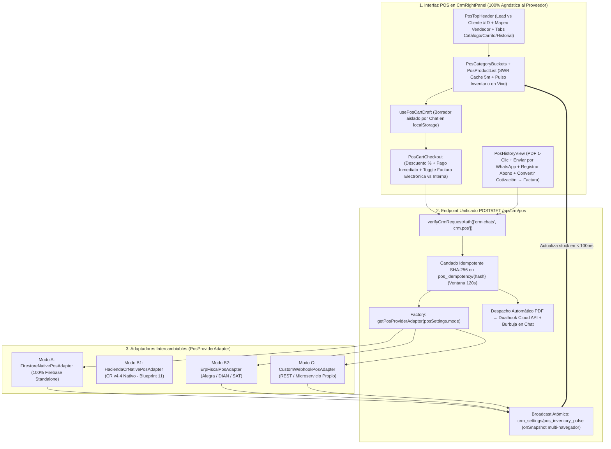

# Blueprint 06: Punto de Venta (POS) Omnicanal Globalizado de 3 Modos (`PosProviderAdapter`), Cotizaciones, Facturación, Inventario en Vivo y Despacho Automático de PDF por WhatsApp

> **PROPÓSITO DE ESTE MANUAL**: Especificar al 100% la arquitectura desacoplada y globalizada del **Punto de Venta (POS)** integrado dentro del panel lateral derecho del CRM (`CrmRightPanel` → pestaña `'pos'`), diseñada para que cualquier negocio pueda operar bajo **4 modos intercambiables** mediante el patrón `PosProviderAdapter` sin reescribir un solo componente de interfaz:
> 1. **Modo A — POS Nativo Standalone (`mode: 'firestore_native'`)**: 100% autocontenido en Firebase/Firestore (`catalogProducts`, `crm_pos_estimates`, `crm_pos_invoices`, `crm_pos_payments`) con descuento atómico de stock, pulso reactivo de inventario en tiempo real (`crm_settings/pos_inventory_pulse`) y generador interno de comprobantes PDF enviados directo al chat de WhatsApp vía Dualhook.
> 2. **Modo B1 — POS Nativo Hacienda Costa Rica v4.4 (`mode: 'hacienda_cr_v44'`)**: Emisión directa TRIBU-CR / DGT v4.4 en Node.js puro (cero PHP / cero AGPL), firma XAdES-EPES con `.p12` en bóveda write-only, validación offline XSD v4.4, Outbox `PRE_SAVED`, conversión `TE -> NC + FE`, `REP 10` (Art. 27 LIVA) y archivo legal de 5 años. Ver especificación completa en [Blueprint 11: Motor Fiscal Hacienda CR v4.4](./11-hacienda-cr-v44-pos-fiscal-engine.md).
> 3. **Modo B2 — POS Integrado con ERP Fiscal Externo (`mode: 'erp_fiscal'` — ej. Alegra API, DIAN CO, SAT MX, Facturama, Siigo)**: Sincroniza catálogo e inventario con el ERP, autocompleta datos fiscales por cédula/RUC/NIT/RFC, previene clientes duplicados sugiriendo coincidencias antes de crear, mapea asesores 1-a-1 con vendedores del ERP, emite **Cotizaciones/Proformas**, **Facturas Internas**, **Tiquetes Electrónicos (`TE`)** y **Facturas Electrónicas (`FE`)**, registra pagos/abonos con cuenta de destino o método de cobro y despacha el PDF firmado por WhatsApp en 1 clic.
> 4. **Modo C — POS Híbrido con Conector REST / Webhook Propio (`mode: 'custom_webhook'`)**: Mantiene toda la experiencia visual del carrito en el CRM y delega el catálogo, emisión de documentos y retorno de `pdfUrl` a un microservicio o ERP corporativo propio configurado en la Bóveda Cifrada (`resolveCrmIntegrations(tenantId).posWebhook`).

---

## 1. Arquitectura Global del Punto de Venta: Patrón `PosProviderAdapter` de 3 Modos



### 1.1 Contrato Universal `src/lib/services/pos-provider-adapter.ts`

```typescript
// src/lib/services/pos-provider-adapter.ts
import { initializeFirebaseAdmin } from '@/firebase/server';
import { FieldValue } from 'firebase-admin/firestore';
import { removeUndefined } from '@/lib/utils';
import type {
  PosCatalogItem,
  PosDocumentSummary,
  PosSeller,
  PosBankAccount,
  PosPaymentMethod,
} from '@/components/crm/right-panel/pos/pos-types';

export type PosProviderMode = 'firestore_native' | 'hacienda_cr_v44' | 'erp_fiscal' | 'custom_webhook';

export interface PosRuntimeSettings {
  enabled: boolean;
  mode: PosProviderMode;
  providerLabel: string;          // Ej: 'POS Nativo', 'Alegra ERP', 'SAP Business One'
  currencySymbol: string;         // Ej: '₡', '$', 'MX$', 'S/'
  currencyCode: string;           // Ej: 'CRC', 'USD', 'MXN', 'COP'
  defaultTaxRatePercent: number;  // Ej: 13 (CR), 16 (MX), 19 (CO), 0 (Exento)
  taxLabel: string;               // Ej: 'IVA 13%', 'IVA 16%', 'IGV 18%'
  supportsElectronicInvoicing: boolean;
  autoSendPdfToWhatsApp: boolean;
}

export interface CreatePosEstimateInput {
  tenantId?: string;
  contactId: string;
  clientId: string;
  sellerId?: string | number | null;
  observations?: string;
  items: Array<{
    id: string;
    name?: string;
    sku?: string;
    price: number;
    discount?: number;
    quantity: number;
    taxRatePercent?: number;
  }>;
}

export interface CreatePosInvoiceInput extends CreatePosEstimateInput {
  isElectronic: boolean;
  hasFiscalProfile?: boolean;
  fiscalDocumentMode?: 'QUOTE' | 'INTERNAL_INVOICE' | 'TE' | 'FE';
  codigoActividadReceptor?: string;
  replacesRejectedClave?: string;
  payment?: {
    amount: number;
    bankAccountId?: string;
    paymentMethod?: PosPaymentMethod;
    reference?: string;
  };
}

export interface RegisterPosPaymentInput {
  tenantId?: string;
  invoiceId: string;
  amount: number;
  bankAccountId: string;
  paymentMethod?: PosPaymentMethod;
  notes?: string;
}

export interface FiscalLookupResult {
  name: string;
  identificationType: '01' | '02' | '03' | '04';
  identificationNumber: string;
  regime?: string;
  taxActivity?: {
    code: string;
    description: string;
  };
}

export interface PosProviderAdapter {
  readonly mode: PosProviderMode;
  getCatalog(forceRefresh?: boolean): Promise<PosCatalogItem[]>;
  getHistoryAndAuxiliaryData(clientId?: string | null): Promise<{
    estimates: PosDocumentSummary[];
    invoices: PosDocumentSummary[];
    sellers: PosSeller[];
    bankAccounts: PosBankAccount[];
  }>;
  createEstimate(input: CreatePosEstimateInput): Promise<PosDocumentSummary>;
  updateEstimate(estimateId: string, input: CreatePosEstimateInput): Promise<PosDocumentSummary>;
  createInvoice(input: CreatePosInvoiceInput): Promise<PosDocumentSummary>;
  registerPayment(input: RegisterPosPaymentInput): Promise<{ paymentId: string; invoice: PosDocumentSummary | null }>;
  getDocumentPdfUrl(docType: 'estimate' | 'invoice', docId: string): Promise<string | null>;
  lookupFiscalContributor?(identification: string): Promise<FiscalLookupResult | null>;
}

/**
 * Emite un pulso atómico en `crm_settings/pos_inventory_pulse` cada vez que una factura
 * descuenta inventario, permitiendo que todos los navegadores abiertos actualicen el stock
 * de su catálogo y carrito en tiempo real mediante `onSnapshot` sin recargar el catálogo entero.
 */
export async function broadcastPosInventoryPulse(
  itemsSold: Array<{ id: string; quantity: number }>,
  currentCatalog: PosCatalogItem[]
): Promise<void> {
  if (!itemsSold.length) return;
  const { firestore } = initializeFirebaseAdmin();
  const stockMap = new Map<string, number>();
  for (const prod of currentCatalog) {
    stockMap.set(String(prod.id), Number(prod.quantity ?? 0));
  }

  const updatedItems = itemsSold.map((sold) => {
    const prev = stockMap.get(String(sold.id)) ?? 0;
    const nextQty = Math.max(0, prev - Number(sold.quantity || 0));
    return {
      id: String(sold.id),
      quantity: nextQty,
    };
  });

  await firestore
    .collection('crm_settings')
    .doc('pos_inventory_pulse')
    .set(
      {
        updatedAtMs: Date.now(),
        items: updatedItems,
        updatedAt: FieldValue.serverTimestamp(),
      },
      { merge: true }
    );
}
```

### 1.2 Modo A — Adaptador Nativo Standalone en Firestore (`FirestoreNativePosAdapter`)
Cuando el proyecto elige **Modo A (`firestore_native`)** en la entrevista de configuración, el POS funciona **100% dentro de Firebase** sin requerir suscripción a ningún ERP externo:
- **Catálogo (`catalogProducts`)**: Lee productos activos desde Firestore con precio base, porcentaje de impuesto (`taxRatePercent`) y stock disponible (`quantity`).
- **Cotizaciones (`crm_pos_estimates`) y Facturas (`crm_pos_invoices`)**: Genera numeración secuencial atómica en `crm_settings/pos_counters` (`COT-0001`, `FAC-0001`), descuenta el inventario dentro de `firestore.runTransaction()` y publica el pulso en `crm_settings/pos_inventory_pulse`.
- **Pagos (`crm_pos_payments`)**: Calcula el saldo pendiente (`balance = Math.max(0, total - amountPaid)`), marca la factura como `'paid'` cuando `balance <= 0.01` y registra el abono en la subcolección o colección de pagos.

```typescript
// src/lib/services/pos-firestore-native-adapter.ts
import { initializeFirebaseAdmin } from '@/firebase/server';
import { FieldValue } from 'firebase-admin/firestore';
import { removeUndefined } from '@/lib/utils';
import {
  broadcastPosInventoryPulse,
  type CreatePosEstimateInput,
  type CreatePosInvoiceInput,
  type PosProviderAdapter,
  type RegisterPosPaymentInput,
} from './pos-provider-adapter';
import type {
  PosBankAccount,
  PosCatalogItem,
  PosDocumentSummary,
  PosSeller,
} from '@/components/crm/right-panel/pos/pos-types';

export class FirestoreNativePosAdapter implements PosProviderAdapter {
  readonly mode = 'firestore_native' as const;

  async getCatalog(): Promise<PosCatalogItem[]> {
    const { firestore } = initializeFirebaseAdmin();
    const snap = await firestore.collection('catalogProducts').orderBy('name', 'asc').get();
    return snap.docs.map((doc) => {
      const d = doc.data();
      const basePrice = Number(d.price || 0);
      const taxRate = Number(d.taxRatePercent ?? 13);
      const finalPrice = Math.round(basePrice * (1 + taxRate / 100) * 100) / 100;
      return {
        id: doc.id,
        name: String(d.name || 'Producto'),
        sku: String(d.sku || doc.id.slice(0, 8).toUpperCase()),
        description: d.description ? String(d.description) : undefined,
        categoryName: d.category ? String(d.category) : 'General',
        basePrice,
        taxRate,
        finalPrice,
        quantity: Number(d.stock ?? d.quantity ?? 0),
        unit: d.unit ? String(d.unit) : 'unidad',
        imageUrl: d.imageUrl || d.images?.[0] || null,
        isInventoryTrackable: d.trackInventory !== false,
      };
    });
  }

  async getHistoryAndAuxiliaryData(clientId?: string | null): Promise<{
    estimates: PosDocumentSummary[];
    invoices: PosDocumentSummary[];
    sellers: PosSeller[];
    bankAccounts: PosBankAccount[];
  }> {
    const { firestore } = initializeFirebaseAdmin();
    const [usersSnap, accountsSnap] = await Promise.all([
      firestore.collection('users').limit(100).get(),
      firestore.collection('crm_pos_bank_accounts').limit(50).get(),
    ]);

    const sellers: PosSeller[] = usersSnap.docs.map((u) => {
      const data = u.data();
      return {
        id: u.id,
        name: String(data.name || data.displayName || data.email || 'Vendedor'),
        identification: data.identification || undefined,
        status: 'active',
      };
    });

    const bankAccounts: PosBankAccount[] =
      accountsSnap.size > 0
        ? accountsSnap.docs.map((b) => ({
            id: b.id,
            name: String(b.data().name || 'Cuenta Principal'),
            type: (b.data().type as 'bank' | 'cash' | 'credit-card') || 'bank',
          }))
        : [
            { id: 'default-bank', name: 'Cuenta Bancaria Principal / Transferencia', type: 'bank' },
            { id: 'default-cash', name: 'Caja General Efectivo', type: 'cash' },
          ];

    if (!clientId) {
      return { estimates: [], invoices: [], sellers, bankAccounts };
    }

    const [estSnap, invSnap] = await Promise.all([
      firestore
        .collection('crm_pos_estimates')
        .where('clientId', '==', String(clientId))
        .orderBy('createdAtMs', 'desc')
        .limit(40)
        .get(),
      firestore
        .collection('crm_pos_invoices')
        .where('clientId', '==', String(clientId))
        .orderBy('createdAtMs', 'desc')
        .limit(40)
        .get(),
    ]);

    return {
      estimates: estSnap.docs.map((d) => d.data() as PosDocumentSummary),
      invoices: invSnap.docs.map((d) => d.data() as PosDocumentSummary),
      sellers,
      bankAccounts,
    };
  }

  async createEstimate(input: CreatePosEstimateInput): Promise<PosDocumentSummary> {
    const { firestore } = initializeFirebaseAdmin();
    const counterRef = firestore.doc('crm_settings/pos_counters');
    const estimateRef = firestore.collection('crm_pos_estimates').doc();

    const summary = await firestore.runTransaction(async (tx) => {
      const counterSnap = await tx.get(counterRef);
      const nextSeq = Number(counterSnap.data()?.estimateSeq || 0) + 1;
      const numberTemplate = `COT-${String(nextSeq).padStart(4, '0')}`;

      const lineItems = input.items.map((item) => {
        const discountPct = Number(item.discount || 0);
        const taxPct = Number(item.taxRatePercent ?? 13);
        const netUnit = item.price * (1 - discountPct / 100);
        const lineTotal = Math.round(netUnit * (1 + taxPct / 100) * item.quantity * 100) / 100;
        return {
          id: String(item.id),
          name: item.name || 'Producto',
          reference: item.sku || '',
          price: item.price,
          discount: discountPct,
          quantity: item.quantity,
          taxRate: taxPct,
          total: lineTotal,
        };
      });

      const total = lineItems.reduce((acc, l) => acc + l.total, 0);
      const today = new Date().toISOString().slice(0, 10);

      const docData: PosDocumentSummary & { createdAtMs: number; contactId: string } = {
        id: estimateRef.id,
        docType: 'estimate',
        numberTemplate,
        date: today,
        clientId: String(input.clientId),
        clientName: 'Cliente CRM',
        sellerId: input.sellerId ? String(input.sellerId) : null,
        total: Math.round(total * 100) / 100,
        status: 'open',
        pdfUrl: `/api/crm/pos/pdf?type=estimate&id=${estimateRef.id}`,
        observations: input.observations || '',
        items: lineItems,
        createdAtMs: Date.now(),
        contactId: input.contactId,
      };

      tx.set(counterRef, { estimateSeq: nextSeq, updatedAt: FieldValue.serverTimestamp() }, { merge: true });
      tx.set(estimateRef, removeUndefined(docData));
      return docData;
    });

    return summary;
  }

  async updateEstimate(estimateId: string, input: CreatePosEstimateInput): Promise<PosDocumentSummary> {
    const { firestore } = initializeFirebaseAdmin();
    const ref = firestore.collection('crm_pos_estimates').doc(estimateId);
    const snap = await ref.get();
    if (!snap.exists) throw new Error('La cotización indicada no existe.');
    const existing = snap.data() as PosDocumentSummary;

    const lineItems = input.items.map((item) => {
      const discountPct = Number(item.discount || 0);
      const taxPct = Number(item.taxRatePercent ?? 13);
      const netUnit = item.price * (1 - discountPct / 100);
      const lineTotal = Math.round(netUnit * (1 + taxPct / 100) * item.quantity * 100) / 100;
      return {
        id: String(item.id),
        name: item.name || 'Producto',
        reference: item.sku || '',
        price: item.price,
        discount: discountPct,
        quantity: item.quantity,
        taxRate: taxPct,
        total: lineTotal,
      };
    });

    const total = Math.round(lineItems.reduce((acc, l) => acc + l.total, 0) * 100) / 100;
    const updated: PosDocumentSummary = {
      ...existing,
      sellerId: input.sellerId ? String(input.sellerId) : existing.sellerId,
      observations: input.observations ?? existing.observations,
      items: lineItems,
      total,
    };

    await ref.set(removeUndefined({ ...updated, updatedAtMs: Date.now() }), { merge: true });
    return updated;
  }

  async createInvoice(input: CreatePosInvoiceInput): Promise<PosDocumentSummary> {
    const { firestore } = initializeFirebaseAdmin();
    const counterRef = firestore.doc('crm_settings/pos_counters');
    const invoiceRef = firestore.collection('crm_pos_invoices').doc();
    const catalog = await this.getCatalog();

    const summary = await firestore.runTransaction(async (tx) => {
      const counterSnap = await tx.get(counterRef);
      const nextSeq = Number(counterSnap.data()?.invoiceSeq || 0) + 1;
      const numberTemplate = `FAC-${String(nextSeq).padStart(4, '0')}`;

      for (const item of input.items) {
        const prodRef = firestore.collection('catalogProducts').doc(String(item.id));
        const prodSnap = await tx.get(prodRef);
        if (prodSnap.exists) {
          const currentStock = Number(prodSnap.data()?.stock ?? prodSnap.data()?.quantity ?? 0);
          const nextStock = Math.max(0, currentStock - Number(item.quantity || 0));
          tx.update(prodRef, {
            stock: nextStock,
            quantity: nextStock,
            updatedAt: FieldValue.serverTimestamp(),
          });
        }
      }

      const lineItems = input.items.map((item) => {
        const discountPct = Number(item.discount || 0);
        const taxPct = Number(item.taxRatePercent ?? 13);
        const netUnit = item.price * (1 - discountPct / 100);
        const lineTotal = Math.round(netUnit * (1 + taxPct / 100) * item.quantity * 100) / 100;
        return {
          id: String(item.id),
          name: item.name || 'Producto',
          reference: item.sku || '',
          price: item.price,
          discount: discountPct,
          quantity: item.quantity,
          taxRate: taxPct,
          total: lineTotal,
        };
      });

      const total = Math.round(lineItems.reduce((acc, l) => acc + l.total, 0) * 100) / 100;
      const paidNow = Math.min(total, Number(input.payment?.amount || 0));
      const balance = Math.max(0, Math.round((total - paidNow) * 100) / 100);
      const today = new Date().toISOString().slice(0, 10);

      const docData: PosDocumentSummary & { createdAtMs: number; contactId: string } = {
        id: invoiceRef.id,
        docType: 'invoice',
        numberTemplate,
        date: today,
        clientId: String(input.clientId),
        clientName: 'Cliente CRM',
        sellerId: input.sellerId ? String(input.sellerId) : null,
        total,
        amountPaid: paidNow,
        balance,
        status: balance <= 0.01 ? 'paid' : 'open',
        isElectronic: false,
        pdfUrl: `/api/crm/pos/pdf?type=invoice&id=${invoiceRef.id}`,
        observations: input.observations || '',
        items: lineItems,
        createdAtMs: Date.now(),
        contactId: input.contactId,
      };

      tx.set(counterRef, { invoiceSeq: nextSeq, updatedAt: FieldValue.serverTimestamp() }, { merge: true });
      tx.set(invoiceRef, removeUndefined(docData));
      return docData;
    });

    await broadcastPosInventoryPulse(
      input.items.map((i) => ({ id: String(i.id), quantity: i.quantity })),
      catalog
    );

    return summary;
  }

  async registerPayment(
    input: RegisterPosPaymentInput
  ): Promise<{ paymentId: string; invoice: PosDocumentSummary | null }> {
    const { firestore } = initializeFirebaseAdmin();
    const invRef = firestore.collection('crm_pos_invoices').doc(input.invoiceId);
    const paymentRef = firestore.collection('crm_pos_payments').doc();

    const updatedInvoice = await firestore.runTransaction(async (tx) => {
      const invSnap = await tx.get(invRef);
      if (!invSnap.exists) throw new Error('La factura indicada no existe.');
      const inv = invSnap.data() as PosDocumentSummary;

      const prevPaid = Number(inv.amountPaid || 0);
      const nextPaid = Math.min(inv.total, Math.round((prevPaid + input.amount) * 100) / 100);
      const nextBalance = Math.max(0, Math.round((inv.total - nextPaid) * 100) / 100);
      const nextStatus = nextBalance <= 0.01 ? 'paid' : 'open';

      const updated: PosDocumentSummary = {
        ...inv,
        amountPaid: nextPaid,
        balance: nextBalance,
        status: nextStatus,
      };

      tx.set(invRef, removeUndefined({ ...updated, updatedAtMs: Date.now() }), { merge: true });
      tx.set(
        paymentRef,
        removeUndefined({
          id: paymentRef.id,
          invoiceId: input.invoiceId,
          amount: input.amount,
          bankAccountId: input.bankAccountId,
          paymentMethod: input.paymentMethod || 'transfer',
          notes: input.notes || '',
          createdAtMs: Date.now(),
          createdAt: FieldValue.serverTimestamp(),
        })
      );

      return updated;
    });

    return { paymentId: paymentRef.id, invoice: updatedInvoice };
  }

  async getDocumentPdfUrl(docType: 'estimate' | 'invoice', docId: string): Promise<string | null> {
    return `/api/crm/pos/pdf?type=${docType}&id=${encodeURIComponent(docId)}`;
  }
}
```

---

## 2. Tipos Canónicos, Cálculos de Carrito, Validaciones de Stock y Sanitizador Fiscal (`src/components/crm/right-panel/pos/pos-types.ts`)

```typescript
// src/components/crm/right-panel/pos/pos-types.ts

export type PosSubView = 'catalog' | 'cart' | 'history';

export type PosDocumentType = 'estimate' | 'invoice';

export type PosPaymentMethod =
  | 'cash'
  | 'transfer'
  | 'sinpe-movil'
  | 'debit-card'
  | 'credit-card';

export interface PosPaymentMethodOption {
  value: PosPaymentMethod;
  label: string;
  shortLabel: string;
}

export const POS_PAYMENT_METHODS: PosPaymentMethodOption[] = [
  { value: 'sinpe-movil', label: 'Transferencia Móvil / Instantánea', shortLabel: 'Móvil' },
  { value: 'transfer', label: 'Transferencia Bancaria', shortLabel: 'Transferencia' },
  { value: 'cash', label: 'Efectivo', shortLabel: 'Efectivo' },
  { value: 'debit-card', label: 'Tarjeta Débito', shortLabel: 'T. Débito' },
  { value: 'credit-card', label: 'Tarjeta Crédito', shortLabel: 'T. Crédito' },
];

export interface PosCatalogItem {
  id: string;
  name: string;
  sku: string;
  description?: string;
  categoryName?: string;
  basePrice: number;        // Precio unitario SIN impuesto
  taxRate: number;          // Porcentaje de impuesto (ej. 13, 16, 19)
  taxId?: string | number;  // ID del impuesto en el ERP (si aplica)
  cabysCode?: string;       // Código CABYS oficial de 13 dígitos (Hacienda CR v4.4)
  taxRateCode?: string;     // Código tarifa IVA v4.4 (ej. '08'=13%, '04'=4%, '10'=0%)
  finalPrice: number;       // Precio unitario CON impuesto incluido
  quantity: number;         // Stock disponible en bodega
  unit?: string;
  imageUrl?: string | null;
  isInventoryTrackable: boolean;
}

export interface PosCartItem {
  product: PosCatalogItem;
  quantity: number;
  discountPercent: number; // 0..100
}

export interface PosSeller {
  id: string;
  name: string;
  identification?: string;
  observations?: string;
  status: 'active' | 'inactive';
}

export interface PosBankAccount {
  id: string;
  name: string;
  type: 'bank' | 'cash' | 'credit-card';
  description?: string;
}

export interface PosDocumentLineItem {
  id: string;
  name: string;
  reference?: string;
  price: number;
  discount: number;
  quantity: number;
  taxRate?: number;
  total?: number;
}

export interface PosDocumentSummary {
  id: string;
  docType: PosDocumentType;
  numberTemplate: string; // Ej: "COT-0042" o "FE-00100001010000001234"
  date: string;
  dueDate?: string;
  clientId: string;
  clientName: string;
  sellerId?: string | null;
  sellerName?: string | null;
  total: number;
  amountPaid?: number;
  balance?: number;
  status: 'open' | 'paid' | 'void' | 'draft' | 'accepted' | 'invoiced';
  isElectronic?: boolean;
  stampStatus?: 'accepted' | 'pending' | 'rejected' | 'not_electronic';
  nationalKey?: string;
  pdfUrl?: string | null;
  observations?: string;
  items: PosDocumentLineItem[];
}

export interface PosCartTotals {
  subtotalBruto: number;
  descuentoTotal: number;
  subtotalNeto: number;
  impuestoTotal: number;
  totalFinal: number;
  totalUnits: number;
}

/**
 * Calcula los totales exactos del carrito desglosando:
 * - Subtotal Bruto (sin impuestos ni descuentos)
 * - Descuento Total
 * - Subtotal Neto Gravable
 * - Impuesto Total (según taxRate de cada línea)
 * - Total Final a Pagar
 */
export function calculatePosCartTotals(cart: PosCartItem[]): PosCartTotals {
  let subtotalBruto = 0;
  let descuentoTotal = 0;
  let subtotalNeto = 0;
  let impuestoTotal = 0;
  let totalUnits = 0;

  for (const line of cart) {
    const qty = Math.max(0, Number(line.quantity) || 0);
    const discPct = Math.min(100, Math.max(0, Number(line.discountPercent) || 0));
    const baseUnit = Math.max(0, Number(line.product.basePrice) || 0);
    const taxRate = Math.max(0, Number(line.product.taxRate) ?? 13);

    const lineBruto = baseUnit * qty;
    const lineDisc = lineBruto * (discPct / 100);
    const lineNeto = lineBruto - lineDisc;
    const lineTax = lineNeto * (taxRate / 100);

    subtotalBruto += lineBruto;
    descuentoTotal += lineDisc;
    subtotalNeto += lineNeto;
    impuestoTotal += lineTax;
    totalUnits += qty;
  }

  const totalFinal = subtotalNeto + impuestoTotal;

  return {
    subtotalBruto: Math.round(subtotalBruto * 100) / 100,
    descuentoTotal: Math.round(descuentoTotal * 100) / 100,
    subtotalNeto: Math.round(subtotalNeto * 100) / 100,
    impuestoTotal: Math.round(impuestoTotal * 100) / 100,
    totalFinal: Math.round(totalFinal * 100) / 100,
    totalUnits,
  };
}

/**
 * Verifica qué líneas del carrito superan el stock disponible en bodega.
 * Se invoca antes de emitir Facturas (las Cotizaciones pueden emitirse sin bloquear por stock).
 */
export function findStockExceedingCartItems(cart: PosCartItem[]): Array<{
  productId: string;
  name: string;
  sku: string;
  requested: number;
  available: number;
}> {
  const violations: Array<{
    productId: string;
    name: string;
    sku: string;
    requested: number;
    available: number;
  }> = [];

  for (const item of cart) {
    if (!item.product.isInventoryTrackable) continue;
    const available = Math.max(0, Number(item.product.quantity) || 0);
    if (item.quantity > available) {
      violations.push({
        productId: item.product.id,
        name: item.product.name,
        sku: item.product.sku,
        requested: item.quantity,
        available,
      });
    }
  }
  return violations;
}

/**
 * Formatea montos monetarios respetando la divisa configurada en `crm_settings/general`.
 */
export function formatPosCurrency(
  amount: number | undefined | null,
  currencySymbol = '₡',
  locale = 'es-CR'
): string {
  const num = Number(amount || 0);
  if (!Number.isFinite(num)) return `${currencySymbol}0`;
  const hasDecimals = Math.abs(num - Math.round(num)) > 0.009;
  return `${currencySymbol}${num.toLocaleString(locale, {
    minimumFractionDigits: hasDecimals ? 2 : 0,
    maximumFractionDigits: 2,
  })}`;
}

/**
 * Sanitiza y valida el documento de identificación fiscal según el tipo seleccionado:
 * - '01': Cédula Física (9 dígitos)
 * - '02': Cédula Jurídica / Persona Moral (10 dígitos)
 * - '03': DIMEX / Extranjero Residente (11 o 12 dígitos)
 * - '04': NITE / Identificación Tributaria Especial (10 dígitos)
 */
export function sanitizeFiscalIdentification(
  rawNumber: string,
  idType: '01' | '02' | '03' | '04' = '01'
): { digits: string; isValid: boolean; expectedHint: string } {
  const digits = (rawNumber || '').replace(/\D/g, '');
  switch (idType) {
    case '01':
      return {
        digits: digits.slice(0, 9),
        isValid: digits.length === 9,
        expectedHint: '9 dígitos exactos (sin guiones)',
      };
    case '02':
      return {
        digits: digits.slice(0, 10),
        isValid: digits.length === 10,
        expectedHint: '10 dígitos exactos (sin guiones)',
      };
    case '03':
      return {
        digits: digits.slice(0, 12),
        isValid: digits.length === 11 || digits.length === 12,
        expectedHint: '11 o 12 dígitos exactos',
      };
    case '04':
      return {
        digits: digits.slice(0, 10),
        isValid: digits.length === 10,
        expectedHint: '10 dígitos exactos',
      };
    default:
      return {
        digits,
        isValid: digits.length >= 6,
        expectedHint: 'Mínimo 6 dígitos',
      };
  }
}
```

---

## 3. Persistencia de Borradores por Chat (`usePosCartDraft`) & Caché SWR + Pulso de Inventario en Vivo (`pos-catalog-cache.ts`)

### 3.1 Hook de Borrador de Carrito Aislado por Conversación (`src/components/crm/right-panel/pos/use-pos-cart-draft.ts`)
Garantiza que si un asesor está armando un carrito en el chat A y salta a responder una urgencia en el chat B, al regresar al chat A su carrito, descuento global y observaciones siguen intactos, y al cambiar al chat B jamás se mezclan los ítems del chat A:

```typescript
// src/components/crm/right-panel/pos/use-pos-cart-draft.ts
'use client';

import { useEffect, useRef, useCallback } from 'react';
import type { PosCartItem } from './pos-types';

const DRAFT_STORAGE_PREFIX = 'crm_pos_cart_draft_';

interface StoredPosCartDraft {
  cart: PosCartItem[];
  globalDiscount: string;
  observations: string;
  updatedAt: number;
}

interface UsePosCartDraftParams {
  chatId: string | null | undefined;
  isSpecialMode: boolean; // true cuando se está editando una cotización existente o convirtiéndola a factura
  cart: PosCartItem[];
  globalDiscount: string;
  observations: string;
  setCart: React.Dispatch<React.SetStateAction<PosCartItem[]>>;
  setGlobalDiscount: React.Dispatch<React.SetStateAction<string>>;
  setObservations: React.Dispatch<React.SetStateAction<string>>;
}

export function usePosCartDraft({
  chatId,
  isSpecialMode,
  cart,
  globalDiscount,
  observations,
  setCart,
  setGlobalDiscount,
  setObservations,
}: UsePosCartDraftParams) {
  const hydratedChatIdRef = useRef<string | null>(null);

  // 1. Hidratar borrador específico del chat activo al cambiar de conversación
  useEffect(() => {
    if (!chatId) {
      hydratedChatIdRef.current = null;
      return;
    }
    if (isSpecialMode) return;

    hydratedChatIdRef.current = null;
    try {
      const raw = localStorage.getItem(`${DRAFT_STORAGE_PREFIX}${chatId}`);
      if (raw) {
        const parsed = JSON.parse(raw) as StoredPosCartDraft;
        setCart(Array.isArray(parsed.cart) ? parsed.cart : []);
        setGlobalDiscount(typeof parsed.globalDiscount === 'string' ? parsed.globalDiscount : '');
        setObservations(typeof parsed.observations === 'string' ? parsed.observations : '');
      } else {
        setCart([]);
        setGlobalDiscount('');
        setObservations('');
      }
    } catch {
      setCart([]);
      setGlobalDiscount('');
      setObservations('');
    } finally {
      hydratedChatIdRef.current = chatId;
    }
  }, [chatId, isSpecialMode, setCart, setGlobalDiscount, setObservations]);

  // 2. Persistir automáticamente cambios cuando no estamos en modo edición/conversión
  useEffect(() => {
    if (!chatId || isSpecialMode) return;
    if (hydratedChatIdRef.current !== chatId) return;

    try {
      const key = `${DRAFT_STORAGE_PREFIX}${chatId}`;
      if (cart.length === 0 && !globalDiscount.trim() && !observations.trim()) {
        localStorage.removeItem(key);
        return;
      }
      const payload: StoredPosCartDraft = {
        cart,
        globalDiscount,
        observations,
        updatedAt: Date.now(),
      };
      localStorage.setItem(key, JSON.stringify(payload));
    } catch {
      // Ignorar errores de cuota de localStorage
    }
  }, [chatId, isSpecialMode, cart, globalDiscount, observations]);

  // 3. Limpiar borrador tras emitir documento o vaciar manualmente el carrito
  const clearCartDraft = useCallback(() => {
    if (!chatId) return;
    try {
      localStorage.removeItem(`${DRAFT_STORAGE_PREFIX}${chatId}`);
    } catch {
      // noop
    }
  }, [chatId]);

  return { clearCartDraft };
}
```

### 3.2 Caché SWR de Catálogo en Memoria + `localStorage` y Pulso Reactivo de Inventario (`src/components/crm/right-panel/pos/pos-catalog-cache.ts`)

```typescript
// src/components/crm/right-panel/pos/pos-catalog-cache.ts
'use client';

import { useEffect, useRef } from 'react';
import { doc, onSnapshot } from 'firebase/firestore';
import { useFirestore } from '@/firebase';
import type { PosCartItem, PosCatalogItem } from './pos-types';

const CATALOG_CACHE_KEY = 'crm_pos_catalog_v2';
const CATALOG_TTL_MS = 5 * 60 * 1000; // 5 minutos SWR

interface CachedCatalogPayload {
  items: PosCatalogItem[];
  fetchedAt: number;
}

let memoryCatalogCache: CachedCatalogPayload | null = null;

export function readCachedPosCatalog(): { items: PosCatalogItem[]; isStale: boolean } | null {
  const now = Date.now();
  if (memoryCatalogCache && memoryCatalogCache.items.length > 0) {
    return {
      items: memoryCatalogCache.items,
      isStale: now - memoryCatalogCache.fetchedAt > CATALOG_TTL_MS,
    };
  }

  if (typeof window === 'undefined') return null;
  try {
    const raw = localStorage.getItem(CATALOG_CACHE_KEY);
    if (!raw) return null;
    const parsed = JSON.parse(raw) as CachedCatalogPayload;
    if (!Array.isArray(parsed?.items) || parsed.items.length === 0) return null;
    memoryCatalogCache = parsed;
    return {
      items: parsed.items,
      isStale: now - (parsed.fetchedAt || 0) > CATALOG_TTL_MS,
    };
  } catch {
    return null;
  }
}

export function writeCachedPosCatalog(items: PosCatalogItem[]): void {
  const payload: CachedCatalogPayload = {
    items,
    fetchedAt: Date.now(),
  };
  memoryCatalogCache = payload;
  if (typeof window === 'undefined') return;
  try {
    localStorage.setItem(CATALOG_CACHE_KEY, JSON.stringify(payload));
  } catch {
    // noop
  }
}

export function patchCachedPosCatalogQuantities(
  updates: Array<{ id: string; quantity: number }>
): void {
  if (!updates.length) return;
  const qtyMap = new Map(updates.map((u) => [String(u.id), Number(u.quantity)]));
  if (memoryCatalogCache) {
    memoryCatalogCache = {
      ...memoryCatalogCache,
      items: memoryCatalogCache.items.map((item) =>
        qtyMap.has(String(item.id))
          ? { ...item, quantity: qtyMap.get(String(item.id))! }
          : item
      ),
    };
    if (typeof window !== 'undefined') {
      try {
        localStorage.setItem(CATALOG_CACHE_KEY, JSON.stringify(memoryCatalogCache));
      } catch {
        // noop
      }
    }
  }
}

/**
 * Escucha en tiempo real el documento `crm_settings/pos_inventory_pulse` (1 sola lectura al montar
 * + deltas cuando alguien emite una factura) y sincroniza las existencias en el catálogo y en el carrito activo.
 */
export function usePosLiveInventoryPulse(
  setProducts: React.Dispatch<React.SetStateAction<PosCatalogItem[]>>,
  setCart: React.Dispatch<React.SetStateAction<PosCartItem[]>>
) {
  const firestore = useFirestore();
  const lastPulseMsRef = useRef<number>(0);

  useEffect(() => {
    if (!firestore) return;
    const pulseRef = doc(firestore, 'crm_settings', 'pos_inventory_pulse');
    const unsub = onSnapshot(
      pulseRef,
      (snap) => {
        if (!snap.exists()) return;
        const data = snap.data();
        const updatedAtMs = Number(data?.updatedAtMs || 0);
        if (!updatedAtMs || updatedAtMs <= lastPulseMsRef.current) return;
        lastPulseMsRef.current = updatedAtMs;

        const updates: Array<{ id: string; quantity: number }> = Array.isArray(data?.items)
          ? data.items
          : [];
        if (updates.length === 0) return;

        const qtyMap = new Map(updates.map((u) => [String(u.id), Number(u.quantity)]));
        patchCachedPosCatalogQuantities(updates);

        setProducts((prev) =>
          prev.map((p) =>
            qtyMap.has(String(p.id)) ? { ...p, quantity: qtyMap.get(String(p.id))! } : p
          )
        );

        setCart((prev) =>
          prev.map((line) =>
            qtyMap.has(String(line.product.id))
              ? {
                  ...line,
                  product: {
                    ...line.product,
                    quantity: qtyMap.get(String(line.product.id))!,
                  },
                }
              : line
          )
        );
      },
      (err) => {
        console.warn('[POS Inventory Pulse listener warning]:', err?.message);
      }
    );

    return () => unsub();
  }, [firestore, setProducts, setCart]);
}
```

---

## 4. Componentes UI del POS en el Panel Derecho (`PosTab`, `PosTopHeader`, `PosCategoryBuckets`, `PosProductList`)

### 4.1 Cabecera Superior del POS (`src/components/crm/right-panel/pos/pos-top-header.tsx`)
Muestra el estado comercial del contacto (**`Lead (Sin cliente POS)`** vs **`Cliente #ID`** con badge de estado fiscal para Factura Electrónica), el selector de Vendedor con **auto-resolución desde el mapeo 1-a-1**, alerta de modo edición/conversión y la barra segmentada de 3 sub-vistas (`Catálogo`, `Carrito (N)` e `Historial`):

```tsx
// src/components/crm/right-panel/pos/pos-top-header.tsx
'use client';

import {
  ShoppingBag,
  ShoppingCart,
  History,
  UserCheck,
  UserPlus,
  RefreshCw,
  FileCheck2,
  AlertCircle,
  X,
} from 'lucide-react';
import type { PosSeller, PosSubView } from './pos-types';

interface PosTopHeaderProps {
  subView: PosSubView;
  onChangeSubView: (view: PosSubView) => void;
  cartCount: number;
  historyCount: number;
  posClientId?: string | null;
  hasFiscalProfile: boolean;
  onOpenClientSetup: () => void;
  sellers: PosSeller[];
  selectedSellerId: string;
  onChangeSellerId: (id: string) => void;
  isSellerLockedByMapping?: boolean;
  isRefreshingCatalog: boolean;
  onRefreshCatalog: () => void;
  specialBanner?: {
    label: string;
    onCancel: () => void;
  } | null;
}

export function PosTopHeader({
  subView,
  onChangeSubView,
  cartCount,
  historyCount,
  posClientId,
  hasFiscalProfile,
  onOpenClientSetup,
  sellers,
  selectedSellerId,
  onChangeSellerId,
  isSellerLockedByMapping,
  isRefreshingCatalog,
  onRefreshCatalog,
  specialBanner,
}: PosTopHeaderProps) {
  return (
    <div className="border-b border-border bg-card px-3.5 py-2.5 space-y-2.5 shrink-0">
      {/* Fila 1: Estado de Cliente POS + Botón Refrescar Catálogo */}
      <div className="flex items-center justify-between gap-2">
        {posClientId ? (
          <div className="flex items-center gap-1.5 min-w-0 flex-wrap">
            <span className="inline-flex items-center gap-1 px-2 py-0.5 rounded-full text-[11px] font-semibold bg-emerald-500/15 text-emerald-700 dark:text-emerald-300 border border-emerald-500/30">
              <UserCheck className="w-3 h-3 shrink-0" />
              Cliente #{posClientId}
            </span>
            {hasFiscalProfile ? (
              <span
                className="inline-flex items-center gap-1 px-2 py-0.5 rounded-full text-[10px] font-semibold bg-primary/10 text-primary border border-primary/25"
                title="Perfil fiscal completo para Factura Electrónica"
              >
                <FileCheck2 className="w-3 h-3 shrink-0" />
                FE Lista
              </span>
            ) : (
              <button
                type="button"
                onClick={onOpenClientSetup}
                className="inline-flex items-center gap-1 px-2 py-0.5 rounded-full text-[10px] font-medium bg-amber-500/15 text-amber-700 dark:text-amber-300 border border-amber-500/30 hover:bg-amber-500/25 transition-colors cursor-pointer"
                title="Completar cédula y correo para emitir Factura Electrónica"
              >
                <AlertCircle className="w-3 h-3 shrink-0" />
                Completar datos FE
              </button>
            )}
          </div>
        ) : (
          <div className="flex items-center gap-2 min-w-0">
            <span className="inline-flex items-center gap-1 px-2 py-0.5 rounded-full text-[11px] font-semibold bg-amber-500/15 text-amber-700 dark:text-amber-300 border border-amber-500/30">
              Lead (Sin cliente POS)
            </span>
            <button
              type="button"
              onClick={onOpenClientSetup}
              className="inline-flex items-center gap-1 px-2.5 py-1 rounded-lg text-[11px] font-semibold bg-primary text-primary-foreground hover:bg-primary/90 transition-colors cursor-pointer shadow-2xs"
            >
              <UserPlus className="w-3 h-3" />
              Convertir a Cliente
            </button>
          </div>
        )}

        <button
          type="button"
          onClick={onRefreshCatalog}
          disabled={isRefreshingCatalog}
          className="p-1.5 rounded-lg text-muted-foreground hover:text-foreground hover:bg-muted transition-colors cursor-pointer disabled:opacity-50"
          title="Sincronizar catálogo e inventario"
        >
          <RefreshCw className={`w-3.5 h-3.5 ${isRefreshingCatalog ? 'animate-spin text-primary' : ''}`} />
        </button>
      </div>

      {/* Fila 2: Selector de Vendedor POS/ERP */}
      {sellers.length > 0 && (
        <div className="flex items-center gap-2">
          <span className="text-[11px] font-medium text-muted-foreground shrink-0">Vendedor:</span>
          <select
            value={selectedSellerId}
            onChange={(e) => onChangeSellerId(e.target.value)}
            disabled={Boolean(isSellerLockedByMapping)}
            className="flex-1 min-w-0 px-2.5 py-1 rounded-lg bg-background border border-input text-foreground text-xs font-medium focus:outline-none focus:ring-1 focus:ring-primary disabled:opacity-75"
          >
            <option value="">Seleccionar vendedor...</option>
            {sellers.map((s) => (
              <option key={s.id} value={String(s.id)}>
                {s.name}
              </option>
            ))}
          </select>
        </div>
      )}

      {/* Banner de Modo Especial (Edición de Cotización o Conversión a Factura) */}
      {specialBanner && (
        <div className="flex items-center justify-between gap-2 px-2.5 py-1.5 rounded-xl bg-primary/10 border border-primary/30 text-primary text-xs font-medium">
          <span className="truncate">{specialBanner.label}</span>
          <button
            type="button"
            onClick={specialBanner.onCancel}
            className="inline-flex items-center gap-1 px-2 py-0.5 rounded-md bg-background/80 hover:bg-background text-foreground text-[11px] font-semibold shrink-0 cursor-pointer"
          >
            <X className="w-3 h-3" />
            Cancelar
          </button>
        </div>
      )}

      {/* Fila 3: Navegación Segmentada Catálogo | Carrito | Historial */}
      <div className="grid grid-cols-3 gap-1 p-1 rounded-xl bg-muted/70 border border-border/60">
        <button
          type="button"
          onClick={() => onChangeSubView('catalog')}
          className={`flex items-center justify-center gap-1.5 py-1.5 px-2 rounded-lg text-xs font-semibold transition-all cursor-pointer ${
            subView === 'catalog'
              ? 'bg-card text-foreground shadow-2xs border border-border/60'
              : 'text-muted-foreground hover:text-foreground'
          }`}
        >
          <ShoppingBag className="w-3.5 h-3.5 shrink-0" />
          <span>Catálogo</span>
        </button>

        <button
          type="button"
          onClick={() => onChangeSubView('cart')}
          className={`flex items-center justify-center gap-1.5 py-1.5 px-2 rounded-lg text-xs font-semibold transition-all cursor-pointer ${
            subView === 'cart'
              ? 'bg-card text-foreground shadow-2xs border border-border/60'
              : 'text-muted-foreground hover:text-foreground'
          }`}
        >
          <ShoppingCart className="w-3.5 h-3.5 shrink-0" />
          <span>Carrito</span>
          {cartCount > 0 && (
            <span className="px-1.5 py-0.2 rounded-full text-[10px] font-bold bg-primary text-primary-foreground">
              {cartCount}
            </span>
          )}
        </button>

        <button
          type="button"
          onClick={() => onChangeSubView('history')}
          className={`flex items-center justify-center gap-1.5 py-1.5 px-2 rounded-lg text-xs font-semibold transition-all cursor-pointer ${
            subView === 'history'
              ? 'bg-card text-foreground shadow-2xs border border-border/60'
              : 'text-muted-foreground hover:text-foreground'
          }`}
        >
          <History className="w-3.5 h-3.5 shrink-0" />
          <span>Historial</span>
          {historyCount > 0 && (
            <span className="px-1.5 py-0.2 rounded-full text-[10px] font-semibold bg-muted-foreground/20 text-foreground">
              {historyCount}
            </span>
          )}
        </button>
      </div>
    </div>
  );
}
```

### 4.2 Agrupación Inteligente por Categorías (`src/components/crm/right-panel/pos/pos-category-buckets.tsx`) y Lista de Productos (`src/components/crm/right-panel/pos/pos-product-list.tsx`)

```tsx
// src/components/crm/right-panel/pos/pos-category-buckets.tsx
'use client';

import type { PosCatalogItem } from './pos-types';

export interface PosCategoryBucket {
  id: string;
  label: string;
  count: number;
}

export function buildCategoryBuckets(products: PosCatalogItem[]): PosCategoryBucket[] {
  const counts = new Map<string, number>();
  for (const p of products) {
    const cat = (p.categoryName || 'General').trim();
    counts.set(cat, (counts.get(cat) || 0) + 1);
  }
  const sorted = Array.from(counts.entries())
    .sort((a, b) => b[1] - a[1])
    .map(([label, count]) => ({ id: label, label, count }));

  return [{ id: 'ALL', label: 'Todos', count: products.length }, ...sorted];
}

interface PosCategoryBucketsProps {
  buckets: PosCategoryBucket[];
  activeCategory: string;
  onSelectCategory: (id: string) => void;
}

export function PosCategoryBuckets({
  buckets,
  activeCategory,
  onSelectCategory,
}: PosCategoryBucketsProps) {
  if (buckets.length <= 1) return null;

  return (
    <div className="flex items-center gap-1.5 overflow-x-auto no-scrollbar py-1">
      {buckets.map((b) => {
        const isActive = activeCategory === b.id;
        return (
          <button
            key={b.id}
            type="button"
            onClick={() => onSelectCategory(b.id)}
            className={`shrink-0 inline-flex items-center gap-1 px-2.5 py-1 rounded-full text-[11px] font-semibold border transition-colors cursor-pointer ${
              isActive
                ? 'bg-primary text-primary-foreground border-primary shadow-2xs'
                : 'bg-card text-muted-foreground border-border hover:text-foreground hover:bg-muted/60'
            }`}
          >
            <span>{b.label}</span>
            <span className={`text-[10px] ${isActive ? 'opacity-90' : 'opacity-65'}`}>
              ({b.count})
            </span>
          </button>
        );
      })}
    </div>
  );
}
```

```tsx
// src/components/crm/right-panel/pos/pos-product-list.tsx
'use client';

import { useMemo, useState } from 'react';
import { Search, Plus, Minus, Package, X } from 'lucide-react';
import {
  formatPosCurrency,
  type PosCartItem,
  type PosCatalogItem,
} from './pos-types';
import { buildCategoryBuckets, PosCategoryBuckets } from './pos-category-buckets';

interface PosProductListProps {
  products: PosCatalogItem[];
  cart: PosCartItem[];
  currencySymbol?: string;
  onAddProduct: (product: PosCatalogItem) => void;
  onUpdateQuantity: (productId: string, nextQty: number) => void;
  onGoToCart: () => void;
}

export function PosProductList({
  products,
  cart,
  currencySymbol = '₡',
  onAddProduct,
  onUpdateQuantity,
  onGoToCart,
}: PosProductListProps) {
  const [search, setSearch] = useState('');
  const [activeCategory, setActiveCategory] = useState('ALL');
  const [onlyInStock, setOnlyInStock] = useState(false);

  const buckets = useMemo(() => buildCategoryBuckets(products), [products]);

  const cartQtyMap = useMemo(() => {
    const map = new Map<string, number>();
    for (const item of cart) {
      map.set(item.product.id, item.quantity);
    }
    return map;
  }, [cart]);

  const filtered = useMemo(() => {
    const q = search.trim().toLowerCase();
    return products.filter((p) => {
      if (activeCategory !== 'ALL' && (p.categoryName || 'General').trim() !== activeCategory) {
        return false;
      }
      if (onlyInStock && p.isInventoryTrackable && p.quantity <= 0) {
        return false;
      }
      if (!q) return true;
      return (
        p.name.toLowerCase().includes(q) ||
        p.sku.toLowerCase().includes(q) ||
        (p.categoryName || '').toLowerCase().includes(q)
      );
    });
  }, [products, search, activeCategory, onlyInStock]);

  return (
    <div className="flex-1 flex flex-col min-h-0 overflow-hidden">
      {/* Buscador y Filtro de Stock */}
      <div className="p-3 border-b border-border bg-card/50 space-y-2 shrink-0">
        <div className="flex items-center gap-2">
          <div className="relative flex-1 min-w-0">
            <Search className="w-3.5 h-3.5 text-muted-foreground absolute left-3 top-1/2 -translate-y-1/2" />
            <input
              type="text"
              value={search}
              onChange={(e) => setSearch(e.target.value)}
              placeholder="Buscar por nombre o SKU..."
              className="w-full pl-8 pr-7 py-1.5 rounded-xl bg-background border border-input text-foreground text-[16px] sm:text-xs focus:outline-none focus:ring-2 focus:ring-primary/30"
            />
            {search && (
              <button
                type="button"
                onClick={() => setSearch('')}
                className="absolute right-2.5 top-1/2 -translate-y-1/2 text-muted-foreground hover:text-foreground"
              >
                <X className="w-3.5 h-3.5" />
              </button>
            )}
          </div>

          <button
            type="button"
            onClick={() => setOnlyInStock((v) => !v)}
            className={`px-2.5 py-1.5 rounded-xl text-[11px] font-semibold border shrink-0 transition-colors cursor-pointer ${
              onlyInStock
                ? 'bg-emerald-500/15 border-emerald-500/40 text-emerald-700 dark:text-emerald-300'
                : 'bg-background border-border text-muted-foreground hover:text-foreground'
            }`}
          >
            En stock
          </button>
        </div>

        <PosCategoryBuckets
          buckets={buckets}
          activeCategory={activeCategory}
          onSelectCategory={setActiveCategory}
        />
      </div>

      {/* Lista de Productos */}
      <div className="flex-1 overflow-y-auto p-3 space-y-2">
        {filtered.length === 0 ? (
          <div className="py-12 text-center text-muted-foreground space-y-2">
            <Package className="w-8 h-8 mx-auto opacity-35" />
            <p className="text-xs font-medium">No se encontraron productos con ese criterio.</p>
          </div>
        ) : (
          filtered.map((item) => {
            const qtyInCart = cartQtyMap.get(item.id) || 0;
            const outOfStock = item.isInventoryTrackable && item.quantity <= 0;

            return (
              <div
                key={item.id}
                className={`p-2.5 rounded-xl border transition-all flex items-center justify-between gap-2.5 ${
                  qtyInCart > 0
                    ? 'bg-primary/5 border-primary/40 shadow-2xs'
                    : 'bg-card border-border hover:border-border/90'
                }`}
              >
                <div className="min-w-0 flex-1 space-y-0.5">
                  <div className="flex items-center gap-1.5 flex-wrap">
                    <span className="text-xs font-semibold text-foreground leading-snug break-words">
                      {item.name}
                    </span>
                    {item.sku && (
                      <span className="px-1.5 py-0.2 rounded text-[10px] font-mono bg-muted text-muted-foreground">
                        {item.sku}
                      </span>
                    )}
                  </div>

                  <div className="flex items-center gap-2 text-[11px]">
                    <span className="font-bold text-primary">
                      {formatPosCurrency(item.finalPrice, currencySymbol)} IVA inc.
                    </span>
                    <span className="text-muted-foreground">
                      (Base: {formatPosCurrency(item.basePrice, currencySymbol)})
                    </span>
                  </div>

                  {item.isInventoryTrackable && (
                    <div className="text-[10px] font-medium">
                      {outOfStock ? (
                        <span className="text-destructive font-semibold">Agotado (0 disp.)</span>
                      ) : (
                        <span className="text-emerald-600 dark:text-emerald-400">
                          Disponible: {item.quantity} {item.unit || 'uds'}
                        </span>
                      )}
                    </div>
                  )}
                </div>

                {/* Controles + / - */}
                {qtyInCart > 0 ? (
                  <div className="flex items-center gap-1 bg-background border border-primary/40 rounded-xl p-1 shrink-0">
                    <button
                      type="button"
                      onClick={() => onUpdateQuantity(item.id, qtyInCart - 1)}
                      className="w-6 h-6 rounded-lg flex items-center justify-center hover:bg-muted text-foreground cursor-pointer"
                    >
                      <Minus className="w-3.5 h-3.5" />
                    </button>
                    <span className="w-6 text-center text-xs font-bold text-primary">
                      {qtyInCart}
                    </span>
                    <button
                      type="button"
                      onClick={() => onUpdateQuantity(item.id, qtyInCart + 1)}
                      className="w-6 h-6 rounded-lg flex items-center justify-center hover:bg-muted text-foreground cursor-pointer"
                    >
                      <Plus className="w-3.5 h-3.5" />
                    </button>
                  </div>
                ) : (
                  <button
                    type="button"
                    onClick={() => onAddProduct(item)}
                    className="px-2.5 py-1.5 rounded-xl bg-primary/10 hover:bg-primary text-primary hover:text-primary-foreground text-xs font-semibold transition-colors inline-flex items-center gap-1 shrink-0 cursor-pointer"
                  >
                    <Plus className="w-3.5 h-3.5" />
                    Agregar
                  </button>
                )}
              </div>
            );
          })
        )}
      </div>

      {/* Barra Flotante Inferior para Ir al Carrito */}
      {cart.length > 0 && (
        <div className="p-3 border-t border-border bg-card shrink-0">
          <button
            type="button"
            onClick={onGoToCart}
            className="w-full py-2.5 px-4 rounded-xl bg-primary hover:bg-primary/90 text-primary-foreground font-semibold text-xs flex items-center justify-between shadow-sm transition-all cursor-pointer"
          >
            <span>Ver Carrito ({cart.reduce((a, c) => a + c.quantity, 0)} ítems)</span>
            <span>Continuar →</span>
          </button>
        </div>
      )}
    </div>
  );
}
```

---

## 5. Checkout, Clasificador de Errores e Historial con Pagos y Conversión `Cotización → Factura`

### 5.1 Alerta Clasificadora de Errores de Emisión (`src/components/crm/right-panel/pos/pos-emit-error-alert.tsx`)
Traduce errores crudos del ERP o red (`400`, `401`, `429`, falta de stock, datos fiscales incompletos) en tarjetas accionables con guía exacta de resolución para el asesor:

```tsx
// src/components/crm/right-panel/pos/pos-emit-error-alert.tsx
'use client';

import { AlertTriangle, X, UserCog } from 'lucide-react';

interface PosEmitErrorAlertProps {
  error: string | null;
  onDismiss: () => void;
  onOpenClientSetup?: () => void;
}

export function PosEmitErrorAlert({
  error,
  onDismiss,
  onOpenClientSetup,
}: PosEmitErrorAlertProps) {
  if (!error) return null;

  const lower = error.toLowerCase();
  const isFiscalError =
    lower.includes('identificación') ||
    lower.includes('cédula') ||
    lower.includes('fiscal') ||
    lower.includes('receptor') ||
    lower.includes('correo');

  return (
    <div className="p-3 rounded-xl bg-destructive/10 border border-destructive/30 text-destructive text-xs space-y-2 animate-in fade-in duration-150">
      <div className="flex items-start justify-between gap-2">
        <div className="flex items-start gap-2 min-w-0">
          <AlertTriangle className="w-4 h-4 shrink-0 mt-0.5" />
          <div className="space-y-1 min-w-0">
            <p className="font-bold leading-tight">No se pudo emitir el documento</p>
            <p className="text-[11px] opacity-90 break-words leading-relaxed">{error}</p>
          </div>
        </div>
        <button
          type="button"
          onClick={onDismiss}
          className="p-1 rounded-lg hover:bg-destructive/15 text-destructive shrink-0 cursor-pointer"
        >
          <X className="w-3.5 h-3.5" />
        </button>
      </div>

      {isFiscalError && onOpenClientSetup && (
        <button
          type="button"
          onClick={onOpenClientSetup}
          className="w-full py-1.5 px-3 rounded-lg bg-background border border-destructive/30 text-foreground hover:bg-muted text-[11px] font-semibold flex items-center justify-center gap-1.5 transition-colors cursor-pointer"
        >
          <UserCog className="w-3.5 h-3.5 text-primary" />
          Revisar / Completar Ficha Fiscal del Cliente
        </button>
      )}
    </div>
  );
}
```

### 5.2 Vista de Checkout del Carrito (`src/components/crm/right-panel/pos/pos-cart-checkout.tsx`)
Incluye edición de cantidades, descuento global o por línea, bloqueo preventivo de stock al facturar (`stockViolations`), selector **Factura Electrónica (`FE/TE`) vs. Factura Interna**, registro de pago inmediato con cuenta de destino y envío automático del PDF al chat:

```tsx
// src/components/crm/right-panel/pos/pos-cart-checkout.tsx
'use client';

import { useState } from 'react';
import {
  Trash2,
  FileText,
  Receipt,
  Loader2,
  Send,
  AlertTriangle,
  Percent,
  Wallet,
} from 'lucide-react';
import {
  calculatePosCartTotals,
  findStockExceedingCartItems,
  formatPosCurrency,
  POS_PAYMENT_METHODS,
  type PosBankAccount,
  type PosCartItem,
  type PosPaymentMethod,
} from './pos-types';
import { PosEmitErrorAlert } from './pos-emit-error-alert';

interface PosCartCheckoutProps {
  cart: PosCartItem[];
  currencySymbol?: string;
  globalDiscount: string;
  onChangeGlobalDiscount: (val: string) => void;
  onApplyGlobalDiscount: (pct: number) => void;
  observations: string;
  onChangeObservations: (val: string) => void;
  onUpdateQuantity: (productId: string, nextQty: number) => void;
  onUpdateDiscount: (productId: string, nextDisc: number) => void;
  onClearCart: () => void;
  bankAccounts: PosBankAccount[];
  hasClientLinked: boolean;
  hasFiscalProfile: boolean;
  onOpenClientSetup: () => void;
  isSubmitting: boolean;
  emitError: string | null;
  onDismissError: () => void;
  isEditingEstimate: boolean;
  isConvertingEstimate: boolean;
  onSubmitEstimate: (sendViaWhatsApp: boolean) => Promise<void>;
  onSubmitInvoice: (options: {
    isElectronic: boolean;
    sendViaWhatsApp: boolean;
    payment?: {
      amount: number;
      bankAccountId: string;
      paymentMethod: PosPaymentMethod;
      reference?: string;
    };
  }) => Promise<void>;
}

export function PosCartCheckout({
  cart,
  currencySymbol = '₡',
  globalDiscount,
  onChangeGlobalDiscount,
  onApplyGlobalDiscount,
  observations,
  onChangeObservations,
  onUpdateQuantity,
  onUpdateDiscount,
  onClearCart,
  bankAccounts,
  hasClientLinked,
  hasFiscalProfile,
  onOpenClientSetup,
  isSubmitting,
  emitError,
  onDismissError,
  isEditingEstimate,
  isConvertingEstimate,
  onSubmitEstimate,
  onSubmitInvoice,
}: PosCartCheckoutProps) {
  const [isElectronic, setIsElectronic] = useState(true);
  const [sendViaWhatsApp, setSendViaWhatsApp] = useState(true);
  const [registerImmediatePayment, setRegisterImmediatePayment] = useState(false);
  const [paymentAmount, setPaymentAmount] = useState('');
  const [selectedBankId, setSelectedBankId] = useState(bankAccounts[0]?.id || '');
  const [paymentMethod, setPaymentMethod] = useState<PosPaymentMethod>('sinpe-movil');
  const [paymentReference, setPaymentReference] = useState('');

  const totals = calculatePosCartTotals(cart);
  const stockViolations = findStockExceedingCartItems(cart);
  const canEmitInvoice = stockViolations.length === 0 && cart.length > 0 && hasClientLinked;

  if (cart.length === 0) {
    return (
      <div className="flex-1 flex flex-col items-center justify-center p-6 text-center text-muted-foreground">
        <p className="text-xs font-medium">Tu carrito está vacío. Agrega productos desde el Catálogo.</p>
      </div>
    );
  }

  return (
    <div className="flex-1 overflow-y-auto p-3.5 space-y-3.5">
      <PosEmitErrorAlert
        error={emitError}
        onDismiss={onDismissError}
        onOpenClientSetup={onOpenClientSetup}
      />

      {/* Líneas del Carrito */}
      <div className="space-y-2">
        <div className="flex items-center justify-between">
          <span className="text-xs font-bold text-foreground">
            Productos ({totals.totalUnits} uds)
          </span>
          <button
            type="button"
            onClick={onClearCart}
            className="text-[11px] font-medium text-destructive hover:underline inline-flex items-center gap-1 cursor-pointer"
          >
            <Trash2 className="w-3 h-3" />
            Vaciar
          </button>
        </div>

        {cart.map(({ product, quantity, discountPercent }) => {
          const lineNet = product.basePrice * quantity * (1 - discountPercent / 100);
          const lineTotal = lineNet * (1 + (product.taxRate ?? 13) / 100);

          return (
            <div
              key={product.id}
              className="p-2.5 rounded-xl bg-card border border-border space-y-2"
            >
              <div className="flex items-start justify-between gap-2">
                <div className="min-w-0">
                  <p className="text-xs font-semibold text-foreground leading-snug break-words">
                    {product.name}
                  </p>
                  <p className="text-[10px] text-muted-foreground font-mono">
                    SKU: {product.sku} · Base: {formatPosCurrency(product.basePrice, currencySymbol)}
                  </p>
                </div>
                <span className="text-xs font-bold text-primary shrink-0">
                  {formatPosCurrency(lineTotal, currencySymbol)}
                </span>
              </div>

              <div className="flex items-center justify-between gap-2 pt-1 border-t border-border/50">
                <div className="flex items-center gap-1.5">
                  <label className="text-[10px] text-muted-foreground">Cant:</label>
                  <input
                    type="number"
                    min={1}
                    value={quantity}
                    onChange={(e) => onUpdateQuantity(product.id, Number(e.target.value) || 0)}
                    className="w-14 px-2 py-1 rounded-lg bg-background border border-input text-xs font-semibold text-center"
                  />
                </div>

                <div className="flex items-center gap-1.5">
                  <label className="text-[10px] text-muted-foreground">Desc %:</label>
                  <input
                    type="number"
                    min={0}
                    max={100}
                    value={discountPercent}
                    onChange={(e) => onUpdateDiscount(product.id, Number(e.target.value) || 0)}
                    className="w-14 px-2 py-1 rounded-lg bg-background border border-input text-xs font-semibold text-center"
                  />
                </div>
              </div>
            </div>
          );
        })}
      </div>

      {/* Descuento Global + Observaciones */}
      <div className="p-3 rounded-xl bg-muted/40 border border-border space-y-2.5">
        <div className="flex items-center gap-2">
          <Percent className="w-3.5 h-3.5 text-muted-foreground shrink-0" />
          <input
            type="number"
            min={0}
            max={100}
            value={globalDiscount}
            onChange={(e) => {
              onChangeGlobalDiscount(e.target.value);
              onApplyGlobalDiscount(Number(e.target.value) || 0);
            }}
            placeholder="Descuento global (%) a todo el carrito"
            className="flex-1 px-2.5 py-1.5 rounded-lg bg-background border border-input text-xs"
          />
        </div>

        <textarea
          rows={2}
          value={observations}
          onChange={(e) => onChangeObservations(e.target.value)}
          placeholder="Observaciones o notas en el documento PDF..."
          className="w-full px-2.5 py-1.5 rounded-lg bg-background border border-input text-[16px] sm:text-xs resize-none"
        />
      </div>

      {/* Alerta de Stock Insuficiente para Facturar */}
      {stockViolations.length > 0 && (
        <div className="p-3 rounded-xl bg-amber-500/15 border border-amber-500/35 text-amber-800 dark:text-amber-200 text-xs space-y-1">
          <div className="flex items-center gap-1.5 font-bold">
            <AlertTriangle className="w-4 h-4 shrink-0" />
            <span>Stock insuficiente para emitir Factura (puedes emitir Cotización):</span>
          </div>
          <ul className="list-disc list-inside text-[11px] space-y-0.5">
            {stockViolations.map((v) => (
              <li key={v.productId}>
                <strong>{v.name}</strong>: pides {v.requested}, disponible {v.available}
              </li>
            ))}
          </ul>
        </div>
      )}

      {/* Desglose de Totales */}
      <div className="p-3 rounded-xl bg-card border border-border space-y-1.5 text-xs">
        <div className="flex justify-between text-muted-foreground">
          <span>Subtotal Bruto:</span>
          <span>{formatPosCurrency(totals.subtotalBruto, currencySymbol)}</span>
        </div>
        {totals.descuentoTotal > 0 && (
          <div className="flex justify-between text-emerald-600 dark:text-emerald-400">
            <span>Descuento:</span>
            <span>-{formatPosCurrency(totals.descuentoTotal, currencySymbol)}</span>
          </div>
        )}
        <div className="flex justify-between text-muted-foreground">
          <span>Impuestos (IVA):</span>
          <span>{formatPosCurrency(totals.impuestoTotal, currencySymbol)}</span>
        </div>
        <div className="flex justify-between text-sm font-bold text-foreground pt-1.5 border-t border-border">
          <span>Total Final:</span>
          <span className="text-primary">{formatPosCurrency(totals.totalFinal, currencySymbol)}</span>
        </div>
      </div>

      {/* Opciones de Facturación y Pago Inmediato */}
      {!isEditingEstimate && (
        <div className="p-3 rounded-xl bg-card border border-border space-y-2.5 text-xs">
          <label className="flex items-center justify-between gap-2 cursor-pointer">
            <span className="font-semibold text-foreground">
              Emitir como Comprobante Electrónico Fiscal ({hasFiscalProfile ? 'FE' : 'TE'})
            </span>
            <input
              type="checkbox"
              checked={isElectronic}
              onChange={(e) => setIsElectronic(e.target.checked)}
              className="rounded border-input text-primary focus:ring-primary"
            />
          </label>

          <label className="flex items-center justify-between gap-2 cursor-pointer pt-1 border-t border-border/60">
            <span className="font-semibold text-foreground flex items-center gap-1.5">
              <Wallet className="w-3.5 h-3.5 text-primary" />
              Registrar pago / abono inmediato
            </span>
            <input
              type="checkbox"
              checked={registerImmediatePayment}
              onChange={(e) => {
                setRegisterImmediatePayment(e.target.checked);
                if (e.target.checked && !paymentAmount) {
                  setPaymentAmount(String(totals.totalFinal));
                }
              }}
              className="rounded border-input text-primary focus:ring-primary"
            />
          </label>

          {registerImmediatePayment && (
            <div className="space-y-2 pt-2 border-t border-border/50">
              <div className="grid grid-cols-2 gap-2">
                <div>
                  <label className="block text-[10px] text-muted-foreground mb-0.5">Monto a abonar</label>
                  <input
                    type="number"
                    value={paymentAmount}
                    onChange={(e) => setPaymentAmount(e.target.value)}
                    className="w-full px-2.5 py-1.5 rounded-lg bg-background border border-input text-xs font-semibold"
                  />
                </div>
                <div>
                  <label className="block text-[10px] text-muted-foreground mb-0.5">Método</label>
                  <select
                    value={paymentMethod}
                    onChange={(e) => setPaymentMethod(e.target.value as PosPaymentMethod)}
                    className="w-full px-2 py-1.5 rounded-lg bg-background border border-input text-xs"
                  >
                    {POS_PAYMENT_METHODS.map((m) => (
                      <option key={m.value} value={m.value}>
                        {m.shortLabel}
                      </option>
                    ))}
                  </select>
                </div>
              </div>

              {bankAccounts.length > 0 && (
                <div>
                  <label className="block text-[10px] text-muted-foreground mb-0.5">Cuenta Destino</label>
                  <select
                    value={selectedBankId}
                    onChange={(e) => setSelectedBankId(e.target.value)}
                    className="w-full px-2.5 py-1.5 rounded-lg bg-background border border-input text-xs"
                  >
                    {bankAccounts.map((b) => (
                      <option key={b.id} value={b.id}>
                        {b.name}
                      </option>
                    ))}
                  </select>
                </div>
              )}

              <input
                type="text"
                value={paymentReference}
                onChange={(e) => setPaymentReference(e.target.value)}
                placeholder="N.º de comprobante o referencia bancaria (opcional)"
                className="w-full px-2.5 py-1.5 rounded-lg bg-background border border-input text-xs"
              />
            </div>
          )}
        </div>
      )}

      {/* Switch Enviar PDF automáticamente por WhatsApp */}
      <label className="flex items-center justify-between gap-2 p-2.5 rounded-xl bg-primary/5 border border-primary/25 text-xs cursor-pointer">
        <span className="font-semibold text-foreground flex items-center gap-1.5">
          <Send className="w-3.5 h-3.5 text-primary" />
          Enviar PDF automáticamente al chat de WhatsApp
        </span>
        <input
          type="checkbox"
          checked={sendViaWhatsApp}
          onChange={(e) => setSendViaWhatsApp(e.target.checked)}
          className="rounded border-input text-primary focus:ring-primary"
        />
      </label>

      {/* Botones de Acción Principal */}
      {!hasClientLinked ? (
        <button
          type="button"
          onClick={onOpenClientSetup}
          className="w-full py-2.5 px-4 rounded-xl bg-primary text-primary-foreground font-semibold text-xs shadow-sm hover:bg-primary/90 transition-all cursor-pointer"
        >
          Vincular / Crear Cliente para Emitir Documento
        </button>
      ) : (
        <div className="grid grid-cols-2 gap-2 pt-1">
          {!isConvertingEstimate && (
            <button
              type="button"
              disabled={isSubmitting}
              onClick={() => onSubmitEstimate(sendViaWhatsApp)}
              className="py-2.5 px-3 rounded-xl bg-secondary hover:bg-secondary/80 text-secondary-foreground font-semibold text-xs flex items-center justify-center gap-1.5 transition-all cursor-pointer disabled:opacity-50"
            >
              {isSubmitting ? <Loader2 className="w-4 h-4 animate-spin" /> : <FileText className="w-4 h-4" />}
              <span>{isEditingEstimate ? 'Guardar Cotización' : 'Emitir Cotización'}</span>
            </button>
          )}

          {!isEditingEstimate && (
            <button
              type="button"
              disabled={isSubmitting || !canEmitInvoice}
              onClick={() =>
                onSubmitInvoice({
                  isElectronic,
                  sendViaWhatsApp,
                  payment:
                    registerImmediatePayment && Number(paymentAmount) > 0
                      ? {
                          amount: Number(paymentAmount),
                          bankAccountId: selectedBankId || bankAccounts[0]?.id || 'default-bank',
                          paymentMethod,
                          reference: paymentReference.trim() || undefined,
                        }
                      : undefined,
                })
              }
              className={`py-2.5 px-3 rounded-xl bg-primary hover:bg-primary/90 text-primary-foreground font-semibold text-xs flex items-center justify-center gap-1.5 shadow-sm transition-all cursor-pointer disabled:opacity-50 ${
                isConvertingEstimate ? 'col-span-2' : ''
              }`}
            >
              {isSubmitting ? <Loader2 className="w-4 h-4 animate-spin" /> : <Receipt className="w-4 h-4" />}
              <span>{isConvertingEstimate ? 'Emitir Factura desde Cotización' : 'Emitir Factura'}</span>
            </button>
          )}
        </div>
      )}
    </div>
  );
}
```

### 5.3 Historial de Cotizaciones y Facturas con Abonos, Conversión a Factura y Despacho de PDF (`src/components/crm/right-panel/pos/pos-history-view.tsx`)

```tsx
// src/components/crm/right-panel/pos/pos-history-view.tsx
'use client';

import { useState } from 'react';
import {
  FileText,
  Receipt,
  ExternalLink,
  Send,
  ArrowRightLeft,
  Pencil,
  DollarSign,
  Loader2,
} from 'lucide-react';
import {
  formatPosCurrency,
  POS_PAYMENT_METHODS,
  type PosBankAccount,
  type PosDocumentSummary,
  type PosPaymentMethod,
} from './pos-types';

interface PosHistoryViewProps {
  estimates: PosDocumentSummary[];
  invoices: PosDocumentSummary[];
  bankAccounts: PosBankAccount[];
  currencySymbol?: string;
  onEditEstimate: (doc: PosDocumentSummary) => void;
  onConvertEstimateToInvoice: (doc: PosDocumentSummary) => void;
  onSendDocumentPdfToChat: (doc: PosDocumentSummary) => Promise<void>;
  onRegisterInvoicePayment: (input: {
    invoiceId: string;
    amount: number;
    bankAccountId: string;
    paymentMethod: PosPaymentMethod;
    notes?: string;
  }) => Promise<void>;
}

export function PosHistoryView({
  estimates,
  invoices,
  bankAccounts,
  currencySymbol = '₡',
  onEditEstimate,
  onConvertEstimateToInvoice,
  onSendDocumentPdfToChat,
  onRegisterInvoicePayment,
}: PosHistoryViewProps) {
  const [payingInvoiceId, setPayingInvoiceId] = useState<string | null>(null);
  const [payAmount, setPayAmount] = useState('');
  const [payBankId, setPayBankId] = useState(bankAccounts[0]?.id || '');
  const [payMethod, setPayMethod] = useState<PosPaymentMethod>('sinpe-movil');
  const [payNotes, setPayNotes] = useState('');
  const [sendingDocId, setSendingDocId] = useState<string | null>(null);
  const [submittingPayment, setSubmittingPayment] = useState(false);

  return (
    <div className="flex-1 overflow-y-auto p-3.5 space-y-4">
      {/* Sección 1: Facturas Emitidas */}
      <div className="space-y-2">
        <h4 className="text-xs font-bold text-foreground flex items-center gap-1.5">
          <Receipt className="w-3.5 h-3.5 text-primary" />
          Facturas ({invoices.length})
        </h4>

        {invoices.length === 0 ? (
          <p className="text-xs text-muted-foreground py-3">Sin facturas registradas para este cliente.</p>
        ) : (
          invoices.map((inv) => {
            const isPaid = inv.status === 'paid' || (inv.balance !== undefined && inv.balance <= 0.01);
            const isPayingThis = payingInvoiceId === inv.id;

            return (
              <div key={inv.id} className="p-3 rounded-xl bg-card border border-border space-y-2">
                <div className="flex items-start justify-between gap-2">
                  <div>
                    <div className="flex items-center gap-1.5">
                      <span className="text-xs font-bold text-foreground">{inv.numberTemplate}</span>
                      <span
                        className={`px-1.5 py-0.2 rounded-full text-[10px] font-semibold ${
                          isPaid
                            ? 'bg-emerald-500/15 text-emerald-700 dark:text-emerald-300'
                            : 'bg-amber-500/15 text-amber-700 dark:text-amber-300'
                        }`}
                      >
                        {isPaid ? 'Pagada' : 'Pendiente'}
                      </span>
                    </div>
                    <p className="text-[10px] text-muted-foreground">{inv.date}</p>
                  </div>

                  <div className="text-right">
                    <p className="text-xs font-bold text-primary">
                      {formatPosCurrency(inv.total, currencySymbol)}
                    </p>
                    {!isPaid && inv.balance !== undefined && (
                      <p className="text-[10px] text-amber-600 dark:text-amber-400 font-semibold">
                        Saldo: {formatPosCurrency(inv.balance, currencySymbol)}
                      </p>
                    )}
                  </div>
                </div>

                <div className="flex items-center gap-1.5 flex-wrap pt-1 border-t border-border/50">
                  {inv.pdfUrl && (
                    <a
                      href={inv.pdfUrl}
                      target="_blank"
                      rel="noopener noreferrer"
                      className="px-2 py-1 rounded-lg bg-muted hover:bg-muted/80 text-foreground text-[11px] font-medium inline-flex items-center gap-1"
                    >
                      <ExternalLink className="w-3 h-3" />
                      Ver PDF
                    </a>
                  )}

                  <button
                    type="button"
                    disabled={sendingDocId === inv.id}
                    onClick={async () => {
                      setSendingDocId(inv.id);
                      try {
                        await onSendDocumentPdfToChat(inv);
                      } finally {
                        setSendingDocId(null);
                      }
                    }}
                    className="px-2 py-1 rounded-lg bg-primary/10 hover:bg-primary/20 text-primary text-[11px] font-semibold inline-flex items-center gap-1 cursor-pointer"
                  >
                    {sendingDocId === inv.id ? (
                      <Loader2 className="w-3 h-3 animate-spin" />
                    ) : (
                      <Send className="w-3 h-3" />
                    )}
                    Enviar al Chat
                  </button>

                  {!isPaid && (
                    <button
                      type="button"
                      onClick={() => {
                        setPayingInvoiceId(isPayingThis ? null : inv.id);
                        setPayAmount(String(inv.balance ?? inv.total));
                      }}
                      className="px-2 py-1 rounded-lg bg-emerald-500/15 hover:bg-emerald-500/25 text-emerald-700 dark:text-emerald-300 text-[11px] font-semibold inline-flex items-center gap-1 cursor-pointer"
                    >
                      <DollarSign className="w-3 h-3" />
                      Abonar
                    </button>
                  )}
                </div>

                {isPayingThis && (
                  <div className="p-2.5 rounded-xl bg-muted/50 border border-border space-y-2 pt-2">
                    <div className="grid grid-cols-2 gap-2">
                      <input
                        type="number"
                        value={payAmount}
                        onChange={(e) => setPayAmount(e.target.value)}
                        placeholder="Monto"
                        className="px-2 py-1 rounded-lg bg-background border border-input text-xs font-semibold"
                      />
                      <select
                        value={payMethod}
                        onChange={(e) => setPayMethod(e.target.value as PosPaymentMethod)}
                        className="px-2 py-1 rounded-lg bg-background border border-input text-xs"
                      >
                        {POS_PAYMENT_METHODS.map((m) => (
                          <option key={m.value} value={m.value}>
                            {m.shortLabel}
                          </option>
                        ))}
                      </select>
                    </div>

                    {bankAccounts.length > 0 && (
                      <select
                        value={payBankId}
                        onChange={(e) => setPayBankId(e.target.value)}
                        className="w-full px-2 py-1 rounded-lg bg-background border border-input text-xs"
                      >
                        {bankAccounts.map((b) => (
                          <option key={b.id} value={b.id}>
                            {b.name}
                          </option>
                        ))}
                      </select>
                    )}

                    <input
                      type="text"
                      value={payNotes}
                      onChange={(e) => setPayNotes(e.target.value)}
                      placeholder="Referencia / Comprobante"
                      className="w-full px-2 py-1 rounded-lg bg-background border border-input text-xs"
                    />

                    <button
                      type="button"
                      disabled={submittingPayment || Number(payAmount) <= 0}
                      onClick={async () => {
                        setSubmittingPayment(true);
                        try {
                          await onRegisterInvoicePayment({
                            invoiceId: inv.id,
                            amount: Number(payAmount),
                            bankAccountId: payBankId || bankAccounts[0]?.id || 'default-bank',
                            paymentMethod: payMethod,
                            notes: payNotes.trim() || undefined,
                          });
                          setPayingInvoiceId(null);
                          setPayNotes('');
                        } finally {
                          setSubmittingPayment(false);
                        }
                      }}
                      className="w-full py-1.5 rounded-lg bg-emerald-600 hover:bg-emerald-700 text-white text-xs font-semibold cursor-pointer disabled:opacity-50"
                    >
                      {submittingPayment ? 'Registrando...' : 'Confirmar Abono'}
                    </button>
                  </div>
                )}
              </div>
            );
          })
        )}
      </div>

      {/* Sección 2: Cotizaciones / Proformas */}
      <div className="space-y-2 pt-2 border-t border-border">
        <h4 className="text-xs font-bold text-foreground flex items-center gap-1.5">
          <FileText className="w-3.5 h-3.5 text-primary" />
          Cotizaciones ({estimates.length})
        </h4>

        {estimates.length === 0 ? (
          <p className="text-xs text-muted-foreground py-3">Sin cotizaciones registradas.</p>
        ) : (
          estimates.map((est) => (
            <div key={est.id} className="p-3 rounded-xl bg-card border border-border space-y-2">
              <div className="flex items-start justify-between gap-2">
                <div>
                  <span className="text-xs font-bold text-foreground">{est.numberTemplate}</span>
                  <p className="text-[10px] text-muted-foreground">{est.date}</p>
                </div>
                <span className="text-xs font-bold text-primary">
                  {formatPosCurrency(est.total, currencySymbol)}
                </span>
              </div>

              <div className="flex items-center gap-1.5 flex-wrap pt-1 border-t border-border/50">
                {est.pdfUrl && (
                  <a
                    href={est.pdfUrl}
                    target="_blank"
                    rel="noopener noreferrer"
                    className="px-2 py-1 rounded-lg bg-muted hover:bg-muted/80 text-foreground text-[11px] font-medium inline-flex items-center gap-1"
                  >
                    <ExternalLink className="w-3 h-3" />
                    PDF
                  </a>
                )}

                <button
                  type="button"
                  onClick={() => onEditEstimate(est)}
                  className="px-2 py-1 rounded-lg bg-muted hover:bg-muted/80 text-foreground text-[11px] font-medium inline-flex items-center gap-1 cursor-pointer"
                >
                  <Pencil className="w-3 h-3" />
                  Editar
                </button>

                <button
                  type="button"
                  onClick={() => onConvertEstimateToInvoice(est)}
                  className="px-2 py-1 rounded-lg bg-primary/15 hover:bg-primary/25 text-primary text-[11px] font-semibold inline-flex items-center gap-1 cursor-pointer"
                >
                  <ArrowRightLeft className="w-3 h-3" />
                  Facturar
                </button>

                <button
                  type="button"
                  disabled={sendingDocId === est.id}
                  onClick={async () => {
                    setSendingDocId(est.id);
                    try {
                      await onSendDocumentPdfToChat(est);
                    } finally {
                      setSendingDocId(null);
                    }
                  }}
                  className="px-2 py-1 rounded-lg bg-primary/10 hover:bg-primary/20 text-primary text-[11px] font-semibold inline-flex items-center gap-1 cursor-pointer"
                >
                  <Send className="w-3 h-3" />
                  Enviar
                </button>
              </div>
            </div>
          ))
        )}
      </div>
    </div>
  );
}
```

---

## 6. Endpoint Unificado `/api/crm/pos/route.ts` con Candado de Idempotencia `SHA-256` (`pos_idempotency`) y Despacho Automático de PDF a WhatsApp

Este Route Handler unifica todas las operaciones del POS (`GET` catálogo/historial/lookup fiscal y `POST` crear/actualizar cotización, emitir factura con descuento atómico de stock + pulso `pos_inventory_pulse`, registrar pagos y despachar el PDF directo a la conversación de WhatsApp del cliente):

```typescript
// src/app/api/crm/pos/route.ts
import crypto from 'node:crypto';
import { NextRequest, NextResponse } from 'next/server';
import { initializeFirebaseAdmin } from '@/firebase/server';
import { FieldValue } from 'firebase-admin/firestore';
import { verifyCrmRequestAuth } from '@/lib/services/crm-auth-guard';
import { CRM_PERMISSIONS } from '@/lib/constants/crm-permissions';
import { FirestoreNativePosAdapter } from '@/lib/services/pos-firestore-native-adapter';
import type { PosProviderAdapter } from '@/lib/services/pos-provider-adapter';

const IDEMPOTENCY_BUCKET_MS = 120 * 1000; // 2 minutos anti-doble clic

function getActivePosAdapter(): PosProviderAdapter {
  // En proyectos con Modo B (ERP Fiscal como Alegra) o Modo C (Webhook propio),
  // retorna la instancia configurada en crm_settings/general.posConfig.mode
  return new FirestoreNativePosAdapter();
}

export async function GET(req: NextRequest) {
  const authResult = await verifyCrmRequestAuth(req, [
    CRM_PERMISSIONS.CHATS,
    CRM_PERMISSIONS.POS,
  ]);
  if (!authResult.ok) return authResult.response;

  const { searchParams } = new URL(req.url);
  const action = searchParams.get('action') || 'catalog';
  const adapter = getActivePosAdapter();

  try {
    if (action === 'catalog') {
      const force = searchParams.get('force') === '1';
      const items = await adapter.getCatalog(force);
      return NextResponse.json({ success: true, items });
    }

    if (action === 'history') {
      const clientId = searchParams.get('clientId');
      const data = await adapter.getHistoryAndAuxiliaryData(clientId);
      return NextResponse.json({ success: true, ...data });
    }

    if (action === 'lookup_fiscal' && adapter.lookupFiscalContributor) {
      const identification = searchParams.get('identification') || '';
      const result = await adapter.lookupFiscalContributor(identification);
      return NextResponse.json({ success: true, contributor: result });
    }

    return NextResponse.json({ error: 'Acción GET no soportada' }, { status: 400 });
  } catch (err: any) {
    return NextResponse.json(
      { error: err?.message || 'Error al consultar el Punto de Venta' },
      { status: 500 }
    );
  }
}

export async function POST(req: NextRequest) {
  const authResult = await verifyCrmRequestAuth(req, [
    CRM_PERMISSIONS.CHATS,
    CRM_PERMISSIONS.POS,
  ]);
  if (!authResult.ok) return authResult.response;

  const body = await req.json();
  const { action } = body;
  const adapter = getActivePosAdapter();
  const { firestore } = initializeFirebaseAdmin();

  try {
    // Candado de idempotencia SHA-256 en ventana de 120s para evitar facturas o cobros duplicados por doble clic
    if (['create_estimate', 'create_invoice', 'register_payment'].includes(action)) {
      const bucket = Math.floor(Date.now() / IDEMPOTENCY_BUCKET_MS);
      const rawSignature = JSON.stringify({
        uid: authResult.uid,
        action,
        contactId: body.contactId,
        clientId: body.clientId,
        items: body.items,
        invoiceId: body.invoiceId,
        amount: body.amount,
        bucket,
      });
      const hash = crypto.createHash('sha256').update(rawSignature).digest('hex');
      const lockRef = firestore.collection('pos_idempotency').doc(hash);

      try {
        await lockRef.create({
          uid: authResult.uid,
          action,
          createdAtMs: Date.now(),
          createdAt: FieldValue.serverTimestamp(),
        });
      } catch (lockErr: any) {
        if (lockErr?.code === 6 || String(lockErr?.message || '').includes('ALREADY_EXISTS')) {
          return NextResponse.json(
            {
              error:
                'Esta operación ya se está procesando o fue emitida hace unos segundos. Verifica el Historial antes de reintentar.',
            },
            { status: 409 }
          );
        }
        throw lockErr;
      }
    }

    if (action === 'create_estimate') {
      const doc = await adapter.createEstimate(body);
      return NextResponse.json({ success: true, document: doc });
    }

    if (action === 'update_estimate') {
      const doc = await adapter.updateEstimate(String(body.estimateId), body);
      return NextResponse.json({ success: true, document: doc });
    }

    if (action === 'create_invoice') {
      const doc = await adapter.createInvoice(body);
      return NextResponse.json({ success: true, document: doc });
    }

    if (action === 'register_payment') {
      const res = await adapter.registerPayment(body);
      return NextResponse.json({ success: true, ...res });
    }

    return NextResponse.json({ error: 'Acción POST no reconocida' }, { status: 400 });
  } catch (err: any) {
    return NextResponse.json(
      { error: err?.message || 'Error al procesar operación en el POS' },
      { status: 500 }
    );
  }
}
```

---

## 7. Anatomía Exhaustiva de Interfaz, Botones, Multiplicadores y Estados del POS Universal (`v5.2` — Común a los 4 Modos `A / B1 / B2 / C`)

> [!IMPORTANT]
> **SEPARACIÓN ESTRICTA UI UNIVERSAL vs. BACKEND INTERCAMBIABLE**:
> Toda la experiencia visual de botones, multiplicadores, borradores, validaciones de cliente, carrito e historial aquí especificada es **100% idéntica y reproducible** sin importar cuál motor eligió el usuario en el Wizard Interactivo (`Fase 0.5`):
> - **Modo A**: Firestore Nativo Standalone (`Sección 1.2`).
> - **Modo B1**: Facturación Directa Hacienda CR v4.4 sin ERP intermediario ([Blueprint 11](./11-hacienda-cr-v44-pos-fiscal-engine.md)).
> - **Modo B2**: ERP Externo (ej. Alegra API — encapsulado en la **Sección 10** de este documento).
> - **Modo C**: Webhook / API REST propio.

### 7.1 Cabecera Operativa, Multiplicador Rápido y Ficha Colapsable de Cliente (`PosTopHeader` + `ContactPosClientForm`)

1. **Fila 1 — Estado del Cliente + Píldora Multiplicadora (`PosMultiplier`)**:
   - **Estado Vinculado (`posClientId` presente)**: Píldora esmeralda clicable `Cliente #<id> · <nombre>` (con ícono `UserCheck`) que despliega/oculta el formulario colapsable de cliente en modo actualización.
   - **Estado Lead (`!posClientId`)**: Badge ámbar `Lead: <nombre>` + botón primario `+ Guardar Cliente` (`UserPlus`) que abre el formulario en modo creación.
   - **Multiplicador Rápido de Cantidad (`Cant: +1 | +5 | +10`)**: Píldora segmentada al extremo derecho (visible en vista `Catálogo` cuando el formulario de cliente está cerrado) que escala los botones `+` / `-` de cada tarjeta de producto en saltos de `1`, `5` o `10` unidades.
2. **Banner de Sugerencia 1-Clic por Teléfono E.164**:
   - Cuando el chat no está vinculado (`!posClientId`) pero el backend detecta coincidencia **exacta** por teléfono E.164 en la base de clientes POS/ERP, muestra el banner compacto:
     `Existe cliente: <nombre> (#<id>) · <teléfono>` + botón **`Vincular 1-Clic`** (`Link2`).
3. **Formulario Colapsable de Cliente Fiscal (`ContactPosClientForm` — reutilizable en `PosTopHeader` y `EditContactModal`)**:
   - **Campos estándar**: Tipo ID (`CF`, `CJ`, `DIMEX`, `NITE`, `Extranjero/COF`), Número de Identificación (con botón opcional de consulta de padrón público en `blur` si el país/modo lo soporta, autocompletando razón social, tipo de ID y selector `<select>` de actividades económicas `CIIU`), Nombre/Razón Social, Correo de Facturación, Teléfono WhatsApp y Dirección (Provincia/Estado, Cantón/Ciudad, Distrito, Señas).
   - **Sanitizador Anti-Emojis para Nombres de WhatsApp (`ALLOWED_FISCAL_NAME_CHAR_REGEX`)**:
     - Valida en tiempo real `/^[A-Za-zÁÉÍÓÚÜÑáéíóúüñ0-9\s.,&()-]+$/`. Si el nombre heredado del perfil de WhatsApp contiene emojis o símbolos especiales, muestra alerta rosa y botón 1-clic **`Quitar símbolos`** (`sanitizeFiscalClientName`), bloqueando el guardado hasta limpiarlo.
   - **Pie de acciones**: Botón rosa **`Desvincular`** (`Unlink`, solo cuando existe vínculo activo), **`Cancelar`** y **`Guardar Cliente` / `Actualizar`** (habilitado solo si `hasChanges === true` y el nombre es fiscalmente válido).
4. **Fila 2 — Selector Principal y Deep-Linking (`PosOpenIntent`)**:
   - Control segmentado de 2 columnas: **`Nueva`** (`FilePlus2`, vistas `catalog`/`cart`) | **`Historial`** (`History`, vista `history`).
   - Soporte de apertura directa por URL `?chatId=...&contactId=...&posFilter=draft|estimate|invoice|all` (`PosOpenIntent`), abriendo automáticamente el drawer derecho en el tab `POS` sobre el filtro solicitado (usado por notificaciones Web Push de pedidos B2B o aprobaciones).
5. **Fila 3 — Buscador Anti-Zoom y Conmutador de Vista (`Mosaico` vs `Lista Rápida`)**:
   - Input `text-[16px] sm:text-xs` (filtra por nombre/SKU/categoría sin tildes) + botón `X` para limpiar.
   - Toggle de 2 íconos: **`LayoutGrid` (`buckets` — Mosaico de Categorías)** vs **`Zap` (`fast_list` — Lista Plana Rápida)**.

### 7.2 Mosaicos de Categorías, Semáforo de Stock por Tipo de Ítem y Barra Inferior Fija (`Sticky Action Bar`)

1. **Mosaico de Categorías (`PosCategoryBuckets` en `2` / `3` columnas)**:
   - **Tile #1 `Promociones` (`__PROMO__`)**: Tarjeta ámbar con ícono `Sparkles`, renderizada automáticamente al inicio cuando existen productos con oferta activa (`dealDiscountPercent > 0`).
   - **Tiles Dinámicos de Categorías**: Construidos desde `productCategories` rotando una paleta semántica de 7 acentos con contador de SKUs.
   - **Tile Final `Todos los Productos` (`__ALL__`)**: Tarjeta neutra con conteo total del catálogo; al entrar a cualquier tile muestra barra superior fija `← Volver a Categorías`.
2. **Semáforo de Stock en Tarjetas de Producto (`fe` | `no-inv` | `service`)**:
   - `productType === 'service'`: Badge neutro `Servicio` (nunca bloquea emisión).
   - `productType === 'no-inv'`: Badge celeste `Disp. (No-Inv)` (ítems bajo pedido o no inventariables; nunca bloquean facturación).
   - `productType === 'fe'` (inventario físico): Badge esmeralda `Stock: X` si `stockQuantity > 0` o rosa `Sin stock (0)`. Si la cantidad solicitada supera `stockQuantity`, dispara un toast preventivo (*"Puedes cotizarlo, pero el POS bloqueará facturarlo sin stock"*) permitiendo agregarlo al carrito para no frenar **Cotizaciones**.
   - **Controles por tarjeta**: Input numérico compacto `Desc %` (`0–100`, escribir un descuento en un ítem aún no agregado añade automáticamente `multiplier` unidades con ese descuento) + stepper `- / input / +`.
3. **Barra Inferior Fija (`Sticky Bottom Action Bar` — visible en `catalog` y `cart`)**:
   - **Botón Izquierdo (`Save`)**: **`Borrador`** (o **`Actualizar Borrador`** cuando `editingDraft` está activo). Guarda el carrito en la nube (`POST /api/crm/pos-drafts`), limpia el carrito local y salta a `Historial → Borradores`. Se deshabilita si `cart.length === 0` o durante edición/conversión de documentos emitidos.
   - **Botón Primario Derecho (`ShoppingCart`)**: Muestra **`Ver Carrito (<N>)`** estando en `Catálogo` o **`Seguir agregando`** estando en `Carrito`, con el total monoespaciado alineado a la derecha.

### 7.3 Checkout de 3 Modos de Documento, Pantalla Post-Emisión e Historial de 4 Pestañas

1. **Banner Azul de Modo Especial con Restauración Segura**:
   - Visible cuando `editingDocument` (*Editando Cotización/Factura*), `convertingEstimate` (*Facturando Cotización*) o `editingDraft` (*Editando Borrador `BOR-XXXX` / `B2B-XXXX`*). El botón `X Cancelar` sale del modo especial y ejecuta `restoreDraftForChat()` recuperando intacto el carrito local previo del asesor.
2. **Selector de 3 Tarjetas de Documento (`DOC_MODE_CARDS`)**:
   - **`Cotización`** (`estimate` — Proforma PDF; si falta stock muestra aviso ámbar informativo sin bloquear).
   - **`Factura Interna`** (`invoice_internal` — Comprobante interno no fiscal; bloquea checkout en rosa si falta stock físico).
   - **`Factura Electrónica`** (`invoice_electronic` — Comprobante fiscal; despliega sub-selector **`Factura Electrónica (FE)`** vs **`Tiquete Electrónico (TE)`**).
   - **Guardián Automático de Elegibilidad `FE` (`isFeClientEligible`)**: Verifica tipo de ID válido, longitud de identificación, correo con `'@'`, actividad económica y nombre sin símbolos inválidos. Si falta algún requisito, selecciona automáticamente **`TE`**, deshabilita `FE` y muestra alerta ámbar con botón **`Completar Cliente`**.
3. **Clasificación Fiscal de Descuentos por Línea**:
   - Cuando `item.discountPercent > 0` y el país/modo exige tipificación (ej. Hacienda v4.4), despliega `<select>` de naturaleza (`Comercial`, `Promoción`, `Volumen`, `Frecuencia`, `Bonificación 100%`, `Temporada`, `Otro`) y campo obligatorio `Motivo del descuento (máx. 80 caracteres)` cuando se elige `Otro`.
   - En borradores provenientes del Portal Mayorista B2B (`useExplicitBase: true`), `calcPosCartTotals` calcula sobre la base exacta sin IVA (`explicitUnitPriceNoIva`) para evitar derivas de redondeo de `±1` unidad monetaria.
4. **Pantalla de Éxito Post-Emisión (`emittedDoc`)**:
   - Al emitir con éxito (usando `attemptKeyRef` determinístico `pos_<chatId>_<ts>_<rand>` para reintentos seguros ante cortes de red), reemplaza el formulario por la tarjeta de confirmación:
     - Botón primario **`Enviar PDF al Chat`** (protegido por `sendingPdfLockRef` síncrono; cambia a estado deshabilitado `PDF Enviado al Chat` tras completarse).
     - Enlace secundario **`Abrir PDF en Pestaña`** (`ExternalLink`) + botón inferior **`Volver al Catálogo POS`**.
5. **Vista `PosHistoryView` con 4 Filtros (`Todos | Borradores | Cotizaciones | Facturas`) y Orden Cronológico Estricto de 3 Niveles**:
   - Ordena documentos por: `1)` `b.date.localeCompare(a.date)` (`YYYY-MM-DD` DESC), `2)` desempate intradía `b.sortTimestamp - a.sortTimestamp` (`emittedAtMs` en milisegundos), `3)` ID numérico descendente.
   - **Tarjeta de Borrador (`PosDraftCard`)**: Distingue origen `Borrador POS` (`BOR-XXXX`) vs `Portal B2B` (`B2B-XXXX` con píldora de retiro/envío), lista colapsable de líneas (`+N producto(s) más`) y botón 1-clic **`Cotizar y Enviar PDF`** (auto-vincula/crea cliente sanitizado, emite cotización con `idempotencyKey: draft_quote_<draft.id>` + `sourceDraftId`, obtiene el PDF con `1` reintento a `900ms`, lo envía al chat y marca `pdfSentAt`), además de **`Editar`** y **`Eliminar`** con confirmación de 2 pasos.
   - **Tarjeta de Documento Emitido (`PosHistoryEntryCard`)**: Badges de tipo y estado (`Anulada`, `Facturada → #num`, `Pagada`, `Pendiente`), desglose de abonos con anulación en 2 pasos (que también reversa el movimiento vinculado en Caja si aplica), drawer inline **`+ Pago`**, botón azul **`Facturar`** en cotizaciones abiertas, y regla estricta de **`Editar`** (habilitado únicamente en cotizaciones no facturadas y en facturas internas sin abonos; las **Facturas Electrónicas son inmutables** y muestran nota indicando emitir Nota de Crédito/Débito).

---

## 8. Borradores Híbridos en 2 Niveles (`localStorage` + Nube `crm_pos_drafts`) y Emparejamiento Estricto `100% E.164`

### 8.1 Arquitectura Dual de Borradores (`Tier 1 Local` + `Tier 2 Cloud "Documento Madre"`)

1. **Tier 1 — Autoguardado Local por Conversación (`usePosCartDraft`)**:
   - Persiste instantáneamente en `localStorage` (`pos_cart_draft_${chatId}`) los ítems, modo de documento, método de pago, cuenta bancaria, vendedor y observaciones de cada chat.
   - **Congelamiento en Modo Especial (`isSpecialMode`)**: Cuando el asesor entra a editar una cotización histórica, facturar una cotización o editar un borrador nube (`BOR-XXXX` / `B2B-XXXX`), se suspenden las escrituras a `localStorage` para no sobrescribir jamás el carrito de trabajo en curso de ese chat.
2. **Tier 2 — Colección Cloud `crm_pos_drafts` (`/api/crm/pos-drafts`, permiso `crm.pos`)**:
   - `firestore.rules`: Lectura permitida a usuarios con acceso CRM/B2B; `allow write: if false` (mutación exclusiva vía Admin SDK).
   - Índices compuestos obligatorios en `firestore.indexes.json`: `(conversationId ASC, updatedAt DESC)` y `(contactId ASC, updatedAt DESC)`.
   - **Secuencia Atómica**: Transacción sobre `crm_settings/pos_draft_counter` que acuña `BOR-0001`, `BOR-0002`... (o `B2B-0001` cuando un distribuidor envía un pedido desde el Portal Mayorista B2B).
   - **Idempotencia de Conversión (`HTTP 409` + `WriteBatch`)**: Cuando `/api/crm/pos` recibe `sourceDraftId`, verifica antes de emitir que `draft.status !== 'converted'` (abortando con `409` si otro asesor ya lo procesó). Tras emitir la cotización o factura, marca en el mismo `WriteBatch` `status: 'converted'`, `convertedDocId`, `convertedDocNumber` y sincroniza `b2b_orders/{b2bOrderId}` si proviene del portal B2B.

### 8.2 Reglas de Hierro de Vinculación de Clientes `100% E.164` y Desvinculación Segura (`v4.20.3`)

1. **Prohibido Emparejar por Nombre, Correo o Homónimos**: El descubridor de clientes sugeridos extrae todos los teléfonos del contacto externo (`phonePrimary`, `mobile`, `phoneSecondary`), los normaliza con `normalizePhoneToE164()` y exige **igualdad exacta E.164**. Dos personas llamadas *"María Rodríguez"* con distinto celular jamás colisionan.
2. **Candado en Servidor al Vincular (`linkExistingPosClientToCrm`)**: Antes de guardar el vínculo 1-clic, el backend re-verifica que la ficha externa contenga el teléfono E.164 del chat; de lo contrario rechaza la operación con error explícito.
3. **Protección Anti-Sobreescritura en `upsert`**: Antes de ejecutar un `PUT` sobre un `posClientId`, valida que esa ficha no pertenezca a otro `crmContactId` con teléfonos ajenos; si detecta conflicto, limpia el ID destino para crear/asociar por teléfono sin corromper datos de otro cliente.
4. **Desvinculación Local No Destructiva (`unlinkPosClientFromCrm`)**: Limpia `{ posClientId: null, isPosClient: false }` en `crm_contacts` y `crm_conversations` (y limpia la referencia inversa en el espejo local) **sin borrar ni modificar** el cliente en la base fiscal/ERP.

---

## 9. Despacho de PDFs por WhatsApp en Ventana Abierta (`< 24h`) vs. Ventana Expirada (`> 24h` con Plantilla `HEADER DOCUMENT`)

Meta Cloud API rechaza envíos libres (`type: 'document'`) cuando han pasado más de **24 horas** desde el último mensaje entrante del cliente (`Date.now() >= conv.serviceWindowExpiresAt`). Implementa el despachador unificado de documentos PDF del CRM/POS soportando ambos escenarios sin errores `502`:

1. **Ventana Abierta (`< 24h` — `mode: 'freeform_window_open'`)**:
   - Despacha directamente `sendMediaMessage(recipientPhone, 'document', pdfUrl, caption, fileName)` vía Dualhook y persiste la burbuja en `messages`.
2. **Ventana Cerrada (`>= 24h` — `mode: 'template_window_closed'`)**:
   - **Opción A (Automática si hay Plantilla PDF configurada en `crm_settings/general.posConfig.expiredWindowPdfTemplateName`)**: Consulta la plantilla aprobada en `crm_whatsapp_templates` con cabecera `HEADER` de formato `DOCUMENT`, inyecta `{ headerDocument: { link: pdfUrl, filename: fileName } }` junto con los parámetros `{{1}}` (nombre del cliente) y `{{2}}` (número de cotización/factura), e invoca `sendTemplateMessage(...)`. El cliente recibe el PDF adjunto dentro de la plantilla oficial y reabre el flujo comercial sin fricción.
   - **Opción B (Sin plantilla PDF configurada)**: Antes de llamar a Dualhook, detecta `isWindowExpired === true` y devuelve `HTTP 409 { code: 'WA_WINDOW_EXPIRED' }` mostrando en el POS un aviso claro con botón directo **"Enviar Plantilla de Reapertura"** en vez de un fallo genérico `502`.

---

## 10. Cápsula Backend Exclusiva para `Modo B2` (Conector ERP Externo ej. Alegra — Activar SOLO si se Elige `Modo B2` en `Fase 0.5`)

> [!NOTE]
> **CUÁNDO USAR ESTA SECCIÓN**: Esta arquitectura de sincronización bidireccional aplica **únicamente** cuando el cliente elige en `Fase 0.5` conectar su POS a un ERP externo con inventario propio (como **Alegra API**). Si el proyecto usa **Modo A** (Firestore Nativo) o **Modo B1** (Hacienda CR v4.4 directo), omite esta cápsula por completo.

1. **Catálogo del CRM (`catalogProducts`) como Única Fuente de Verdad (SSOT) + Candado `pos_idempotency`**:
   - `catalogProducts` gobierna precios, stock, códigos fiscales y visibilidad web; los webhooks entrantes de ítems del ERP (`new-item` / `edit-item`) solo enlazan IDs faltantes sin pisar precios ni existencias locales.
   - Antes de emitir en el ERP, una transacción sobre `pos_idempotency/pos_<sha256>` devuelve el documento cacheado si `status === 'completed'` (`TTL 5 min`) o aborta con `HTTP 409` si `status === 'processing'` (`TTL 45s`).
2. **Reconciliador Anti-Doble-Deducción de Facturas (`markInvoiceInFlight` + `stockAppliedStatus`)**:
   - Al emitir una factura desde el POS del CRM, se marca el ID en vuelo (`60s`) y en un solo `WriteBatch` se descuenta `stockQuantity` en `catalogProducts`, se estampa `stockAppliedStatus: 'deducted'` en el espejo de la factura y se actualiza `crm_settings/pos_inventory_pulse` (`stockMap`, `updatedAtMs`) para refrescar en vivo todas las pestañas abiertas de asesores.
   - Cuando llega el webhook del ERP (`new-invoice` / `edit-invoice` / `delete-invoice`): si ya tiene `'deducted'` y sigue activa, hace **NO-OP** (cero doble rebajo); si fue creada directamente en la web del ERP (sin sello), rebaja el stock y estampa `'deducted'`; si pasa a `'void'` estando `'deducted'`, restaura el stock (`+qty`) y estampa `'void_restored'`.
3. **Ledger Idempotente de Movimientos Externos No-Factura (`pos_external_stock_ledger` — `v4.23.0`)**:
   - Captura movimientos hechos directamente en el ERP que no disparan webhooks estándar: `1)` Ajustes manuales de inventario (`/inventory-adjustments`), `2)` Notas de crédito por devolución (`/credit-notes`) y `3)` Facturas de compra a proveedores (`/bills`).
   - Guarda cursores incrementales en `pos_settings/stock_ledger_state` (sembrados en la cabeza actual en el primer arranque sin alterar stock histórico) y procesa cada evento dentro de `runTransaction` sobre `pos_stock_events/{adj_<id> | cn_<id> | bill_<id>}`:
     - **Prevención de bucle**: Ignora ajustes cuyas observaciones indiquen origen propio (`"Sincronización CRM → ERP"`).
     - **Prevención de doble devolución en Nota de Crédito**: Si la factura asociada ya tiene `stockAppliedStatus === 'void_restored'`, omite la Nota de Crédito.
     - **Reversión por anulación**: Revisa los últimos `20` eventos de notas de crédito y compras; si pasaron a `'void'`, invierte el delta y marca `'void_reverted'`.
4. **Cron de Reconciliación cada `15 min` con `Smart-Skip` (`90s`) y Separación de Moneda**:
   - Un scheduler cada `15 min` adquiere candado transaccional (`TTL 140s`). Si el último webhook sincronizó hace `< 90s` (`SMART_SKIP_THRESHOLD_MS`), ejecuta modo ligero (`ensureErpWebhooksRegistered()` + `reconcileExternalStockMovements()`); de lo contrario corre delta completo + barrido de facturas abiertas antiguas.
   - El POS opera estrictamente en la moneda principal configurada (filtrando cuentas bancarias de otra divisa en el selector del carrito), mientras que el conciliador de Caja Física evalúa `payment.currency.code` (`CRC` vs `USD`) para enrutar billetes físicos a bolsillos separados sin mezclar tipos de cambio.

