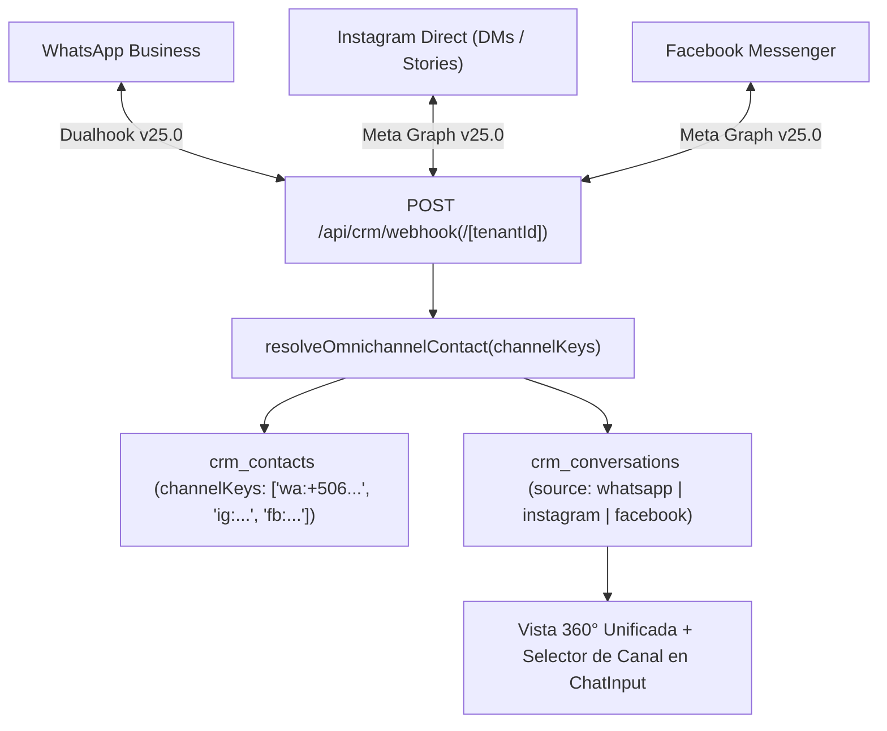

# Blueprint 07 — Meta Omnicanal (Instagram Direct + Facebook Messenger) y Unificación de Identidad (`Vista 360°`)

> **Lectura Obligatoria**: Todo agente que construya o audite canales sociales Meta (**Instagram Direct** y **Facebook Messenger**) o la **Unificación de Identidad Omnicanal (WA + IG + FB)** en el CRM DEBE seguir exactamente este contrato.

---

## 1. Arquitectura Omnicanal Unificada

- **WhatsApp Business:** Vía **Dualhook (`api.dualhook.com/v25.0`)** para Coexistencia móvil (`smb_message_echoes`).
- **Instagram Direct & Facebook Messenger:** Conexión **nativa y directa sin intermediarios de pago** hacia `https://graph.facebook.com/v25.0`, con coexistencia nativa (app de Instagram + Meta Business Suite + CRM simultáneos).



---

## 2. Guía Externa de Configuración Meta Business (Reproducible por Cliente)

1. **Instagram Profesional + Interruptor Crítico:**
   - La cuenta de Instagram debe ser **Empresa / Profesional** y estar vinculada a la Página de Facebook en el mismo **Meta Business Portfolio**.
   - **CRÍTICO (en celular dentro de la app Instagram):** *Configuración y actividad → Mensajes y respuestas a historias → Controles de mensajes → Herramientas conectadas → **Permitir acceso a los mensajes** (ON)*. Sin este switch, Meta jamás envía webhooks de IG.
2. **App de Meta for Developers:**
   - Crear App tipo **Negocios**, copiar el **`App Secret`** y agregar productos **Messenger** e **Instagram**.
3. **Token Permanente (`System User Token`):**
   - En `business.facebook.com/settings/system-users` crear o usar un **Usuario del Sistema (Admin)**, asignarle Página + Cuenta IG + App con control total, y generar token con caducidad **`Nunca`** y estos 8 permisos:
     `pages_messaging`, `pages_manage_metadata`, `pages_read_engagement`, `pages_manage_engagement`, `pages_show_list`, `instagram_basic`, `instagram_manage_messages`, `instagram_manage_comments`.
4. **Pegar en la Tarjeta `metaSocial` de Configuración → Conexiones y APIs:**
   - El admin del cliente solo pega `App Secret` + `System User Token`. El backend autodescubre Páginas/IG y suscribe webhooks automáticamente.

---

## 3. Auto-Discovery 1-Token y Bóveda Write-Only (`POST /api/crm/admin/meta-social/discover`)

```typescript
// src/app/api/crm/admin/meta-social/discover/route.ts
import { NextRequest, NextResponse } from 'next/server';
import { verifyCrmRequestAuth } from '@/lib/services/crm-auth-guard';
import { saveMetaSocialVaultCredentials } from '@/lib/services/crm-credentials-vault';

export async function POST(req: NextRequest) {
  try {
    const caller = await verifyCrmRequestAuth(req, 'crm.settings.credentials');
    if (Date.now() / 1000 - caller.authTimeSeconds > 900) {
      return NextResponse.json({ error: 'Sesión reciente requerida (< 15 min).' }, { status: 401 });
    }

    const body = await req.json();
    const appSecret = String(body.appSecret || '').trim();
    const systemUserToken = String(body.systemUserToken || '').trim();
    const selectedPageId = String(body.selectedPageId || '').trim();

    if (!appSecret || !systemUserToken) {
      return NextResponse.json({ error: 'App Secret y System User Token son obligatorios.' }, { status: 400 });
    }

    const res = await fetch(
      `https://graph.facebook.com/v25.0/me/accounts?fields=id,name,access_token,instagram_business_account{id,username,profile_picture_url}&access_token=${encodeURIComponent(systemUserToken)}`
    );
    const json = await res.json();
    if (!res.ok || !Array.isArray(json.data)) {
      return NextResponse.json({ error: json?.error?.message || 'Error consultando Meta Graph' }, { status: 400 });
    }

    const pages = json.data.map((p: any) => ({
      pageId: String(p.id),
      pageName: String(p.name),
      pageAccessToken: String(p.access_token || ''),
      igAccountId: p.instagram_business_account?.id ? String(p.instagram_business_account.id) : '',
      igUsername: p.instagram_business_account?.username ? String(p.instagram_business_account.username) : '',
    }));

    const target = selectedPageId ? pages.find((p: any) => p.pageId === selectedPageId) : pages.length === 1 ? pages[0] : null;
    if (!target) {
      return NextResponse.json({
        requiresSelection: true,
        pages: pages.map(({ pageAccessToken: _omit, ...safe }) => safe),
      });
    }

    const sub = await fetch(`https://graph.facebook.com/v25.0/${target.pageId}/subscribed_apps`, {
      method: 'POST',
      headers: { 'Content-Type': 'application/json' },
      body: JSON.stringify({
        subscribed_fields: ['messages', 'messaging_postbacks', 'message_echoes', 'message_deliveries', 'message_reads', 'message_reactions', 'feed'],
        access_token: target.pageAccessToken,
      }),
    });
    if (!sub.ok) {
      return NextResponse.json({ error: `Falló suscripción de webhooks (${sub.status})` }, { status: 400 });
    }

    await saveMetaSocialVaultCredentials(caller.tenantId, {
      appSecret,
      pageAccessToken: target.pageAccessToken,
      pageId: target.pageId,
      pageName: target.pageName,
      igAccountId: target.igAccountId,
      igUsername: target.igUsername,
    });

    return NextResponse.json({
      ok: true,
      pageId: target.pageId,
      pageName: target.pageName,
      igAccountId: target.igAccountId,
      igUsername: target.igUsername,
    });
  } catch (err: any) {
    return NextResponse.json({ error: err.message || 'Error Meta Social' }, { status: err.statusCode || 500 });
  }
}
```

---

## 4. Parser Webhook Social + Cliente Saliente (`24h` vs `7d HUMAN_AGENT`)

### Reglas del Parser Social (`src/lib/services/crm-social-webhook-parser.ts`)
1. En `POST /api/crm/webhook` (y `/webhook/[tenantId]`):
   - Si `body.object === 'instagram' || body.object === 'page'`, valida `X-Hub-Signature-256` contra `creds.metaSocial.appSecret` con `crypto.timingSafeEqual`.
   - Ignora mensajes cuyo `sender.id === pageId || sender.id === igAccountId` salvo cuando `message.is_echo === true`, en cuyo caso se guardan como `direction: 'outbound'`, `senderType: 'mobile'`, activando `humanTookOver: true`.
   - Soporta `message.reply_to?.story` (guarda `storyContext` para previsualización en burbuja), `attachments` (`image`, `video`, `audio`, `file`, `story_mention` descargados y comprimidos a `.webp`/`.ogg` en Storage) y `referral.ad_id` (atribución Meta Ads).
   - **Detección Automática de Teléfono:** Si el mensaje del cliente contiene un número (`/\b(?:\+?\d[\d\s-]{6,14}\d)\b/`), busca coincidencias con `getPhoneLookupVariants` en `crm_contacts`; si encuentra un contacto WhatsApp existente, escribe `suggestedMergeContact: { contactId, contactName, phone }` en la conversación para que el asesor confirme en 1 clic sin fusionar a ciegas.

### Cliente Outbound (`src/lib/services/meta-social-client.ts`)
```typescript
import { resolveCrmIntegrations } from '@/lib/services/crm-credentials-vault';
import { buildSignedWhatsappJpegUrl } from '@/lib/services/dualhook-client';

export async function sendMetaSocialMessage(params: {
  tenantId?: string;
  source: 'instagram' | 'facebook';
  recipientScopedId: string;
  text?: string;
  mediaType?: 'image' | 'video' | 'audio' | 'file';
  storagePath?: string;
  externalMediaUrl?: string;
  lastInboundAtMs?: number;
}) {
  const { metaSocial } = await resolveCrmIntegrations(params.tenantId || 'default');
  if (!metaSocial?.pageAccessToken || !metaSocial?.pageId) {
    throw new Error('Meta Social no configurado en Bóveda.');
  }

  const elapsedMs = params.lastInboundAtMs ? Date.now() - params.lastInboundAtMs : 0;
  const useHumanAgent = elapsedMs > 24 * 3600 * 1000 && elapsedMs <= 7 * 24 * 3600 * 1000;

  let message: Record<string, any>;
  if (params.mediaType && (params.storagePath || params.externalMediaUrl)) {
    const mediaUrl =
      params.mediaType === 'image' && params.storagePath?.endsWith('.webp')
        ? buildSignedWhatsappJpegUrl(params.storagePath, params.tenantId || 'default')
        : params.externalMediaUrl || '';
    message = { attachment: { type: params.mediaType, payload: { url: mediaUrl, is_reusable: true } } };
  } else {
    message = { text: params.text || '' };
  }

  const endpoint =
    params.source === 'instagram' && metaSocial.igAccountId
      ? `https://graph.facebook.com/v25.0/${metaSocial.igAccountId}/messages`
      : `https://graph.facebook.com/v25.0/${metaSocial.pageId}/messages`;

  const res = await fetch(endpoint, {
    method: 'POST',
    headers: { Authorization: `Bearer ${metaSocial.pageAccessToken}`, 'Content-Type': 'application/json' },
    body: JSON.stringify({
      recipient: { id: params.recipientScopedId },
      messaging_type: useHumanAgent ? 'MESSAGE_TAG' : 'RESPONSE',
      ...(useHumanAgent ? { tag: 'HUMAN_AGENT' } : {}),
      message,
    }),
  });
  const json = await res.json();
  if (!res.ok) throw new Error(json?.error?.message || `Meta Graph error ${res.status}`);
  return { messageId: json.message_id || '' };
}
```

---

## 5. Unificación de Contactos (`channelKeys`) y Vista 360°

### Contrato en `crm_contacts/{contactId}`
- `channelKeys: string[]` (ej. `['wa:+50688887777', 'ig:17841400...', 'fb:928173...']`) consultado con `where('channelKeys', 'array-contains', key)`.
- `igScopedId`, `igUsername`, `fbPsid`, `fbProfileName`, `linkedConversationIds: { whatsapp?, instagram?, facebook? }`, `mergedFromContactIds`.

### Transacción de Fusión (`POST /api/crm/contacts/merge`)
```typescript
// src/lib/services/crm-identity-merge.ts
import { FieldValue } from 'firebase-admin/firestore';
import { initializeFirebaseAdmin } from '@/firebase/server';
import { crmPaths } from '@/lib/utils/crm-paths';
import { generateSearchPrefixes } from '@/lib/utils/search-helpers';

export async function mergeOmnichannelContacts(params: {
  tenantId?: string;
  primaryContactId: string;
  secondaryContactId: string;
}) {
  const { firestore } = initializeFirebaseAdmin();
  const paths = crmPaths(params.tenantId || 'default');
  if (params.primaryContactId === params.secondaryContactId) {
    throw new Error('Los contactos deben ser distintos.');
  }

  const primaryRef = firestore.doc(`${paths.contacts}/${params.primaryContactId}`);
  const secondaryRef = firestore.doc(`${paths.contacts}/${params.secondaryContactId}`);

  await firestore.runTransaction(async (tx) => {
    const [pSnap, sSnap] = await Promise.all([tx.get(primaryRef), tx.get(secondaryRef)]);
    if (!pSnap.exists || !sSnap.exists) throw new Error('Contacto no encontrado.');
    const p = pSnap.data()!;
    const s = sSnap.data()!;

    const channelKeys = Array.from(new Set([...(p.channelKeys || []), ...(s.channelKeys || [])]));
    const tagIds = Array.from(new Set([...(p.tagIds || []), ...(s.tagIds || [])]));
    const linkedConversationIds = { ...(s.linkedConversationIds || {}), ...(p.linkedConversationIds || {}) };
    const finalName = p.name || s.name || s.fbProfileName || s.igUsername || 'Cliente';
    const finalPhone = p.phone || s.phone || null;
    const finalIgUser = p.igUsername || s.igUsername || null;

    tx.update(primaryRef, {
      name: finalName,
      phone: finalPhone,
      email: p.email || s.email || null,
      igScopedId: p.igScopedId || s.igScopedId || null,
      igUsername: finalIgUser,
      fbPsid: p.fbPsid || s.fbPsid || null,
      fbProfileName: p.fbProfileName || s.fbProfileName || null,
      channelKeys,
      tagIds,
      linkedConversationIds,
      mergedFromContactIds: Array.from(new Set([...(p.mergedFromContactIds || []), params.secondaryContactId])),
      searchPrefixes: generateSearchPrefixes(`${finalName} ${finalIgUser || ''}`, finalPhone || '', p.email || s.email || '', p.company || s.company || ''),
      updatedAt: FieldValue.serverTimestamp(),
    });

    tx.set(secondaryRef, {
      mergedIntoContactId: params.primaryContactId,
      archivedByMerge: true,
      channelKeys: [],
      updatedAt: FieldValue.serverTimestamp(),
    }, { merge: true });
  });

  const convsSnap = await firestore.collection(paths.conversations).where('contactId', '==', params.secondaryContactId).get();
  const batch = firestore.batch();
  for (const c of convsSnap.docs) {
    batch.update(c.ref, { contactId: params.primaryContactId, suggestedMergeContact: FieldValue.delete(), updatedAt: FieldValue.serverTimestamp() });
  }
  await batch.commit();

  return { ok: true, primaryContactId: params.primaryContactId, reassignedConversations: convsSnap.size };
}
```

### UI Omnicanal
- `ChatSidebar`: Filtro de canal (`Todos` | `WhatsApp` | `Instagram` | `Messenger`).
- `ChatHeader`: Píldoras de canales vinculados + toggle **"Vista 360° Unificada"** (fusiona cronológicamente los hilos vinculados mostrando insignia de canal en cada burbuja) + banner de sugerencia automática *"🔗 Vincular con WhatsApp"*.
- `ChatInput`: Selector del canal de respuesta con estado de ventana (`WA 24h/Plantilla`, `IG 7d`, `FB 24h/7d`).
