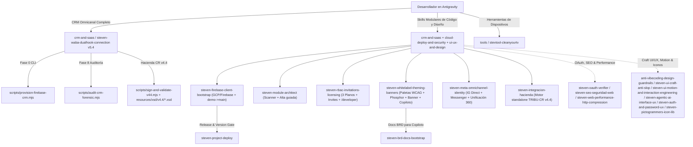

# Manual Maestro del Ecosistema `steven-*` (CRM v5.4, Cloud, UI/UX y Tools)

> Guía práctica de referencia para **Steven, colaboradores y cualquier equipo** que instale este repositorio. Explica cómo se conectan las **17 skills `steven-*`**, la skill maestra autocontenida **`steven-waba-dualhook-connection` v5.4**, la suite de diseño UI/UX (incluyendo **`anti-vibecoding-design-guardrails`**) y la herramienta **`stevtool-cleanyourtv`**, organizadas por tipo.

---

## 1. Mapa Completo del Ecosistema

---

## 2. Catálogo Completo por Tipo

### Tipo 1: `crm-and-saas/` — Código de Producto, CRM, SaaS & Facturación CR (6 Skills)
1. **[`steven-waba-dualhook-connection`](../crm-and-saas/steven-waba-dualhook-connection/README.md)** *(v5.4)* — Skill maestra universal para construir, aprovisionar, extender o auditar un CRM Omnicanal (WhatsApp Dualhook + IG + Messenger) con Catálogo Parametrizable/CABYS, IA `<slug>_ai_agent_docs` token-densa, POS de 4 modos, Facturación Hacienda CR v4.4, Entregas/Agenda, Add-Ons B2B/PWA y licenciamiento `/developer`.
2. **[`steven-module-architect`](../crm-and-saas/steven-module-architect/README.md)** — Escáner `analyze-project-architecture.mjs` + protocolo para agregar módulos sin romper tokens CSS, RBAC ni docs IA.
3. **[`steven-rbac-invitations-licensing`](../crm-and-saas/steven-rbac-invitations-licensing/README.md)** — RBAC dinámico en 3 planos (`platformDev` / Owner / `roles/{roleId}`), invitaciones SHA-256 72h por subdominio, panel `/developer` y webhooks HMAC (Stripe/Tilopay/Paddle).
4. **[`steven-meta-omnichannel-identity`](../crm-and-saas/steven-meta-omnichannel-identity/README.md)** — Instagram Direct + Facebook Messenger nativos (`Graph v25.0`), Auto-Discovery 1-Token y unificación 360° (`channelKeys`).
5. **[`steven-integracion-hacienda`](../crm-and-saas/steven-integracion-hacienda/README.md)** — Motor standalone Node.js para Facturación Electrónica Costa Rica DGT v4.4 / TRIBU-CR (`XAdES-EPES` + XSD v4.4, Outbox `PRE_SAVED`, cero PHP/AGPLv3).
6. **[`steven-brd-docs-bootstrap`](../crm-and-saas/steven-brd-docs-bootstrap/README.md)** — Base documental `/*_ai_agent_docs/` estilo BRD multi-rol con EGM y compilación automática de rangos `Lxxx-Lyyy`.

### Tipo 2: `cloud-deploy-and-security/` — Cloud, Deploy, OAuth, SEO & Performance (5 Skills)
7. **[`steven-firebase-client-bootstrap`](../cloud-deploy-and-security/steven-firebase-client-bootstrap/README.md)** — Provisioner CLI/REST multi-proyecto Firebase + App Check + CI/CD 2 ramas (`demo` → `main`).
8. **[`steven-project-deploy`](../cloud-deploy-and-security/steven-project-deploy/README.md)** — Despliegue seguro Firebase App Hosting (SSR `instrumentation.ts`) y Classic Hosting (`postdeploy`) con Version Gate reactivo SemVer.
9. **[`steven-oauth-verifier`](../cloud-deploy-and-security/steven-oauth-verifier/README.md)** — Verificación de dominio, Google Search Console, Google OAuth Consent, anti-fugas `firebaseapp.com` y cumplimiento CR (Ley 8968 y Ley 7472).
10. **[`steven-seo-seguridad-web`](../cloud-deploy-and-security/steven-seo-seguridad-web/README.md)** — Clasificador Fase 0 (CRM vs Web B2C vs Portal B2B vs Híbrido), SEO On-Page, GEO/LLMO (`/llms.txt`), Security Headers Grado `A+`, PWA y GA4/Meta Pixel.
11. **[`steven-web-performance-http-compression`](../cloud-deploy-and-security/steven-web-performance-http-compression/README.md)** — Compresión Brotli/Zstd/Gzip, configuración Nginx/Express/Fastify/Vite/Cloud Run, SSE (`X-Accel-Buffering: no`) y prevención de `ERR_CONTENT_DECODING_FAILED`.

### Tipo 3: `ui-ux-and-design/` — Diseño UI/UX, Anti-Slop, Motion & Iconografía (7 Skills)
12. **[`anti-vibecoding-design-guardrails`](../ui-ux-and-design/anti-vibecoding-design-guardrails/README.md)** — Guardrails estrictos anti-vibecoding con presets tipográficos, regex lint y lista negra de copywriting genérico.
13. **[`steven-ui-craft-anti-slop`](../ui-ux-and-design/steven-ui-craft-anti-slop/README.md)** — 20 reglas Anti-AI Slop, color perceptual `OKLCH`, radios concéntricos, sombras ambientales y 22 superficies no planas.
14. **[`steven-ui-motion-and-interaction-engineering`](../ui-ux-and-design/steven-ui-motion-and-interaction-engineering/README.md)** — Física de animaciones UI, curvas exactas, `0ms` en flujos frecuentes, principios Disney y leyes cognitivas de UX.
15. **[`steven-whitelabel-theming-banners`](../ui-ux-and-design/steven-whitelabel-theming-banners/README.md)** — Estudio visual en vivo (8 paletas WCAG AA/AAA con `--primary`/`--secondary`/`--tertiary`, Zero-FOUC), `@phosphor-icons/react` `<AppIcon />`, Banner Global estilo Jira y Copiloto IA gratuito (`gemini-2.5-flash-lite`).
16. **[`steven-pictogrammers-icon-lib`](../ui-ux-and-design/steven-pictogrammers-icon-lib/README.md)** — Bóveda local compartida (`~/.local/share/pictogrammers/`) y extractor selectivo sin dependencias npm para MDI, MDI Light y Memory Icons.
17. **[`steven-agentic-ai-interface-ux`](../ui-ux-and-design/steven-agentic-ai-interface-ux/README.md)** — 7 patrones para UI de chat y agentes IA (empty states accionables, *Labor Illusion*, citas verificables, streaming Zero-CLS, *Brushing & Linking* y HITL + Undo).
18. **[`steven-auth-and-password-ux`](../ui-ux-and-design/steven-auth-and-password-ux/README.md)** — Flujos de login y contraseña sin fricción (1 CTA, sin Confirm Password, *Reward Early / Punish Late*, SVG Closure y Peak-End).

### Tipo 4: `tools/` — Herramientas de Dispositivos (1 Skill)
19. **[`stevtool-cleanyourtv`](../tools/stevtool-cleanyourtv/README.md)** — Gestor aislado multi-TV de CleanYourTV para Android TV / Google TV con perfiles por dispositivo, auditoría ADB `check-compat`, debloat y parches de la edición personal.

---

## 3. Cinco Playbooks Operativos Rápidos

### Playbook 1 — Levantar el CRM Maestro (`demo` → `main`) Desde Cero
1. Abre un proyecto vacío o repositorio en Antigravity.
2. Invoca **`/steven-waba-dualhook-connection`** indicando tu `PROJECT_ID` demo y tu correo de desarrollador.
3. El agente ejecuta `scripts/provision-firebase-crm.mjs`, completa el Pre-Flight `7/7`, ejecuta el **Wizard Interactivo de 4 Rondas** (`ask_question`) y construye/verifica el CRM con `audit-crm-forensic.mjs`.

### Playbook 2 — Dar de Alta un Nuevo Cliente en Minutos
1. Ejecuta `node scripts/provision-firebase-crm.mjs --project crm-<cliente> --region nam5 --owner-email <tu-correo>` (o usa `/steven-firebase-client-bootstrap`).
2. Confirma plan Blaze y registra el cliente en `deploy/clients.manifest.json`.
3. En la web del cliente: configura `/setup`, marca/colores White-Label, credenciales en Bóveda Write-Only (`Dualhook`, `Meta Social`, `Hacienda CR` y `helpCopilotAi`).

### Playbook 3 — Agregar un Módulo Nuevo Sin Romper Diseño ni RBAC
1. Invoca **`/steven-module-architect`**: su escáner inspecciona tokens CSS, íconos, RBAC, reglas e índices.
2. Implementa tipos, guardián RBAC, licenciamiento `tenant_license` y UI `< 500` líneas.
3. Sincroniza `/*_ai_agent_docs/` usando **`/steven-brd-docs-bootstrap`** (Modo C) para actualizar el Copiloto IA.

### Playbook 4 — Auditar Seguridad, OAuth, SEO y Performance Antes de Lanzar
1. **`/steven-oauth-verifier`**: verifica dominio custom, Search Console, consentimiento OAuth y cumplimiento legal CR.
2. **`/steven-seo-seguridad-web`**: aplica cabeceras `A+`, `/llms.txt`, JSON-LD y `robots.ts` según clasificación Fase 0.
3. **`/steven-web-performance-http-compression`**: verifica `br`/`gzip`, `Vary: Accept-Encoding` y exclusión SSE.
4. **`/steven-project-deploy`**: ejecuta el release SemVer y Version Gate seguro.

### Playbook 5 — Activar Facturación Electrónica Hacienda CR v4.4 (`SIMULATED_DGT` → `stag` → `prod`)
1. Usa `scripts/generate-lab-p12.mjs` en `SIMULATED_DGT` para capacitar y probar los 4 modos POS (`QUOTE`, `INTERNAL_INVOICE`, `TE`, `FE`, `NC` y `REP 10`).
2. Pasa a `LIVE_DGT` (`stag`) cargando tu `.p12` y usuario Sandbox de TRIBU-CR con **"Verificar y Activar"**.
3. Activa `prod` en modo Write-Only (las llaves nunca regresan al navegador ni al repo) y valida esquemas con `scripts/sign-and-validate-v44.mjs`.
